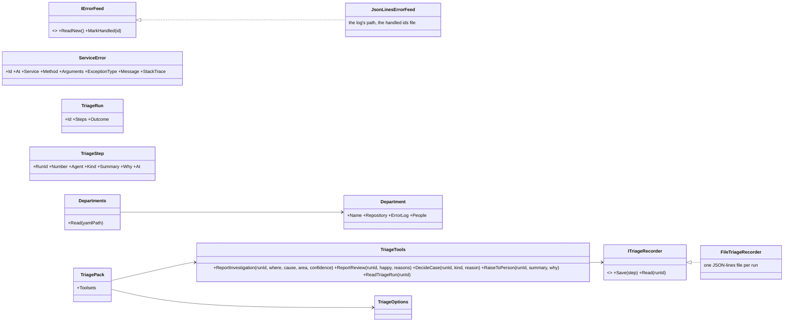

# F106.3.1 The service and the triage pack

> **Plan** (2026-11-08), the first child of [F106.3 Triage and fix a service](F106.3-triage-and-fix-a-service.md),
> approved with its parent (Louis, 2026-11-08: "go"). Built on `feature/F106.3.1-the-service-and-the-pack`; it changes
> only under *Approved during the build*. The parent holds the four diagrams and the namespace map; this file holds
> the slice this child builds and its steps.

## Context

The workflow needs something to triage and the tools to triage it with, and neither needs the engine's new rungs
(F39 Part A) or the saved conversations (F43), so this child comes first. The made-up service existed: the
orchestrator demo's `order-service` (eleven API methods, ten seeded bugs, a traffic file that trips them, its own
tests) went with CL10 and is whole at the tag `pre-cl10`; it is restored, not rebuilt (ADR 0030). The orchestrator's
`ErrorFeed` reads the service's JSON-lines error log and remembers what was handled; it moves into the pack, as the
feed every department's workflow reads.

**Done when:** the feed reads the service's errors and hands each out once across restarts; a recorder saves a run's
steps and reads them back; each decision tool refuses a bad record in code and records a good one as a step; a test
shows a department's coder cannot touch another department's repository (the workspace boundary); the pack stays
convertible to MCP (`PackConvertibilityTests`); the service builds and its own tests pass.

## Design

### What this child adds



- **The feed** is the orchestrator's `ErrorFeed`, moved and made public behind an interface: it reads the log's new
  lines into `ServiceError` records (the service's snake_case keys), ignores an id that isn't a plain token (ids end up
  in branch names), and keeps the handled ids in a file beside the log, so each error is handed out once across
  restarts. A webhook feed is F100.
- **The recorder** keeps a run as JSON lines, one file per run under `TRIAGE_RUNS`, one line per step as it lands, so a
  run can be read while it runs and after a restart; F106.3.3 adds the Mongo one on F43's store. A step says which
  agent did what, in plain words (`Summary`) and why (`Why`), which is what the demo page's popups and the guide read.
- **The decision tools** are the roles' typed endings before F39's result toolset exists: a role ends its work by
  calling its tool, whose arguments are plain values parsed once into the record's enums (`DepartmentArea`,
  `Confidence`, `CaseDecisionKind`) with `SettingChoice`; a bad value is refused with its reason as text, never a thrown
  exception (MCP's rule), and a good one is saved as a step the workflow reads back. The run id arrives as a parameter,
  since a tool reads nothing from the session (the pack contract).
- **`RaiseToPerson`** writes a case file under the department's people folder and records the step; a real endpoint
  (mail, a tracker) is a later pack setting. **`ReadTriageRun`** returns a run's steps as text for anyone with the
  toolset: the guide in the corner, a person at the terminal.
- **A department is configuration**: `departments.yaml` names each department's repository, error log and people
  folder; `Departments.Read` gives the records, and a department's coder gets a `WorkspaceBoundary` on its repository
  alone. The test holds that boundary: a path in the other department's repository is refused.
- **A sample is the agent's workspace, not the framework's code** (a finding, the recommended pick taken): the repo's
  size and folder rules (`FileSizeTests`, `FolderSizeTests`) skip `demos/*/samples/`, since a sample must look like a
  customer's repository and is what the coder edits, never ours to shape. The alternatives were splitting the sample's
  `Api/` into subfolders (bending a customer's repo to our rules) or listing it among the folders still oversized (a
  grace list meant to shrink, not grow).

### Folder tree (after)

```
packs/tools/louis-agent.pack.triage/
├── Feed/          IErrorFeed, JsonLinesErrorFeed, ServiceError
├── Runs/          ITriageRecorder, FileTriageRecorder, TriageRun, TriageStep, TriageAgent, TriageStepKind, TriageOutcome
├── Tools/         TriageTools, Investigation, Review, CaseDecision, DepartmentArea, Confidence, CaseDecisionKind
├── Departments/   Department, Departments
├── Messages/      TriageToolMessage
├── Prompts/toolsets/triage.md
├── TriagePack.cs, TriageToolset.cs, TriageOptions.cs
packs/tests/louis-agent.pack.triage.tests/     Feed/, Runs/, Tools/, Departments/, Messages/ (the golden), TriagePackTests
demos/louis-agent/samples/order-service/       restored from pre-cl10: src/OrderService, tests/OrderService.Tests, data/
demos/louis-agent/samples/README.md
demos/louis-agent/config/departments.yaml
```

## Steps

1. **The service, restored.** `samples/order-service` from `pre-cl10` into `demos/louis-agent/samples/order-service`,
   with a README that says what it is and how to trip its bugs; `FileSizeTests` and `FolderSizeTests` learn to skip
   a demo's `samples/` (their test first: a sample path is not ours). The service builds and its own tests pass.
2. **The pack and the feed.** The project, `TriageToolset.Triage`, `TriageOptions` (`TRIAGE_RUNS`), `IErrorFeed`,
   `JsonLinesErrorFeed` and `ServiceError` moved from the orchestrator (which keeps working on the pack's feed). Test
   first: a log with three lines, one bad id; read, mark, read again.
3. **The run and the recorder.** `TriageStep`, `TriageRun`, the three enums, `ITriageRecorder`, `FileTriageRecorder`.
   Test first: save steps out of order, read the run back in order; a missing run is null.
4. **The decision tools.** `TriageTools.ReportInvestigation`, `ReportReview`, `DecideCase` with their records and enums;
   `TriageToolMessage` and its golden. Tests first: a good call records a step with the record's words; a bad enum
   value, an empty reason and an unknown run are refused with their reason.
5. **A person, and the run read back.** `RaiseToPerson` (a case file under the department's people folder, a step) and
   `ReadTriageRun` (the steps as text, or that there is no such run). Tests first.
6. **Departments.** `Department`, `Departments.Read` over YAML (YamlDotNet, already in the repo),
   `demos/louis-agent/config/departments.yaml` with `code` (the sample) and `ops` (a folder F106.3.5 fills); the
   boundary test: the code department's boundary refuses a path in the ops repository.
7. **The pack class and its guide.** `TriagePack`, the guide `toolsets/triage.md` (what each tool is for, when to call
   it, that an answer ends with the decision tool), `TriagePackTests` on the shape, the solution entries and
   `SolutionLayoutTests`, `PackConvertibilityTests`.
8. **Docs.** `packs/docs/projects/louis-agent.pack.triage.md`, the samples README, the orchestrator's doc (the feed
   is the pack's), the work log's row; this plan's lasting parts noted in the parent.

## Verification

- Each step's tests; `core.tests` for the rules when a project or folder is added; the pack's and the orchestrator's
  tests after step 2.
- By hand, free: `dotnet run --project demos/louis-agent/samples/order-service/src/OrderService -- serve data/requests.txt`
  writes thirteen errors to `logs/errors.jsonl`; `dotnet test` in the sample passes.
- No paid run in this child.

## Concepts, and where they sit in GOAL.md

- **Tool design** (skill 4): a decision as a tool with plain arguments parsed once; refusal as text, never a throw.
- **Structured outputs** (skill 5): a record checked in code is the role's answer, prose is not.
- **Safety** (skill 15): a department's coder held to its repository by the boundary, proved by a test.

## Approved during the build

- **Step 1** (2026-11-08): the size and folder rules skip a demo's `samples/` (the pick the plan recommended), with a
  test each that only that folder is skipped.
- **Step 2**: the orchestrator's `ServiceTools` crossed the 200-line limit under Rider's formatter, so the checks of a
  fix (`VerifyFixCommit`, `ReplayRequest`, `RunServiceTests`) split into `Tools/Checks/FixChecks`, the tools and
  their descriptions unchanged; the orchestrator's two test projects build their checks apart from their tools.
- **Step 3**: the step and its enums sit under `Runs/Steps/`, the folder rule's six; `TriageStep` gains `result`, the
  typed record as JSON by wire names, in step 4, so the workflow reads a decision back as its record.
- **Step 5**: `RaiseToPerson` and `ReadTriageRun` are a second tool class, `RunTools`, apart from the decision tools
  by responsibility and each under the size limit; a case goes under `TRIAGE_PEOPLE` until a department's own
  endpoint is a setting (the plan's people folder per department is read in step 6 and used by F106.3.3).
- **Step 6**: the reader is `DepartmentsFile`, not `Departments`: a class named like its folder's namespace is
  shadowed by it; a path in the file is relative to the file's folder.
- **Step 7**: convertibility to MCP is held by Puls's `PackConvertibilityTests` over the packs Puls loads; this pack
  joins the coding demo's catalogue in F106.3.2, where the same check holds it, so the done-when's last line moves
  there.
- **Step 8**: the Packs and Architecture pages name the pack, since `PacksPageTests` and `SiteMapTests` (F109.4) hold
  the site to the repo.

---
[Docs index](../README.md) · [Plans](README.md) · Parent: [F106.3](F106.3-triage-and-fix-a-service.md)
