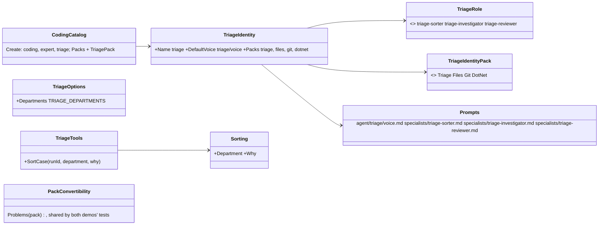

# F106.3.2 The triage identity

> **Plan** (2026-11-08), the second child of [F106.3 Triage and fix a service](F106.3-triage-and-fix-a-service.md),
> approved with its parent (Louis, 2026-11-08: "go", one identity with three roles). Built on
> `feature/F106.3.2-the-triage-identity`; it changes only under *Approved during the build*. The parent holds the four
> diagrams and the namespace map; this file holds the slice this child builds and its steps.

## Context

The pack (F106.3.1) gives the roles their typed endings, a recorder, a person's endpoint and the departments. What
triages is still the orchestrator's proof of concept: one voice (`louis-agent/voice-orchestrator`) that classifies
an error against a runbook per method and calls the coding agent. This child builds the team Louis described as an
identity: the **manager** is its voice (the hub: decides what a case gets, checks everyone's work, never agent to
agent), and the **sorter**, the **investigator** and the **reviewer** are its roles, level-1 sessions with only the
tools their job needs. The **coder** stays the coding identity, reached as a peer. The runbooks stay what they are,
a service's policy as markdown, handed to the manager in its brief by the workflow (F106.3.3).

**Done when:** the coding demo's catalogue runs the triage identity beside the coding agent and the expert, with the
triage pack loaded, so a session can open as the manager or any of its roles; each role's prompt names its tools and
ends its work with its typed tool, held by a test that reads the prompt; the pack's convertibility is held by the
same check Puls's packs pass; an eval per role exists as files with its code checks, replayable once a recording
exists (the live run that records it waits for Louis's go); the Identities and Architecture pages name the identity.

## Design

### What this child adds



- **One identity, three roles** (the parent's pick 2). The manager's voice is the level-0 mode: it reads a case's
  run, decides with `DecideCase`, raises with `RaiseToPerson`, and asks its roles through the engine's delegation
  (the specialists' path that exists today; F39 Part A's typed delegation replaces the plumbing, not the roles).
  The roles are `specialists/triage-*.md`, each with its toolsets: the sorter `triage` alone; the investigator
  `triage`, `files`, `git` and `dotnet` (it reads the code and runs the tests, never writes); the reviewer `triage`,
  `files` and `git` (it reads the diff on the branch). The identity names the packs `triage`, `files`, `git` and
  `dotnet` by its own enum.
- **The sorter ends typed too.** The pack gains `SortCase(runId, department, why)`: the department name is checked
  against the departments file (`TRIAGE_DEPARTMENTS`, a third setting of the pack), a wrong one refused with the
  names, and the step saved as `Sorted` with a `Sorting` record. A finding of F106.3.1 the plan missed: the sorter
  had no tool to end with.
- **The runbooks are the brief, not the voice.** The manager's voice says how to decide in general (expected, a
  person, a fix, a hand-off; checks everyone; a hub), and the workflow hands it the department's runbooks as its
  brief with the case, so one voice serves every department. The orchestrator's method runbooks stay where they are
  until F106.3.3 moves them beside the sample.
- **Loaded by the coding demo's catalogue** beside the coding agent and the expert: the triage pack joins its packs
  (its three settings read from the environment), so the model-request golden gains the triage tools and the router
  test leaves the triage toolset to the triage identity, as it leaves the docs to the expert.
- **The convertibility check is shared.** Puls's `PackConvertibilityTests` holds its checker in its own test
  project; the checker moves to `louis-agent.testing` as `PackConvertibility.Problems(pack)`, and the coding
  catalogue's tests run it over every pack the catalogue loads, so the done-when's last line of F106.3.1 holds here.
- **An eval per role, as files.** `demos/louis-agent/evals/louis-agent.identity.triage.evals/`: one scenario per
  role over an error of the sample service (the sorter's department, the investigator's cause and area, the
  reviewer's verdict on a given diff), with code checks that the role ended with its tool and that the record's
  enums are what the scenario expects; the first live run records the answers and spends the key, so it waits for
  Louis's go, and every run after replays for nothing.

### Folder tree (after)

```
demos/louis-agent/identity/louis-agent.identity.triage/
├── TriageIdentity.cs, TriageIdentityName, TriageRole, TriageIdentityPack
└── Prompts/agent/triage/voice.md, Prompts/specialists/triage-sorter.md, triage-investigator.md, triage-reviewer.md
demos/louis-agent/evals/louis-agent.identity.triage.evals/     the three scenarios, their checks, the manifest
demos/louis-agent/tests/louis-agent.identity.triage.tests/     the identity's shape, each role's prompt, the roles catalogue
packs/tools/louis-agent.pack.triage/Tools/TriageTools.cs       + SortCase; Tools/Results/Sorting; TriageOptions.Departments
src/tests/shared/louis-agent.testing/Packs/PackConvertibility.cs   the checker, shared
```

## Steps

1. **The identity and the manager's voice.** The project, `TriageIdentity`, its names, its packs enum, the voice
   (who the manager is, the hub, what each decision means, how it checks a report before trusting it, how it briefs
   a role, the typed endings it uses). Tests first: the shape (name, voice, packs), the voice loads through the
   roles catalogue and names its toolsets.
2. **The sorter, and its tool.** `SortCase` and `Sorting` in the pack, `TRIAGE_DEPARTMENTS`; the sorter's prompt.
   Tests first: a wrong department refused with the names, a right one saved as `Sorted`; the prompt names its tool.
3. **The investigator.** Its prompt: read the error, the stack, the code and the tests, report where, cause, area,
   confidence; honest about doubt. Tests first: the prompt names its toolsets and its tool and no other.
4. **The reviewer.** Its prompt: the diff on the branch, the tests, the fix against the cause; happy or not, with
   reasons one per line. Tests first: as for the investigator.
5. **The catalogue loads it.** `CodingCatalog.Create` with the identity, its packs with the triage pack; the goldens
   regenerated and reviewed; the router test still names the coding agent's toolsets only.
6. **Convertibility, shared.** `PackConvertibility` into `louis-agent.testing`; Puls's test uses it; the coding
   catalogue's tests hold every pack it loads, the triage pack among them.
7. **The evals.** The project, the three scenarios over the sample's errors, the code checks, the manifest; the
   runner lists them; the live run waits for Louis's go and is named in the plan's record.
8. **Docs.** The identity's design doc; the Identities and Architecture pages name it; the settings in the demo's
   `.env.example` and compose; the work log; this plan's record; the plan deleted.

## Approved during the build

Built unattended on 2026-11-08 ("continue unattended"); the picks are the recommended ones, recorded here.

- **Step 6 found two things.** The shared check flagged the run tool's description for the word "triage", which is
  also the identity's name: reworded, since a tool names no identity (ADR 0028). And it found that the paymo and
  devops packs' async tools take no CancellationToken, twenty tools, a gap no test saw while only Puls's catalogue
  was checked: recorded as FX83 in the TODO, and the catalogue's test names the two as the known gap and lets
  nothing else hide behind it.
- **Step 8's settings came with the merge of main**, not in a commit of their own: `TRIAGE_RUNS`, `TRIAGE_PEOPLE`
  and `TRIAGE_DEPARTMENTS` in the demo's settings example and its compose, and the Identities page's fourth card.
- **Step 7 waits for Louis's pick.** A role's tools (`SortCase`, `ReportInvestigation`, `ReportReview`) refuse a run
  id the recorder doesn't know (`NoSuchRun`), and an eval's trial opens a fresh session with no run behind it, so a
  scenario can't make a role end with its tool unless a run exists first. Three ways, the first recommended:
  **A.** during an eval's trial (`IPackContext.InATrial`, made for this) the recorder accepts a run id it hasn't seen
  and starts the run on the first write, so the pack changes only for trials and the eval needs no fixture;
  **B.** the harness gets a fixtures hook that seeds a run file under `TRIAGE_RUNS` before a trial, a new harness
  feature every eval could use but a bigger change; **C.** the tools always start a run they don't know, simplest,
  but a mistyped run id then makes a stray run the manager never reads. The checks themselves need no code: the
  harness's `tool-used` and `tool-used-with` hold that the role ended with its tool and with the expected choice.
- **Louis picked A** (2026-11-09). `TriageTools` takes the trial flag as a function the pack reads from
  `IPackContext.InATrial` on every call; in a trial an unknown run starts with its first step, outside one it is still
  refused. A trial's run files land under `TRIAGE_RUNS` like any other.

## Verification

- Each step's tests; the coding catalogue's tests with their goldens; `core.tests` when a project is added; the
  site's tests (the identity on its pages).
- By hand, free: a session opened as `triage` in the local app answers as the manager on a pasted error (the
  guide's door is not open to it; a key or a sign-in).
- **Paid, on Louis's go:** the first eval run, which records the three roles' answers.

## Concepts, and where they sit in GOAL.md

- **Roles as prompts with a typed ending** (skill 5, 10): a role's work is a brief in and a record out.
- **A hub, never agent to agent** (skill 10): the manager checks everyone; the roles never talk to each other.
- **Evals as files** (skill 12): a scenario, its checks and a recording that replays for nothing.

---
[Docs index](../README.md) · [Plans](README.md) · Parent: [F106.3](F106.3-triage-and-fix-a-service.md)
