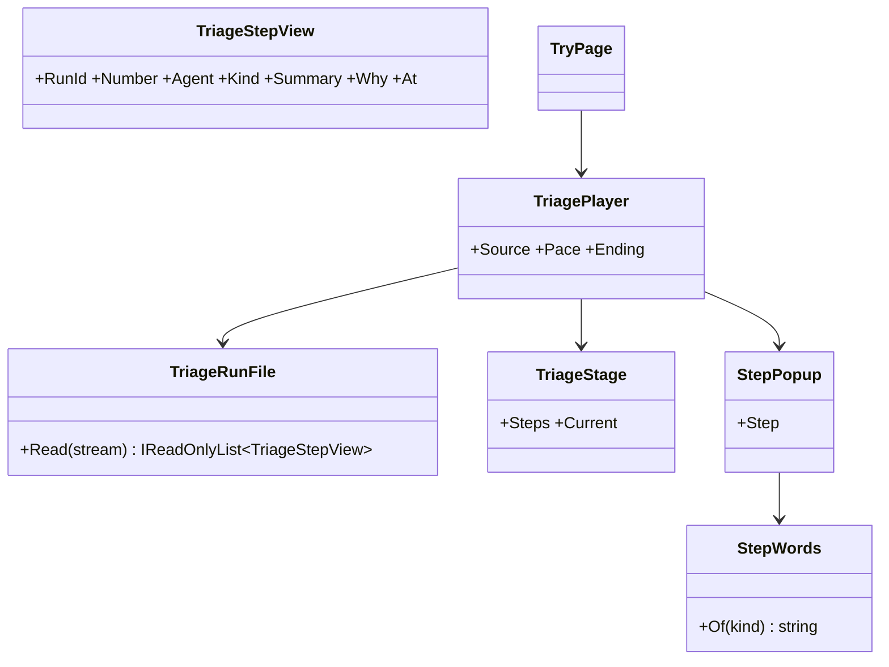
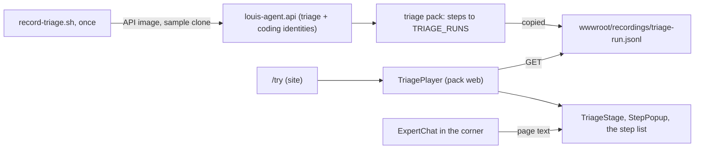
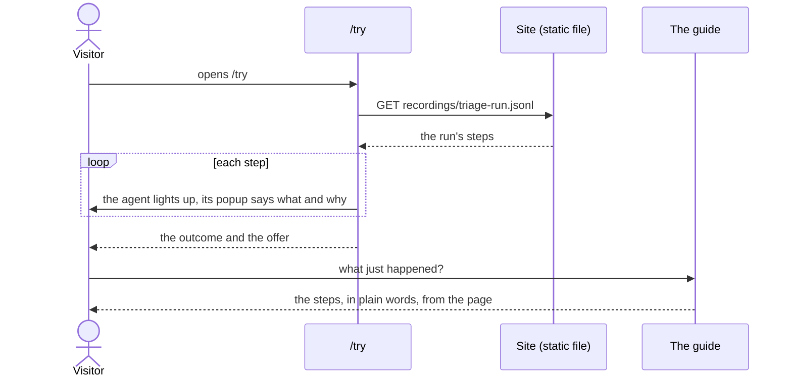

# F106.3.4 The triage demo, on a recorded run

> **Plan** (2026-11-09), a child of [F106.3 Triage and fix a service](F106.3-triage-and-fix-a-service.md), built
> before F106.3.3 as the parent allows. Louis's picks of 2026-11-09 are below, and he approved the steps and the paid recording run the same day.
> Branch `feature/F106.3.4-the-demo-on-a-recording`; it changes only under *Approved during the build*.

## Context

F106.3.3, the live workflow, is built on F39 Part A's typed delegation and F43's saved conversations, and neither
exists yet. So the site's triage demo comes first, on a run recorded once: a visitor opens `/try`, watches the team
triage one error of the made-up order service step by step, each step explained in a popup beside the agent at work,
and can ask the guide what happened. When F106.3.3 lands, the same page plays a live run instead.

**Louis's picks (2026-11-09), each of three:**

- **What F106 builds next:** this page on a recording, over F39 Part A first and F106.1 the builder.
- **The recording:** a small script drives one real triage through the API, step by step as F106.3.3 will in code:
  the sorter, the manager's decision, the investigator, the manager again, the coder fixing a fresh clone of the
  sample on a branch, the reviewer, the manager's close. Each role saves its typed step with the triage pack; the
  script saves the code's own checks of the fix (the commit on the branch, the tests) as a step, as the workflow will.
  One paid run on Haiku, about R1 to R3, on Louis's go. The script goes when the workflow lands. Over stitching the
  eval answers (some steps written by us) and the roles only (no fix).
- **The doors:** the hero's second button becomes "Watch a triage" and leads to `/try`; the header's "Watch it work"
  stays on the coding agent's page. Over both to `/try`, and neither.

**Done when:** `/try` plays the recorded run step by step, the stage lighting the agent at work and a popup per step
saying in plain words what it did and why; it ends on the outcome (a fixed branch, or a person) and the offer; the
guide in the corner explains the run from the page; the hero leads there; checked at desktop and phone width; the
recording and its script are in the repo, every step from a real agent or a real check.

## Design

- **A run is the triage pack's own file**, one `TriageStep` per line (`run_id`, `number`, `agent`, `kind`, `summary`,
  `why`, `at`, the typed `result`), the format `FileTriageRecorder` writes and `ReadTriageRun` reads. The page plays
  that file, so the live run later is the same steps arriving one at a time.
- **The demo's views are the pack's web project** (ADR 0086), `packs/web/louis-agent.pack.triage.web`, beside the git
  and files packs' views: a site that uses the triage pack opts into its demo. It references the framework's web only,
  so it keeps its own copy of the step record, held to the pack's JSON by a test (a tested duplicate, ADR 0027).
- **The stage** draws the team as the parent sketched: the sorter, the manager in the middle as the hub, the
  investigator, the coder and the reviewer, and a person. The agent of the current step lights up, and an arrow from
  the manager shows who it handed the case to.
- **A popup per step**, beside the lit agent: who, what it did (the step's summary), why (its reason), and the plain
  words for that kind of step (`StepWords`: "The sorter reads the error and says whose it is", tested alone). It gives
  way to the next step after a beat; the visitor can pause, step back and play again.
- **The guide explains it from the page.** The steps are also a plain list under the stage, which is the page's text,
  so the guide's page block carries the run and "what is happening?" is answered from it. The guide needs no triage
  toolset on this page.
- **The script** (`demos/louis-agent/recordings/record-triage.sh`) runs the API's own image on a fresh git clone of
  `samples/order-service`, with only the model key (as `record.sh` does), opens each role's session at its level
  (`depth: 1` for the roles, the manager's voice at 0, the coding identity for the fix), hands each the brief the
  workflow will, and copies the run file and each turn's stream out.

### Interface



```csharp
// packs/web/louis-agent.pack.triage.web
public sealed record TriageStepView(string RunId, int Number, string Agent, string Kind, string Summary, string Why, DateTimeOffset At);
public static class TriageRunFile { public static IReadOnlyList<TriageStepView> Read(string jsonLines); }
public static class StepWords { public static string Of(string kind); }
public partial class TriagePlayer { [Parameter] string Source; [Parameter] double Pace; [Parameter] RenderFragment? Ending; }
```

### Architecture



### Communication



### Types

| Type | Folder | Namespace | Step |
|---|---|---|---|
| `record-triage.sh`, `triage-run.jsonl` | `demos/louis-agent/recordings/`, the site's `wwwroot/recordings/` | — | 1 new |
| `TriageStepView`, `TriageRunFile`, `StepWords` | `packs/web/louis-agent.pack.triage.web/Runs/` | `LouisAgent.Packs.Triage.Web.Runs` | 2 new |
| `TriageStage`, `StepPopup`, `TriagePlayer` | `packs/web/louis-agent.pack.triage.web/Demo/` | `LouisAgent.Packs.Triage.Web.Demo` | 3 new |
| the pack web's tests | `packs/tests/louis-agent.pack.triage.web.tests/` | `LouisAgent.Packs.Triage.Web.Tests` | 2, 3 new |
| `TryPage` | `demos/louis-agent/web/louis-agent.code-review/Pages/Site/Agents/` | `LouisAgent.CodeReview.Pages.Site.Agents` | 4 new |
| `Hero` (the second button), the guide's voice | the site, the expert identity | unchanged | 4 changed |

## Steps

1. **The recording.** The script; the one paid run on Louis's go; the run file and the turns' streams into the site,
   read for anything private first.
2. **Reading a run.** The pack web project, `TriageStepView`, `TriageRunFile`, `StepWords`; tests first, the record
   held to the pack's JSON.
3. **The stage and the player.** `TriageStage`, `StepPopup`, `TriagePlayer` (the pace, pause, back, play again, the
   ending); bUnit, with its styles beside it.
4. **The page and the door.** `/try` on the site, the hero's "Watch a triage", the guide's voice names the page, the
   sitemap; tests; checked at desktop and phone width.
5. **Docs.** The pack web's design doc, the work log, the parent's record, the write-up; the plan deleted.

## Approved during the build

(none yet)

---
[Docs index](../README.md) · Related: [plans](README.md), [F106.3](F106.3-triage-and-fix-a-service.md)
