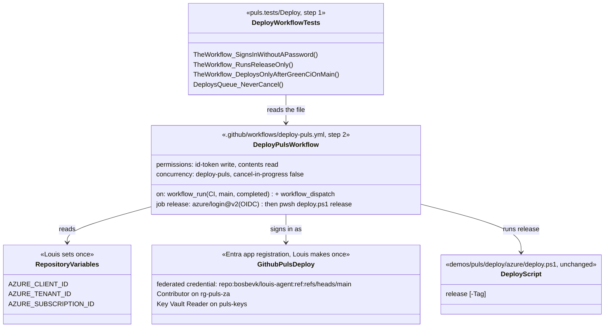
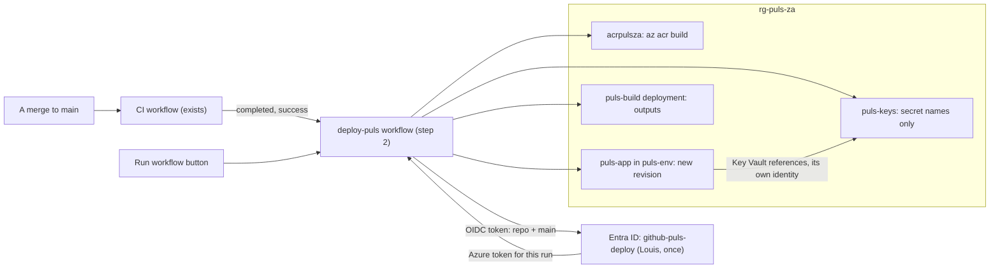
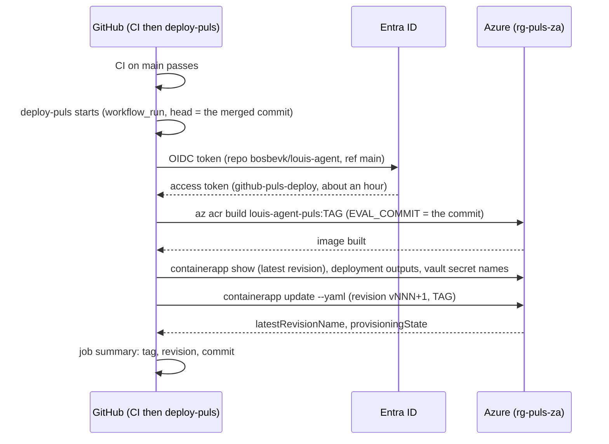
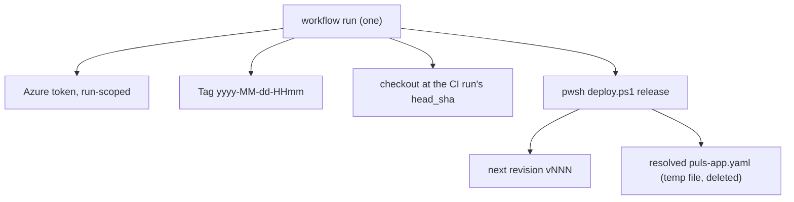

# F109 Puls deploys from GitHub

> **Plan.** How a merge to `main` puts Puls on mypuls.co.za without Louis's PC: a GitHub Actions workflow that signs
> in to Azure with no stored password and runs the same `deploy.ps1 release` Louis runs today. Drafted 2026-11-07 in
> the thread "Review fix merge" (Louis: "let's do a git hub action then", after FX63 had to wait for his PC to
> deploy). **Approved by Louis 2026-11-07**, built unattended (his pick). Deleted when the work is done (its why moves to an ADR, its how to the deploy README).

## Approved during the build

- **2026-11-07, the three picks and the way of working** (Louis, one card each): after green CI on `main` plus a
  button; OpenID Connect; `deploy.ps1 release` as it is; the three steps built unattended, merged when CI is green.
- **2026-11-07, actions pinned by major tag**, as `ci.yml` does (`actions/checkout@v7`, `azure/login@v2`), not by
  commit SHA: this session could not read the actions' release SHAs, and one way across the repo's workflows is simpler.

- **2026-11-07, built** (steps 1 to 3 on `feature/F109-deploy-from-github`); ADR 0097 holds the why, the deploy README
  the setup. The plan and its TODO row stay until Louis's one-time setup is done and the first run is green; then
  the plan goes and the work-log gets its row.

## Context

**What exists:** `demos/puls/deploy/azure/deploy.ps1 release` builds the Puls image in the registry `acrpulsza`
(`az acr build`, so no Docker on the machine), then creates the next revision of `puls-app` in `puls-env` from
`puls-app.yaml`, with the VM's address, the environment, the identity and the vault's secret names read from Azure
itself ([ADR 0095](../adr/0095-puls-runs-from-azure-and-nothing-points-at-the-pc.md)). `release` reads no file Louis
keeps off git: the secrets are already in Key Vault (`deploy.ps1 secrets`, a separate verb). It needs only `az`, signed
in, and the repo. Today that sign-in is Louis's on his PC, so a fix merged at night (FX63, the message box) waits for
him. GitHub runs only CI (`.github/workflows/ci.yml`); it holds no Azure credentials.

**Checked in this container:** `deploy.ps1` runs on Linux PowerShell 7 as written: `Join-Path` and `Resolve-Path` turn
its `\` into `/` (`demos\puls\docker\images\Dockerfile.puls` resolved, `puls-app.yaml` found). GitHub's Ubuntu runners
have PowerShell 7 and `az` installed.

**Done when:** a merge to `main` whose CI passes puts a new `puls-app` revision live without anyone's PC; a button in
GitHub's Actions tab does the same on demand; GitHub stores no Azure password; the identity it signs in as can do no
more than build an image and update `puls-app`; the deploy README says how to set it up and how to roll back.

**Not in this plan:** `infra`, `vm`, `secrets` and `domain` stay on Louis's PC (they read files kept off git, or change
the network); the framework's site (F61.6) gets the same workflow when it is deployed; preview environments per PR.

## Design

### The shape, in plain words

- **No password: OpenID Connect.** GitHub hands each workflow run a short-lived token that says "this is
  `bosbevk/louis-agent`, on `main`". Azure is told once to trust exactly that (a *federated credential* on an app
  registration), and swaps it for an Azure token that lasts the run. Nothing secret is stored in GitHub: the three ids
  (client, tenant, subscription) are plain repository variables. This is Microsoft's and GitHub's recommended way
  ([azure/login](https://github.com/Azure/login),
  [GitHub's OIDC in Azure](https://docs.github.com/actions/deployment/security-hardening-your-deployments/configuring-openid-connect-in-azure)).
- **The same script.** The workflow runs `deploy.ps1 release` in `pwsh`, so the PC and GitHub deploy the same way and
  there is one place to fix (ADR 0055, keep it simple; ADR 0030, reuse before building).
- **Least privilege.** The app registration `github-puls-deploy` gets *Contributor* on the resource group
  `rg-puls-za` (build in the registry, update the app, read the deployment's outputs) and *Key Vault Reader* on
  `puls-keys` (the secrets' names, which `update` lists, never their values). Nothing at subscription scope.
- **One deploy at a time, after green CI.** A `concurrency` group queues a second deploy behind the first, never
  cancels it mid-way; the automatic trigger waits for CI on `main` to pass (decision card 1).
- **Rolling back** stays an `az` line in the README: `az containerapp revision activate` on the previous revision,
  or a re-run of an older workflow run (its image tag is in its log).

### Interface design

The "interfaces" here are the workflow's inputs and the Azure roles; there is no C# type in this plan.



### Architecture



### Communication, the main case



### Objects in memory, the main case



### Folder trees

```
.github/workflows/
├── ci.yml
└── deploy-puls.yml                         # step 2, new
demos/puls/tests/louis-agent.puls.tests/Deploy/
├── DeployFilesTests.cs
└── DeployWorkflowTests.cs                  # step 1, new
demos/puls/deploy/azure/README.md           # step 3: "Deploying from GitHub"
src/docs/adr/0097-puls-deploys-from-github-without-a-password.md   # step 3 (0096 is F106.1's)
```

### Namespace map

| Type | Folder | Namespace | Step |
|---|---|---|---|
| `DeployWorkflowTests` | `demos/puls/tests/louis-agent.puls.tests/Deploy/` | `LouisAgent.Puls.Tests.Deploy` | 1 |

## Steps

1. **The rule test, red.** `DeployWorkflowTests` reads `.github/workflows/deploy-puls.yml` as text (plain string
   checks, ADR 0057): `id-token: write` and no `AZURE_CLIENT_SECRET` or `creds:` anywhere; the run step calls
   `deploy.ps1 release` and no other verb; the automatic trigger is `workflow_run` on `CI`, `main`, guarded by
   `conclusion == 'success'`; `cancel-in-progress: false`. Fails: the file doesn't exist.
2. **The workflow.** `deploy-puls.yml`: `workflow_run` + `workflow_dispatch`; checkout at the CI run's `head_sha`
   (so the image is the commit CI passed, not a later push); `azure/login@v2` with the three variables; `pwsh
   ./demos/puls/deploy/azure/deploy.ps1 release`; the tag, revision and commit written to the job summary; actions
   pinned by full commit SHA. The test goes green. Until Louis's one-time setup is done, the run fails at sign-in with a
   clear message (a first step checks the three variables are set and says where to set them).
3. **Docs.** The deploy README's new section *Deploying from GitHub*: Louis's one-time setup as `az` lines (the app
   registration, its federated credential, the two role assignments, the three repository variables), how to press
   the button, how to roll back; ADR 0097 *Puls deploys from GitHub without a password*; the deployment view and the
   architecture diagrams gain the workflow; TODO and work-log rows; the write-up's section in
   [learning/18](../learning/18-testing-and-shipping.md).

**Louis's part, after step 3** (once, about ten minutes, in Azure and GitHub): the setup lines from the README, then
Actions → *Deploy Puls* → *Run workflow*.

## Verification

- **Per step:** `DeployWorkflowTests`, `DeployFilesTests`; `core.tests`' docs and size rules.
- **By hand (free, after Louis's setup):** press *Run workflow*; the run signs in, builds, and `az containerapp
  revision list -n puls-app -g rg-puls-za -o table` shows the new revision healthy; mypuls.co.za answers. Then merge
  a docs-only PR and watch the deploy start after CI by itself.
- **The guard:** a run from any branch but `main` fails at sign-in (the federated credential names `main` only).

## Concepts, and where they sit in GOAL.md

- **Continuous delivery** (skill 18, testing and shipping): a merge that passes its checks reaches users without a
  person's machine; the pipeline is code, reviewed like code.
- **Workload identity federation** (skill 15, safety): trust between two systems by a signed, short-lived token
  instead of a shared secret; nothing to leak, nothing to rotate.
- **Least privilege** (skill 15): the deploy identity can build and roll the app, never read a secret's value.

## Decisions (Louis, 2026-11-07, one card each)

1. **When it deploys:** after green CI on `main`, plus a button (his pick; not the button alone, not every push
   without waiting for CI).
2. **How it signs in:** OpenID Connect, no password (his pick; not a client secret in GitHub, not a self-hosted
   runner on the PC).
3. **What it runs:** `deploy.ps1 release` as it is (his pick; not the steps rewritten as `az` lines, not Microsoft's
   `azure/container-apps-deploy-action`).

---
[Docs index](../README.md) · Related: [Plans](README.md) · [ADR 0095](../adr/0095-puls-runs-from-azure-and-nothing-points-at-the-pc.md) · [Puls on Azure](../../../demos/puls/deploy/azure/README.md)
