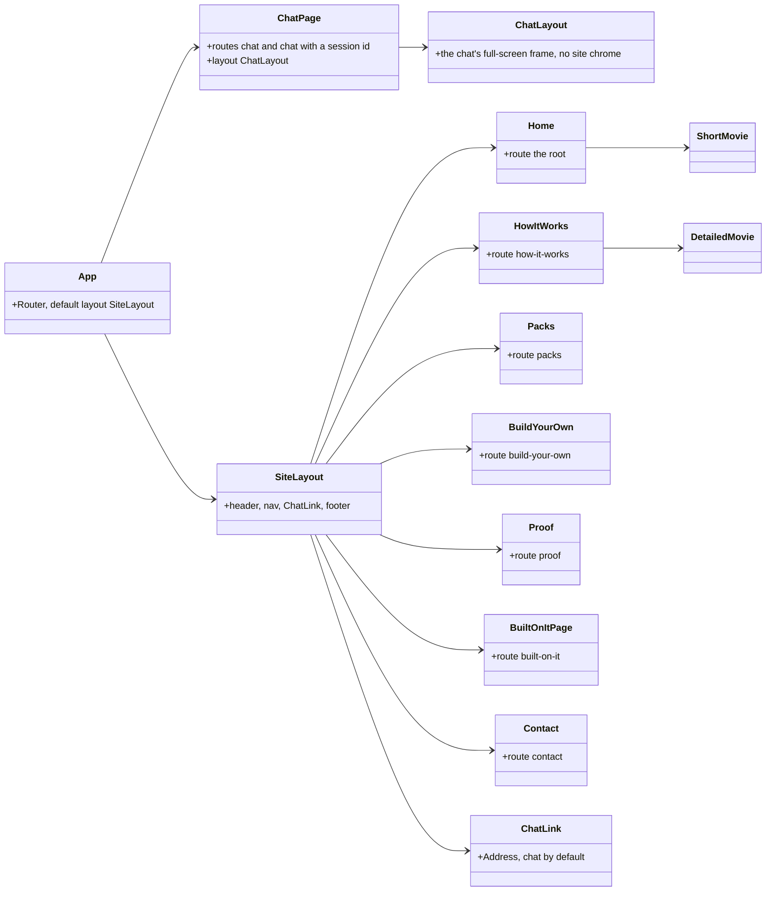
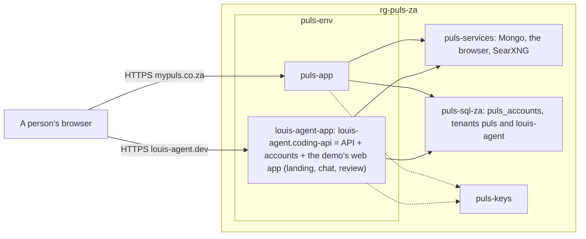

# F109 The site in the louis-agent demo's web app, deployed beside Puls

> **Plan** (a parent with two children). How the framework's static site becomes the layout page of the louis-agent
> demo's web app, keeping the site's theme, and how that app goes live beside Puls on the same environment and VM.
> Drafted 2026-11-08, **approved by Louis the same day** with two picks (below); committed on
> `feature/F109.1-the-site-in-the-web-app`. Deleted when the work is done: its why goes to an ADR, its what to the
> project docs.

## Context

**Louis's words (2026-11-08, during F61.4):** "louis-agent static site will be the same as puls, it will merge with
that demo and become the layout page and that will be a demo of it"; "not puls demo: louis-agent demo.web"; "but we
have to merge then first"; "we keep the static sites theme though"; "we will have to deploy louis-agent to the same
VM, to save money; can be split later"; "louis-agent goes into the same directory"; "yes merge louis-agent next
then deploy it".

**What exists:**
- `demos/louis-agent/web/louis-agent.site`: a static server-rendered Razor app (ADR 0066) of seven pages (`/`,
  `/how-it-works`, `/packs`, `/build-your-own`, `/proof`, `/built-on-it`, `/contact`), a `SiteLayout` (header,
  nav, footer), the landing's parts (`Hero`, `ProofTiles`, `LiveTurn`, `BuiltOnIt`, `ContactStrip`, `ChatLink`) and
  the two CSS films (`ShortMovie`, `DetailedMovie`); its own Sass (`settings/tokens`, `base/elements`,
  `layout/shell`, `landing/*`, `movie/*`, `layout/responsive`) on the framework's colours; its tests
  (`louis-agent.site.tests`: the pages, the films' goldens, `FilmExportTests` for the webp films on GitHub, ADR
  0077); `Dockerfile.site`; referenced by nothing of ours.
- `demos/louis-agent/web/louis-agent.code-review`: the demo's Blazor WebAssembly app, served by
  `louis-agent.coding-api`; the chat at `/`, `/chat` and `/chat/{id}`; `MainLayout` is bare; the framework's chat,
  the git and files pack views, the accounts and the eval studio opted in; two themes (`retro`, `paper`) picked on
  the page, loaded after `app.css`.
- Puls does the same shape already: its landing page at `/` in the WASM app, the chat at `/gesels`.
- F61.4 (live): Puls on `puls-env`, the VM, Azure SQL, the vault, one Bicep file in `demos/puls/config/azure`,
  one `deploy.ps1`; the tenant model (ADR 0088) lets a second app keep its accounts in the same database.

## Design

**The shape, in plain words.** The site's pages move into the code-review app as its pages: `/` becomes the
landing, the chat moves to `/chat` (as Puls has it at `/gesels`), and `SiteLayout` becomes the app's default layout
with the chat page keeping its own full-screen one. The site's Sass moves in under `site/` and becomes the app's
look: its tokens set the colours after the framework's, so the app comes out as the site does today. **Louis's
two picks (2026-11-08):** the landing's pages are WebAssembly pages like the rest of the app (option A of three:
one app, one way, as Puls; the cost is a slower first paint and no server-side HTML for crawlers, which
prerendering could add later), and the app has one look, the site's, with one theme kept on the chat's picker
"to show you can do it" (option C of three, with that one addition): `retro` stays, `paper` goes. The films come
along as components. The site project,
its tests project and `Dockerfile.site` go; the site's tests move into the code-review app's. Then the app goes
to Azure as a second Container App on `puls-env`, declared in the same Bicep file, deployed from the same folder
with a `-App` switch, reaching the same VM and SQL server as its own tenant; `louis-agent.dev` points at it.

### Interface design



The signatures, read from the code:

```csharp
// demos/louis-agent/web/louis-agent.code-review (moved in, F109.1)
public partial class SiteLayout : LayoutComponentBase            // Layout/SiteLayout.razor, the default
public partial class ChatLayout : LayoutComponentBase            // Layout/ChatLayout.razor, @Body only (today's MainLayout, renamed)
public partial class ChatLink { [Parameter] string Address = "/chat"; [Parameter] string Class; }
// the seven pages and the films keep their markup and their class names; only the folder and the namespace change
```

### Architecture (after F109.2)



### Communication: a visitor becomes a chat

```mermaid
sequenceDiagram
    participant B as Browser
    participant A as louis-agent-app
    participant S as Azure SQL (tenant louis-agent)
    B->>A: GET / (the landing, in the site's theme)
    A-->>B: the WASM app; SiteLayout draws Home
    B->>A: click "Try it" (ChatLink to /chat)
    A-->>B: ChatPage in ChatLayout: sign in first (F107 once built)
    B->>A: POST /account/login
    A->>S: the user, in the tenant the host name says
    B->>A: POST /v1/sessions (cookie + X-Requested-With)
```

### Namespace map

| Type or file | From | To | Step |
|---|---|---|---|
| `SiteLayout.razor` | `louis-agent.site/Components/Layout/` | `louis-agent.code-review/Layout/` (`LouisAgent.CodeReview.Layout`) | 1.1 |
| `MainLayout.razor` | `louis-agent.code-review/Layout/` | renamed `ChatLayout.razor`, same folder | 1.1 |
| `Home`, `HowItWorks`, `Packs`, `BuildYourOwn`, `Proof`, `BuiltOnItPage`, `Contact` | `louis-agent.site/Components/Pages/` | `louis-agent.code-review/Pages/Site/` (`LouisAgent.CodeReview.Pages.Site`) | 1.2 |
| `Hero`, `ProofTiles`, `LiveTurn`, `BuiltOnIt`, `ContactStrip`, `ChatLink` | `louis-agent.site/Components/Landing/` | `louis-agent.code-review/Components/Landing/` | 1.2 |
| `ShortMovie`, `DetailedMovie` | `louis-agent.site/Components/Movies/` | `louis-agent.code-review/Components/Movies/` | 1.3 |
| `settings/_tokens`, `base/_elements`, `layout/_shell`, `landing/*`, `movie/*`, `layout/_responsive` | `louis-agent.site/Styles/` | `louis-agent.code-review/Styles/site/` (same names under one folder) | 1.4 |
| the pages', films' and ChatLink tests, the films' goldens | `louis-agent.site.tests/` | `louis-agent.code-review.tests/Site/`, `Movies/` | 1.5 |
| `FilmExportTests`, `FilmNamesTests` | `louis-agent.site.tests/Movies/` | `louis-agent.film-export.tests/` or kept beside the films, as the tool's host decides (step 1.5 finds out) | 1.5 |
| `louis-agent.site`, `louis-agent.site.tests`, `Dockerfile.site`, `louis-agent.site.md`, `change-the-site.md` | the demo | deleted; the docs folded into the code-review app's | 1.6 |
| `louis-agent-app.yaml` | — | `demos/puls/deploy/azure/` (the same folder, Louis's pick) | 2.2 |
| the app's share, identity and role | — | `demos/puls/config/azure/main.bicep` | 2.1 |

## F109.1 The site in the web app (`feature/F109.1-the-site-in-the-web-app`, off `main`)

Done when: the code-review app opens on the site's landing page at `/`, in the site's look, every site page and
both films answer at their addresses, the chat is at `/chat` with its themes, the films still export, the site
project is gone and every test is green.

1. **The layouts.** `MainLayout` renamed `ChatLayout`; `SiteLayout` moved in as the router's default; `ChatPage`
   takes `@layout ChatLayout` and loses `@page "/"`. Test first: `SiteRoutesTests` says `/` is the landing and
   `/chat` the chat.
2. **The pages and the landing's parts.** The seven pages under `Pages/Site/`, the parts under
   `Components/Landing/`, `ChatLink` pointing at `/chat`; `_Imports` for the folders. Tests: the site's page tests
   moved, run against the WASM host with bUnit.
3. **The films.** `ShortMovie` and `DetailedMovie` under `Components/Movies/` with their goldens.
4. **The look.** The site's Sass under `Styles/site/` and on the app's list after the framework's rules
   (`site/settings/tokens` right after `web/settings/colours`, so the site's colours are the app's); `chat/_boot`
   stays; of the themes `retro` stays as the one the chat's picker can switch to and `paper` goes, with
   `themes.json` and the picker's words saying so. The stylesheet tests updated; checked in the browser at
   desktop and 390 px on every page.
5. **The films' export.** `FilmExportTests` and the film-export tool run against the moved films (the tool renders
   the page in a browser; if it started the site's host in memory, it starts the API host serving the app now);
   the webp films on GitHub re-rendered if a pixel moved (ADR 0077).
6. **The site project goes.** `louis-agent.site`, its tests, `Dockerfile.site`, the solution entries; the
   code-review app's doc and guide take the site's sections; `SolutionLayoutTests` and `FrameworkWebSites` see one
   project; the TODO's F54 and F57 rows close.

## F109.2 The demo's app beside Puls (`feature/F109.2-the-demo-app-beside-puls`, after F61.4 and F109.1 merge)

Done when: `https://louis-agent.dev` and `www` open the demo's app from `puls-env` with a padlock, sign-in works in
its own tenant, a review session reaches the VM's services, and the month's cost line is in the README.

1. **The template.** `main.bicep` gains the app's share `louis-agent-workspace` on `pulsstorage` as storage
   `louis-agent-vol` on the environment, a second identity `louis-agent-app-identity` with Key Vault Secrets User,
   and outputs for them; `deploy.ps1 infra` updates in place (what-if first).
2. **The app.** `louis-agent-app.yaml` from `puls-app.yaml`: the `louis-agent-coding` image (`Dockerfile.api`,
   built by `build -App louis-agent-app`), `IDENTITIES`, `PACKS` and the roles as the demo's compose sets them,
   `ACCOUNTS_TENANT=louis-agent`, `ACCOUNTS_COOKIE_DOMAIN=louis-agent.dev`, the VM's addresses, the same vault
   references plus its own `agent-api-key-louis-agent` and `admin-api-key-louis-agent`; every verb takes
   `-App puls-app|louis-agent-app` and reads the app's config from `demos/louis-agent/config/`.
3. **Secrets and release.** `secrets -App louis-agent-app`, `release -App louis-agent-app` as revision `v001`.
4. **The domain.** `domain -App louis-agent-app` for `louis-agent.dev` and `www`, the records in Cloudflare
   (Louis), the `_dnsauth` token for the apex.
5. **Docs.** The deploy README and the architecture doc gain the second app; `ARCHITECTURE.md`'s diagrams; the
   ADR *The demo's app runs beside Puls, split later*; the TODO (F51's hosting row, F59's leftovers); the work
   log; the write-up (skill 18); this plan deleted.

## Verification

- F109.1: each step's tests; the three stylesheet tests of the demo; the full suite before the PR; the browser at
  desktop and 390 px on every page and the chat; the films re-exported and compared.
- F109.2: `infra -WhatIf` before `infra`; `/health` on the app's own address, then on the domain; sign in and a
  review session (**spends the Anthropic key: ask first**); the VM's ports from the app; the cost panel after a week.

## Concepts, and where they sit in GOAL.md

- **One app per demo** (skill 20, extensibility): the landing, the chat and the review are one WASM app with two
  layouts, as Puls is; a static site beside it was a second thing to host for nothing.
- **A tenant per site on one database** (skill 9): the second app's accounts live in the same Azure SQL under its
  own tenant, resolved from the host name (ADR 0088), with no new server.
- **Shared infrastructure, split later** (skill 18): two apps on one environment and one VM halve the floor;
  the Bicep file declares both, so a split is a second file with half the resources, not a rebuild.

## Approved during the build

(none yet)

---
[Docs index](../README.md) · Related: [Plans](README.md) · [ADR 0095](../adr/0095-puls-runs-from-azure-and-nothing-points-at-the-pc.md) · [louis-agent.code-review](../../../demos/louis-agent/docs/projects/louis-agent.code-review.md)
