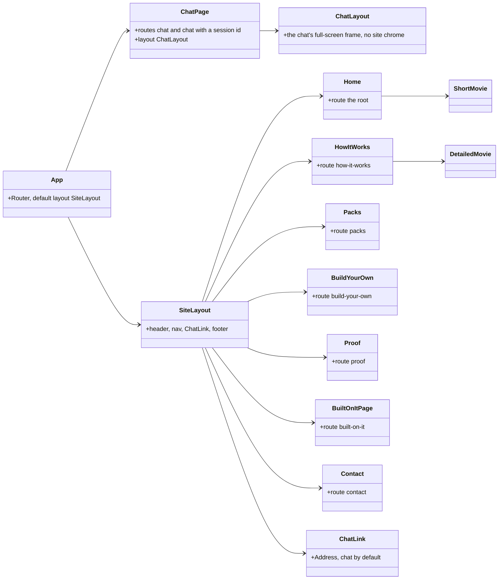
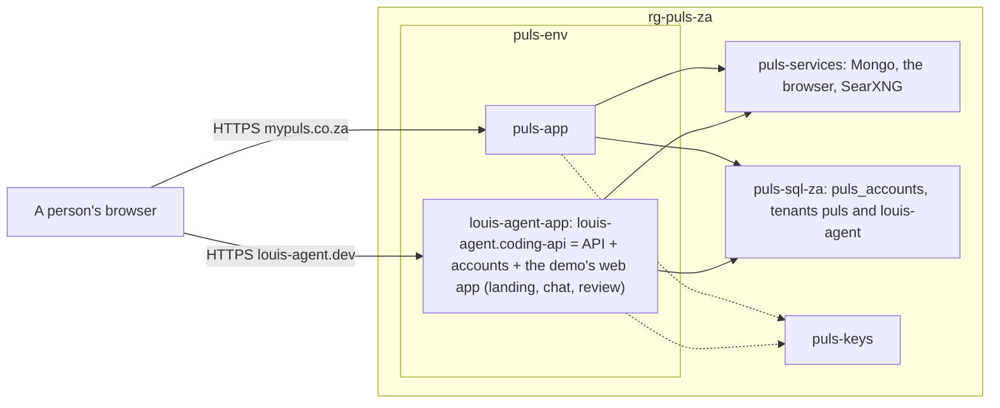
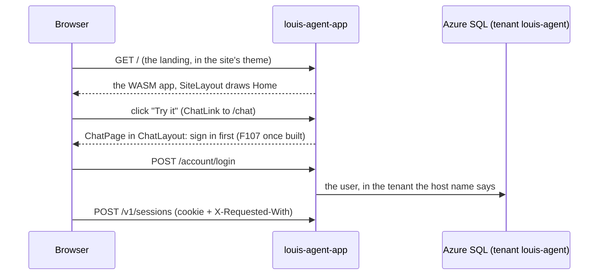

# F109 The site in the louis-agent demo's web app, deployed beside Puls

> **Plan** (a parent with five children). How the framework's static site becomes the layout page of the louis-agent
> demo's web app, keeping the site's theme, and how that app goes live beside Puls on the same environment and VM.
> Drafted 2026-11-08, **approved by Louis the same day** with two picks (below); committed on
> `feature/F109.1-the-site-in-the-web-app`. Deleted when the work is done: its why goes to an ADR, its what to the
> project docs.

## Context

**Louis's words (2026-11-08, during F61.4):** "louis-agent static site will be the same as puls, it will merge with
that demo and become the layout page and that will be a demo of it"; "not puls demo: louis-agent demo.web"; "but we
have to merge then first"; "we keep the static sites theme though"; "we will have to deploy louis-agent to the same
VM, to save money; can be split later"; "louis-agent goes into the same directory"; "yes merge louis-agent next
then deploy it".

**What exists:**
- `demos/louis-agent/web/louis-agent.site`: a static server-rendered Razor app (ADR 0066) of seven pages (`/`,
  `/how-it-works`, `/packs`, `/build-your-own`, `/proof`, `/built-on-it`, `/contact`), a `SiteLayout` (header,
  nav, footer), the landing's parts (`Hero`, `ProofTiles`, `LiveTurn`, `BuiltOnIt`, `ContactStrip`, `ChatLink`) and
  the two CSS films (`ShortMovie`, `DetailedMovie`); its own Sass (`settings/tokens`, `base/elements`,
  `layout/shell`, `landing/*`, `movie/*`, `layout/responsive`) on the framework's colours; its tests
  (`louis-agent.site.tests`: the pages, the films' goldens, `FilmExportTests` for the webp films on GitHub, ADR
  0077); `Dockerfile.site`; referenced by nothing of ours.
- `demos/louis-agent/web/louis-agent.code-review`: the demo's Blazor WebAssembly app, served by
  `louis-agent.coding-api`; the chat at `/`, `/chat` and `/chat/{id}`; `MainLayout` is bare; the framework's chat,
  the git and files pack views, the accounts and the eval studio opted in; two themes (`retro`, `paper`) picked on
  the page, loaded after `app.css`.
- Puls does the same shape already: its landing page at `/` in the WASM app, the chat at `/gesels`.
- F61.4 (live): Puls on `puls-env`, the VM, Azure SQL, the vault, one Bicep file in `demos/puls/config/azure`,
  one `deploy.ps1`; the tenant model (ADR 0088) lets a second app keep its accounts in the same database.

## Design

**The shape, in plain words.** The site's pages move into the code-review app as its pages: `/` becomes the
landing, the chat moves to `/chat` (as Puls has it at `/gesels`), and `SiteLayout` becomes the app's default layout
with the chat page keeping its own full-screen one. The site's Sass moves in under `site/` and becomes the app's
look: its tokens set the colours after the framework's, so the app comes out as the site does today. **Louis's
two picks (2026-11-08):** the landing's pages are WebAssembly pages like the rest of the app (option A of three:
one app, one way, as Puls; the cost is a slower first paint and no server-side HTML for crawlers, which
prerendering could add later), and the app has one look, the site's, with one theme kept on the chat's picker
"to show you can do it" (option C of three, with that one addition): `retro` stays, `paper` goes. The films come
along as components. The site project,
its tests project and `Dockerfile.site` go; the site's tests move into the code-review app's. Then the app goes
to Azure as a second Container App on `puls-env`, declared in the same Bicep file, deployed from the same folder
with a `-App` switch, reaching the same VM and SQL server as its own tenant; `louis-agent.dev` points at it.

### Interface design



The signatures, read from the code:

```csharp
// demos/louis-agent/web/louis-agent.code-review (moved in, F109.1)
public partial class SiteLayout : LayoutComponentBase            // Layout/SiteLayout.razor, the default
public partial class ChatLayout : LayoutComponentBase            // Layout/ChatLayout.razor, @Body only (today's MainLayout, renamed)
public partial class ChatLink { [Parameter] string Address = "/chat"; [Parameter] string Class; }
// the seven pages and the films keep their markup and their class names; only the folder and the namespace change
```

### Architecture (after F109.2)



### Communication: a visitor becomes a chat



### Namespace map

| Type or file | From | To | Step |
|---|---|---|---|
| `SiteLayout.razor` | `louis-agent.site/Components/Layout/` | `louis-agent.code-review/Layout/` (`LouisAgent.CodeReview.Layout`) | 1.1 |
| `MainLayout.razor` | `louis-agent.code-review/Layout/` | renamed `ChatLayout.razor`, same folder | 1.1 |
| `Home`, `HowItWorks`, `Packs`, `BuildYourOwn`, `Proof`, `BuiltOnItPage`, `Contact` | `louis-agent.site/Components/Pages/` | `louis-agent.code-review/Pages/Site/` (`LouisAgent.CodeReview.Pages.Site`) | 1.2 |
| `Hero`, `ProofTiles`, `LiveTurn`, `BuiltOnIt`, `ContactStrip`, `ChatLink` | `louis-agent.site/Components/Landing/` | `louis-agent.code-review/Components/Landing/` | 1.2 |
| `ShortMovie`, `DetailedMovie` | `louis-agent.site/Components/Movies/` | `louis-agent.code-review/Components/Movies/` | 1.3 |
| `settings/_tokens`, `base/_elements`, `layout/_shell`, `landing/*`, `movie/*`, `layout/_responsive` | `louis-agent.site/Styles/` | `louis-agent.code-review/Styles/site/` (same names under one folder) | 1.4 |
| the pages', films' and ChatLink tests, the films' goldens | `louis-agent.site.tests/` | `louis-agent.code-review.tests/Site/`, `Movies/` | 1.5 |
| `FilmExportTests`, `FilmNamesTests` | `louis-agent.site.tests/Movies/` | `louis-agent.film-export.tests/` or kept beside the films, as the tool's host decides (step 1.5 finds out) | 1.5 |
| `louis-agent.site`, `louis-agent.site.tests`, `Dockerfile.site`, `louis-agent.site.md`, `change-the-site.md` | the demo | deleted; the docs folded into the code-review app's | 1.6 |
| `louis-agent-app.yaml` | — | `demos/puls/deploy/azure/` (the same folder, Louis's pick) | 2.2 |
| the app's share, identity and role | — | `demos/puls/config/azure/main.bicep` | 2.1 |

## F109.1 The site in the web app (`feature/F109.1-the-site-in-the-web-app`, off `main`)

Done when: the code-review app opens on the site's landing page at `/`, in the site's look, every site page and
both films answer at their addresses, the chat is at `/chat` with its themes, the films still export, the site
project is gone and every test is green.

1. **The layouts.** `MainLayout` renamed `ChatLayout`; `SiteLayout` moved in as the router's default; `ChatPage`
   takes `@layout ChatLayout` and loses `@page "/"`. Test first: `SiteRoutesTests` says `/` is the landing and
   `/chat` the chat.
2. **The pages and the landing's parts.** The seven pages under `Pages/Site/`, the parts under
   `Components/Landing/`, `ChatLink` pointing at `/chat`; `_Imports` for the folders. Tests: the site's page tests
   moved, run against the WASM host with bUnit.
3. **The films.** `ShortMovie` and `DetailedMovie` under `Components/Movies/` with their goldens.
4. **The look.** The site's Sass under `Styles/site/` and on the app's list after the framework's rules
   (`site/settings/tokens` right after `web/settings/colours`, so the site's colours are the app's); `chat/_boot`
   stays; of the themes `retro` stays as the one the chat's picker can switch to and `paper` goes, with
   `themes.json` and the picker's words saying so. The stylesheet tests updated; checked in the browser at
   desktop and 390 px on every page.
5. **The films' export.** `FilmExportTests` and the film-export tool run against the moved films (the tool renders
   the page in a browser; if it started the site's host in memory, it starts the API host serving the app now);
   the webp films on GitHub re-rendered if a pixel moved (ADR 0077).
6. **The site project goes.** `louis-agent.site`, its tests, `Dockerfile.site`, the solution entries; the
   code-review app's doc and guide take the site's sections; `SolutionLayoutTests` and `FrameworkWebSites` see one
   project; the TODO's F54 and F57 rows close.

## F109.2 The demo's app beside Puls (`feature/F109.2-the-demo-app-beside-puls`, after F61.4 and F109.1 merge)

Done when: `https://louis-agent.dev` and `www` open the demo's app from `puls-env` with a padlock, sign-in works in
its own tenant, a review session reaches the VM's services, and the month's cost line is in the README.

1. **The template.** `main.bicep` gains the app's share `louis-agent-workspace` on `pulsstorage` as storage
   `louis-agent-vol` on the environment, a second identity `louis-agent-app-identity` with Key Vault Secrets User,
   and outputs for them; `deploy.ps1 infra` updates in place (what-if first).
2. **The app.** `louis-agent-app.yaml` from `puls-app.yaml`: the `louis-agent-coding` image (`Dockerfile.api`,
   built by `build -App louis-agent-app`), `IDENTITIES`, `PACKS` and the roles as the demo's compose sets them,
   `ACCOUNTS_TENANT=louis-agent`, `ACCOUNTS_COOKIE_DOMAIN=louis-agent.dev`, the VM's addresses, the same vault
   references plus its own `agent-api-key-louis-agent` and `admin-api-key-louis-agent`; every verb takes
   `-App puls-app|louis-agent-app` and reads the app's config from `demos/louis-agent/config/`.
3. **Secrets and release.** `secrets -App louis-agent-app`, `release -App louis-agent-app` as revision `v001`.
4. **The domain.** `domain -App louis-agent-app` for `louis-agent.dev` and `www`, the records in Cloudflare
   (Louis), the `_dnsauth` token for the apex.
5. **Docs.** The deploy README and the architecture doc gain the second app; `ARCHITECTURE.md`'s diagrams; the
   ADR *The demo's app runs beside Puls, split later*; the TODO (F51's hosting row, F59's leftovers); the work
   log; the write-up (skill 18); this plan deleted.
6. **The app deploys from GitHub as Puls does** (Louis, 2026-11-08: "this agent must also deploy like this"):
   the deploy workflow (F109.5) gains the second app, after green CI on `main` and from the button, signed in by
   the same OpenID Connect identity, running `deploy.ps1 release -App louis-agent`; `DeployWorkflowTests` holds it;
   the deploy README's *Deploying from GitHub* names both apps.

## F109.3 The guide in the corner (`feature/F109.3-the-guide-in-the-corner`, after F109.1; drafted, its steps to come)

**Louis (2026-11-08):** "for this layout we need something like a chatbot in the lower right corner, for the
layout and he will know everything about louis-agent and will have all the knowledge on the framework. then demos
will be the workflow triage example"; "like we have to be able to also inject a chat bot on a page".

- **A framework component, `ChatWidget`, in `louis-agent.web`:** a small chat panel any page or layout drops in
  with one tag and a parameter for who it talks as (`<ChatWidget Identity="guide" />`), folded to a button in the
  lower-right corner, built from the chat frame's own parts (the message list, the composer, the turn view), not a
  second chat; its own session on the API with that identity and its toolsets; the same gate as the chat.
- **The site's layout places it** configured with the louis-agent expert (Louis: "our layout page will have a
  louis-agent expert configured"): an identity of this demo under `demos/louis-agent/identity`, beside the coding
  one, whose whole knowledge is the framework, its voice and toolsets its own files. **The demo wraps the widget
  once as its own component, `ExpertChat`** (Louis: "why not in a component? also as well as layout"), configured
  with the expert, so the layout places `<ExpertChat />` in the corner and any page places the same tag where it
  wants it, nothing configured twice; another demo wraps `ChatWidget` with its own identity the same way.
- **The guide's knowledge** is open: a tool that searches the docs in the mounted workspace (Claude's pick), an
  index built at build time, or a digest in the prompt; Louis to pick. Whatever the pick, it must answer in
  detail about everything the site says (Louis, 2026-11-08; F109.4), so the architecture docs, the ADRs and
  the project docs are in its reach, not a digest of the pages alone.
- **It follows the framework, and extends it where needed** (Louis, 2026-11-08: "it must follow the framework set in
  place, extend the framework if/where needed"): the expert is an identity like Puls's (its voice, modes and
  toolsets as files under the demo's `identity/`), what it reads is a pack's tool (ADR 0080), the widget is a
  framework component opening an ordinary API session, and where the framework lacks a seam (a session that takes
  its identity from the widget, a smaller frame) the framework gets it, never the demo a way around it.
- **The demos section** shows the triage workflow (F106) once that is built; until then the review chat at `/chat`
  is the demo the site leads to.

## F109.4 The site tells the whole architecture (`feature/F109.4-the-site-tells-the-architecture`, after F109.2; to plan)

**Louis (2026-11-08):** "the whole website should explain the whole architecture, and the identity running on our
landing page must be able to answer in detail everything mentioned on the website." Said first of the films ("we
should update the films with what it looks like now, explaining the whole architecture"), then of the site.

- **What the site says today** stops at the engine: both films tell one turn through core, the pages name the
  engine, identities, packs and the two demos. Missing: the hosts as libraries, the framework's web and the sites
  built on it, a pack's four folders (tools, evals, web, tests), the accounts, the evals harness, a demo as
  someone's own project, and where it runs (Azure).
- **Done when:** every part of [the building block view](../architecture/05-building-block-view.md) has its place
  on the site, in plain words, with the films drawn from the same map; and the expert in the corner (F109.3) answers
  in detail about anything a page or a film says, from the same sources the pages were written from. Louis
  (2026-11-08): "make sure the whole framework is explained": a test holds it, the way `PacksPageTests` holds the
  packs page to `packs/tools/`: every project family in the solution (the engine and its satellites, the hosts, the
  web, the accounts, the packs, the evals, the demos, the deploy) is named on a page, so a new part can't be left
  off the site.
- **The shape, to plan with a storyboard Louis approves first:** the pages and films are written from the
  architecture docs (`src/docs/architecture/`), the ADRs and the project docs, so the site and the expert share one
  source and cannot drift; a test pins each page's claims to the code or the docs the way `BuildYourOwnTests` pins
  the program. **Which film tells what, picked** (Louis, 2026-11-08, option 1 of three): the short film on the
  landing becomes the map of the whole architecture, in six scenes; the detailed film on How it works stays the
  turn through core, with today's names fixed. Each film keeps one job, and the turn's story stays on the site.
- **What it's built on, and 100% C#** (Louis, 2026-11-08: "it should also have a built on section and advertisement
  that 100% C#, like Microsoft Extensions"): a section on what the framework stands on (Microsoft.Extensions.AI,
  ASP.NET Core, Blazor, ASP.NET Core Identity, EF Core, Bootstrap; nothing paid, licences named), apart from
  *Built on it* (what runs on the framework); and "100% C#" said up front on the landing, not only in the footer.
- **Puls's numbers in rand, South Africa, a solo project** (Louis, 2026-11-08, on the Measured page: "also include
  Puls numbers in R, and how that works. Make sure people know we are from South Africa and it is a solo project"):
  the Puls figures shown in rand beside the dollars, with how that works in plain words (every request priced in
  dollars by a dated price table, the rates file turning them into rand, the rate's date shown, ADR 0007); and the
  site says where it comes from and that one person builds it, on the landing and the contact page.
- **What's coming** (Louis, 2026-11-08: "also mention coming features"): a section of the planned features, drawn
  from [the roadmap](../../../ROADMAP.md) and the TODO, each marked as planned and dated, with a test that every
  feature it names has a TODO row, so the list can't outlive the plan. ADR 0066's "what's planned is at most one
  honest line" is superseded by the F109 ADR: planned work is shown, labelled, never as shipped.
- **The repository is private** (Louis, 2026-11-08: "I have made the repo private"): *Build your own* and *Contact* link
  to github.com/bosbevk/louis-agent, which a visitor can't open now; the links go, or point at what is public (the
  packages once on NuGet, the docs if they are published), and the words "the architecture, every design decision and
  the learning write-ups are public" change with them.
- **A section on identities** (Louis, 2026-11-08: "we should have a section on identities"): what an identity is
  (who the agent is: the principles every agent opens with, its voice, its modes, its roles, the toolsets it names,
  all as files under its own project, ADR 0017 to 0020 and 0027), the two that exist (Puls with its specialists,
  the coding agent) and how a customer's is a folder of markdown of their own, the way the expert in the corner is
  this site's (F109.3); the test of F109.4 counts `identity/` folders under `demos/` as it counts the packs.
- **The branding arrives with the next merge** (Louis, 2026-11-08: "when you are done, on the next merge the branding
  will be available"): the site takes it (the brand slot, the icon, the colours it names) in the first step after
  it lands, before F109.4's rewrite, so the pages and films are written on the brand.
- **Order:** F109.1 moves the pages and films as they are, so the goldens prove the move; F109.2 deploys them;
  F109.3 brings the expert; F109.4 rewrites what they say, and F109.3's knowledge tool is sized to it.

## F109.5 Puls deploys from GitHub (`feature/F109-deploy-from-github`, built 2026-11-07, merged in PR #223)

Planned and built in another thread under the same id, folded in here as the fifth child at Louis's word
(2026-11-08: "merge these 2, the work is done and working"). What it is: a GitHub Actions workflow,
`.github/workflows/deploy-puls.yml`, that after green CI on `main` (and from a button) signs in to Azure by OpenID
Connect with no stored password and runs the same `deploy.ps1 release` Louis runs from his PC, so a merge puts a
new `puls-app` revision live. Louis's three picks (after green CI plus a button; OpenID Connect; the script as it
is) and the why are [ADR 0097](../adr/0097-puls-deploys-from-github.md); the how, with his one-time Azure setup, is
the deploy README's *Deploying from GitHub*; the rule test is `DeployWorkflowTests`. Its own plan file is deleted,
as a done plan is. The second app (F109.2) deploys the same way once it exists.

## Verification

- F109.1: each step's tests; the three stylesheet tests of the demo; the full suite before the PR; the browser at
  desktop and 390 px on every page and the chat; the films re-exported and compared.
- F109.2: `infra -WhatIf` before `infra`; `/health` on the app's own address, then on the domain; sign in and a
  review session (**spends the Anthropic key: ask first**); the VM's ports from the app; the cost panel after a week.

## Concepts, and where they sit in GOAL.md

- **One app per demo** (skill 20, extensibility): the landing, the chat and the review are one WASM app with two
  layouts, as Puls is; a static site beside it was a second thing to host for nothing.
- **A tenant per site on one database** (skill 9): the second app's accounts live in the same Azure SQL under its
  own tenant, resolved from the host name (ADR 0088), with no new server.
- **Shared infrastructure, split later** (skill 18): two apps on one environment and one VM halve the floor;
  the Bicep file declares both, so a split is a second file with half the resources, not a rebuild.

## Approved during the build

- **The site's frame is the framework's** (Louis, 2026-11-08, on step 1: "that custom layout can be reused, it should
  be in the framework, with the chat in the lower right corner; it is only now used in the agent site"). Step 1 gains
  `SiteShell` in `louis-agent.web`'s `Components/Site/`: the frame (header with brand, menu and actions; the page; a
  footer; a `Corner` slot fixed lower right, where F109.3's chat widget goes), Template Method in Razor as
  `AdminShell` is, with its own scoped styles (`SiteShell.razor.scss`, the site's `layout/_shell.scss` and its phone
  rules, on `--bs-border-color` and a `--site-gutter` the site sets in step 4). The demo's `SiteLayout` only fills
  the slots, under the 40-line rule; `louis-agent.site` keeps its own copy until step 6 deletes it. Louis also asked
  (2026-11-08) that the chat sit in the corner of this layout: the slot is here, the widget is F109.3.
- **F61.6 is F109** (Louis, 2026-11-08, pick 1 of three). PR #221 trimmed the F61 plan to a child F61.6 "The framework's site beside Puls": the same work as F109.1 and F109.2. F109 stays, the F61 plan is deleted (its full text at commit `20f28c9f`) and the TODO's F61 row closes in the work log. F61.6's notes already sit here: the site project goes in F109.1 step 6 (not kept as a library), the second app's accounts are a tenant on the same database (F109.2), the TODO's F54 row closes with step 6.
- **Step 2 takes five pages, step 3 the other two** (2026-11-08, a sequencing call): `Home` and `HowItWorks` embed the films, so they move with them in step 3. The pages are copied, not moved, until step 6 deletes the site project. They are named `…Page` as `ChatPage` is, since a class `Packs` collides with the packs' `LouisAgent.Packs` namespace. The site's HTTP tests become bUnit renders; its plain-HTML and `/health` tests have no counterpart in a WebAssembly app and are dropped.
- **A fourth child, F109.4** (Louis, 2026-11-08: "the whole website should explain the whole architecture, and the identity running on our landing page must be able to answer in detail everything mentioned on the website"). The films' rewrite Louis asked for first is part of it. Its section is above; F109.1 moves the films as they are.
- **Step 4: the site's look stays inside the frame** (Louis, 2026-11-08, pick 1 of three). The site's element and
  utility rules (`site/base/_elements.scss`) hang off the frame's root `.site`, so the chat and the admin keep the
  framework's elements; the tokens stay on `:root`, with `--gutter` renamed `--site-gutter`, the name the
  framework's `SiteShell` reads. The default theme is `console`, a theme file that forwards the framework's
  colours as they are (the site's Console look), `retro` the one to switch to, `paper` gone; the picker's list is
  the tracked `wwwroot/css/themes/themes.json`. The site's stylesheet tests moved in, two narrowed to the site's
  partials (the whole app's CSS reads names Bootstrap and the scripts set); the chat goldens changed only in
  the theme options.
- **Step 5: the export runs the API host** (2026-11-08). `SiteProcess` starts `louis-agent.coding-api` on a spare
  port with only its URL set, as it started the site; the renderer waits for the film's element, since a
  WebAssembly app draws a moment after the network goes quiet; `FilmSource` names the app's files, so the hash
  changed and both films were re-exported from the app. The test holding the exports to the films moves to the
  app's tests, which reference the tool as the site's tests did.
- **Step 6: the site project goes** (2026-11-08). `louis-agent.site`, its tests, `Dockerfile.site`, its design doc and
  guide are deleted; the code-review app's doc and guide take their sections; the solution loses the two projects and
  two items; ADR 0066 is superseded in part (the pages are the app's, the films stay CSS) and ADR 0084's bullet on the
  site says so; the TODO's F54 and F57 rows close. The films' pause Louis asked for (2026-11-08: "can we pause these
  films?") is a step of its own after this one, his pick pending.
- **Step 7: a pause on each film** (Louis, 2026-11-08: "can we pause these films?", pick 1 of three, "1 now"). A
  `FilmFrame` component (Decorator) wraps a film on its page with one button, outside the film's own element, so
  the film's markup, golden and export stay as they are; paused is a class on the frame that its scoped stylesheet
  turns into `animation-play-state: paused` on everything under the stage. The export tool is untouched: it seeks
  the animations itself and photographs the film's element, never the frame.
- **One F109, five children** (Louis, 2026-11-08: "merge these 2, the work is done and working"). Another thread
  had planned and built *Puls deploys from GitHub* as F109 (PR #223); it is this plan's F109.5, its plan file
  deleted, ADR 0097 and the deploy README its lasting parts, and the TODO carries one F109 row.
- **F109.2 steps 1 to 3 run** (2026-11-08, each on Louis's "go"): `infra` made the second identity, its vault role,
  the share and the environment storage (four creates, the what-if's reference-only modifies); `workspace -App
  louis-agent-app` put the price tables in the share; `secrets` put the app's two keys in the vault, no provider
  keys yet (sign-in by password only until Louis registers providers for `louis-agent.dev`); `release` built
  `louis-agent-coding:2026-11-08-0050` in four minutes and created the app as `v001`, live at its Azure address
  with health 200 and the landing page.
- **F109.2 step 4: the domain** (2026-11-08). Cloudflare had imported the old host's records (a proxied wildcard and
  apex, Afrihost's mail records); Louis replaced them with the four DNS-only records and the `_dnsauth` TXT. The
  verb's token fallback found nothing: the certificate list and the newer API versions leave the token out, the
  2023-05-01 version still returns it, so the verb reads it there, stops while the certificate is pending (the bind
  refuses a pending one) and doesn't re-add a hostname it added. The apex validated after nine checks and is bound
  with its padlock; `www` validates by its CNAME on Azure's clock. Chrome showed ERR_QUIC_PROTOCOL_ERROR once: it
  remembered the old proxy's HTTP/3, a reload clears it.
- **F109.2 steps 5 and 6** (2026-11-08): the deploy README, the architecture doc and the deployment view carry the
  second app; ADR 0098 *The demo's app runs beside Puls, split later*; the workflow releases both apps from one
  merge, each tried even when the other fails (`DeployWorkflowTests`); the TODO's F59 row closes (the site is on the
  framework's web and deployed); F51 stays, since it is about public traffic, not where the apps run. The
  data-protection keys finding (both apps sign everyone out on a cold start) is a fix of its own, FX64, to open.
- **F109.2 step 7: the link card is the framework's rule** (Louis, 2026-11-08, on a bare Facebook card for
  louis-agent.dev: "we need to fix this", "this must be in the framework"). A crawler runs no script, so a site's
  card is Open Graph tags in its own `index.html`; `SiteLinkCardTests` in the framework's web tests holds every
  site to the six tags with an absolute picture and address, the starter carries them as placeholders, the web
  guide says how. The louis-agent app's picture is the brand's social card (PR #227), its own copy; Puls's its
  icon and its Afrikaans hero line.

---
[Docs index](../README.md) · Related: [Plans](README.md) · [ADR 0095](../adr/0095-puls-runs-from-azure-and-nothing-points-at-the-pc.md) · [louis-agent.code-review](../../../demos/louis-agent/docs/projects/louis-agent.code-review.md)
