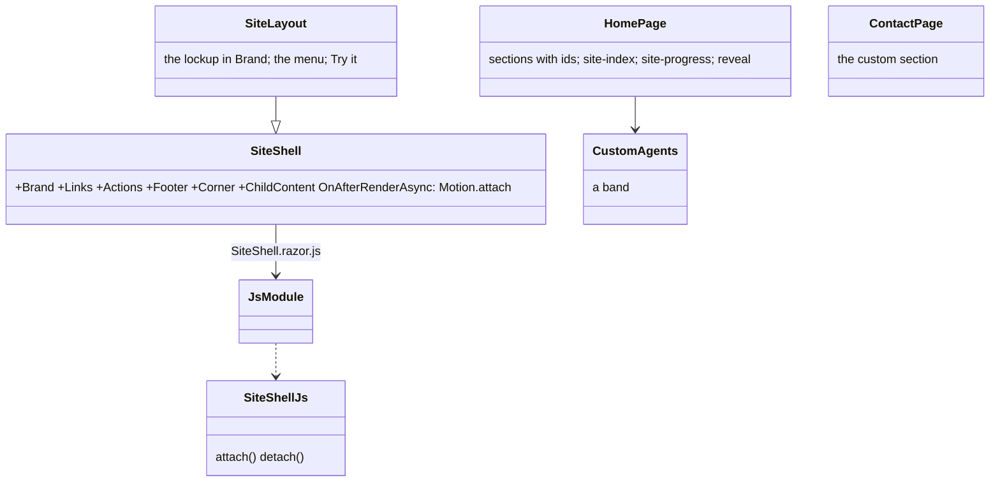
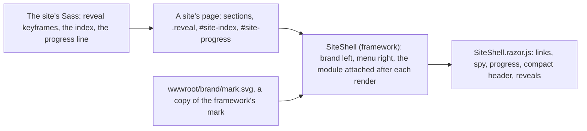
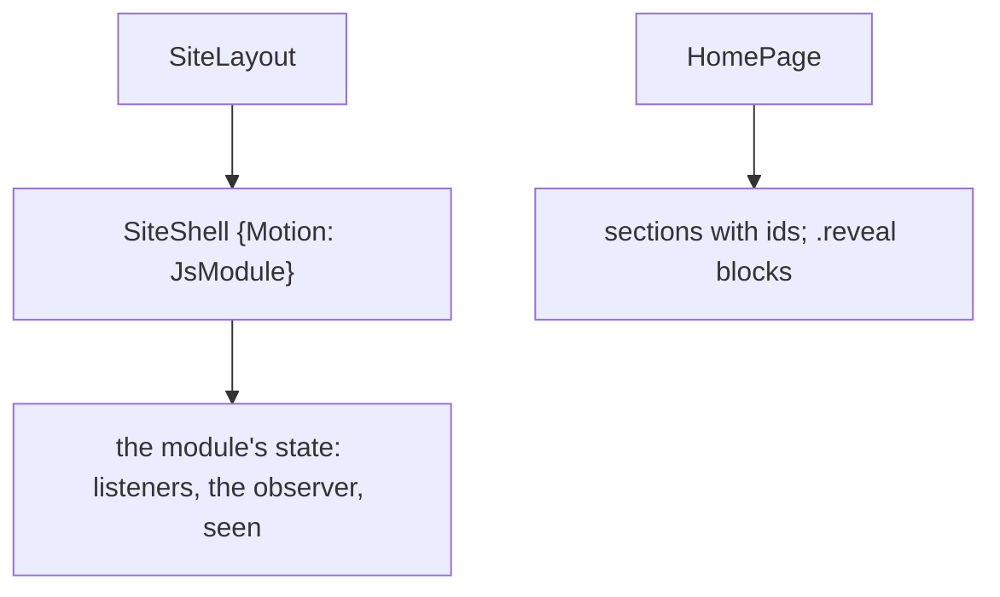

# F110 The landing like Puls: the lockup, the menu on the right, one page that moves, custom agents

> **Plan** (2026-11-08), from Louis's asks of that morning on louis-agent.dev: "can we also have this on right as like
> with puls, and also add some nice animations like as with puls, one page scroll through menus like puls"; "also logo
> missing and we should have a section where someone who wants a AI agent can contact me and we can do custom
> implementations". Built on `feature/F110-the-landing-like-puls` on his word to continue unattended; it changes only
> under *Approved during the build*.

## Context

The site is the code-review app's landing on the framework's `SiteShell` (F109), and it tells the whole architecture
(F109.4). What it lacks beside Puls's landing: the brand is a word, not the lockup, though the mark exists
(`src/docs/brand/mark.svg`, the favicon already its copy); the menu sits beside the brand, not on the right; the
landing is a column of bands with no motion, no index of its sections and no progress line, where Puls's page reveals
each block as it enters, keeps a section index on the left and lands an in-page link centred; and nothing on the site
says that Louis builds custom agents for a business on this framework.

**Done when:** the header shows the lockup (the mark and the name) on the left and the menu with *Try it* on the
right, at desktop and phone widths; the landing's sections reveal as they enter, a section index and a progress line
follow the scroll, and an in-page link lands its section centred; a *Custom agents* band on the landing and a section
on *Contact* say what Louis builds and how to ask; every test of F109.4 still holds the pages to the repo.

## Design

### The shape, in plain words

- **The lockup is the site's, the mark its own copy.** The brand slot holds the mark and the name set in Geist Mono
  500, as the brand README says; the mark is copied into the app's `wwwroot/brand/`, since a demo references no
  framework folder (ADR 0074), the way the favicon already is.
- **The menu on the right is the frame's.** Every site on `SiteShell` gets the brand left and the menu with the
  actions on the right (`margin-left: auto` on the menu); a phone keeps the menu on its own row under the brand.
- **The motion is the frame's module, the sections are the site's.** The general half of Puls's landing script (the
  in-page links that land centred, the scroll spy for an index, the progress line, the compact header, the reveals
  by an `IntersectionObserver`) becomes `SiteShell.razor.js`, a module beside the frame (ADR 0093), attached after
  every render so a page that just drew gets its reveals observed; Puls's own half (the water, the headline split,
  the counters, the tour) stays Puls's. A site marks what reveals with `reveal` and `data-delay`, draws its index
  (`site-index`) and its progress line (`site-progress`) where it wants them, and the keyframes are the site's
  partials, so a site chooses its motion. Less motion when the system asks stays the framework's one rule.
- **The landing as one page.** The sections get ids (`top`, `proof`, `how`, `concepts`, `built`, `custom`,
  `contact`) and an index on the left names them; the header menu keeps the pages, so the deep pages stay one click
  away, and the index is the one-page scroll Louis asked for.
- **Custom agents.** A band on the landing between *Built on it* and the contact strip: an agent for your business,
  built by Louis on this framework (an identity and packs for your systems, hosted and measured, in rand), and the
  way to ask; the same words as a section of *Contact*, with the mail address the page already holds.

### Interface design



```csharp
// src/web/louis-agent.web (steps 1, 3)
public static class FrameworkScripts { public const string SiteShell = Content + "Components/Site/SiteShell.razor.js"; }
public partial class SiteShell : IAsyncDisposable { protected override Task OnAfterRenderAsync(bool firstRender); }  // attach each render
// SiteShell.razor.js: export function attach(); export function detach();
```

### Architecture



### Communication: a visitor scrolls

```mermaid
sequenceDiagram
    actor V as Visitor
    participant S as SiteShell
    participant J as SiteShell.razor.js
    S->>J: attach() after the render
    J->>J: observe every .reveal not yet seen; hang scroll and click listeners
    V->>J: scrolls
    J->>J: progress width, header compact, index's active link
    J->>J: a .reveal enters: add .in (the site's keyframe plays)
    V->>J: clicks an index link
    J->>J: land the section centred, smooth unless less motion
```

### Objects in memory



### Namespace map

| Type | Folder | Namespace | Step |
|---|---|---|---|
| `wwwroot/brand/mark.svg` | `demos/louis-agent/web/louis-agent.code-review/` | — | 1 new |
| `SiteLayout` (the lockup) | `demos/louis-agent/web/louis-agent.code-review/Layout/` | `LouisAgent.CodeReview.Layout` | 1 changed |
| `SiteShell.razor.scss` (menu right) | `src/web/louis-agent.web/Components/Site/` | — | 1 changed |
| `SiteShell.razor.cs`, `SiteShell.razor.js`, `FrameworkScripts.SiteShell` | `src/web/louis-agent.web/Components/Site/`, `Scripts/` | `LouisAgent.Web.Components.Site` | 3 new |
| `HomePage` (ids, the index, the progress line, reveals), `site/landing/_motion.scss` | the app's `Pages/Site/`, `Styles/site/landing/` | — | 2, 3 |
| `CustomAgents` | the app's `Components/Landing/` | `LouisAgent.CodeReview.Components.Landing` | 4 new |

## Steps

1. **The lockup, and the menu on the right.** The mark copied to `wwwroot/brand/`; the brand slot holds it with the
   name; the frame puts the menu and the actions on the right. Tests first: `SiteLayoutTests` (the brand holds the
   mark and the name), the framework's style test (the menu's rule).
2. **The landing's sections, index and progress line.** Ids on the landing's sections, the index on the left and the
   progress line, their styles in the site's partials. Tests first: `SitePagesTests` (every index link's target is a
   section on the page).
3. **The motion.** `SiteShell.razor.js` with the general half of Puls's script, attached by the frame after each
   render; `.reveal` on the landing's blocks with the site's keyframes. Tests first: a frame test that the module is
   attached, `FrameworkModulesTests` on the path, a style test on the reveal rule.
4. **Custom agents.** The band and the contact section. Tests first: `SitePagesTests` words on both pages.
5. **Docs and the write-up.** The brand README, the code-review design doc and guide, the web project doc (the
   frame's module), the work log; the plan's lasting parts into those and the plan deleted.

## Verification

Each step's tests; the site's and the framework's web tests; the docs rules. By hand: the landing at 1440 px and
390 px, the index and the progress line following the scroll, a reveal on each section, the lockup crisp; the guide
in the corner still opens. No paid run.

## Concepts, and where they sit in GOAL.md

- **Shipping a site a visitor trusts** (skill 18): motion that honours the system's setting, the brand as the brand
  README says, tests that hold each page to the repo.
- **One module beside its component** (ADR 0093): the frame's behaviour as the frame's script, a site's motion as
  the site's rules.

---
[Docs index](../README.md) · [Plans](README.md) · Related: [ADR 0084](../adr/0084-every-site-is-built-on-the-frameworks-web.md), [ADR 0100](../adr/0100-the-site-tells-the-whole-architecture.md), [the brand](../brand/README.md)
