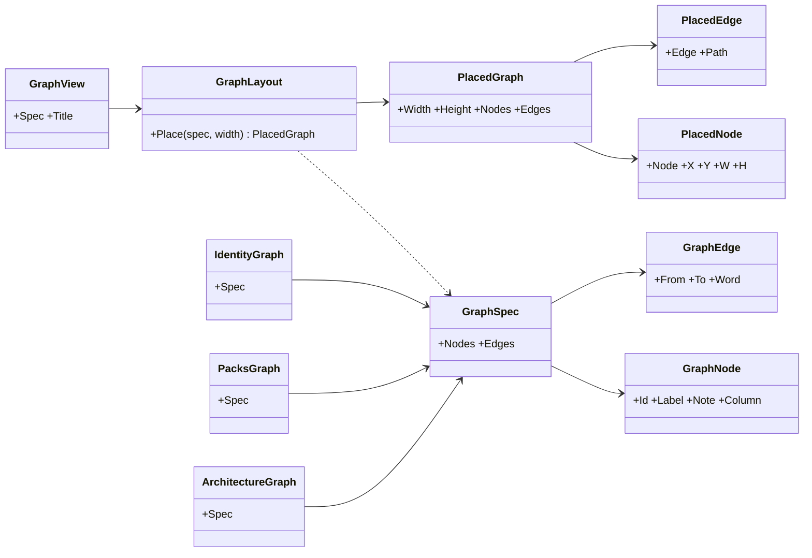
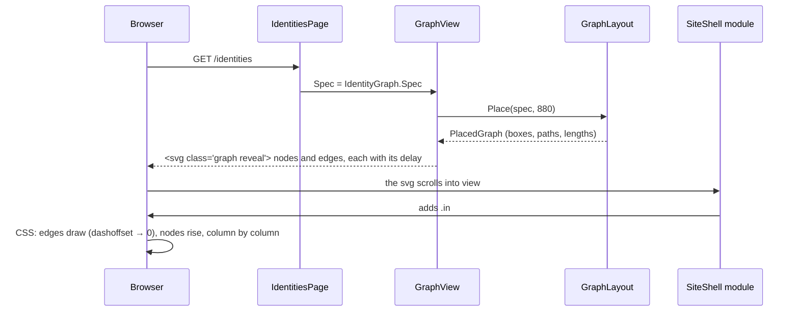
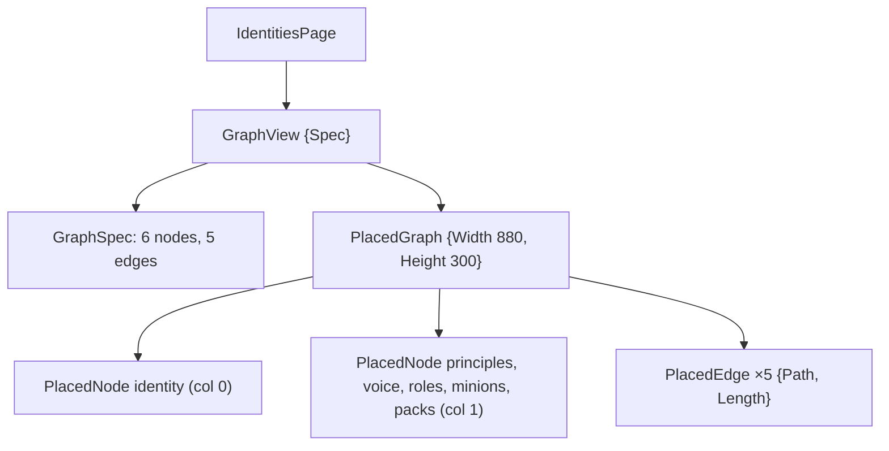

# F111 A diagram on every page

> **Plan.** How every page of the louis-agent site gets an animated diagram of what it explains, drawn by one
> component in the framework's web from data each page declares. Drafted 2026-11-08 on
> `feature/F111-a-diagram-on-every-page`; approved under Louis's "continue unattended" with the recommended pick.

## Context

**What Louis asked (2026-11-08, from the live site):** "where is the fancy diagram?" on the Architecture page, then
"add a nice graph on each page", then "animated graph, not movies": every page that explains a part of the framework
shows that part as a diagram that draws itself as the visitor reaches it, the way the landing's blocks reveal (F110).
The two films stay what they are, on the landing and How it works.

**The pick (recommended, taken under "continue unattended"):** B of three. A: one hand-drawn SVG per page (seven
drawings kept by hand). **B: one `GraphView` component in `louis-agent.web`, fed nodes and edges as data; a page's
diagram is ten lines of data, the layout and the animation are written once, and a test holds the data to the code.**
C: Mermaid rendered in the browser from the docs' diagrams (a 2 MB package, a look that is hard to brand, a fade for
an animation). B because every site built on the framework gets a diagram the same way (ADR 0084), and a diagram that
is data can be held to the repository like the pages' words are (ADR 0100).

**What exists:** the site's pages under `Pages/Site/` with their `reveal` blocks; the frame's module (`SiteShell.razor.js`)
adds `.in` to a `.reveal` as it enters, so a CSS animation keyed on `.in` plays once; the films as CSS-only animation
(ADR 0077); `SitePagesTests` and the architecture tests that hold each page's claims to the solution (ADR 0100).

**Not in this plan:** a diagram editor, a diagram for the chat pages, Mermaid.

## Design

### The shape, in plain words

- **A graph is data.** `GraphSpec(Nodes, Edges)`: a node has an id, a label, an optional note (one line under the
  label), and a column (0, 1, 2…); an edge joins two ids and may carry a word. A page declares its graph as a static
  record in the demo (`IdentityGraph.Spec`), so what the diagram says sits beside what the page says.
- **The layout is a few lines of C#.** `GraphLayout.Place(spec, width)` puts the columns left to right, the nodes of a
  column top to bottom, centred, and returns `PlacedGraph` with every node's box and every edge's path (a cubic curve
  from a node's right edge to the next's left). Pure, tested on its own, no browser.
- **The view draws SVG.** `GraphView` takes a `GraphSpec`, places it, and writes one `<svg>` with a `<g class="node">`
  per node and a `<path class="edge">` per edge; the root carries `graph reveal`. Its styles sit beside it
  (ADR 0094): under `.in`, each edge draws itself (`stroke-dashoffset` from its length to 0) and each node rises, with
  a delay by column, so the diagram unfolds left to right once. Colours read the framework's names.
- **A diagram is held to the code.** Each page's graph has a test in the demo: the Identities graph names the four
  identities the catalogue loads; the Packs graph names every pack project under `packs/tools/`; the Architecture
  graph's columns are the solution's groups; How it works names the pipeline's middleware in its real order (as
  `DetailedMovieTests` does). A page that explains a part and shows no graph fails `SitePagesTests`.

### Interface design



```csharp
// src/web/louis-agent.web/Graphs/ (step 1)
public sealed record GraphSpec(IReadOnlyList<GraphNode> Nodes, IReadOnlyList<GraphEdge> Edges);
public sealed record GraphNode(string Id, string Label, string? Note, int Column);
public sealed record GraphEdge(string From, string To, string? Word = null);
public static class GraphLayout { public static PlacedGraph Place(GraphSpec spec, int width = 880); }
// src/web/louis-agent.web/Graphs/Placed/ (step 1)
public sealed record PlacedGraph(int Width, int Height, IReadOnlyList<PlacedNode> Nodes, IReadOnlyList<PlacedEdge> Edges);
public sealed record PlacedNode(GraphNode Node, double X, double Y, double W, double H);
public sealed record PlacedEdge(GraphEdge Edge, string Path, double Length);
// src/web/louis-agent.web/Components/Graphs/GraphView.razor(.cs,.scss) (step 2)
public partial class GraphView : ComponentBase { [Parameter] public required GraphSpec Spec { get; set; } [Parameter] public string? Title { get; set; } }
// demos/louis-agent/web/louis-agent.code-review/Graphs/Framework/IdentityGraph.cs (step 3) … one static class per page
public static class IdentityGraph { public static GraphSpec Spec { get; } = new([...], [...]); }
```

### Architecture

```mermaid
flowchart LR
    subgraph web["louis-agent.web (framework)"]
        spec["Graphs: GraphSpec, GraphNode, GraphEdge (1)"]
        layout["GraphLayout → PlacedGraph (1)"]
        view["Components/Graphs/GraphView.razor + .scss (2)"]
        shell["SiteShell.razor.js: .reveal → .in (exists)"]
    end
    subgraph demo["louis-agent.code-review (demo)"]
        data["Graphs/*: one Spec per page (3–9)"]
        pages["Pages/Site/*: <GraphView Spec=… /> (3–9)"]
    end
    data --> view
    pages --> view
    view --> layout
    layout --> spec
    shell -. adds .in .-> view
```

### Communication: a visitor reaches the Identities page



### Object diagram (the Identities page in memory)



### Namespace map

| Type | Folder | Namespace | Step |
|---|---|---|---|
| `GraphSpec`, `GraphNode`, `GraphEdge`, `GraphLayout` | `src/web/louis-agent.web/Graphs/` | `LouisAgent.Web.Graphs` | 1 new |
| `PlacedGraph`, `PlacedNode`, `PlacedEdge` | `src/web/louis-agent.web/Graphs/Placed/` | `LouisAgent.Web.Graphs.Placed` | 1 new |
| `GraphView` (`.razor`, `.razor.cs`, `.razor.scss`) | `src/web/louis-agent.web/Components/Graphs/` | `LouisAgent.Web.Components.Graphs` | 2 new |
| `GraphLayoutTests`, `GraphViewTests` (+ `GraphView.html` golden) | `src/tests/web/louis-agent.web.tests/Graphs/`, `Components/Graphs/` | `LouisAgent.Web.Tests.Graphs`, `.Components.Graphs` | 1, 2 new |
| `IdentityGraph`, `PacksGraph`, `ArchitectureGraph`, `TurnGraph`, `ProgramGraph` | `demos/louis-agent/web/louis-agent.code-review/Graphs/Framework/` | `LouisAgent.CodeReview.Graphs.Framework` | 3–7 new |
| `ProofGraph`, `DemosGraph` | `demos/louis-agent/web/louis-agent.code-review/Graphs/` | `LouisAgent.CodeReview.Graphs` | 8, 9 new |
| `*GraphTests` | `demos/louis-agent/tests/louis-agent.code-review.tests/Graphs/` (+ `Framework/`) | `LouisAgent.CodeReview.Tests.Graphs` | 3–9 new |
| `SitePagesTests.EveryExplainingPage_ShowsItsGraph` | `demos/louis-agent/tests/louis-agent.code-review.tests/Pages/Site/` | unchanged | 9 changed |

### Folder trees (after)

```
src/web/louis-agent.web/
├── Graphs/                 GraphSpec, GraphNode, GraphEdge, GraphLayout; Placed/ (PlacedGraph, PlacedNode, PlacedEdge)
└── Components/Graphs/      GraphView.razor, .razor.cs, .razor.scss
demos/louis-agent/web/louis-agent.code-review/
└── Graphs/                 ProofGraph, DemosGraph; Framework/ (IdentityGraph, PacksGraph, ArchitectureGraph, TurnGraph, ProgramGraph)
```

## Steps

Each a commit with its test, seen failing first; the review stop after each (built unattended today, the stops are the
commits). A graph's words follow the site's rules: short labels, no semicolon, held by a test to the code it names.

1. **The data and the layout.** The records and `GraphLayout.Place`: columns left to right, a column's nodes
   centred, boxes 180×56 (taller with a note), edges as cubic paths with their lengths. `GraphLayoutTests`: two
   columns land where expected, an edge's path starts at the right edge and ends at the left, the height fits the
   tallest column.
2. **The view.** `GraphView` draws the SVG; its `.razor.scss` animates under `.in` (edge draw, node rise, delay by
   column) and reads only the framework's colour names. `GraphViewTests`: the golden markup, one `path.edge` per
   edge, one `g.node` per node, the root `graph reveal`, `FixedColourTests` and `ScopedStylesTests` hold.
3. **Identities.** `IdentityGraph`: identity → principles, voice, roles, minions, the packs it names; the page shows it
   under its lede. Test: the graph's labels name what `IdentitiesPage` lists and the four identities in the catalogue.
4. **Packs.** `PacksGraph`: a pack → its toolsets → tools, the engine's guards around them, MCP on the side. Test: every
   pack project under `packs/tools/` is a node.
5. **Architecture.** `ArchitectureGraph`: `src/engine` → `src/hosts`, `src/web`, `src/evals`; `packs/`; `demos/`, as the
   solution file groups them. Test: the columns name every group the solution file has.
6. **How it works.** `TurnGraph`: program → host → engine (the pipeline's middleware in order) → model and tool → ledger.
   Test: the middleware names match `ChatPipeline`'s order, as `DetailedMovieTests` checks.
7. **Build your own.** `ProgramGraph`: your program → the catalogue (identities, packs) → a host → the engine.
8. **Proof.** `ProofGraph`: an eval → a run → its records → a re-score for nothing → the ledger.
9. **Built on it, and the rule.** `DemosGraph`: the framework → Puls, the coding agent, the starter. `SitePagesTests`:
   every page but Contact, What's coming and the landing shows exactly one `.graph`.
10. **Docs.** The web project's design doc (the component and its data), the code-review app's doc (the graphs and
    their tests), the guide's voice names the diagrams (a visitor can be told to look at one), `GuideKnowsTheSiteTests`
    holds; the work log; this plan deleted.

## Verification

- **Per step:** the step's tests; `louis-agent.web.tests` and `louis-agent.code-review.tests` whole at steps 2 and 9;
  `core.tests` at steps 1–3 (new folders and names).
- **In the browser (free):** each page at desktop and at 390 px: the diagram unfolds once as it enters, reads at
  phone width (the SVG scales to its box, `viewBox`), honours reduced motion (no animation, the finished drawing).
- **No paid run.**

## Concepts, and where they sit in GOAL.md

- **Data-driven views** (skill 20, extensibility): the diagram is a record, the drawing a function of it, so a page
  adds a diagram by adding data, and a test can read the data.
- **A claim held to the code** (skill 17, evals as a habit): a diagram that names a part is checked against the
  part's existence, as the pages' words are (ADR 0100).
- **Motion as a one-time reveal** (skill 15, the product surface): CSS keyed on a class the observer adds, the same
  mechanism as the landing's blocks, so motion needs no script of its own.

---
[Docs index](../README.md) · [Plans](README.md)
