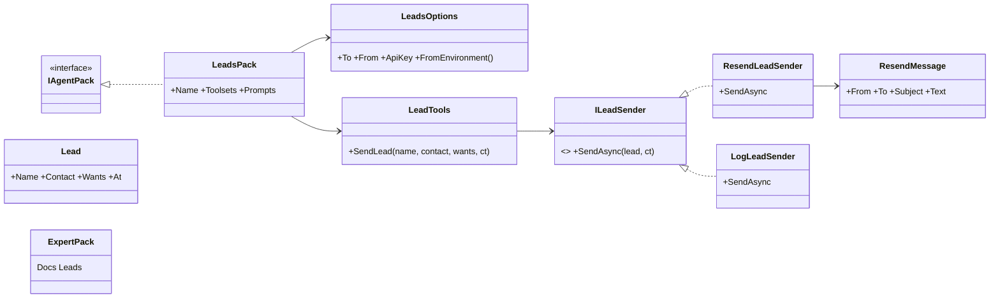
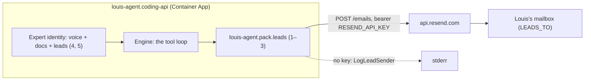
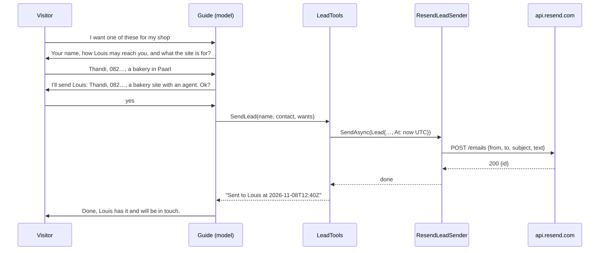
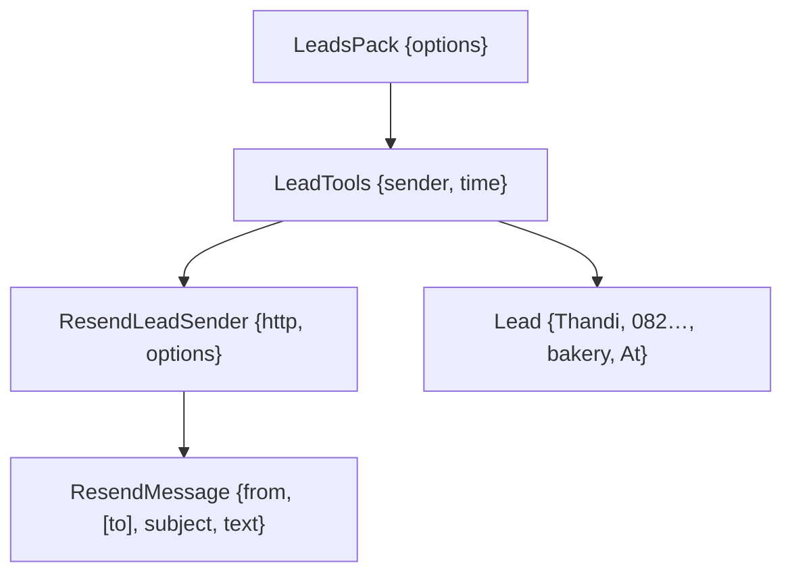

# F112 The guide mails a lead

> **Plan.** How the guide in the site's corner tells Louis when a visitor wants a website with an agent or a custom
> agent: a leads pack with one tool, a sender behind a seam, and the rule in the guide's voice. Drafted 2026-11-08 on
> `feature/F112-the-guide-mails-a-lead`; approved under Louis's "continue unattended" with the recommended pick.

## Context

**What Louis asked (2026-11-08):** "the agent should send me an email, if someone is interested." The guide sells
(FX72): a hosted site with an agent at R500 to R1,000 a month, and custom agents. Today the only way from interest to
Louis is the Contact page's mail links. A tool when it improves the prompt (ADR 0080): the guide gets a tool that
sends Louis the lead, instead of a rule that tells the visitor to go and write a mail.

**The pick (recommended, taken under "continue unattended"):** C of three ways to send. A: Azure Communication
Services Email (a package and an Azure resource). B: SMTP through MailKit (a package and a mailbox password).
**C: Resend's HTTP API with our own `HttpClient`: no package, one JSON call, free to 3,000 mails a month; Louis adds
one DNS record on louis-agent.dev to verify the sender.** C because it adds no package (reuse before building weighs a
package against one HTTP call) and the secret is a key, not a mailbox password.

**What exists:** packs as the shape for a tool (`DocsPack`, `PaymoTools` with its own `HttpClient`), options read by
the composition root (`DocsOptions.FromEnvironment`), `MissingSettings` turning a toolset off, the expert identity
naming its packs as an enum, the voice's *What we sell today* (FX72), the deploy's secrets on Container Apps.

**Not in this plan:** a leads list in the admin, a reply to the visitor, an eval (evals stay off the site today).

## Design

### The shape, in plain words

- **One tool, `SendLead`.** Name, how to reach them (a mail address or a phone number), what they want, in the visitor's
  words. It refuses without a name or a way to reach them, and says so to the model. It returns a plain "sent" with
  the time, so the guide can tell the visitor Louis has it.
- **The sender is a seam.** `ILeadSender` (Strategy, with a Null Object): `ResendLeadSender` posts a JSON record to
  `https://api.resend.com/emails` with the key as a bearer token; `LogLeadSender` writes the lead to the log when no
  key is set, so the PC and the tests send nothing. The pack picks by its options at tool build.
- **Settings.** `LEADS_TO` (Louis's address; without it the toolset is off and the guide has no tool), `LEADS_FROM`
  (the verified sender, `guide@louis-agent.dev`), `RESEND_API_KEY` (in the secrets; without it the log sender).
- **The rule in the voice.** When someone wants a site with an agent or a custom agent, the guide asks for their name,
  how Louis may reach them and a line on what they want, repeats it back, and sends only after they say yes, once; it
  never sends what it was not told, and tells the visitor Louis will be in touch. The expert names the `leads` pack.
- **JSON through records** (ADR 0041): `ResendMessage(From, To, Subject, Text)` is the wire; the lead's body is plain
  text with the three fields and the time in UTC (ADR 0046).

### Interface design



```csharp
// packs/tools/louis-agent.pack.leads
public sealed class LeadsOptions { public const string ToSetting = "LEADS_TO"; public string? To { get; init; } public string From { get; init; } = "guide@louis-agent.dev"; public string? ApiKey { get; init; } public static LeadsOptions FromEnvironment(Func<string, string?>? getVariable = null); }
public sealed class LeadsPack(LeadsOptions options, HttpClient? http = null) : IAgentPack;      // toolset "leads"
public sealed class LeadTools(ILeadSender sender, TimeProvider time) { public Task<string> SendLead(string name, string contact, string wants, CancellationToken ct); }
public interface ILeadSender { Task SendAsync(Lead lead, CancellationToken ct); }               // Strategy
public sealed class ResendLeadSender(HttpClient http, LeadsOptions options) : ILeadSender;        // the real one
public sealed class LogLeadSender(ILogger<LogLeadSender> log) : ILeadSender;                      // Null Object
public sealed record Lead(string Name, string Contact, string Wants, DateTimeOffset At);
public sealed record ResendMessage(string From, string[] To, string Subject, string Text);        // the wire, snake_case options
public enum LeadsToolset { [WireName("leads")] Leads }
public enum LeadsToolMessage { Sent, NoName, NoContact, NoWants, Failed, Logged }
```

### Architecture



### Communication: a visitor is interested



### Object diagram (one send in memory)



### Namespace map

| Type | Folder | Namespace | Step |
|---|---|---|---|
| `LeadsPack`, `LeadsOptions`, `LeadsToolset` | `packs/tools/louis-agent.pack.leads/` | `LouisAgent.Packs.Leads` | 1, 3 new |
| `ILeadSender`, `LogLeadSender`, `ResendLeadSender`, `Lead`, `ResendMessage`, `ResendJson` | `packs/tools/louis-agent.pack.leads/Sending/` | `LouisAgent.Packs.Leads.Sending` | 1, 2 new |
| `LeadTools` | `packs/tools/louis-agent.pack.leads/Tools/` | `LouisAgent.Packs.Leads.Tools` | 1 new |
| `LeadsToolMessage` | `packs/tools/louis-agent.pack.leads/Messages/` | `LouisAgent.Packs.Leads.Messages` | 1 new |
| `Prompts/toolsets/leads.md` | `packs/tools/louis-agent.pack.leads/Prompts/toolsets/` | embedded | 3 new |
| `LeadToolsTests`, `ResendLeadSenderTests`, `LeadsPackTests` | `packs/tests/louis-agent.pack.leads.tests/` | `LouisAgent.Packs.Leads.Tests` | 1–3 new |
| `ExpertPack.Leads`; `voice.md` *When someone is interested* | `demos/louis-agent/identity/louis-agent.identity.expert/` | unchanged | 4 changed |
| `CodingCatalog.Packs(…, leads)` | `demos/louis-agent/hosts/louis-agent.coding-catalog/` | unchanged | 5 changed |
| `LEADS_TO`, `LEADS_FROM`, `RESEND_API_KEY` | `demos/louis-agent/config/.env.example`, `.env.secrets.example`, `deploy/azure/*.yaml` | — | 6 |

## Steps

1. **The tool and the log sender.** The project, `Lead`, `ILeadSender`, `LogLeadSender`, `LeadTools.SendLead` with
   its refusals, `LeadsToolMessage`. Tests: refuses without a name, a contact or a want, each with its message; sends
   a lead with the three fields and the clock's UTC time; the log sender logs the template.
2. **The Resend sender.** `ResendMessage`, `ResendJson` options (snake_case), `ResendLeadSender` posting with the bearer
   key; a failure comes back as text with the status, never a throw into the loop (ADR 0005). Tests with a
   `StubHandler`: the request's address, header and body; a 422 becomes `Failed` with its reason.
3. **The pack.** `LeadsOptions.FromEnvironment`, `LeadsPack`: toolset `leads`, `MissingSettings` names `LEADS_TO`, the
   sender picked by the key, `ToolTypes`, the guide file. Tests: off without `LEADS_TO`, the log sender without a key,
   `PackConvertibilityTests` hold.
4. **The guide knows.** `ExpertPack.Leads`; the voice's *When someone is interested*: ask the three things, repeat
   back, send on yes, once, and tell them. `GuideKnowsTheSiteTests` keeps holding; a voice test holds the rule's words.
5. **The catalogue loads it.** `CodingCatalog.Packs(…, LeadsOptions)` and `Create()`; the goldens regenerated and their
   diff reviewed (the new tool's description and the voice).
6. **Settings and deploy.** `.env.example` (`LEADS_TO`, `LEADS_FROM`), `.env.secrets.example` (`RESEND_API_KEY`), the
   site's Container App yaml with the three (the key by secretRef), the deploy README's line for Louis: the DNS record
   Resend gives for `louis-agent.dev` and the key into the app's secrets.
7. **Docs and the plan goes.** The pack's design doc under `packs/docs/projects/`, the expert's doc, ADR *A lead is a
   tool, sent once on the visitor's yes*, the work log, this plan deleted.

## Verification

- **Per step:** the step's tests; `core.tests` at step 1 (a new project); the pack's tests whole at step 3.
- **Free, by hand:** on the PC with `LEADS_TO` set and no key, ask the guide for a site, give the three things, say yes:
  the lead is in the log and the guide says Louis has it. (Spends the guide's model: ask first, or run through the
  recorded fixture.)
- **Live, once Louis has added the DNS record and the key:** one real lead from the site to his mailbox. Needs his go.

## Concepts, and where they sit in GOAL.md

- **A tool for a side effect, with consent in the prompt** (skill 3, tools and function calling; skill 15, safety): the
  tool does one thing and refuses incomplete input; the voice holds when it may be called.
- **Strategy with a Null Object behind a seam** (skill 20, extensibility): the real sender and the log sender share
  one interface, picked by configuration, so the PC and the tests never send.
- **JSON through records** (ADR 0041) and **a pack that names no identity** (ADR 0027).

---
[Docs index](../README.md) · [Plans](README.md)
