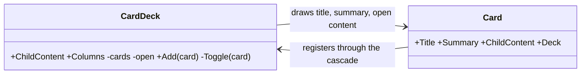
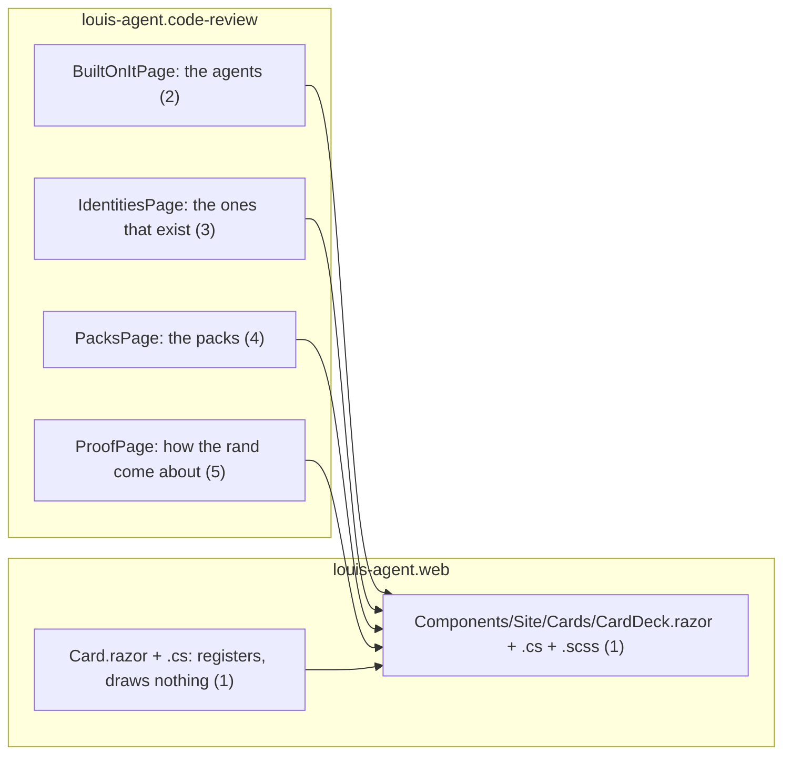
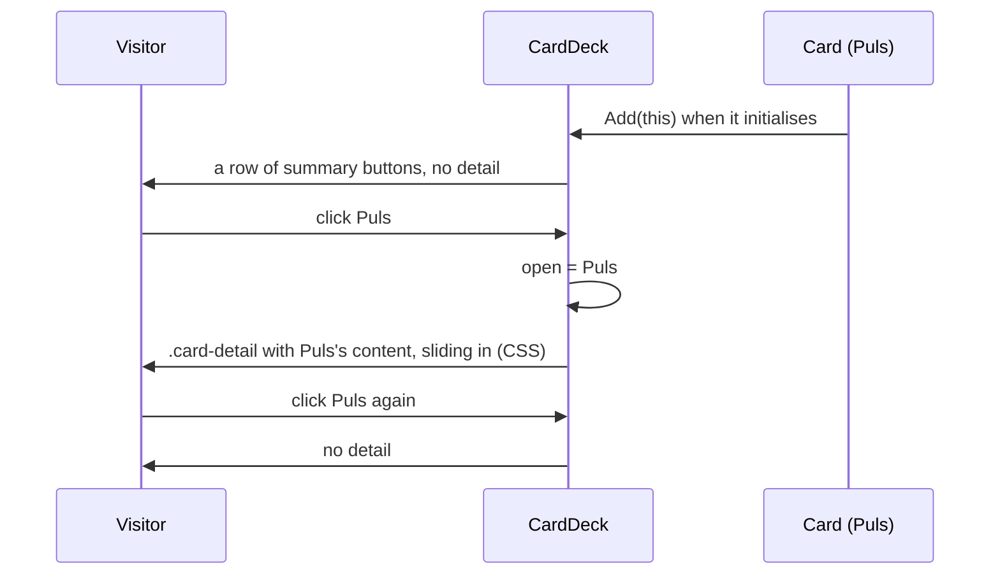
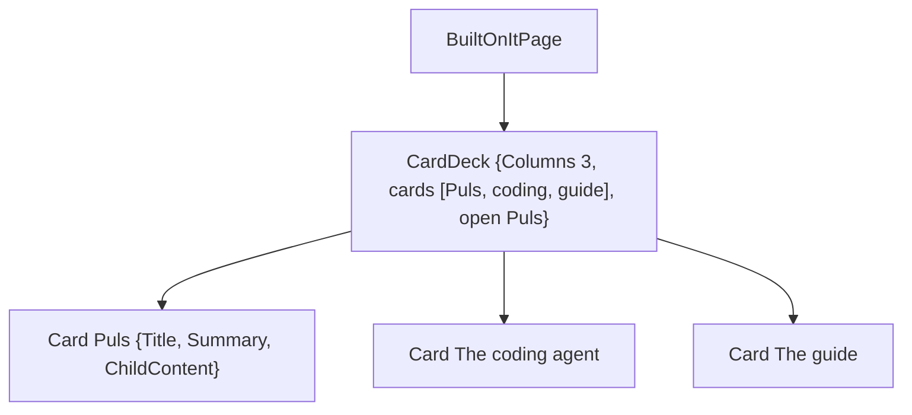

# F113 Cards that open

> **Plan.** How a grid of panels with a summary and a longer story each becomes a row of short cards that open, on a
> click, one detail that slides in under the row; one framework component, used wherever the pattern fits on the
> louis-agent site. Drafted 2026-11-08 on `feature/F113-cards-that-open`; approved under Louis's "continue
> unattended".

## Context

**What Louis asked (2026-11-08, on the Built-on-it page):** "make the card a short summary, and clickable with the
detail sliding in at the bottom when clicked", then "do it everywhere the pattern fits". The pattern fits where a
grid holds panels that each carry a title, a one-line summary and a longer story: the agents on Built on it, the
identities that exist, the packs, and how the rand come about on Proof. It does not fit a list of one-liners (the
rules, the architecture families) or a panel that is already short (the concepts, the custom-agents band).

**The shape (the one taken, no package):** a `CardDeck` that draws its `Card`s as summary buttons in a row and, under
the row, the open card's content, with a slide-in; the cards register with the deck through a cascading value, the
way a tab set's tabs do (Blazor's own pattern). CSS does the motion; no script. Every site can use it (ADR 0084).

**What exists:** the site's `.panel` grid, the frame's reveal (`SiteShell.razor.js` adds `.in`), `SiteMenu` as the
newest frame component with its styles beside it (FX73), the pages' word tests (ADR 0100).

## Design

### Interface design



```csharp
// src/web/louis-agent.web/Components/Site/Cards/ (step 1)
public partial class CardDeck { [Parameter] public RenderFragment? ChildContent { get; set; } [Parameter] public int Columns { get; set; } = 3; internal void Add(Card card); }
public partial class Card { [CascadingParameter] public CardDeck Deck { get; set; } [Parameter, EditorRequired] public string Title { get; set; } [Parameter] public string? Summary { get; set; } [Parameter] public RenderFragment? ChildContent { get; set; } }
```

### Architecture



### Communication: a visitor clicks a card



### Object diagram (Built on it, Puls open)



### Namespace map

| Type | Folder | Namespace | Step |
|---|---|---|---|
| `CardDeck` (`.razor`, `.razor.cs`, `.razor.scss`), `Card` (`.razor`, `.razor.cs`) | `src/web/louis-agent.web/Components/Site/Cards/` | `LouisAgent.Web.Components.Site.Cards` | 1 new |
| `CardDeckTests` (+ `CardDeck.html`) | `src/tests/web/louis-agent.web.tests/Components/Site/` | `LouisAgent.Web.Tests.Components.Site` | 1 new |
| `BuiltOnItPage`, `IdentitiesPage`, `PacksPage`, `ProofPage` | `demos/louis-agent/web/louis-agent.code-review/Pages/Site/…` | unchanged | 2–5 changed |
| `SitePagesTests` cases | `demos/louis-agent/tests/louis-agent.code-review.tests/Pages/Site/` | unchanged | 2–5 changed |

## Steps

1. **The deck and the card.** `CardDeck` draws a row of summary buttons and, under it, the open card's content with a
   slide-in; `Card` registers through the cascade and draws nothing. Tests: two cards give two summaries and no
   detail; a click opens the detail with that card's content; a second click closes it; the other card swaps it in;
   the golden; `ScopedStylesTests` and `FixedColourTests` hold.
2. **Built on it.** The three agents as cards: a one-line summary each, the story as the detail. The page's words
   test keeps the titles visible; the detail's words are tested open.
3. **Identities.** The ones that exist as cards, the project name in the detail.
4. **Packs.** The general tools and the cook's packs as cards, the pack's name the title, one line the summary, the
   rest the detail; `PacksPageTests` (every pack folder is named) keeps holding on the titles.
5. **Proof.** How the rand come about and how it is checked as cards.
6. **Docs.** The web doc's component, the site doc's pages, the work log; this plan deleted.

## Verification

- Per step: the step's tests; `louis-agent.web.tests` whole at step 1, `louis-agent.code-review.tests` whole at step 5.
- In the browser, from the deploy: a card opens with the slide, the row stays one line on a desktop and stacks on a
  phone, the keyboard opens a card (a button), reduced motion gets no slide.

## Concepts, and where they sit in GOAL.md

- **Parent and children through a cascade** (skill 20, extensibility): the tab-set pattern, children declare, the
  parent draws, so a page writes content and never state.
- **Progressive disclosure** (skill 15, the product surface): a summary first, the story on request, the same rule
  the guide's voice follows (FX77).

---
[Docs index](../README.md) · [Plans](README.md)
