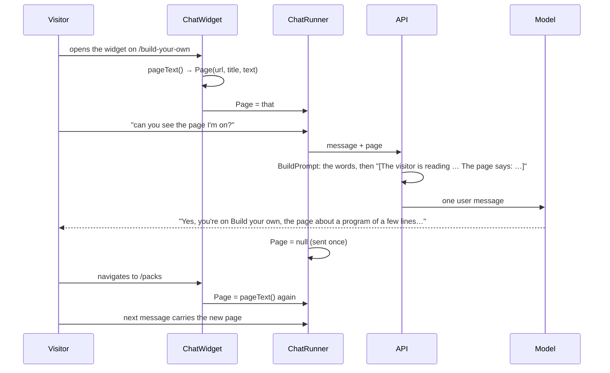

# F115: The guide knows the page

> **Plan.** The guide in the site's corner gets the page the visitor is reading, so it can answer about what they see.
> Approved 2026-11-08 (Louis: "the agent should know which page im on", "it should be able to read what i read and
> see", "then start 115"; option B of three). On `feature/F115-the-guide-knows-the-page`; deleted when the work is
> merged, its lasting parts in the web and API design docs and in ADR 0104.

## Context

A visitor on Build your own asked the guide "can you see the page I'm on?" and it could not: a message carries the
visitor's words and their attached files, nothing about where they are. The guide answers from the docs it searches,
which describe the framework, not the page in front of the visitor. Three ways were weighed: **A** the widget sends the
page's address and the guide gets a tool that reads that page's text from the site (precise, but a new tool, and the
site's pages aren't in its docs); **B** the widget sends what the visitor sees, the page's visible text, capped, with
the first message and again after they move to another page (literally what they read, no new tool, a few thousand
tokens once per page); **C** every page declares a hand-written line of context (cheapest, one more thing to keep
true on every page). Louis picked B.

## Design

**In plain words.** A message to the API may carry a *page*: its address, its title and its visible text, at most
6,000 characters. The API's prompt builder already turns attached files into blocks after the visitor's words; the
page becomes one more such block, so the engine sees one user message and nothing in its history rules changes
(ADR 0008). On the web, the runner holds the page to send with its next message, and the widget sets it when a chat
opens and whenever the route changes, reading the page's main text through a small script beside the widget. The
guide's voice learns that a message may carry the page and that it is what the visitor sees right now.

```mermaid
classDiagram
    direction LR
    class ChatWidget { +OnLocationChanged() sets Runner.Page }
    class ChatWidgetModule { pageText(): {url, title, text} }
    class ChatRunner { +Page : Page? +SendAsync() }
    class Page { +Url +Title +Text }
    class AgentApi { +StreamMessageAsync(sessionId, message, attachments, page) }
    class MessageBody { +Message +Attachments +Page }
    class SendMessageRequest { +Message +Attachments +Page }
    class PageRequest { +Url +Title +Text }
    class TurnStream { +BuildPrompt(request) : adds the page block }
    class ApiModelText { Page, PageTruncated }
    ChatWidget --> ChatWidgetModule
    ChatWidget --> ChatRunner
    ChatRunner --> Page
    ChatRunner --> AgentApi
    AgentApi --> MessageBody
    MessageBody ..> SendMessageRequest : the wire
    SendMessageRequest --> PageRequest
    TurnStream --> SendMessageRequest
    TurnStream --> ApiModelText
```

```csharp
// src/web/louis-agent.web/Chats/Page.cs (new)
public sealed record Page(string Url, string Title, string Text);
// src/web/louis-agent.web/Api/SessionBodies.cs (changed)
public sealed record MessageBody(string Message, IEnumerable<Attachment> Attachments, Page? Page);
// src/web/louis-agent.web/Api/AgentApi.cs (changed)
public IAsyncEnumerable<SessionEvent> StreamMessageAsync(string sessionId, string message, IReadOnlyList<Attachment> attachments, Page? page, CancellationToken ct = default);
// src/web/louis-agent.web/Chats/ChatRunner.cs (changed): the page to send with the next message, cleared once sent
public Page? Page { get; set; }
// src/hosts/louis-agent.api/Sessions/Requests (changed, new)
internal sealed record SendMessageRequest(string? Message, List<AttachmentRequest>? Attachments, PageRequest? Page);
internal sealed record PageRequest(string? Url, string? Title, string? Text);
// src/hosts/louis-agent.api/Messages/ApiModelText.cs (changed)
[Description("[The visitor is reading {Url} ({Title}). The page says:\n{Text}]")] Page,
[Description("\n[Page truncated: showing {Shown} of {Length} chars]")] PageTruncated,
```

```mermaid
flowchart LR
    page["The page (DOM)"] -->|pageText()| module["ChatWidget.razor.js"]
    module --> widget["ChatWidget: on open and on LocationChanged"]
    widget -->|Runner.Page = …| runner["ChatRunner"]
    runner -->|StreamMessageAsync(…, page)| api["AgentApi → POST /v1/sessions/{id}/messages"]
    api --> handler["SessionHandlers.SendMessage"]
    handler --> build["TurnStream.BuildPrompt: words, attachments, the page block"]
    build --> engine["the engine: one user message, as before"]
```



| Type | Folder | Namespace | Step |
|---|---|---|---|
| `PageRequest` | `src/hosts/louis-agent.api/Sessions/Requests/` | `LouisAgent.Api.Sessions.Requests` | 1 new |
| `SendMessageRequest` (+ `Page`) | same | same | 1 changed |
| `ApiModelText.Page`, `.PageTruncated` | `src/hosts/louis-agent.api/Messages/` | `LouisAgent.Api.Messages` | 1 changed |
| `TurnStream.BuildPrompt` | `src/hosts/louis-agent.api/Sessions/` | `LouisAgent.Api.Sessions` | 1 changed |
| `TurnStreamPromptTests` | `demos/puls/tests/louis-agent.api.tests/Sessions/` | `LouisAgent.Api.Tests.Sessions` | 1 new |
| `Page` | `src/web/louis-agent.web/Chats/` | `LouisAgent.Web.Chats` | 2 new |
| `MessageBody` (+ `Page`), `AgentApi.StreamMessageAsync` | `src/web/louis-agent.web/Api/` | `LouisAgent.Web.Api` | 2 changed |
| `ChatRunner.Page` | `src/web/louis-agent.web/Chats/` | `LouisAgent.Web.Chats` | 2 changed |
| `ChatWidget.razor.js` (`pageText`), `ChatWidget.razor.cs` (the module, `LocationChanged`) | `src/web/louis-agent.web/Components/Widget/` | `LouisAgent.Web.Components.Widget` | 3 new, changed |
| `ChatRunnerTests` (the body carries the page once), `ChatWidgetTests` (on open, on a route change, not on the next message) | `src/tests/web/louis-agent.web.tests/Chats/`, `Components/Widget/` | `LouisAgent.Web.Tests.…` | 2, 3 |
| `voice.md` of the expert | `demos/louis-agent/identity/louis-agent.identity.expert/Prompts/agent/louis-agent-expert/` | — | 4 |
| ADR 0104, the web and API design docs, the work log | `src/docs/` | — | 5 |

## Steps

1. **The API takes a page with a message.** `PageRequest`, the field on `SendMessageRequest`, the two texts, the
   block in `BuildPrompt` after the words and the attachments, cut at 6,000 characters with the truncation note.
   Test first: a request with a page yields the block, a long text is cut and says so, no page yields the old prompt.
2. **The web sends it.** `Page`, the field on `MessageBody`, the parameter on `StreamMessageAsync`, `ChatRunner.Page`
   sent with the next message and cleared. Test first in `ChatRunnerTests`: the posted body carries the page once.
3. **The widget knows where the visitor is.** `ChatWidget.razor.js` with `pageText()` (the `main` element's text, else
   the body's, trimmed), loaded as a module; the widget sets `Runner.Page` when it opens and on
   `NavigationManager.LocationChanged`. Test first with bUnit's JS interop: on open the runner has the page, after a
   route change again, after a send not. Checked locally in Chrome: ask the guide which page you're on.
4. **The guide knows.** One rule in its voice: a message may carry the page the visitor is reading, the thing they see
   right now, used to answer about it, named only when that helps.
5. **Docs.** ADR 0104 *A message may carry the page* (why a block in the user's message and not a tool or a system
   line), the web and API design docs, the work log's row, this plan deleted.

## Done when

On louis-agent.dev the guide, asked "which page am I on?", names the page and answers about its content, on the first
message and after moving to another page, and a second message on the same page carries no page again. Every step has
its test, no history rule changes, the engine is untouched.
