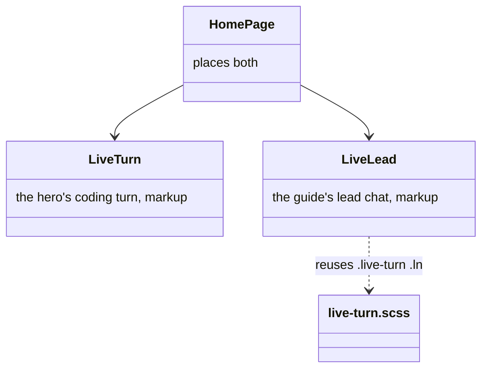
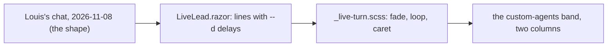
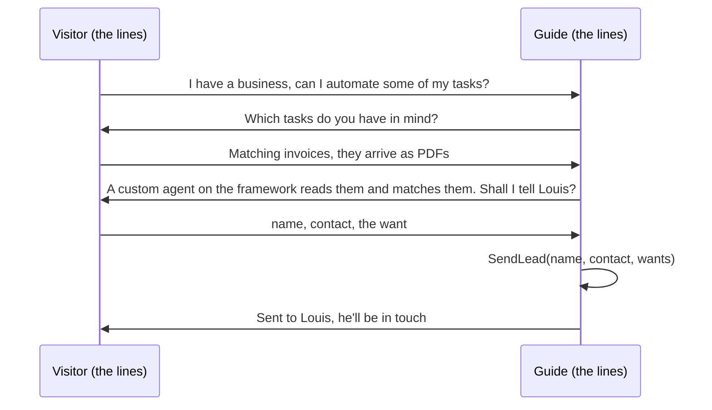

# F116: The guide's chat on the landing

> **Plan.** A simulated conversation between a visitor and the guide, ending in a lead sent to Louis, animated on
> the landing like the hero's live turn. Approved 2026-11-08 (Louis: "look at my last chat I had, can you simulate
> something similar and add it to the website"). On `feature/F116-the-guides-chat-on-the-landing`; deleted when the
> work is merged, its lasting parts in the site's design doc.

## Context

Louis's own chat with the guide on 2026-11-08, read from the widget's store: a business owner asks whether tasks can
be automated, names invoice matching, says the invoices are PDFs, the guide searches the docs twice, explains a
custom agent in plain words, then takes a name, a number and a one-line want, repeats them back, and on "go" sends
the lead with `SendLead` ("Sent to Louis"). That is the sale in one screen, and nothing on the site shows it. The
hero already shows a coding turn as an animated panel (`LiveTurn`, F109/F110); the custom-agents band on the landing
tells what Louis builds in three tiles and a note.

## Design

**In plain words.** A second animated panel, `LiveLead`, beside the custom-agents band's tiles: the visitor's lines
and the guide's answers fade in one after another on the hero's own styles (`.live-turn`, `.ln`), a tool line shows
`SendLead` with the three fields, and the last line says the lead reached Louis. The details are made up (a name, a
mail address at example.co.za), the shape is Louis's chat. Markup only, no code-behind: the lines are content, the
motion is the existing CSS (ADR 0034: a `.razor` holds markup). The band's grid becomes two columns at desktop width:
the three tiles stacked on the left, the panel on the right, and one column on a phone.

| Type | Folder | Namespace | Step |
|---|---|---|---|
| `LiveLead.razor` | `demos/louis-agent/web/louis-agent.code-review/Components/Landing/` | `LouisAgent.CodeReview.Components.Landing` | 1 new |
| `HomePage.razor` (the band's grid) | `.../Pages/Site/` | `LouisAgent.CodeReview.Pages.Site` | 1 changed |
| `_sections.scss` (the band's two columns) | `.../Styles/site/landing/` | — | 1 changed |
| `LiveLeadTests` | `demos/louis-agent/tests/louis-agent.code-review.tests/Components/Landing/` | `LouisAgent.CodeReview.Tests.Components.Landing` | 1 new |

## Steps

1. **The panel and its place.** `LiveLead.razor`, the band's two columns, a bUnit test that the panel's lines come in
   order, name the tool and end with the lead reaching Louis, with no real contact detail in them. Checked locally in
   Chrome at desktop and phone width.
2. **Docs.** The site's design doc names the panel beside `LiveTurn`; the work log's row; this plan deleted.

## Done when

The landing shows the guide's chat animating beside the custom-agents tiles, on the Docker copy and the live site,
with made-up details and the same motion as the hero's turn.
