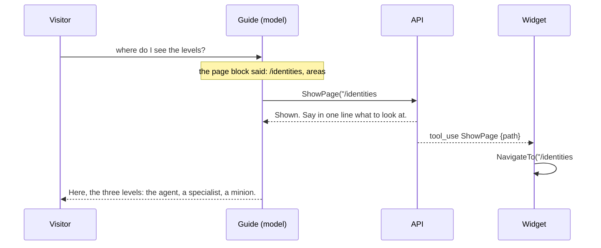

# F117: The guide takes you to a page, and to a part of it

> **Plan.** The guide in the site's corner can open a page of the site for the visitor, and scroll to an area of it,
> instead of pointing. Approved 2026-11-08 (Louis: "I want this agent to take you to a page", "A we do it now", "he
> should be able to direct you to a certain part of the page also, location on the page, so all pages must have
> areas", "can we also give it the capability to highlight areas on the page?"). On `feature/F117-the-guide-takes-you-to-a-page`; deleted when the work is merged, its lasting parts in
> ADR 0105 and the packs, web, site and identity docs.

## Context

The guide ends an answer with "I can point you to the right page", and since F115 it knows the page the visitor is
on. It cannot change it, nor say "look at the diagram just below": an answer carries words, and the visitor has to
find the menu and scroll. Three ways were weighed: **A** a tool, `ShowPage`, that the API validates and the widget
acts on by navigating the browser and scrolling to the area (a tool when it improves the prompt, ADR 0080); **B** a
link in the answer the visitor clicks (points, doesn't take); **C** a marker in the text the widget parses (a hidden
protocol in prose, against arguments as data, ADR 0004). Louis picked A, and asked for areas: every page is made of
named areas the guide can send the visitor to.

## Design

**In plain words.** Three parts.

- **Every page has areas.** A page of the site is a column of sections, each with a kicker and a heading. Every
  section gets an id, in words (`#rule`, `#diagram`, `#parts`, `#contact`), and a site test holds that no section on
  any page is without one. The landing's section index already works this way; the other pages join it.
- **The guide knows the areas.** F115 sends the page the visitor is reading; the page block now also lists the
  page's areas, each as its id and its heading, read by the widget's module from the sections. So the guide knows
  that Identities has `#parts`, `#levels` and `#principles` before it decides where to send anyone.
- **The guide takes them there.** A new pack, `site`, with one tool: `ShowPage(path)`. The path is a page of this
  site, with an area after `#` when there is one (`/identities#levels`); the tool refuses anything else (another
  host, a scheme, `..`) with a plain reason and answers that the page is shown. The web already folds every tool call
  into the chat; the runner tells its listeners when a tool call arrives, and the widget, on `ShowPage`, navigates
  to the path and, once the page has rendered, scrolls the area into view through its module and lights it up: the
  module puts a class on the section for a few seconds, and the framework's web styles it as a soft glow that fades,
  which a site may restyle. The guide's identity
  names the pack, and its voice says: when the right page or area exists, take them there and say in one line what
  to look at.

```mermaid
classDiagram
    direction LR
    class SitePack { +Name "site" +Toolsets +Prompts }
    class SiteTools { +ShowPage(path) : string }
    class SiteToolMessage { Shown, NotASitePage }
    class ExpertPack { Docs, Leads, Site }
    class ChatWidgetModule { pageText(): {url, title, text, areas} showArea(id): scroll + glow }
    class Page { +Url +Title +Text +Areas }
    class PageRequest { +Url +Title +Text +Areas }
    class ChatRunner { +event ToolCalled(Block) }
    class ChatWidget { OnToolCalled: ShowPage → NavigateTo, showArea }
    SitePack --> SiteTools
    SiteTools --> SiteToolMessage
    ExpertPack ..> SitePack : names, never references
    ChatWidget --> ChatWidgetModule
    ChatWidget --> Page
    Page ..> PageRequest : the wire
    ChatRunner --> ChatWidget : ToolCalled
```

```csharp
// packs/tools/louis-agent.pack.site (new)
public enum SiteToolset { [WireName("site")] Site }
public sealed class SitePack : IAgentPack;                       // one toolset, the guide file toolsets/site.md
public sealed class SiteTools { public string ShowPage(string path); }   // "/identities#levels"
public enum SiteToolMessage { Shown, NotASitePage }
// src/web/louis-agent.web/Chats (changed)
public sealed record Page(string Url, string Title, string Text, IReadOnlyList<PageArea> Areas);
public sealed record PageArea(string Id, string Heading);
public event Action<Block>? ToolCalled;                          // ChatRunner, once per tool call as it arrives
// src/hosts/louis-agent.api/Sessions/Requests (changed)
internal sealed record PageRequest(string? Url, string? Title, string? Text, List<PageAreaRequest>? Areas);
// ApiModelText.Page gains "Its areas: {Areas}" (id and heading, one a line)
// ChatWidget.razor.js: pageText() also returns areas from section[id]; showArea(id) scrolls it into view and
// gives it the class area-shown for four seconds; web/styles: .area-shown, a glow that fades (a site may restyle)
// demos/louis-agent/identity/louis-agent.identity.expert/ExpertIdentity.cs: ExpertPack { Docs, Leads, Site }
```

```mermaid
flowchart LR
    sections["every page: section#id + heading"] -->|pageText(): areas| widget["ChatWidget"]
    widget -->|F115 block + areas| model["the model"]
    model -->|ShowPage('/identities#levels')| api["the API: a site path? → Shown"]
    api -->|tool_use in the stream| runner["ChatRunner: ToolCalled"]
    runner --> widget
    widget -->|NavigateTo, then showArea| browser["the browser: the page, scrolled to the area, the area aglow"]
```



| Type | Folder | Namespace | Step |
|---|---|---|---|
| Section ids on every site page, `SitePagesTests.EverySection_HasAnArea` | `demos/louis-agent/web/louis-agent.code-review/Pages/Site/`, its tests | `LouisAgent.CodeReview.Pages.Site` | 1 changed |
| `PageArea`, `Page.Areas`; `PageAreaRequest`, `PageRequest.Areas`; `ApiModelText.Page` | web `Chats/`, api `Sessions/Requests/`, `Messages/` | `LouisAgent.Web.Chats`, `LouisAgent.Api.…` | 2 changed |
| `ChatWidget.razor.js` (`pageText` with areas, `showArea`), `.area-shown` in the web's styles | `src/web/louis-agent.web/Components/Widget/`, `Styles/web/` | — | 2, 4 changed |
| `SitePack`, `SiteToolset`, `SiteTools`, `SiteToolMessage`, `toolsets/site.md` | `packs/tools/louis-agent.pack.site/` | `LouisAgent.Packs.Site`, `.Tools`, `.Messages` | 3 new |
| `SitePackTests`, `SiteToolsTests` | `packs/tests/louis-agent.pack.site.tests/` | `LouisAgent.Packs.Site.Tests` | 3 new |
| `ChatRunner.ToolCalled`, `ChatWidget.OnToolCalled` | web `Chats/`, `Components/Widget/` | `LouisAgent.Web.…` | 4 changed |
| `ExpertPack.Site`, `CodingCatalog.Packs(+ site)`, the goldens, `voice.md`, the Build-your-own listing | identity, catalogue, its tests, the site | — | 5 changed |
| ADR 0105, `packs/docs/projects/louis-agent.pack.site.md`, the web, site and identity docs, the work log | docs | — | 6 |

## Steps

1. **Every page has areas.** An id on every section of every site page, in words; the site test holds it. Test first.
2. **The guide knows the areas.** The module lists the page's sections (id, heading); `Page` and the API's
   `PageRequest` carry them; the page block ends with "Its areas:" and the list. Tests first on the block and the body.
3. **The pack.** `SitePack`, `SiteTools.ShowPage` accepting a site path with an optional area and refusing the rest
   with a reason, the two texts, the guide file. Tests first: the shape, a good path, a bad one, a path with an area.
4. **The widget acts.** `ChatRunner.ToolCalled` once per tool call; the widget navigates on `ShowPage` and, once
   rendered, scrolls to the area and lights it up through `showArea` (the class for four seconds, the glow in the
   web's styles). Tests first: the runner raises once, the fake navigation ends on the path, the module is asked for
   the area; a stream without the call leaves both alone.
5. **The guide gets it.** `ExpertPack.Site`, the catalogue's list and its golden files, the site's listing, the voice's
   rule: when the right page or area exists, take them there and say in one line what to look at.
6. **Docs.** ADR 0105 *The guide acts on the page through a tool the widget hears*, the pack's doc, the web, site and
   identity docs, the work log's row, this plan deleted. Checked live: "take me to the levels".

## Done when

On louis-agent.dev a visitor who asks the guide to show them something lands on that page, scrolled to the area with
the area aglow for a moment, the guide says one line about it, and the next message is about the new page. Every page's sections have ids, every
step has its test, the pack references the composition only, the engine is untouched.
