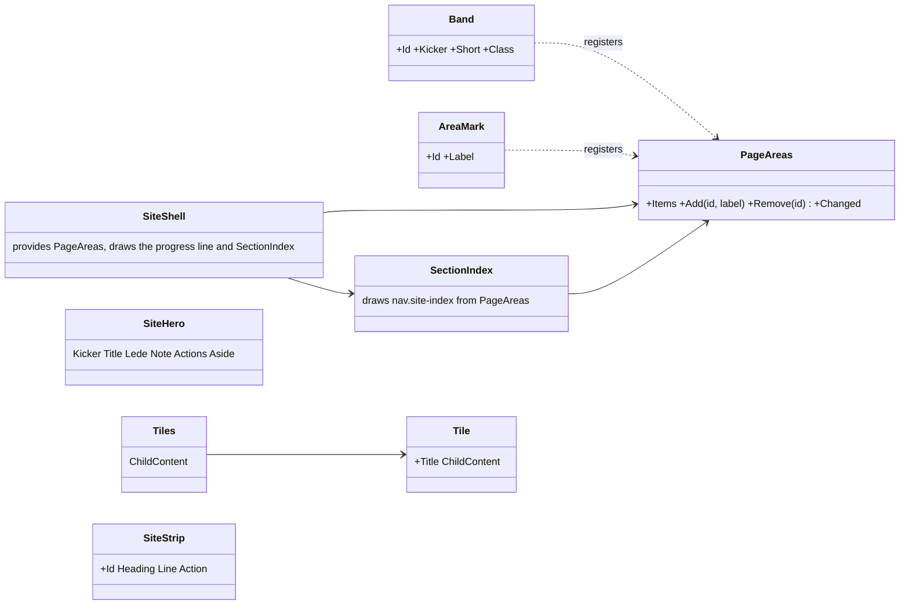
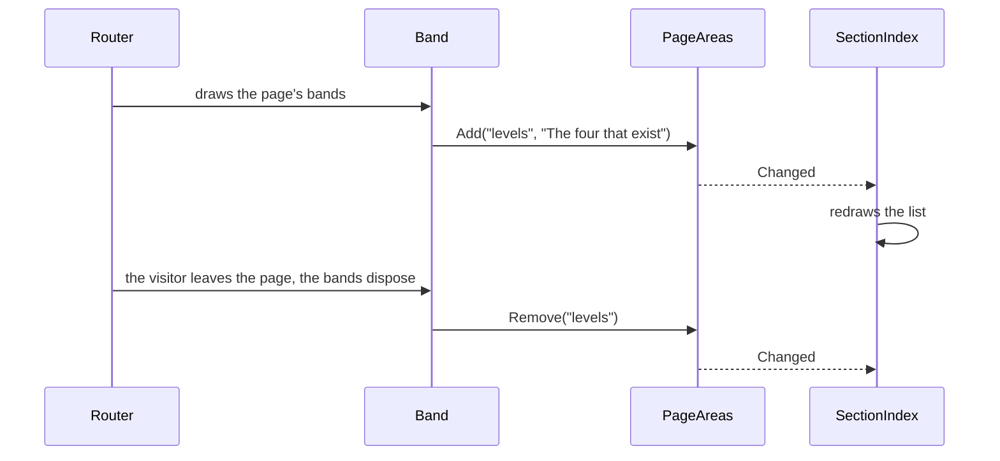

# F118: The landing from the framework's parts

> **Plan.** The section index on every page, built from the bands, the hero, the tiles and the strip as framework
> components, and the guide's scroll to an area made prominent and elegant. Approved 2026-11-08 (Louis: "we should
> also have the sections in the left like on the landing page", "start f118 and finish but make the animation of
> scrolling to a part more prominent and elegant"). On `feature/F118-the-landing-from-the-frameworks-parts`; deleted
> when the work is merged, its lasting parts in ADR 0106 and the web and site docs.

## Context

ADR 0106 made the landing the template of the product, a business's public website built from the framework, and
F117 made every area a framework `Band`. Two things still belong to the site by hand: the section index on the
landing's left is a list the page writes itself, so the other pages have none (Louis's screenshot of Proof), and the
hero, the tile rows and the contact strip are the site's own markup, so a second site would copy them. And the
guide's jump to an area (F117) scrolls and glows a little; Louis wants it to be seen.

## Design

**In plain words.**

- **The index comes from the bands.** The frame keeps a list of the page's areas; every band puts itself on it as it
  draws and takes itself off as it goes, so the list is always the page in view. The frame draws the index from that
  list on the left of every page, with the progress line at the top, and marks the area in view as it does today.
  A band may give a short label for the index (`Short="Measured"` under the kicker "Measured, not assumed"); the hero
  marks its place in the list with a one-line `AreaMark`. The index's and the line's styles move into the framework
  with the components that draw them.
- **The hero, the tiles and the strip are framework components.** `SiteHero` with slots (kicker, title, lede, note,
  actions, aside), `Tiles` with `Tile` children (a row of panels that reveal one after another), `SiteStrip` (a
  closing call: heading, line, button). The site keeps its words and hands them in; the components' own styles move
  beside them.
- **The jump to an area is a spotlight.** When the guide takes a visitor to an area, the page scrolls so the area
  lands under the header, the rest of the page dims for a moment and the area is ringed in the accent, then both fade
  over a few seconds. One overlay element the widget's module places over the area, styled by the web; a visitor who
  asked for less motion gets the dim and the ring without the fade.



```csharp
// src/web/louis-agent.web/Components/Site/Bands/ (changed, new)
public sealed class PageAreas { public IReadOnlyList<PageArea> Items; public event Action? Changed; public void Add(string id, string label); public void Remove(string id); }
public sealed record PageArea(string Id, string Label);
public partial class Band { [CascadingParameter] PageAreas? Areas; [Parameter] string? Short; }   // registers Short ?? Kicker ?? Id
public partial class AreaMark { [Parameter, EditorRequired] string Id; [Parameter, EditorRequired] string Label; }
public partial class SectionIndex { [CascadingParameter] PageAreas Areas; }                  // <nav class="site-index"><a href="#id">label</a>…</nav>
// src/web/louis-agent.web/Components/Site/SiteShell (changed): <CascadingValue Value="_areas"> … <div class="site-progress" id="site-progress"/> <SectionIndex/>
// src/web/louis-agent.web/Components/Site/Hero/SiteHero, Tiles/Tiles, Tiles/Tile, Strip/SiteStrip (new, markup + slots)
// src/web/louis-agent.web/Components/Widget/ChatWidget.razor.js (changed): showArea places .area-spotlight over the area, scrolls under the header
```

```mermaid
flowchart LR
    band["Band / AreaMark draws"] -->|Add(id, label)| areas["PageAreas (the frame's)"]
    areas -->|Changed| index["SectionIndex: nav.site-index"]
    index -->|click| js["SiteShell.razor.js: goTo, spy"]
    guide["ShowPage call"] --> widget["ChatWidget: NavigateTo + showArea"]
    widget --> spot["spotlight overlay + ring, scroll under the header"]
```



| Type | Folder | Namespace | Step |
|---|---|---|---|
| `PageAreas`, `PageArea`, `AreaMark`, `SectionIndex` (+ `.razor.scss`), `Band.Short` | `src/web/louis-agent.web/Components/Site/Bands/` | `LouisAgent.Web.Components.Site.Bands` | 1 new, changed |
| `SiteShell` (the cascade, the progress line, the index; its styles) | `src/web/louis-agent.web/Components/Site/` | `LouisAgent.Web.Components.Site` | 1 changed |
| `HomePage` (the hand-written index and line go), `Hero` (`AreaMark`), `ProofTiles` (`Short`) | the site | — | 1 changed |
| `ChatWidget.razor.js` (`showArea`), `.area-spotlight` in the web's base styles | `src/web/louis-agent.web/Components/Widget/`, `Styles/web/base/` | — | 2 changed |
| `SiteHero` (+ `.razor.scss` from the site's `_hero.scss`) | `src/web/louis-agent.web/Components/Site/Hero/` | `LouisAgent.Web.Components.Site.Hero` | 3 new |
| `Tiles`, `Tile`, `SiteStrip` (+ styles from the site's partials) | `src/web/louis-agent.web/Components/Site/Tiles/`, `Strip/` | `LouisAgent.Web.Components.Site.Tiles`, `.Strip` | 4 new |
| `Hero`, `ProofTiles`, `BuiltOnIt`, `ContactStrip`, `HomePage`, `ContactPage` on the new components | the site | — | 3, 4 changed |
| `SectionIndexTests`, `SiteShellTests`, `SiteHeroTests`, `TilesTests`, `SiteStripTests`; the site's page tests | `src/tests/web/louis-agent.web.tests/Components/Site/…`, the site's tests | — | 1, 3, 4 |
| ADR 0106 (consequences), the web and site docs, the work log, the TODO, this plan | docs | — | 5 |

## Steps

1. **The index from the bands.** `PageAreas` on the frame's cascade; `Band` registers and unregisters, with `Short`;
   `AreaMark` for the hero; `SectionIndex` drawn by `SiteShell` with the progress line, their styles moved in from
   the site's `_motion.scss`; the landing's hand-written list goes. Tests first: the index lists the bands in order
   with their labels, a band gone leaves the index, the shell draws both. Checked locally on Proof and the landing.
2. **The spotlight.** `showArea` scrolls the area under the header (a scroll margin on every band), places an overlay
   that dims the page around the area and rings it, and takes it away after four seconds; the web's base styles
   draw it, with a still version for reduced motion. Checked locally by calling the module on Identities.
3. **The hero.** `SiteHero` with its slots and its styles beside it; the landing's `Hero` becomes its words.
4. **Tiles and the strip.** `Tiles`/`Tile` and `SiteStrip` with their styles; `ProofTiles`, `BuiltOnIt`, the
   custom-agents tiles and `ContactStrip` use them. Tests first on each component's shape.
5. **Docs.** ADR 0106's consequences updated with what moved, the web and site docs, the work log's row, F118 out of
   the TODO and the open list, this plan deleted.

## Approved during the build

Louis is reviewing the Docker copy as the steps land (2026-11-08); his words are the picks, the rest are the
recommended options taken unattended.

- **The index has one width and a long label wraps** (Louis: "should be a fixed width and wrapped"): 150px, the dot
  on the first line; `Short` stays for a site that wants a shorter word, and the landing keeps its three. Because the
  content column is 1280px centred, the index hides under 1560px instead of 1240px, or it would reach into the text.
- **The order is the page's, not the draw's.** A band inside a component (the hero's mark, the proof tiles) registers
  after the page's own bands, so the index's own module reads where each section stands after every draw and the
  list is put in that order. The module also marks the link in view after every draw: a mark made while the page
  was still short pointed at "Concepts" at the top of the landing.
- **One area alone is no index** (the Architecture page): the index draws with two entries or more.
- **A click on an index entry stays on the page** (Louis: "the clicks take you to the home page"): a `#area` link
  resolves against the page's base, so Blazor's own handler opened the home page from every other page; the frame
  hears the click in the capture phase, first, and Blazor leaves it alone.
- **A page's last section fills the screen down to the footer** (Louis: "we need a min height for the section, in
  order for smooth transition"): a short last section ("Yours" on Identities) could not scroll up under the header,
  so a jump to it stopped early and looked cut off. The frame gives the last section a minimum height.
- **The spotlight sits under the site's corner** (z-index 9 under 10), so the guide's own words are never dimmed,
  and follows the area while it plays; the lit area's scroll lands 96px under the header, as the frame's links do.

## Done when

Every page of the site shows the section index on the left with the progress line, built from its bands; the
landing's hero, tiles and strip are framework components the site fills with words; the guide's jump to an area
scrolls the area under the header, dims the rest and rings it for a moment; every step has its test.
