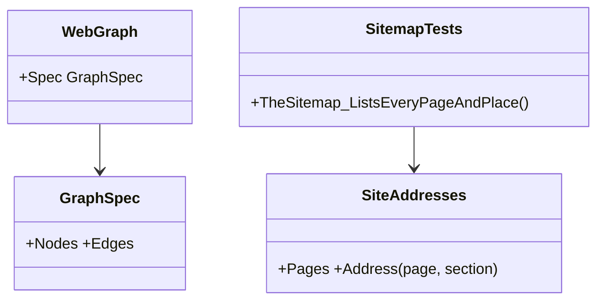
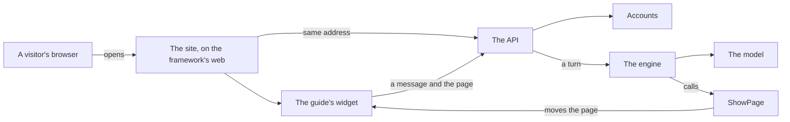
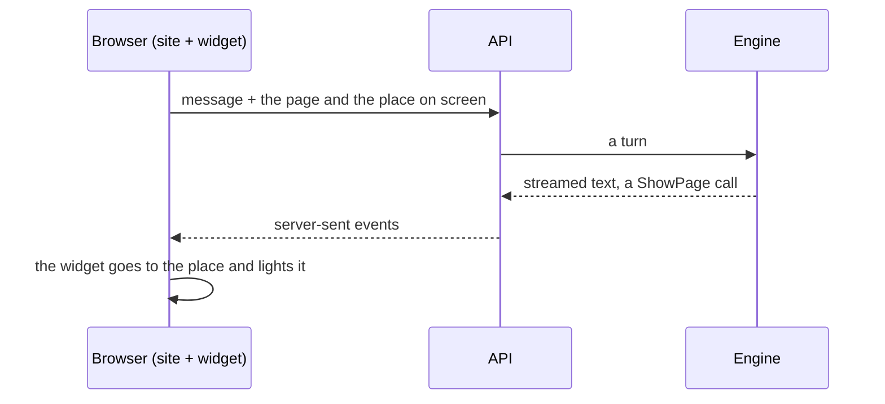

# F119 The web and the backend, and a sitemap

> **Plan.** How the site explains the framework's web working with the backend, splits How it works into the loop and
> the web, and lists every page and place for crawlers. Drafted 2026-11-08 during Louis's unattended run ("finish F118,
> then the rest"); his words are the brief, the picks below are the recommended ones, recorded for his review. On
> `feature/F119-the-web-and-the-backend`; deleted when done, its lasting parts in the web doc and the work log.

## Context

Louis, 2026-11-08: "can we then add more framework sections for how the actual web framework also works in tandem with
the backend", "split the Loop sections from the web sections", "you can have the agent without the web part, but the
web part is what automates the website builds with an agent". And from F118's addresses: a sitemap, since search
engines ignore what follows a `#` and only real addresses can be listed (ADR 0107).

How it works today has one list, "the parts, in plain words", mixing the engine's loop (your program, the hosts, the
engine, the identity, the packs, the harness) with the web (the framework's web and the accounts). Nothing on the site
says how a visitor's browser, the site, the guide's widget, the API, the accounts and the engine work together, or
that the web is the part that turns an agent into a website.

## Design

- **How it works becomes four slides:** the film (`top`), **the loop** (`loop`, the turn's diagram and the engine's
  parts: your program, the hosts, the engine, the identity, the packs, the harness, where it runs), **the web**
  (`web`, a new diagram and the web's parts) and the rules (`rules`). The web slide opens with the line Louis gave: the
  agent runs without the web, from the CLI, Rider, the API or MCP; the web is what turns an agent into a website.
- **The web's parts, in plain words:** the site, a Blazor WebAssembly app on the framework's web, served by the API from
  the same address; the frame, its slides and every place's address; a turn streamed to the page as it happens; the
  guide in the corner reading the page the visitor is on and taking them to a place on it; accounts, a sign-in and a
  tenant, before a session opens; and the same pieces for a customer's site, with their words.
- **A diagram of the web working with the backend**, data like every other (`WebGraph`): a visitor's browser, the site
  and the guide's widget, the API and the accounts, the engine, the model and the site pack's `ShowPage`, which moves
  the page back in the browser.
- **A sitemap** at `/sitemap.xml`, and `robots.txt` naming it: every page and every place's address, the landing's
  under `/home` (ADR 0107), at `https://louis-agent.dev`. A site test renders every page, collects its places by the
  address rule and holds the file to them, so a new page or section can't be left off; the same switch as the golden
  files rewrites it.

### Interface design



```csharp
// demos/louis-agent/web/louis-agent.code-review/Graphs/Framework/WebGraph.cs (new)
public static class WebGraph { public static GraphSpec Spec { get; } }
// demos/louis-agent/tests/louis-agent.code-review.tests/Pages/Site/SitemapTests.cs (new)
public class SitemapTests { [Test] public void TheSitemap_ListsEveryPageAndPlace(); }
```

### Architecture



### Communication



### Namespace map

| Type | Folder | Namespace | Step |
|---|---|---|---|
| `WebGraph` | `demos/louis-agent/web/louis-agent.code-review/Graphs/Framework/` | `LouisAgent.CodeReview.Graphs.Framework` | 2 new |
| `HowItWorksPage` | `…/Pages/Site/` | unchanged | 1, 2 changed |
| `sitemap.xml`, `robots.txt` | `…/wwwroot/` | — | 3 new |
| `SitemapTests` | `demos/louis-agent/tests/louis-agent.code-review.tests/Pages/Site/` | `LouisAgent.CodeReview.Tests.Pages.Site` | 3 new |

## Picks (unattended, recommended, for Louis's review)

1. **A second diagram on How it works.** The page test held each explaining page to exactly one diagram (F111); the web
   slide needs its own picture, so the rule becomes at least one. Options: (a, taken) at least one, a diagram per slide
   where it explains; (b) one diagram with the web added to the turn's, crowded; (c) no diagram for the web.
2. **The sitemap is a file held by a test**, not a route that renders pages on the server: the pages' places are known
   only once they draw, the server would need every page's services, and a file a test regenerates is the golden
   files' own pattern. A paged section's later pages are left out: they depend on the visitor's screen.

## Steps

1. **The loop and the web split.** How it works: `parts` becomes `loop` (the engine's parts) and a new `web` band with
   the web's parts and Louis's line. The site guide's address example moves to `/how-it-works/loop/2`. Tests first:
   the page has the four bands; its words name the web's parts.
2. **The web's diagram.** `WebGraph` on the web slide; the page test becomes at least one diagram. Test: the diagram's
   boxes name parts that exist (the site pack's tool, the accounts, the framework's web).
3. **The sitemap.** `sitemap.xml` and `robots.txt` in the site's `wwwroot`; `SitemapTests` renders every page and holds
   the file to its pages and places, `LOUIS_UPDATE_GOLDEN=1` rewriting it.
4. **Docs.** The web doc and ADR 0107's consequences name the sitemap; the work log's row; the plan deleted.

## Done when

How it works shows the loop and the web as two slides, the web's with its own diagram and Louis's line; `/sitemap.xml`
lists every page and place, held to the pages by a test; the guide reads the new sections like any other.

---
[Docs index](../README.md) · [Plans](README.md)
