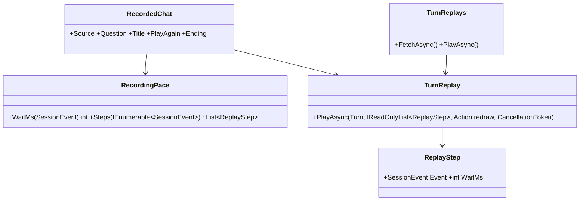
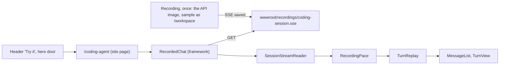
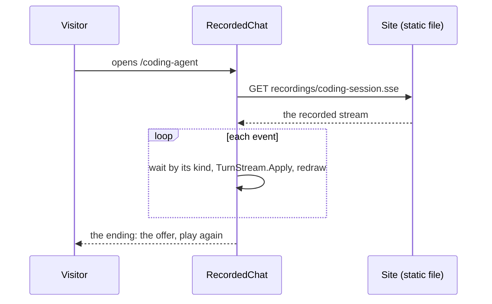

# F120 Watch the coding agent work

> **Plan.** How the site's "Coming soon" door to the coding agent becomes a page where a visitor watches a real,
> recorded coding session play in the real chat, then gets the offer. Approved by Louis on 2026-11-09 ("Watch it
> work", then "continue and finish unattended"). Branch `feature/F120-watch-the-coder-work`.

## Context

The coding agent's chat has been closed to visitors since FX88: it loads every toolset, shell included, on the
server's workspace, and the live site has no sign-in, so only the key holder can use it. The header's "Try it" and the
hero's "Try the coding agent" are a faded "Coming soon" pill that leads nowhere.

**Louis's pick (2026-11-09), from three:** *Watch it work*. The other two were a live read-only sandbox (every visit
spends on the key, and a per-session workspace is new framework work) and a signed-in full agent (per-user sandbox
containers, more than ten steps). The live chat stays closed to strangers and open to the key holder.

**Done when:** the header's and the hero's doors lead to `/coding-agent`, where a recorded session of the coding agent
fixing a real bug plays in the framework's chat view at reading pace, ends on the offer, and can play again; the page
costs nothing per visitor; the recording and the sample it ran on are in the repo, with how to record again.

## Design

- **A recording is the stream the API sent**, saved as a `.sse` file: the same events the chat reads live, so the
  replay draws exactly what a live chat draws. The framework's `SessionStreamReader` reads it and `TurnStream.Apply`
  folds each event into a turn, as the chat and the test fixture already do.
- **The pace comes from the event's kind**, since a stream carries no times: a word of text or thinking types fast, a
  new block and a tool's result take a beat. `RecordingPace` holds the numbers.
- **The loop that plays events into a turn is shared.** The eval studio's `TurnReplays.PlayAsync` folds stored events
  at their own rhythm; its loop (apply, redraw every third event or after a pause) moves to the framework's
  `TurnReplay`, and the studio and the recording both call it with their own waits.
- **`RecordedChat` is a framework component** (Louis: "all this must be framework functions"): a window with the
  chat's own `MessageList`, a source address and the question, an ending slot shown when the play finishes, and a
  play-again button. Any site can show a recorded session of its own agent.
- **The sample is the site's own story**: a small invoice matcher whose bank references don't match their invoices
  (the lead chat on the landing is about invoice matching). It sits in the repo outside the solution, so its failing
  test never runs in CI. The recording runs the API's own image with the sample as its only workspace, on a port of
  its own, so the agent sees nothing of this repo.
- **The recording is one paid run** on Haiku, about 10 to 30 cents, named in the option Louis picked.

### Interface



```csharp
public sealed record ReplayStep(SessionEvent Event, int WaitMs);
public static class TurnReplay { public static Task PlayAsync(Turn turn, IReadOnlyList<ReplayStep> steps, Action redraw, CancellationToken stop); }
public static class RecordingPace { public static int WaitMs(SessionEvent streamEvent); public static List<ReplayStep> Steps(IEnumerable<SessionEvent> events); }
public partial class RecordedChat { [Parameter] string Source; [Parameter] string Question; [Parameter] string Title; [Parameter] string PlayAgain; [Parameter] RenderFragment? Ending; }
```

### Architecture



### Communication



### Types

| Type | Folder | Namespace | Step |
|---|---|---|---|
| `ReplayStep`, `TurnReplay`, `RecordingPace` | `src/web/louis-agent.web/Chats/Replay/` | `LouisAgent.Web.Chats.Replay` | 1 new |
| `TurnReplays` | `src/web/louis-agent.web.evals/Admin/Explorer/Replay/` | unchanged | 1 changed |
| `RecordedChat` | `src/web/louis-agent.web/Components/Recorded/` | `LouisAgent.Web.Components.Recorded` | 2 new |
| the invoice matcher sample | `demos/louis-agent/recordings/invoice-matcher/` | its own | 3 new |
| `CodingAgentPage` | `demos/louis-agent/web/louis-agent.code-review/Pages/Site/` | `LouisAgent.CodeReview.Pages.Site` | 4 new |
| `ChatLink` | `Components/Landing/` | unchanged | 4 changed |

## Steps

1. **The shared replay loop and the recording's pace.** Tests first: the pace by kind, the loop applies every event
   in order and redraws; the studio's replay still plays.
2. **`RecordedChat`.** bUnit: it plays a recorded stream into the chat's view, shows the ending when done, plays again.
3. **The sample and the recording.** The invoice matcher with its failing test; the recording made on the API's
   image; how to record again in its README.
4. **The page and the doors.** `/coding-agent` with the recording and the offer; "Try it" and "Watch it work" lead
   there while the live chat stays closed; the sitemap regenerated. Tests on the page and the doors.
5. **Docs.** ADR 0108 (the public watches the coding agent recorded; live use stays behind the key), the work log,
   the project docs, the write-up; the plan deleted.

## Approved during the build

(none yet)

---
[Docs index](../README.md) · Related: [plans](README.md), [ADR 0107](../adr/0107-every-section-has-an-address.md)
