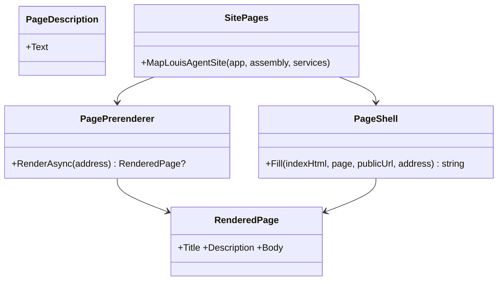
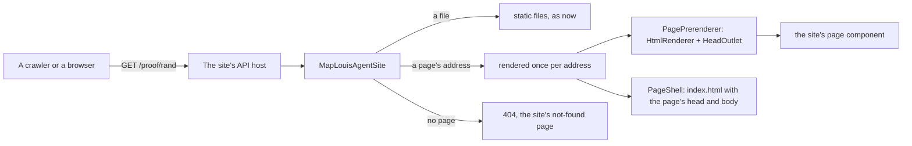
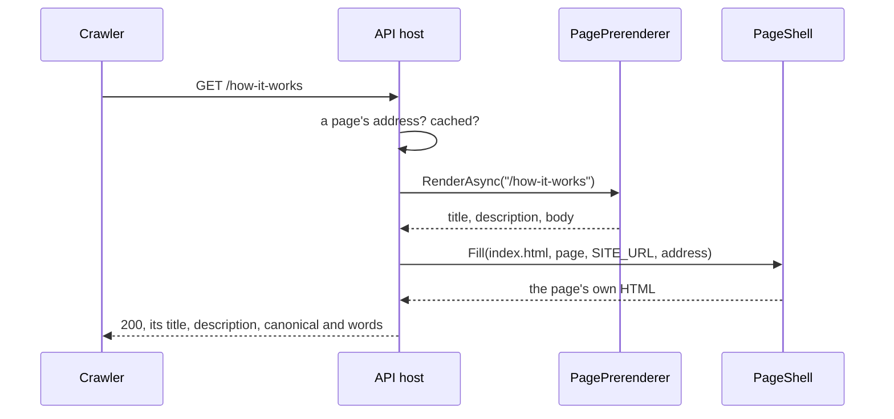

# F121 Every page served as HTML, for search engines

> **Plan** (2026-11-09) for making the sites SEO-friendly, a framework feature every site gets. Louis's picks of
> 2026-11-09 are below; he approved the steps the same day ("approve and build"). Branch `feature/F121-pages-prerendered`.

## Context

Every host answers every page address with the same `index.html` (`MapFallbackToFile`): the landing's title and
description, and an empty body until the WebAssembly app has loaded. Google runs that script, slowly; most other
crawlers, link previews and AI crawlers don't, so for them every page is an empty landing. The sitemap and
`robots.txt` exist since F119.

**Louis's picks (2026-11-09), each of three:** **prerender each page** (over server prerendering, which changes how
every site is hosted, and meta tags only, which leaves the body empty), **built into the framework's web** ("again
this should be built into the webframework"), and **rendered in the API, on request** (over a publish step writing
files, and a test writing them into git): the framework's API host renders a page the first time its address is asked
for, keeps it until the next deploy, and the app takes over in the browser as now.

**Done when:** on every site, `curl` of any page's address returns its own title, description, canonical link, link
card and the page's words in the body; an address that names no page answers 404; the app still starts and takes
over as before; a page that can't be rendered falls back to today's shell and says so in the log; checked on
louis-agent.dev with a crawler's eye (no script).

## Design

- **A page says what it is about.** The framework gains `PageDescription` (beside Blazor's own `PageTitle`): it writes
  the page's `<meta name="description">` through `HeadContent`, so the app shows it in the browser too. Every site
  page declares both; a test holds that none is missing.
- **The framework renders a page to HTML.** `PagePrerenderer` (in the framework's API hosting) finds the page an
  address names from the site's own routes (the same table `SiteAddresses` reads; a site without addresses uses its
  `[Route]`s), renders it with ASP.NET Core's `HtmlRenderer` beside a `HeadOutlet`, so the page's title and head come
  out with its body, and gives back both. A page's `OnAfterRender` and scripts don't run: what a crawler gets is what
  the page says before the app starts, which is all its words. The services a page injects come from the site (one
  registration callback); the framework adds a script runtime that does nothing.
- **The shell takes the page.** `PageShell` puts the rendered head and body into the site's `index.html`: the title,
  the description, `og:title`, `og:description`, `og:url` and a `<link rel="canonical">` at the address on the site's
  public URL (`SITE_URL`), and the page's HTML inside `<div id="app">`, which the app replaces when it starts.
- **One call per host.** `app.MapLouisAgentSite(typeof(App).Assembly, services => ...)` replaces
  `MapFallbackToFile("index.html")`: a page's address answers its rendered shell, kept in memory per address until
  the process restarts (a deploy); a file still answers as a file; an address that names no page answers 404 with the
  site's not-found page. A page that throws while rendering answers today's plain shell, logged once.

### Interface



```csharp
// src/web/louis-agent.web: what a page says about itself
public partial class PageDescription { [Parameter, EditorRequired] public string Text { get; set; } }
// src/hosts/louis-agent.api (or a small library beside it): the rendering and the endpoint
public sealed record RenderedPage(string Title, string Description, string Body);
public sealed class PagePrerenderer(IServiceProvider services, IReadOnlyDictionary<string, Type> routes) { Task<RenderedPage?> RenderAsync(string address); }
public static class PageShell { public static string Fill(string indexHtml, RenderedPage page, Uri publicUrl, string address); }
public static class SitePages { public static WebApplication MapLouisAgentSite(this WebApplication app, Assembly site, Action<IServiceCollection> services); }
```

### Architecture



### Communication



### Types

| Type | Folder | Namespace | Step |
|---|---|---|---|
| `PageDescription` | `src/web/louis-agent.web/Components/Site/Meta/` | `LouisAgent.Web.Components.Site.Meta` | 1 new |
| the site pages' descriptions | each site's `Pages/` | unchanged | 1 changed |
| `RenderedPage`, `PagePrerenderer` | `src/hosts/louis-agent.api/Site/` | `LouisAgent.Api.Site` | 2 new |
| `PageShell` | `src/hosts/louis-agent.api/Site/` | `LouisAgent.Api.Site` | 3 new |
| `SitePages` (`MapLouisAgentSite`) | `src/hosts/louis-agent.api/Site/` | `LouisAgent.Api.Site` | 4 new |
| the three hosts' `Program.cs`, `SITE_URL` | `demos/*/hosts/*-api/`, each demo's config | unchanged | 5 changed |

## Steps

1. **A page says what it is about.** `PageDescription` in the framework; every page of the three sites declares a
   title and a description, in its own words; a test per site holds that none is missing or repeated.
2. **The renderer.** `PagePrerenderer` renders a page with its head through `HtmlRenderer`; tests on a sample page
   (title, description, words in the body, a page that throws gives none).
3. **The shell.** `PageShell` fills a site's `index.html`; tests on the louis-agent site's own file.
4. **The endpoint.** `MapLouisAgentSite`: a page answers its shell, cached; a file answers as a file; no page answers
   404; a failure falls back and logs. Tests through the test server.
5. **The hosts use it.** The coding, Puls and starter hosts call it; `SITE_URL` in each demo's settings and Azure
   files; the review copy checked with `curl` and in Chrome.
6. **Docs.** ADR 0109 (a page is served as HTML, rendered once per deploy), the web and API design docs, the work
   log, the write-up; the plan deleted. After the merge, louis-agent.dev checked with `curl`.

## Approved during the build

(none yet)

---
[Docs index](../README.md) · Related: [plans](README.md), [ADR 0107](../adr/0107-every-section-has-an-address.md)
