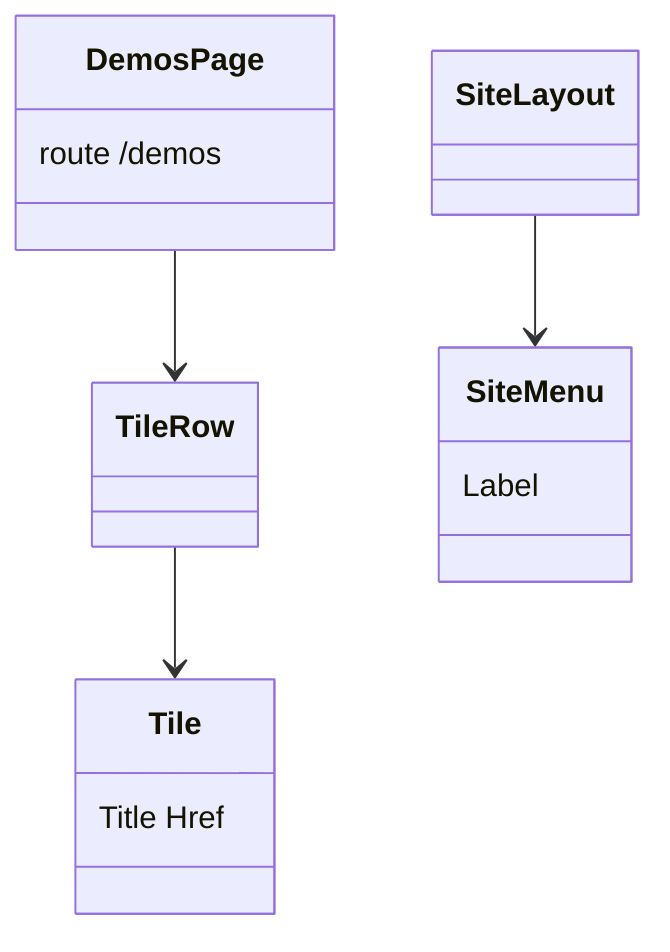
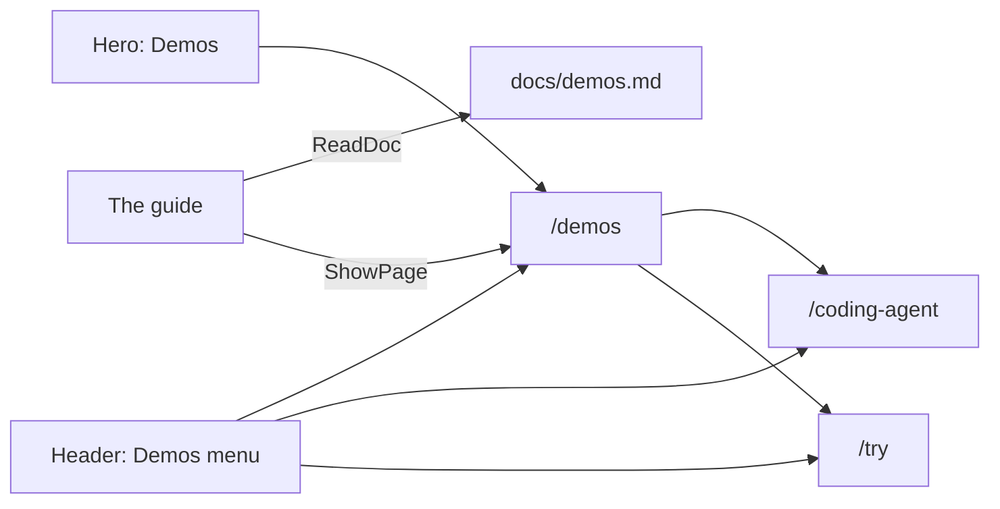
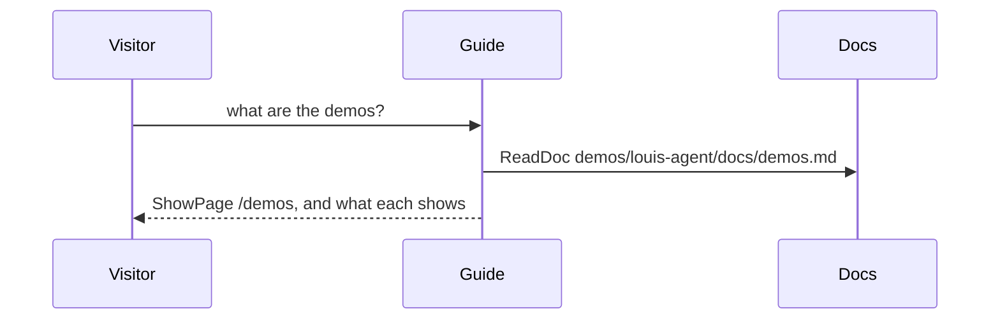

# F122 The demos, in one place

> **Plan** (2026-11-09) for a Demos menu, a demo index and the docs the guide explains the demos from. Louis's asks of
> 2026-11-09 are below. Branch `feature/F122-demos`.

## Context

The site has two demos, each recorded once and played back: the coding agent fixing a bug (`/coding-agent`, F120,
ADR 0108) and the triage team at work (`/try`, F106.3.4). The header's "Watch it work" leads to the first, the hero's
"Watch a triage" to the second, and nothing lists both.

**Louis's asks (2026-11-09):** "we need to add this to a menu called demos and list them there, then take these
buttons out" (the header's "Watch it work" and the hero's "Watch a triage"); "just have a button there then called
demos", "which takes you to the demo index"; "make sure we have documentation on the demos, and the agent can
explain them".

**Done when:** the header has a Demos menu listing the demo index and each demo, and no "Watch it work"; the hero has
"Take the tour" and a "Demos" button to `/demos`; `/demos` lists both demos with what each shows, served as HTML
(F121) and in the sitemap; a doc explains each demo, the guide's voice names `/demos` and the doc, and the guide,
asked about the demos live, explains them and takes the visitor there; checked at 1080p and on a phone.

## Design

- **A doc per demo, in one file.** `demos/louis-agent/docs/demos.md` (an explanation): for each demo what it
  shows, how it was made (recorded once on Haiku, the script, what it cost), what is real and what is played back,
  and what it would mean for a business. The guide reads it with `ReadDoc`; the image already copies the demo's docs.
- **The index is a page of the site.** `/demos`, `DemosPage` in `Pages/Site/Agents/`, the framework's `TileRow` and
  `Tile` (reused, ADR 0084) with one tile per demo and its link, a `PageTitle` and a `PageDescription`.
- **The menu is the framework's `SiteMenu`**, the same as "The framework": "All demos", "The coding agent", "The
  triage team". The header's action slot is left empty (the `ChatLink` goes).
- **The hero's second button** is "Demos" to `/demos`.
- **The guide's voice** names `/demos` with the new doc as its source, and the two demo lines name it too.

### Interface



```csharp
// demos/louis-agent/web/louis-agent.code-review/Pages/Site/Agents/DemosPage.razor: markup only
@page "/demos"
```

### Architecture



### Communication



### Types

| Type or file | Folder | Namespace | Step |
|---|---|---|---|
| `demos.md` | `demos/louis-agent/docs/` | — | 1 new |
| the expert's `voice.md` | `demos/louis-agent/identity/louis-agent.identity.expert/Prompts/agent/louis-agent-expert/` | — | 1 changed |
| `DemosPage` | `demos/louis-agent/web/louis-agent.code-review/Pages/Site/Agents/` | `LouisAgent.CodeReview.Pages.Site.Agents` | 2 new |
| `SiteLayout`, `Hero` | the site's `Layout/`, `Components/Landing/` | unchanged | 3 changed |

## Steps

1. **The demos explained.** `docs/demos.md`; the voice names `/demos` and the doc; the guide's golden files.
   Test: the guide's site tests (every page named, its sources exist).
2. **The index.** `/demos` with a tile per demo, its title and description; the sitemap regenerated. Tests: the
   page's tiles and links, the page descriptions test, the sitemap test.
3. **The menu and the hero.** The Demos menu; "Watch it work" and "Watch a triage" go; the hero's "Demos". Tests:
   the layout's and the hero's.
4. **Checked and written down.** At 1080p and a phone in Chrome; the guide asked live about the demos; the site's
   design doc, the work log, the plan deleted.

## Approved during the build

- **`/try` side by side, like `/coding-agent`** (Louis's pick of three, 2026-11-09, on the triage demo outgrowing a
  1080p screen as its step list fills), then replaced the same day: **"split this in two sections"**, and then
  shaped as **two columns** ("both text lists can be under one another in the second column"): on the left the
  kicker, heading, intro, the six agents and Back / Next / Play it again; on the right the current step's card at
  the top and the list of steps under it, scrolling inside the column so the page fits a slide.
- **The triage team as swimlanes** (Louis: "can we have swimlanes for these buttons", his pick of three, "lanes with
  steps"): a lane per agent, each step a numbered dot in its agent's lane joined by one line, a dot showing its step;
  where the dots go is `SwimlaneLayout`, plain code with its own tests.
- **The triage page stays one section** (Louis at 1080p: "this must be one section"): the framework's `Band` gains
  `Paged="false"`, which the frame's module never pages; the swimlanes scale to 24% of the screen's height.
- **"Ask the guide what happened" joins the controls' row** at its end once the case is closed (Louis: "move this
  button to"), through the player's new `Actions` slot; the offer line stays under them.
- **The menu at the end of the bar opens its list right-aligned** (Louis: "bug", the Demos list ran off the screen).
- **The triage demo is at `/triage-demo`** (Louis: "should just say triage-demo"), no redirect from `/try` (ADR 0049).
- **The recording's closing button is a plain small button** (Louis on `/coding-agent`: "too big just button",
  "the panel should leave space for the button"): "Ask the guide about one" takes the small line style of "Play it
  again", and the recorded chat's window keeps room for its ending, so both fit inside it.

---
[Docs index](../README.md) · Related: [plans](README.md), [ADR 0108](../adr/0108-the-public-watches-the-coding-agent-recorded.md)
