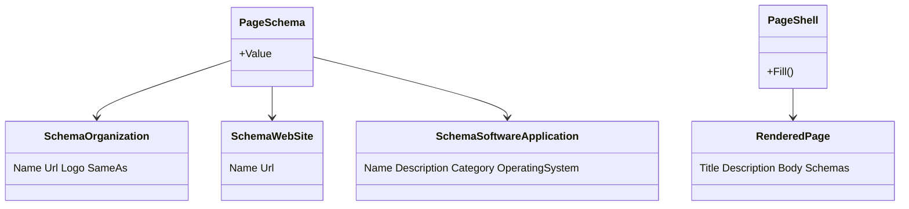
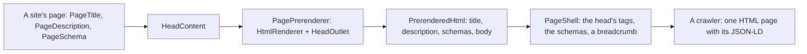
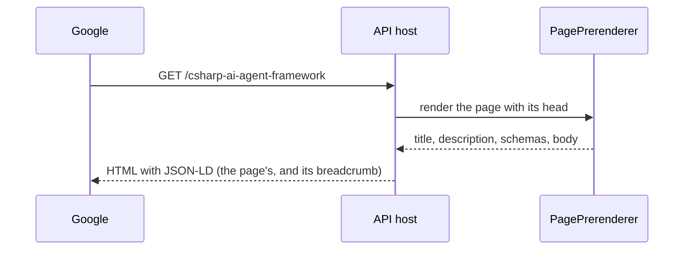

# F123 Found by search: structured data, icons and a page for the search

> **Plan** (2026-11-09) for the SEO work after F121. Louis's picks of 2026-11-09 are below. Branch
> `feature/F123-seo`.

## Context

F121 serves every page as HTML with its own title, description and canonical link on https, and the sitemap lists
every place. What a search engine still lacks: structured data (who runs the site, what the software is, where each
page sits), an icon for Apple devices, and a page written for what people type. **Louis's goal:** page one of Google
for "c# agent framework" and "c# ai framework" (told plainly it can't be promised: the results are Microsoft's own
framework, YouTube and blogs, and Google weighs links from other sites most).

**Louis's picks (2026-11-09), each of three:** **technical and one search page** (over technical only, and content
first); structured data from **a component in the page's head** (over one site record at start-up, and static in
index.html); the page at **`/csharp-ai-agent-framework`** (over a section of How it works, and `/compare`).

**Done when:** every page served carries a breadcrumb in JSON-LD, the landing carries the organisation, the website and
the software; `/csharp-ai-agent-framework` explains louis-agent and compares it fairly with Microsoft Agent Framework
and Semantic Kernel, each claim from their own docs; an Apple touch icon; all checked with `curl` on the review copy
and on louis-agent.dev after the deploy; a how-to for Louis's side (Search Console, the sitemap, where links help).

## Design

- **`PageSchema` in the framework's web** (`Components/Site/Meta/`, beside `PageDescription`): a page places it with a
  value, one of the framework's schema.org records, and it writes `<script type="application/ld+json">` through
  `HeadContent`. The records are plain (`SchemaOrganization`, `SchemaWebSite`, `SchemaSoftwareApplication`), written
  by one options object (ADR 0041: JSON through records), with `@context` and `@type` as their names.
- **The prerender carries it.** `PrerenderedHtml` reads every JSON-LD script in the rendered head into
  `RenderedPage.Schemas`; `PageShell` writes them before `</head>`, and adds a `BreadcrumbList` of its own for every
  page under the landing (the site's name, then the page's title, at their addresses), so no page has to.
- **The site declares its facts** on the landing: the organisation (name, address, logo, LinkedIn), the website, and
  the software (`SoftwareApplication`: a .NET framework, its description, free to read about, offered as built
  sites). An `apple-touch-icon.png` (180×180) from the brand mark, linked in `index.html`.
- **`/csharp-ai-agent-framework`**, a page of the site under The framework: what louis-agent is in one paragraph,
  then what Microsoft Agent Framework and Semantic Kernel are for and where louis-agent differs, each claim taken from
  their own documentation with the link kept in the plan's record, then the offer. Its own title and description, in
  the sitemap, named in the guide's voice.

### Interface



```csharp
public partial class PageSchema { [Parameter, EditorRequired] public object Value { get; set; } }
public sealed record SchemaOrganization(string Name, string Url, string Logo, IReadOnlyList<string> SameAs);
public sealed record RenderedPage(string Title, string Description, string Body, IReadOnlyList<string> Schemas);
```

### Architecture



### Communication



### Types

| Type | Folder | Namespace | Step |
|---|---|---|---|
| `PageSchema`, `Schema*` records | `src/web/louis-agent.web/Components/Site/Meta/` (records under `Schema/`) | `LouisAgent.Web.Components.Site.Meta` | 1 new |
| `RenderedPage`, `PrerenderedHtml`, `PageShell` | `src/hosts/louis-agent.api/Site/` | `LouisAgent.Api.Site` | 2 changed |
| the landing's schemas, `index.html`, the touch icon | the louis-agent site | unchanged | 3 changed |
| `CsharpAgentFrameworkPage` | the site's `Pages/Site/Framework/` | `LouisAgent.CodeReview.Pages.Site.Framework` | 4 new |

## Steps

1. **`PageSchema` and the records**, with tests: the script it writes, the JSON's names and values.
2. **The prerender carries it**, and the breadcrumb: tests on `PrerenderedHtml`, `PageShell` and the endpoint.
3. **The site's facts and the touch icon**: the landing's three schemas, the icon, the link; tests.
4. **`/csharp-ai-agent-framework`**: the research from Microsoft's own docs (sources recorded below), the page, the
   menu, the sitemap, the guide's voice; tests (route, description, no semicolons, every source linked).
5. **Docs and Louis's side**: an ADR (structured data per page, carried by the prerender), the web and API design
   docs, a how-to for Search Console and the sitemap, the work log, the write-up; the plan deleted; checked on
   louis-agent.dev after the deploy.

## Approved during the build

- **One `PageHead`, not a `PageSchema` beside `PageDescription`** (step 3, Louis's pick of three, 2026-11-09). Blazor
  keeps only the last `HeadContent` a page renders, so the landing's three `PageSchema`s pushed its description out of
  the head, and the API served the plain shell (`TwoHeads_OnlyTheLastReachesTheHead` holds it). `PageDescription` became
  `PageHead` (`Description`, and an optional `Schemas` list) by Rider's rename on every page, and `PageSchema` went;
  over a description component that also takes schemas (a name that says less than it does) and two components joined
  by a named section (coupled, and a schema without a description would never show).

## Sources (step 4 fills it)

---
[Docs index](../README.md) · Related: [plans](README.md), [ADR 0109](../adr/0109-a-page-is-served-as-html.md)
