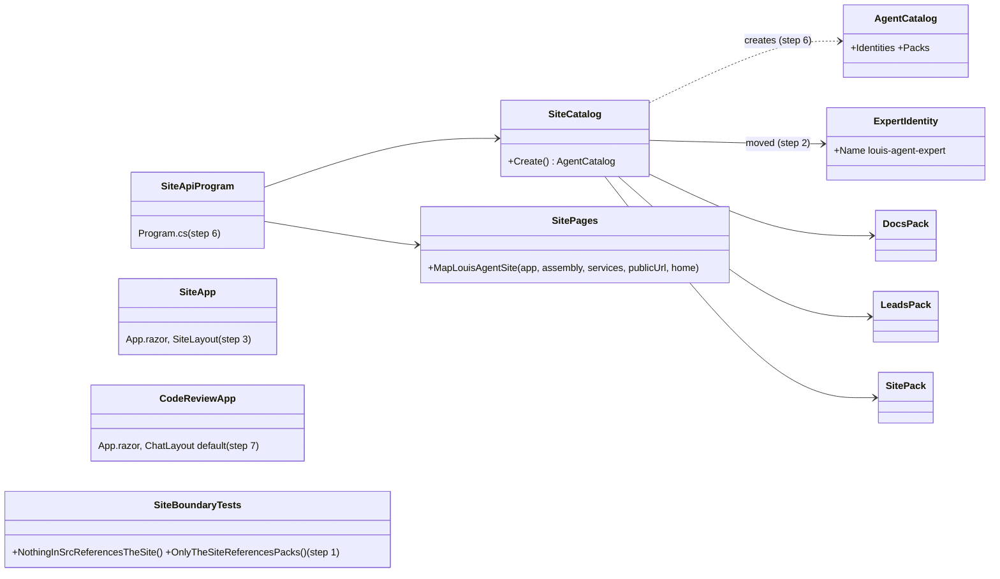
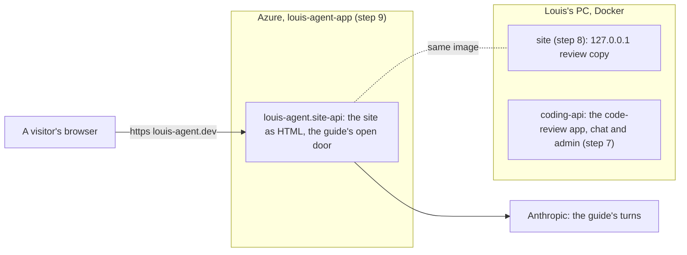
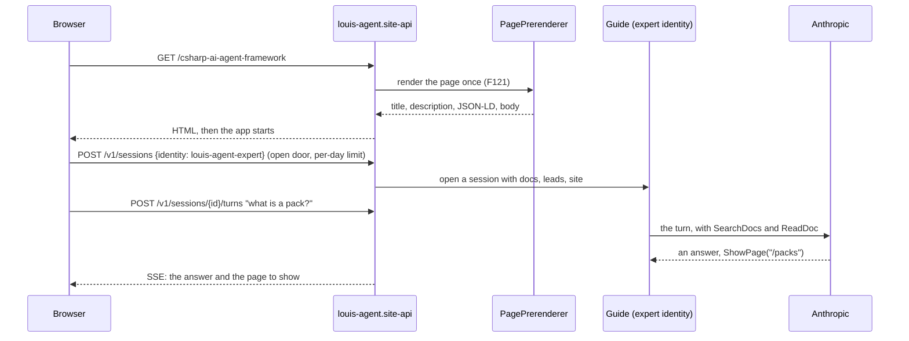
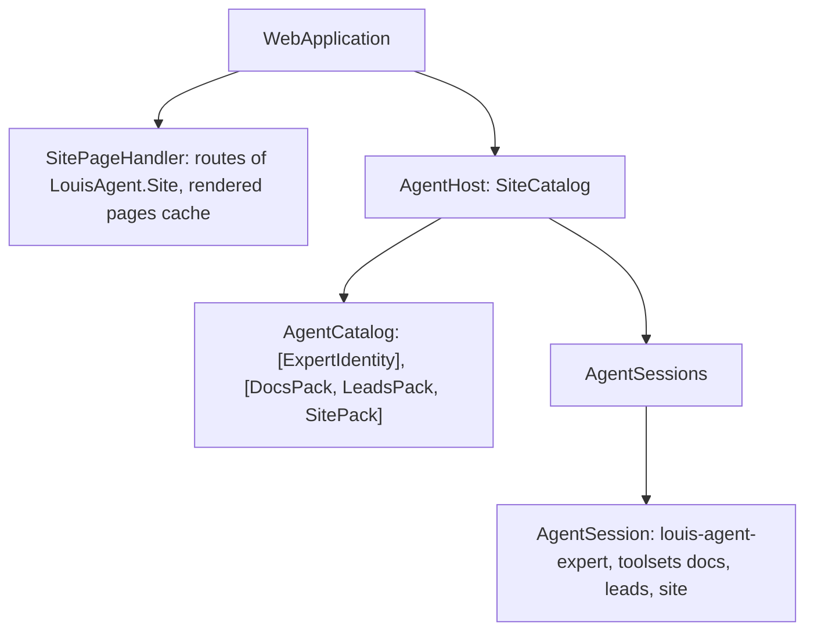

# F124 The framework's website: its own place in src/site

> **Plan** (2026-11-09), for Louis's approval before step 1. Branch `feature/F124-the-frameworks-website`. It changes
> only under *Approved during the build*.

## Context

**What Louis asked (2026-11-09).** Pointing at the Contact page inside `demos/louis-agent/web/louis-agent.code-review`:
"no man the framework website it is not the code-review, it is just a demo". Then: "yes it is the frameworks website and
it must be documented like that", "built on the framework, and must answer questions of the framework", and "the
framework website is visitor area of a business, the framework website only has that atm. Then we will have an
portal." Of three places he chose `src/site/louis-agent.site` (over a demo of its own and a project beside code
review), and of three hosts option A: `src/site/` holds the site, its guide and its own small host. Code review
becoming a web pack is parked (F126); a site's areas (visitor area, showroom, chat portal, admin portal) are F127.

**What is there today.** One Blazor WebAssembly app, `louis-agent.code-review`, holds three things: the framework's
website (14 pages under `Pages/Site/`, the films, the graphs, the guide in the corner), the coding agent's chat
(`Pages/ChatPage`) and the admin portal with the files and git packs' screens. One program, the demo's
`louis-agent.coding-api`, serves it, and louis-agent.dev runs that program with the whole coding catalogue: the coding
agent with its shell, files, git and dotnet tools, the triage team and the guide. The public site plays recordings
and needs only the guide.

**Done when:** louis-agent.dev is served by `src/site/louis-agent.site-api`, whose catalogue is the guide and its three
packs (docs, leads, site) and nothing else; the site is `src/site/louis-agent.site`, a visitor area on the framework's
`SiteShell` with no chat, admin or accounts; its tests pass under `src/tests/site/`; the code-review app is the
chat and the admin portal, served by `coding-api` on the PC; nothing in `src/` outside `src/site/` references the
site; an ADR says the framework's website lives in `src/site/`; every page answers on louis-agent.dev as before.

## Design

### The shape, in plain words

- **`src/site/` is the framework's own site, built like any customer's.** It references the framework's web and the
  packs and identity it uses, the way a demo does. Nothing else in `src/` references it, so the engine, hosts and web
  can still leave for their own repository without it. A test holds both directions (step 1).
- **Three projects.** `louis-agent.site` (the visitor area: pages, components, graphs, films, styles, the static
  files), `louis-agent.identity.expert` (the guide, moved whole from the demo, its id `louis-agent-expert` and its
  namespace unchanged) and `louis-agent.site-api` (a few lines: a catalogue of the guide with the docs, leads and site
  packs, `MapLouisAgentSite`, the guide's open door; no accounts, no eval studio).
- **Moves are moves.** Files go with `git mv`, byte for byte (ADR 0054), and their namespaces change with Rider's
  *Move to namespace* (`LouisAgent.CodeReview…` to `LouisAgent.Site…`), never by hand.
- **The code-review app keeps what is its own:** the chat (now also at `/`), the admin portal with the packs'
  screens, the account frame, its themes and its boot screen.
- **The public site gets smaller.** louis-agent.dev stops running a coding agent with shell access; it runs the guide.

### Interface design



```csharp
// src/site/louis-agent.site-api (step 6): the whole program, as the coding agent's is
public static class SiteCatalog { public static AgentCatalog Create(); }   // the guide and its three packs
var host = AgentHost.Build(SiteCatalog.Create(), new HostServices(WebAccess.Create, OtlpTelemetry.Instance,
    Providers: [AnthropicProvider.Instance]));
app.MapLouisAgentSite(typeof(LouisAgent.Site.App).Assembly, services => { … }, home: "home");
app.MapLouisAgentApi(host);
```

### Architecture



### Communication: a visitor opens a page and asks the guide



### Object diagram: the site-api while a visitor chats



### Folder trees

```
Today                                           After
src/                                            src/
├── engine/ hosts/ web/ evals/ tools/           ├── engine/ hosts/ web/ evals/ tools/
                                                ├── site/                              (new)
                                                │   ├── louis-agent.site/              (step 1, filled 3 to 5)
                                                │   ├── louis-agent.identity.expert/   (step 2, moved)
                                                │   ├── louis-agent.site-api/          (step 6)
                                                │   ├── config/  docker/               (step 8)
└── tests/                                      └── tests/site/louis-agent.site.tests/ (step 1, filled 3 to 6)
demos/louis-agent/                              demos/louis-agent/
├── identity/ coding, expert, triage            ├── identity/ coding, triage
└── web/louis-agent.code-review/                └── web/louis-agent.code-review/       (chat, admin, themes)
    Pages/Site/, Components/{Architecture,          Pages/ChatPage, NotFound; Layout/{Chat,Admin,Account};
    Contact, Guide, Identity, Landing, Movies},     Components/{EmptyChat, ThemeSwitcher}; Styles/{chat,themes}
    Content/, Graphs/, Styles/site/, wwwroot/…
```

### Namespace map

| Type or files | From | To | Namespace | Step |
|---|---|---|---|---|
| `SiteBoundaryTests` | (new) | `src/tests/engine/louis-agent.core.tests/`, beside `ArchitectureTests` | `LouisAgent.Core.Tests` | 1 |
| The site's project, `App`, `_Imports`, `Program` | (new) | `src/site/louis-agent.site/` | `LouisAgent.Site` | 1 |
| `ExpertIdentity` and its prompts | `demos/louis-agent/identity/louis-agent.identity.expert/` | `src/site/louis-agent.identity.expert/` | `LouisAgent.Identities.Expert` (unchanged) | 2 |
| The pages (`HomePage` … `CsharpAgentFrameworkPage`), `SiteLayout` | `…code-review/Pages/Site/`, `Layout/` | `src/site/louis-agent.site/Pages/`, `Layout/` | `LouisAgent.Site.Pages…`, `LouisAgent.Site.Layout` | 3 |
| `Principles`, `SiteDoors`, `SiteFacts`; the graphs | `…code-review/Content/`, `Graphs/` | `src/site/louis-agent.site/Content/`, `Graphs/` | `LouisAgent.Site.Content`, `LouisAgent.Site.Graphs…` | 3 |
| The components (Architecture, Contact, Guide, Identity, Landing, Movies) | `…code-review/Components/` | `src/site/louis-agent.site/Components/` | `LouisAgent.Site.Components…` | 4 |
| The site's Sass and static files | `…code-review/Styles/site/`, `wwwroot/` | `src/site/louis-agent.site/Styles/`, `wwwroot/` | — | 5 |
| The site's tests | `demos/louis-agent/tests/louis-agent.code-review.tests/` | `src/tests/site/louis-agent.site.tests/` | `LouisAgent.Site.Tests…` | 3 to 5 |
| `SiteCatalog`, the program, its Dockerfile | (new) | `src/site/louis-agent.site-api/` | `LouisAgent.SiteApi` | 6 |
| `ChatPage` (also at `/`), `App` (chat layout) | stays | `…code-review/` | `LouisAgent.CodeReview…` | 7 |

## Choices before step 1 (each of three, the recommendation first)

1. **Where the site's settings and Docker files live.** **A (recommended):** `src/site/config/` (`.env.example`,
   its git-ignored `.env` and `.env.secrets`) and `src/site/docker/`, the Azure yaml moved to `src/site/deploy/azure/`,
   with the shared `deploy.ps1` naming it. Everything the site runs on sits with it. **B:** the same, with its own copy of
   `deploy.ps1`: self-contained, but two scripts to keep alike. **C:** settings and Docker in `src/site/`, the yaml left in
   `demos/puls/deploy/azure/`: the smallest change, and a framework file left in a demo's folder.
2. **Which local port is the review copy.** **A (recommended):** the site takes `127.0.0.1:5080`, where you already
   look, and the code-review API moves to 5082. **B:** code review keeps 5080 and the site gets 5082: your bookmarks for
   the site change. **C:** one compose profile at a time on 5080: no two at once.
3. **The guide's name.** **A (recommended):** it keeps `louis-agent.identity.expert` and the id `louis-agent-expert`:
   a move only, no setting or prompt changes. **B:** it becomes `louis-agent.identity.guide` with the id
   `louis-agent-guide`: the name says what it is, and the open door setting, the prompts folder and the tests change too.
   **C:** decide in F125, which reworks the guide: the move now, the name with the work that changes it.

## Steps

Each is one commit with its test, seen failing first where it changes behaviour; a pure move is held by the tests it
moves with, run before and after.

1. **The site's projects, and the boundary.** Empty `louis-agent.site` and `louis-agent.site.tests`, in the solution
   under `site`. `SiteBoundaryTests`: nothing in `src/` outside `src/site/` references a project in it, and `src/site/` is
   the only part of `src/` that references `packs/` or an identity. Seen failing with a deliberate bad reference first.
2. **The guide moves.** `git mv` of `louis-agent.identity.expert` to `src/site/`; the references in the coding catalogue
   and the code-review app follow; `ExpertChatTests`, `GuideKnowsTheSiteTests` and the catalogue's goldens pass unchanged.
3. **The pages, the layout, the content and the graphs move**, with their tests; Rider's *Move to namespace* changes
   `LouisAgent.CodeReview` to `LouisAgent.Site`. The page tests run before and after.
4. **The components move** (Architecture, Contact, Guide, Identity, Landing, Movies with `FilmFrame.razor.scss`), with
   their tests; the film export tool references the site.
5. **The styles and the static files move:** `Styles/site/` and the site's `app.scss`, `index.html`, the brand, the
   icons, the recordings, `sitemap.xml`, `robots.txt`, the social card; `sasscompiler.json`. `StylesheetTests` split in
   two, each holding its own app's import list.
6. **The site's host.** `louis-agent.site-api`: `SiteCatalog`, the program, its Dockerfile. Tests first: the catalogue
   holds the guide and exactly its three packs; the program's route table is the site's and the API's, no accounts or
   eval routes (a snapshot like the API's); the guide's door opens without a key.
7. **The code-review app after.** Its router defaults to the chat's layout, `ChatPage` answers `/` as well as `/chat`,
   `coding-api` serves it without a home word; its tests (`ChatPageTests`, the styles') pass.
8. **Local Docker and settings**, by choices 1 and 2: the site's compose service and config, the code-review API's new
   port, `get-started.md` and the docker README.
9. **louis-agent.dev runs the site's host:** the image `louis-agent-site` from the site's Dockerfile, the yaml's
   settings trimmed to the guide's (no triage, no workspace), `deploy.ps1`'s app entry. Checked by a release after
   merge, with Louis's go.
10. **Docs.** An ADR, *The framework's website lives in src/site* (ADR 0074 gains the line: the framework's own site sits
    in `src/site/`, is built on the framework like any customer's, ships no package, and nothing else in `src/`
    references it); `src/docs/projects/louis-agent.site.md` from the code-review doc's site half; that doc trimmed;
    `src/docs/CLAUDE.md`'s project structure; the guide's sources; the site's own Architecture page names the new
    projects (`SiteMapTests`); the work log, the write-up; the plan deleted.

## Verification

- Per step: the tests that move or change, run before and after; `core.tests`' rules when files move.
- The full unit suite once, after step 9.
- By hand, free: the review copy on 5080 shows every page at 1920×1080 and phone width, paging through each section,
  the guide answers (the guide's turns spend the Anthropic credit Louis allowed for tests), the code-review app on
  5082 opens its chat and its admin screens.
- After the merge and release: `curl` of louis-agent.dev's pages (title, description, JSON-LD, breadcrumb), and the
  guide answering once.

## Concepts, and where they sit in the goal

- **Composition root** (skill 20): a program that names exactly what it serves; the public site's catalogue shrinks to
  the guide, so what a visitor can reach is what the program names.
- **Least privilege at the edge** (skill 15): a public host without shell, files or git tools has less to defend.
- **Dependencies one way** (skill 20): the site depends on the framework, never the reverse, held by a test.
- **Moving code safely** (skill 18): byte-identical moves, namespaces by the IDE, the tests that move with the code as
  the proof.

---
[Docs index](../README.md) · Related: [Plans](README.md) · [ADR 0074](../adr/0074-the-folders-say-what-ships.md) ·
[ADR 0084](../adr/0084-every-site-is-built-on-the-frameworks-web.md)
