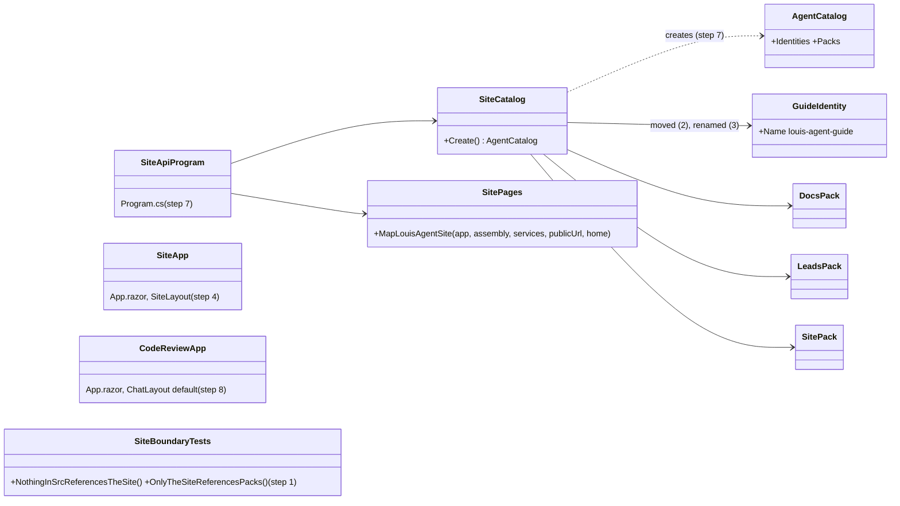
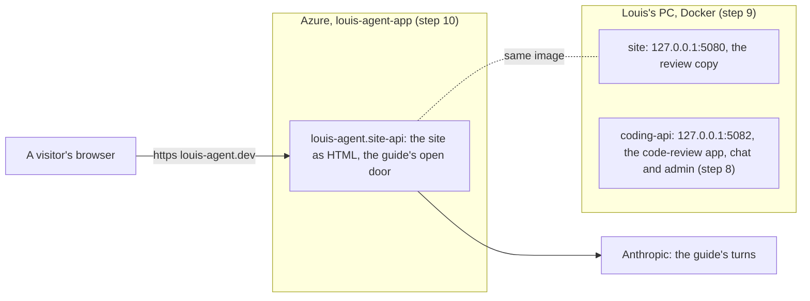
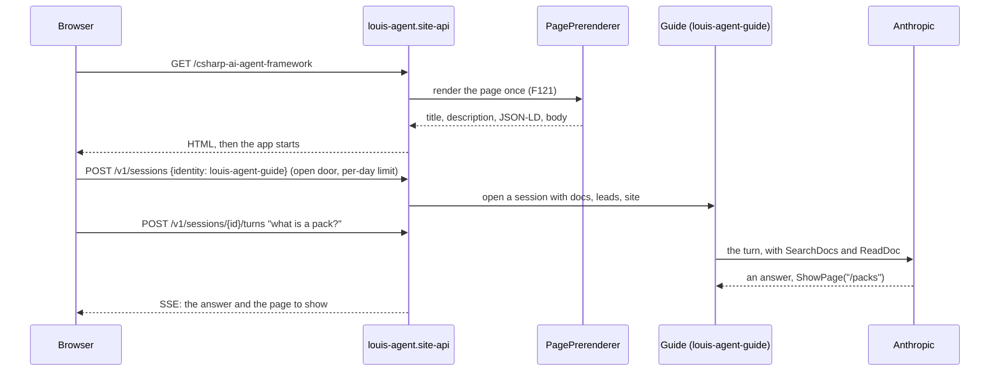
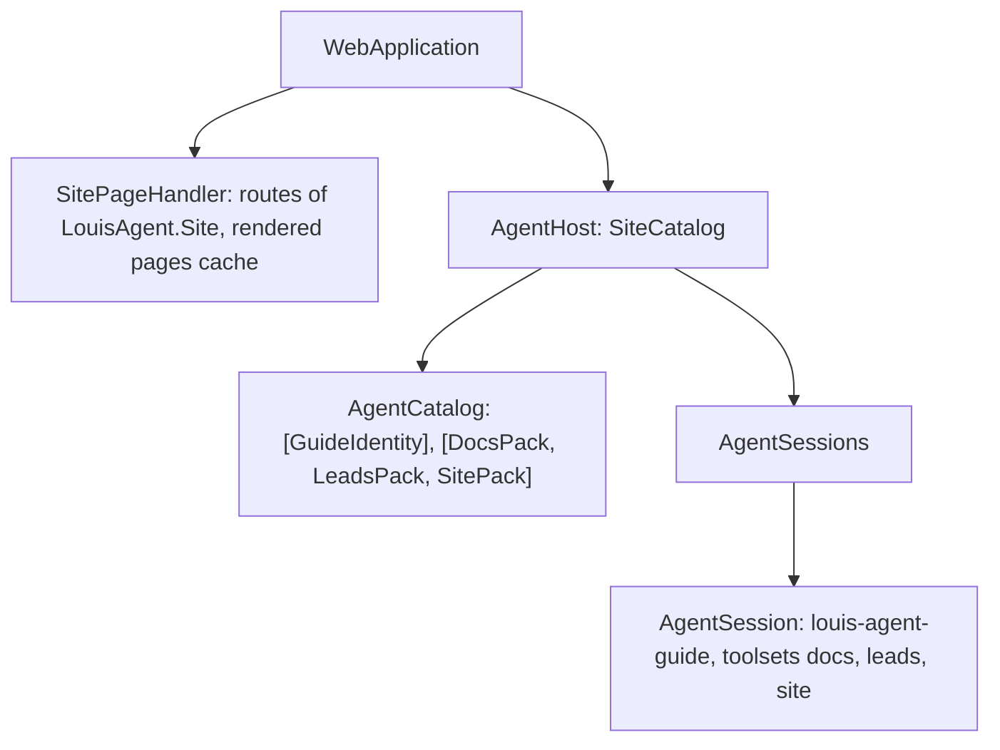

# F124 The framework's website: its own place in src/site

> **Plan** (2026-11-09), for Louis's approval before step 1. Branch `feature/F124-the-frameworks-website`. It changes
> only under *Approved during the build*.

## Context

**What Louis asked (2026-11-09).** Pointing at the Contact page inside `demos/louis-agent/web/louis-agent.code-review`:
"no man the framework website it is not the code-review, it is just a demo". Then: "yes it is the frameworks website and
it must be documented like that", "built on the framework, and must answer questions of the framework", and "the
framework website is visitor area of a business, the framework website only has that atm. Then we will have an
portal." Code review becoming a web pack is parked (F126); a site's areas (visitor area, showroom, chat portal, admin
portal) are F127.

**Louis's picks (2026-11-09), each of three:** the site at `src/site/louis-agent.site` (over a demo of its own and a
project beside code review); **A**, `src/site/` holds the site, its guide and its own small host (over the demo's
`coding-api` serving it, and the guide left in the demo); **1A**, the site's settings, Docker files and Azure yaml all
under `src/site/` with the shared `deploy.ps1` naming the yaml (over a copy of the script, and the yaml left in Puls's
folder); **2A**, the site's review copy on `127.0.0.1:5080` and the code-review API on 5082 (over the reverse, and one
at a time); **3B**, the guide renamed `louis-agent.identity.guide` with the id `louis-agent-guide` (over keeping
`expert`, and leaving the name to F125, whose plan renames nothing).

**What is there today.** One Blazor WebAssembly app, `louis-agent.code-review`, holds three things: the framework's
website (14 pages under `Pages/Site/`, the films, the graphs, the guide in the corner), the coding agent's chat
(`Pages/ChatPage`) and the admin portal with the files and git packs' screens. One program, the demo's
`louis-agent.coding-api`, serves it, and louis-agent.dev runs that program with the whole coding catalogue: the coding
agent with its shell, files, git and dotnet tools, the triage team and the guide. The public site plays recordings
and needs only the guide.

**Done when:** louis-agent.dev is served by `src/site/louis-agent.site-api`, whose catalogue is the guide and its three
packs (docs, leads, site) and nothing else; the site is `src/site/louis-agent.site`, a visitor area on the framework's
`SiteShell` with no chat, admin or accounts; the guide is `louis-agent.identity.guide` (`louis-agent-guide`); the
site's tests pass under `src/tests/site/`; the code-review app is the chat and the admin portal, served by
`coding-api` on the PC; nothing in `src/` outside `src/site/` references the site; an ADR says the framework's
website lives in `src/site/`; every page answers on louis-agent.dev as before.

## Design

### The shape, in plain words

- **`src/site/` is the framework's own site, built like any customer's.** It references the framework's web and the
  packs and identity it uses, the way a demo does. Nothing else in `src/` references it, so the engine, hosts and web
  can still leave for their own repository without it. A test holds both directions (step 1).
- **Three projects, plus what they run on.** `louis-agent.site` (the visitor area: pages, components, graphs, films,
  styles, the static files), `louis-agent.identity.guide` (the guide, moved from the demo, then renamed: the class
  `GuideIdentity`, the namespace `LouisAgent.Identities.Guide`, the prompts under `agent/louis-agent-guide/`) and
  `louis-agent.site-api` (a few lines: a catalogue of the guide with the docs, leads and site packs,
  `MapLouisAgentSite`, the guide's open door; no accounts, no eval studio). Beside them `config/`, `docker/` and
  `deploy/azure/`.
- **Moves are moves, renames are renames.** Files go with `git mv`, byte for byte (ADR 0054), and their namespaces
  change with Rider's *Move to namespace*; a class or a symbol is renamed with Rider's rename; a move and a rename are
  never the same commit.
- **The code-review app keeps what is its own:** the chat (now also at `/`), the admin portal with the packs'
  screens, the account frame, its themes and its boot screen.
- **The public site gets smaller.** louis-agent.dev stops running a coding agent with shell access; it runs the guide.

### Interface design



```csharp
// src/site/louis-agent.identity.guide (step 3): ExpertIdentity renamed by Rider
public sealed class GuideIdentity : IAgentIdentity { /* Name "louis-agent-guide", its voice and its three toolsets */ }

// src/site/louis-agent.site-api (step 7): the whole program, as the coding agent's is
public static class SiteCatalog { public static AgentCatalog Create(); }   // the guide and its three packs
var host = AgentHost.Build(SiteCatalog.Create(), new HostServices(WebAccess.Create, OtlpTelemetry.Instance,
    Providers: [AnthropicProvider.Instance]));
app.MapLouisAgentSite(typeof(LouisAgent.Site.App).Assembly, services => { … }, home: "home");
app.MapLouisAgentApi(host);
```

### Architecture



### Communication: a visitor opens a page and asks the guide



### Object diagram: the site-api while a visitor chats



### Folder trees

```
Today                                           After
src/                                            src/
├── engine/ hosts/ web/ evals/ tools/           ├── engine/ hosts/ web/ evals/ tools/
                                                ├── site/                              (new)
                                                │   ├── louis-agent.site/              (step 1, filled 4 to 6)
                                                │   ├── louis-agent.identity.guide/    (step 2 moved, step 3 renamed)
                                                │   ├── louis-agent.site-api/          (step 7)
                                                │   ├── config/  docker/               (step 9)
                                                │   └── deploy/azure/                  (step 10)
└── tests/                                      └── tests/site/louis-agent.site.tests/ (step 1, filled 4 to 7)
demos/louis-agent/                              demos/louis-agent/
├── identity/ coding, expert, triage            ├── identity/ coding, triage
└── web/louis-agent.code-review/                └── web/louis-agent.code-review/       (chat, admin, themes)
    Pages/Site/, Components/{Architecture,          Pages/ChatPage, NotFound; Layout/{Chat,Admin,Account};
    Contact, Guide, Identity, Landing, Movies},     Components/{EmptyChat, ThemeSwitcher}; Styles/{chat,themes}
    Content/, Graphs/, Styles/site/, wwwroot/…
demos/puls/deploy/azure/louis-agent-app.yaml    src/site/deploy/azure/louis-agent-app.yaml (step 10)
```

### Namespace map

| Type or files | From | To | Namespace | Step |
|---|---|---|---|---|
| `SiteBoundaryTests` | (new) | `src/tests/engine/louis-agent.core.tests/`, beside `ArchitectureTests` | `LouisAgent.Core.Tests` | 1 |
| The site's project, `App`, `_Imports`, `Program` | (new) | `src/site/louis-agent.site/` | `LouisAgent.Site` | 1 |
| `ExpertIdentity` and its prompts | `demos/louis-agent/identity/louis-agent.identity.expert/` | `src/site/louis-agent.identity.expert/` | `LouisAgent.Identities.Expert` (unchanged) | 2 |
| `ExpertIdentity` → `GuideIdentity`, `agent/louis-agent-expert/` → `agent/louis-agent-guide/` | `src/site/louis-agent.identity.expert/` | `src/site/louis-agent.identity.guide/` | `LouisAgent.Identities.Guide` | 3 |
| The pages (`HomePage` … `CsharpAgentFrameworkPage`), `SiteLayout` | `…code-review/Pages/Site/`, `Layout/` | `src/site/louis-agent.site/Pages/`, `Layout/` | `LouisAgent.Site.Pages…`, `LouisAgent.Site.Layout` | 4 |
| `Principles`, `SiteDoors`, `SiteFacts`; the graphs | `…code-review/Content/`, `Graphs/` | `src/site/louis-agent.site/Content/`, `Graphs/` | `LouisAgent.Site.Content`, `LouisAgent.Site.Graphs…` | 4 |
| The components (Architecture, Contact, Guide, Identity, Landing, Movies) | `…code-review/Components/` | `src/site/louis-agent.site/Components/` | `LouisAgent.Site.Components…` | 5 |
| The site's Sass and static files | `…code-review/Styles/site/`, `wwwroot/` | `src/site/louis-agent.site/Styles/`, `wwwroot/` | — | 6 |
| The site's tests | `demos/louis-agent/tests/louis-agent.code-review.tests/` | `src/tests/site/louis-agent.site.tests/` | `LouisAgent.Site.Tests…` | 4 to 6 |
| `SiteCatalog`, the program, its Dockerfile | (new) | `src/site/louis-agent.site-api/` | `LouisAgent.SiteApi` | 7 |
| `ChatPage` (also at `/`), `App` (chat layout) | stays | `…code-review/` | `LouisAgent.CodeReview…` | 8 |
| The site's config, compose and Dockerfile | (new), from the demo's `api` service | `src/site/config/`, `src/site/docker/` | — | 9 |
| `louis-agent-app.yaml` | `demos/puls/deploy/azure/` | `src/site/deploy/azure/` | — | 10 |

## Approved during the build

Unattended (Louis, 2026-11-09: "unattended"); each a call the plan didn't settle, the smallest that keeps every commit
green, for his review:

- **Steps 4 and 5 are one move.** The pages use the components (the hero, the films, the guide's chat), and the site may
  not reference the demo, so neither half builds alone.
- **Step 1's new group broke two of the site's own tests** (ADR 0100), so step 2 named `src/site` on the Architecture page
  and its graph, and added the `SiteFamily` section, instead of waiting for step 11.
- **The code-review chat no longer sends visitors away** (the FX88 gate): the app is no longer public, and with the chat at
  `/` the gate would loop. `SiteDoors` stays with the site, where its links to the recording use it.
- **The site's not-found page lives in `Errors/`**, outside `Pages/`, so the tests that hold every page to a description, the
  sitemap and the guide's voice don't count a 404.
- **The films' recorded hashes are renewed for the move.** The hash includes each file's path; the films didn't change,
  only where their files live. A real re-export follows once the site has its own host (step 7).
- **`SiteRoutesTests` went back to code review**: it holds that app's router and admin frame, not the site's.
- **The film export tool moves to `src/tools/`** (Louis: "move the film export to here"), with its tests, as its own
  commit after this step.

## Steps

Each is one commit with its test, seen failing first where it changes behaviour; a pure move is held by the tests it
moves with, run before and after.

1. **The site's projects, and the boundary.** Empty `louis-agent.site` and `louis-agent.site.tests`, in the solution
   under `site`. `SiteBoundaryTests`: nothing in `src/` outside `src/site/` references a project in it, and `src/site/` is
   the only part of `src/` that references `packs/` or an identity. Seen failing with a deliberate bad reference first.
2. **The guide moves.** `git mv` of `louis-agent.identity.expert` to `src/site/`; the references in the coding catalogue
   and the code-review app follow; `SolutionLayoutTests` learns `src/site`; `ExpertChatTests`, `GuideKnowsTheSiteTests`
   and the catalogue's goldens pass unchanged.
3. **The guide is renamed.** Test first: the guide's name is `louis-agent-guide`, the open door names it, and its voice
   loads from `agent/louis-agent-guide/`. Then Rider renames `ExpertIdentity` to `GuideIdentity` and the namespace,
   `git mv` renames the project folder and the prompts folder, and `OPEN_IDENTITY` follows in the compose file, the
   launch settings and the Azure yaml; the catalogue's goldens are regenerated and their diff reviewed.
4. **The pages, the layout, the content and the graphs move**, with their tests; Rider's *Move to namespace* changes
   `LouisAgent.CodeReview` to `LouisAgent.Site`. The page tests run before and after.
5. **The components move** (Architecture, Contact, Guide, Identity, Landing, Movies with `FilmFrame.razor.scss`), with
   their tests; the film export tool references the site.
6. **The styles and the static files move:** `Styles/site/` and the site's `app.scss`, `index.html`, the brand, the
   icons, the recordings, `sitemap.xml`, `robots.txt`, the social card; `sasscompiler.json`. `StylesheetTests` split in
   two, each holding its own app's import list.
7. **The site's host.** `louis-agent.site-api`: `SiteCatalog`, the program. Tests first: the catalogue holds the guide
   and exactly its three packs; the program's route table is the site's and the API's, no accounts or eval routes (a
   snapshot like the API's); the guide's door opens without a key.
8. **The code-review app after.** Its router defaults to the chat's layout, `ChatPage` answers `/` as well as `/chat`,
   `coding-api` serves it without a home word; its tests (`ChatPageTests`, the styles') pass.
9. **Local Docker and settings** (1A, 2A): `src/site/config/` (`.env.example`, the git-ignored `.env` and
   `.env.secrets`), `src/site/docker/` (its Dockerfile and a compose file with the `site` service on 5080), the
   code-review API on 5082; `get-started.md` and the docker README.
10. **louis-agent.dev runs the site's host.** `louis-agent-app.yaml` moves to `src/site/deploy/azure/` with its settings
    trimmed to the guide's (no triage, no workspace), and `deploy.ps1`'s app entry names the image `louis-agent-site`, the
    site's Dockerfile and that yaml. Checked by a release after merge, with Louis's go.
11. **Docs.** An ADR, *The framework's website lives in src/site* (ADR 0074 gains the line: the framework's own site sits
    in `src/site/`, is built on the framework like any customer's, ships no package, and nothing else in `src/`
    references it); `src/docs/projects/louis-agent.site.md` from the code-review doc's site half, and the guide's design
    doc moved to `src/docs/projects/louis-agent.identity.guide.md`; the code-review doc trimmed; `src/docs/CLAUDE.md`'s
    project structure; the guide's sources; the site's Architecture and Identities pages name the new projects
    (`SiteMapTests`, `IdentitiesPageTests`); a note in F125's plan that the guide is now `louis-agent-guide`; the work
    log, the write-up; the plan deleted.

## Verification

- Per step: the tests that move or change, run before and after; `core.tests`' rules when files move.
- The full unit suite once, after step 10.
- By hand, free: the review copy on 5080 shows every page at 1920×1080 and phone width, paging through each section,
  the guide answers (the guide's turns spend the Anthropic credit Louis allowed for tests), the code-review app on
  5082 opens its chat and its admin screens.
- After the merge and release: `curl` of louis-agent.dev's pages (title, description, JSON-LD, breadcrumb), and the
  guide answering once.

## Concepts, and where they sit in the goal

- **Composition root** (skill 20): a program that names exactly what it serves; the public site's catalogue shrinks to
  the guide, so what a visitor can reach is what the program names.
- **Least privilege at the edge** (skill 15): a public host without shell, files or git tools has less to defend.
- **Dependencies one way** (skill 20): the site depends on the framework, never the reverse, held by a test.
- **Moving code safely** (skill 18): byte-identical moves, renames by the IDE, a move and a rename never in one commit,
  the tests that move with the code as the proof.

---
[Docs index](../README.md) · Related: [Plans](README.md) · [ADR 0074](../adr/0074-the-folders-say-what-ships.md) ·
[ADR 0084](../adr/0084-every-site-is-built-on-the-frameworks-web.md)
