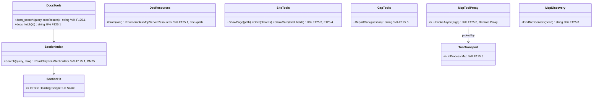
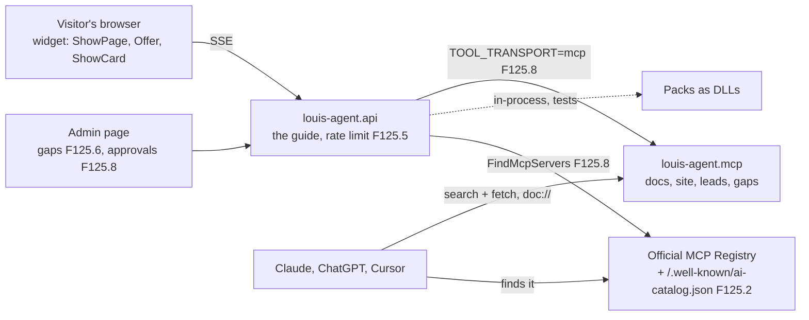
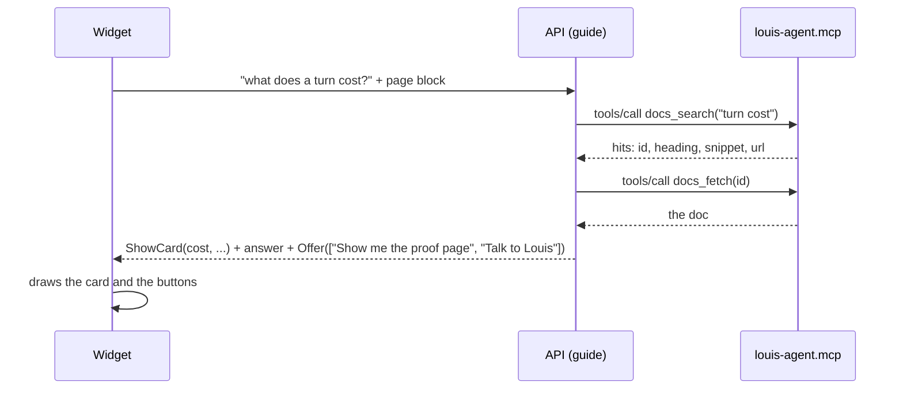
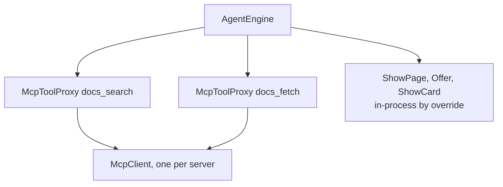

# F125 An agentic site: the guide does more, agents find us, and tools go over MCP

> **Plan, approved by Louis on 2026-11-09** (thread "Make louis-agent.dev more agentic"). A parent with eight
> children, each its own plan, branch and PR when it starts (the development guide, rule 2). Nothing here is built.
> Every choice below was put to Louis with three options and picked by him on 2026-11-09; the research with its
> sources is the doc [Making louis-agent.dev more agentic](https://claude.ai/artifact/NmJUENjagnnPNhxUemquHC). It
> changes only under *Approved during the build*.

## Context

**What Louis asked.** "What we could also add to make our website experience more agentic" (2026-11-09), then: "rework
how we serve docs to the agent and mcp, is it the correct way, what is the standard?", "make our agents capable of
discovering the MCPs and our MCP auto", "I want our agents to use our mcp for tools use and not the dll way", "can we
not have a setting or mode?", "and have both", and "this is all one feature".

**What exists.** The guide in the corner of louis-agent.dev (the expert identity) has three packs: `docs` (`ListDocs`,
`SearchDocs`, `ReadDoc`: a folder listing, an exact-substring grep that returns lines, and a whole file), `leads`
(`SendLead`) and `site` (`ShowPage`, which the widget hears to move the browser, ADR 0105). Each message carries the
page (ADR 0104) and every section has an address (ADR 0107). `louis-agent.mcp` serves the packs' tools and the feeds
as `feed://` resources (F56, ADR 0072), but no public address serves it. Packs load in process as DLLs; ADR 0028 only
keeps them convertible to MCP. The MCP client is F36's draft (`F36-mcp-packs.md`), not built; the Rider discovery
only logs (known limitation 1).

**What the others do.** OpenAI's connectors take exactly a `search` and a `fetch` tool; Microsoft Learn's MCP server
has `microsoft_docs_search` and `microsoft_docs_fetch`; the MCP spec serves documents as resources the app picks;
Anthropic's *Writing effective tools for agents* favours a search that returns context over list-and-read. The
official MCP Registry lists servers by a `server.json`; SEP-2127 server cards and `/.well-known/ai-catalog.json` let a
domain announce its servers. Kapa's website agent shows the owner what it couldn't answer; CopilotKit's generative UI
draws tool calls as components.

## Design

### The shape, in plain words

- **Docs, the standard way (F125.1, F125.2).** Two tools in the common shape: `docs_search(query)` ranks the docs'
  *sections* (each doc split at its headings) with BM25, the classic keyword score, and returns id, title, heading, a
  snippet and the page's public URL; `docs_fetch(id)` returns the whole doc. `ListDocs` goes. The MCP server also
  serves each doc as a `doc://{path}` resource, the way F56 serves feeds. The docs server gets a public address, a
  server card, `/.well-known/ai-catalog.json` on louis-agent.dev and an entry in the official registry
  (`dev.louis-agent/docs`, proved by a DNS record at Cloudflare). Embeddings come later, as their own feature measured
  against BM25 (skill 8).
- **The guide shows more (F125.3, F125.4).** `Offer(choices)` ends an answer with buttons the widget draws; a press
  sends the text. `ShowCard(kind, ...)` draws a card from a fixed catalogue (first a cost card from the ledger and a
  code card); the API checks the kind and fields. Both follow ADR 0105: the model asks as data, the API checks, the
  widget acts.
- **Safe before it spends (F125.5).** A per-visitor rate limit on the guide and prompt-injection tests over the page
  block, before any child below goes live.
- **It learns from visitors (F125.6).** `ReportGap(question)`, called when the docs hold no answer, saves the question
  only (never a name) to Mongo; an admin page counts them; each gap can become an eval sample that fails until the
  docs answer it.
- **Three live demos (F125.7).** Each runs a random identity with a random tool from a safe list (calculator,
  where-to-buy, recipes), on a fixed task, under a daily rand cap; never files, shell, git or dotnet.
- **Tools over MCP, and discovery (F125.8).** One MCP client for our servers and other people's (F36's client,
  folded in). `TOOL_TRANSPORT` (`in-process` or `mcp`, an enum, ADR 0024) is set per host and a pack may override it;
  behind it a Remote Proxy: the engine sees the same `AITool` either way. Production runs `mcp`, tests `in-process`.
  `FindMcpServers(need)` searches the registry and the well-known files; the agent proposes, an admin approves on the
  admin page, and new chats get the server with F36's guard around every result. A chat keeps the tools it opened
  with (ADR 0006, 0008). This amends ADR 0028 in a new ADR.

### Interface design

### Architecture

### Communication: a visitor asks, the guide searches over MCP

### Objects in memory: one guide turn over MCP

### Namespace map (proposed; each child's plan settles it)

| Type | Folder | Namespace | Child |
|---|---|---|---|
| `SectionIndex`, `SectionHit` | `packs/tools/louis-agent.pack.docs/Search/` | `LouisAgent.Packs.Docs.Search` | F125.1 |
| `DocResources` | `src/hosts/louis-agent.mcp/Resources/` | `LouisAgent.Mcp.Resources` | F125.1 |
| `Offer`, `ShowCard` | `packs/tools/louis-agent.pack.site/Tools/` | `LouisAgent.Packs.Site.Tools` | F125.3, F125.4 |
| `GapTools`, `Gap` | a new `packs/tools/louis-agent.pack.gaps/` | `LouisAgent.Packs.Gaps` | F125.6 |
| `ToolTransport`, `McpToolProxy`, `McpDiscovery` | `src/engine/louis-agent.core.mcp/` (new, ADR 0092) | `LouisAgent.Core.Mcp` | F125.8 |

## The children, in build order

| Child | What | Done when |
|---|---|---|
| F125.1 | The docs, the standard way: `docs_search` (BM25 over sections, with URL) and `docs_fetch` (whole doc), `ListDocs` gone, `doc://` resources | The guide's eval holds; a multi-word question finds its section in the top three hits; the golden files reviewed |
| F125.2 | The docs MCP public and findable: an address, a server card, `ai-catalog.json`, the registry entry | `GET /v0.1/servers?search=louis-agent` finds it; Claude Desktop answers from it |
| F125.3 | `Offer(choices)`: buttons under an answer | A walkthrough goes on by a press, no typing |
| F125.4 | `ShowCard`: a cost card and a code card from a fixed catalogue | An unknown kind is refused with its reason; both cards draw in the widget |
| F125.5 | A per-visitor rate limit and prompt-injection tests for the guide | A visitor past the limit is told so; the injection tests pass |
| F125.6 | `ReportGap`, its admin page, a gap as an eval sample | A question the docs can't answer shows on the page with its count |
| F125.7 | Three live demos: safe tools, a fixed task each, a daily cap | The cap stops the fourth run past it; no unsafe tool is reachable |
| F125.8 | Tools over MCP (`TOOL_TRANSPORT`, Remote Proxy) and discovery (agent proposes, admin approves); F36's client folded in, a new ADR amending ADR 0028 | The guide runs with `mcp` and `in-process` and the eval holds on both; a registry server is proposed, approved and used in a new chat |

F125.5 goes before F125.6 and F125.7 go live. The F36 row and its draft stay until F125.8 starts; that child's plan
takes F36's draft as its source and removes the row.

## Verification

Each child's tests first (rule: test first). The guide's eval (the expert's) before and after F125.1 and F125.8, on
Louis's go, since it is a paid run. The hop that `mcp` adds is measured per tool call and shown beside the in-process
time. Free checks: the registry search, Claude Desktop against the public server, the buttons and cards in a browser.

## Concepts, and where they sit in GOAL.md

| Child | Concept | Skill |
|---|---|---|
| F125.1 | Search with context, ranked retrieval over sections | 4 Tool design, 7 Context engineering (8 RAG comes after) |
| F125.2, F125.8 | MCP as the one way to tools, discovery, a full MCP client | 11 Protocols |
| F125.3, F125.4 | Structured outputs a client draws | 5 Structured outputs |
| F125.5 | Rate limits, prompt injection | 15 Safety and security |
| F125.6 | Real questions as eval samples | 12 Evaluation, 17 Observability |
| F125.7 | Live runs under a cap | 13 Cost, 10 Multi-agent |
| F125.8 | A person approves a new server | 16 Human in the loop |

## Decisions taken (Louis, 2026-11-09)

1. The docs over a public MCP address (over llms.txt first).
2. `ShowCard` from a fixed catalogue; 3. `Offer(choices)`.
4. Three live demos of a random identity using random tools; safe tools, fixed tasks, a daily cap.
5. `ReportGap`, then each gap an eval sample.
6. Docs tools as `docs_search` + `docs_fetch`; BM25 over sections, embeddings later; `docs_fetch` returns the whole
   doc (over a section by heading); tools plus `doc://` resources.
7. Our MCP server: a server card plus the official registry. Our agents: the agent proposes, an admin approves.
8. Tools over our MCP, with a setting: `TOOL_TRANSPORT` per host, a pack may override.
9. All of it one feature.

## Approved during the build

- **F124 moved the site and renamed the guide (Louis's picks, 2026-11-09).** Read every path here against it: the
  framework's website is `src/site/louis-agent.site`, its host `src/site/louis-agent.site-api` (the guide on the docs,
  leads and site packs only), and the guide is `src/site/louis-agent.identity.guide` with the id `louis-agent-guide`
  (`GuideIdentity`), no longer the demo's expert ([ADR 0111](../adr/0111-the-frameworks-website-lives-in-src-site.md)).

---
[Plans](README.md) · Related: [F36 draft](F36-mcp-packs.md) · [ADR 0105](../adr/0105-the-guide-acts-on-the-page-through-a-tool-the-widget-hears.md) · [ADR 0072](../adr/0072-feeds-are-mcp-resources.md)
