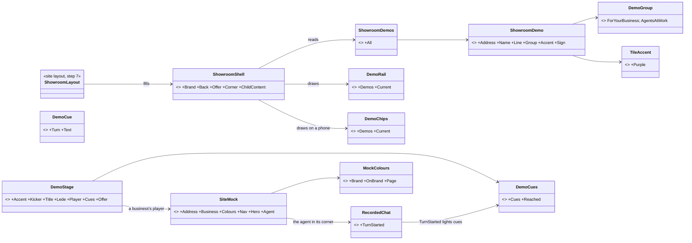
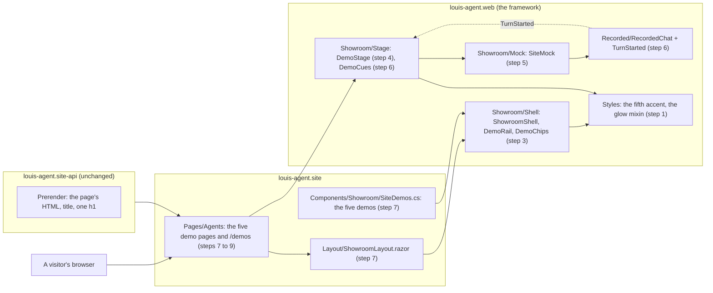
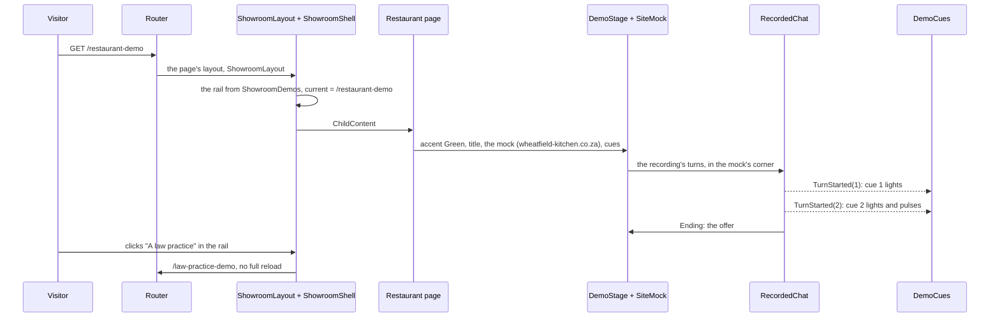
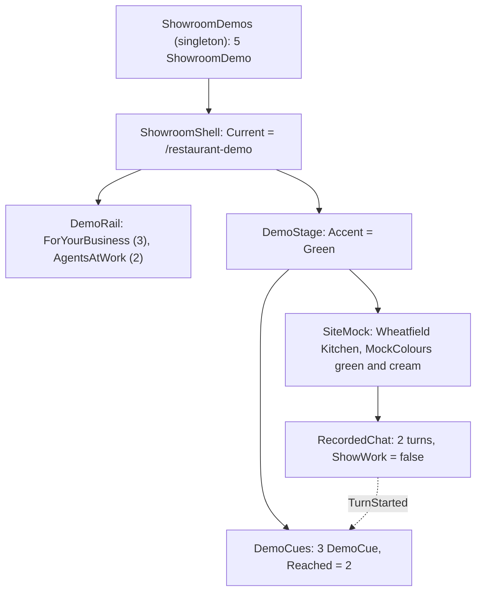

# F127.1 The demo showroom

> **Plan** (2026-11-10), approved by Louis with his picks below. Branch `feature/F127.1-demo-showroom`. The first child
> of **F127** (a site's areas in the framework): the showroom for the demos; the visitor area, the chat portal and the
> admin portal get their own children later. The mockups are [F127.1-mockups/showroom.html](F127.1-mockups/showroom.html)
> (open it in a browser). It changes only under *Approved during the build*.

## Context

The five demos sit today on pages in the landing's frame (`SiteLayout` on the framework's `SiteShell`: the menu, the
section index, slides paged sideways), with an index of tiles at `/demos`. Going from one demo to the next goes back
through the index or the Demos menu, and a business's agent plays in a plain chat window, not on a website like the
visitor's own. F127 names a showroom for the demos as one of a site's areas; this child builds it.

**Louis's picks (2026-11-10):**

| Question | Pick |
|---|---|
| A layout for the demos | Its own, made for demos ("it does not have to follow the layout of the landing page", "geared for demos, with added colors") |
| Which layout, after the research | **The rail and the mocked website combined**: every demo in a rail grouped by what the visitor wants, a business's agent shown on a mock of that business's website, the agents at work in their own windows |
| A colour for the fifth demo | **1a: a fifth accent, purple**, added to the framework's four, so every demo has its own |
| The showroom's header | **2a: a slim bar of its own**: the brand, back to the site, one offer; not the landing's menu |
| How far a mock website goes | **3a: a header, one hero line and the agent in its corner** |
| The look | "make it fancy, it's demos, it can be themed colourful and fancy" |

**The research (2026-11-10):**

- A demo centre is curated and grouped by what the visitor wants, by use case, not by feature
  ([Supademo](https://supademo.com/academy/playbooks/creating-demo-centers),
  [Demoboost](https://demoboost.com/interactive-demo-playbook/demo-gallery)); Appcues's "clear sections by use case and
  'how it works'" ([DemoDash #42](https://demodash.kit.com/posts/show-don-t-tell-42-this-is-what-a-demo-center-should-look-like)).
  Here: *For your business* and *Agents at work*.
- A custom cover per demo, "not just some product screenshot", a big start screen for the main one, and a way in
  wherever a visitor might want to see it work (DemoDash #42); one call to action
  ([Hushly](https://www.hushly.com/?p=103868)).
- Show the agent where the customer meets it: Copilot Studio makes a demo website per agent
  ([Microsoft Learn](https://learn.microsoft.com/en-us/microsoft-copilot-studio/publication-connect-bot-to-web-channels));
  Gardenia's demos use realistic data "so prospects see how their environment would look"
  ([Arcade](https://arcade.software/post/demo-center)).
- Short words in step with what plays: the best demos average about 12 steps at 25 to 30 words a caption
  ([Chameleon](https://chameleon.io/blog/interactive-demo-best-practices)); text that changes with the picture
  ([Framer](https://www.framer.com/marketplace/components/split-screen-slider/)); never cover the demo before it is
  seen ([saasui.design](https://www.saasui.design/blog/saas-product-tour-coachmarks-ux-patterns)).
- No source covers colour coding: one colour per demo is our choice, not a researched practice.

## Design

### The shape, in plain words

- **A showroom frame in the framework**, `ShowroomShell`, as `SiteShell` is for the landing: the slim bar (brand, back
  to the site, one offer), the rail, the stage, the guide's corner. A site fills it in a small layout of its own,
  `ShowroomLayout.razor` (about 30 lines, like `SiteLayout`), and its demo pages name that layout
  (`@layout ShowroomLayout`). The framework names no site (ADR 0084).
- **The demos are data the site gives:** a list of `ShowroomDemo` records (address, name, line, group, accent, sign),
  registered once in the site's `Program.cs`, as `SiteFrames` is. The rail, the phone's chips and the start screen's
  covers are drawn from it, so a new demo is one line and one page.
- **A demo page is a `DemoStage`:** the colour strip, the kicker, the title (the page's h1, FX125), the lede, the
  player, the cues, the offer.
- **A business's player is a `SiteMock`:** a browser frame with the business's address, its header and one hero line in
  its own colours (`MockColours`, the page's data: a mock's look, not the site's theme), and the agent's recorded chat
  in its corner as a widget.
- **Cues light in step:** `RecordedChat` raises `TurnStarted` with the turn's number, and `DemoCues` lights every cue up
  to it, the newest pulsing, a bar over them filling as it plays. A cue names the turn it is about. The triage player
  already shows its steps, so its page has no cues.
- **Addresses stay** (`/restaurant-demo` and the rest): search results, the guide's page index and links keep working;
  `/demos` becomes the showroom's start.

### The look: colourful and fancy

- **Each demo's colour lights its stage:** the stage sets `--demo` from its accent, and the frame paints a large soft
  glow of it from the top right, with faint purple and blue in the corners, over a fine grid that fades out: the
  showroom is colourful whichever demo plays.
- **Covers are glowing tiles:** a gradient of the demo's colour with its sign (🍽, ⚖, ✚, { }, ⇄) and a glow under it;
  the current one's row is tinted and its dot glows. The phone's chips glow the same way.
- **The title fades into the demo's colour**, the strip runs from the colour to nothing, the mock and the work window
  cast a coloured shadow, the offer is a gradient of the colour with a shine crossing it every few seconds, and the
  brand's *Demos* pill wears the current demo's colour.
- **Glows and gradients, never a rainbow:** a gradient runs within one colour (white into it, or it into a lighter
  shade), never through several colours in a row.
- **Motion that stops on request:** the shine, the pulse, the typing dots and the hover lifts all stop under
  `prefers-reduced-motion` or the site's own "less motion" (`preferences.js`), as the frame's reveals do.
- **Colours stay tokens** (`FixedColourTests`): the five accents are tokens; the glows and gradients read them through
  `color-mix` in a shared Sass mixin (`web/tools/_glow.scss`), never a value written into a rule. A mock's business
  colours are the page's data, set as variables on the mock.

### Interface design



```csharp
// src/web/louis-agent.web/Components/Site/Showroom/ (new)
public enum DemoGroup { [WireName("business")] ForYourBusiness, [WireName("at-work")] AgentsAtWork }
public sealed record ShowroomDemo(string Address, string Name, string Line, DemoGroup Group, TileAccent Accent, string Sign);
public sealed record ShowroomDemos(IReadOnlyList<ShowroomDemo> All);              // the site registers it, as SiteFrames
public partial class ShowroomShell { [Inject] ShowroomDemos Demos; [Parameter] RenderFragment? Brand, Back, Offer, Corner, ChildContent; }
public partial class DemoRail  { [Parameter] IReadOnlyList<ShowroomDemo> Demos; [Parameter] string Current; }
public partial class DemoChips { [Parameter] IReadOnlyList<ShowroomDemo> Demos; [Parameter] string Current; }
public partial class DemoStage { [Parameter] TileAccent Accent; string Kicker; RenderFragment Title, Lede, Player, Offer; RenderFragment? Cues; }
public partial class SiteMock  { [Parameter] string Address, Business; MockColours Colours; RenderFragment Nav, Hero, Agent; }
public sealed record MockColours(string Brand, string OnBrand, string Page);       // the business's own, a mock's look
public sealed record DemoCue(int Turn, string Text);
public partial class DemoCues  { [Parameter] IReadOnlyList<DemoCue> Cues; [Parameter] int Reached; }
// changed
public partial class RecordedChat { [Parameter] public EventCallback<int> TurnStarted { get; set; } }   // step 6
public enum TileAccent { None, Red, Green, Blue, Yellow, Purple }                                      // step 1
```

### Architecture



### Communication: a visitor watches the restaurant



### Object diagram: what the restaurant's page holds



### Namespace map

| Type | Folder | Namespace | Step |
|---|---|---|---|
| `TileAccent` (+ `Purple`), the purple token, the glow mixin | `src/web/louis-agent.web/Components/Site/Tiles/`, `Styles/web/settings/_colours.scss`, `Styles/web/tools/_glow.scss` | `LouisAgent.Web.Components.Site.Tiles` | 1 changed |
| `ShowroomDemo`, `ShowroomDemos`, `DemoGroup` | `src/web/louis-agent.web/Components/Site/Showroom/` | `LouisAgent.Web.Components.Site.Showroom` | 2 new |
| `ShowroomShell`, `DemoRail`, `DemoChips` (each with `.razor.cs`, `.razor.scss`) | `…/Components/Site/Showroom/Shell/` | `LouisAgent.Web.Components.Site.Showroom.Shell` | 3 new |
| `DemoStage` | `…/Components/Site/Showroom/Stage/` | `LouisAgent.Web.Components.Site.Showroom.Stage` | 4 new |
| `SiteMock`, `MockColours` | `…/Components/Site/Showroom/Mock/` | `LouisAgent.Web.Components.Site.Showroom.Mock` | 5 new |
| `DemoCue`, `DemoCues` | `…/Components/Site/Showroom/Stage/` | `LouisAgent.Web.Components.Site.Showroom.Stage` | 6 new |
| `RecordedChat.TurnStarted` | `…/Components/Recorded/` | `LouisAgent.Web.Components.Recorded` | 6 changed |
| `ShowroomLayout` | `src/site/louis-agent.site/Layout/` | `LouisAgent.Site.Layout` | 7 new |
| `SiteDemos` | `src/site/louis-agent.site/Components/Showroom/` | `LouisAgent.Site.Components.Showroom` | 7 new |
| `BusinessDemo` and the three business pages | `src/site/louis-agent.site/Components/Showroom/`, `Pages/Agents/Showroom/` | as today | 8 changed |
| `CodingAgentPage`, `TriagePage`, `DemosPage` | `src/site/louis-agent.site/Pages/Agents/` | `LouisAgent.Site.Pages.Agents` | 9 changed |
| `ShowroomDemosTests`, `ShowroomShellTests`, `DemoRailTests`, `DemoStageTests`, `SiteMockTests`, `DemoCuesTests`, `RecordedChatTests` (+ `TurnStarted`) | `src/tests/web/louis-agent.web.tests/Components/Site/Showroom/…`, `…/Components/Recorded/` | `LouisAgent.Web.Tests.Components.Site.Showroom…` | 2 to 6 |
| `ShowroomPagesTests` | `src/tests/site/louis-agent.site.tests/Showroom/` | `LouisAgent.Site.Tests.Showroom` | 7 to 9 |

### Folder trees (after)

```
src/web/louis-agent.web/
├── Components/Site/
│   ├── Showroom/                     # new (steps 2 to 6)
│   │   ├── ShowroomDemo.cs  ShowroomDemos.cs  DemoGroup.cs
│   │   ├── Shell/   ShowroomShell.razor(.cs, .scss)  DemoRail.razor(.cs, .scss)  DemoChips.razor(.cs, .scss)
│   │   ├── Stage/   DemoStage.razor(.cs, .scss)  DemoCues.razor(.cs, .scss)  DemoCue.cs
│   │   └── Mock/    SiteMock.razor(.cs, .scss)  MockColours.cs
│   └── Tiles/TileAccent.cs           # + Purple (step 1)
└── Styles/web/
    ├── settings/_colours.scss        # + the purple token (step 1)
    └── tools/_glow.scss              # new: the glow and gradient mixins (step 1)
src/site/louis-agent.site/
├── Layout/ShowroomLayout.razor       # new (step 7)
├── Components/Showroom/SiteDemos.cs  # new (step 7); BusinessDemo.razor changed (step 8)
└── Pages/Agents/                     # the demo pages name ShowroomLayout (steps 7 to 9)
```

## Steps

Each step one commit with its test, written and seen failing first; the site container rebuilt and the pages looked at
in Chrome at 1920 × 1080 and 390 px before the step is shown.

1. **The fifth accent and the glow.** `TileAccent.Purple`, its token, the colour rule's list grows to five, and
   `web/tools/_glow.scss` (a glow and a gradient from an accent through `color-mix`). Test: a tile in purple wears it;
   the colour rule names five accents.
2. **The demos as data.** `ShowroomDemo`, `ShowroomDemos`, `DemoGroup`: grouped in order, an unknown address none.
   Test: `ShowroomDemosTests`.
3. **The frame.** `ShowroomShell` with the slim bar, `DemoRail` (glowing covers by colour and sign, the current one lit
   and `aria-current="page"`), `DemoChips` on a phone, the corner, the stage's light from `--demo`, motion off on
   request. Test: bUnit, every demo in its group, the current one marked; the chips the same.
4. **The stage.** `DemoStage`: the strip, kicker, title, lede, player, cues and offer, `--demo` from its accent, the
   offer's shine. Test: bUnit, the accent on the stage, the slots in order.
5. **The mock website.** `SiteMock`: the browser bar with the address, the business's header and hero line in its
   colours, the agent in its corner. Test: bUnit, the address, the name, the agent slot in the corner, the colours set.
6. **Cues in step.** `RecordedChat.TurnStarted`; `DemoCues` lights every cue up to the turn reached, the newest
   pulsing, the bar filling. Test: bUnit, a played turn raises its number; cues 1 and 2 lit after turn 2, 3 not.
7. **The site's showroom.** `ShowroomLayout`, `SiteDemos` registered in `Program.cs`, the restaurant's page moved in on
   its mock website with its cues. Test: the restaurant's page draws in the showroom; its address, title and one h1
   kept.
8. **The law and doctor's practices** moved in, each on its own mock website with its cues. Test: every business demo
   in the showroom, each mock with its own address.
9. **The coding agent and the triage team** moved in, in their own players, and `/demos` becomes the start: a big start
   for the restaurant and a glowing cover per demo. Test: every demo page in the showroom; `/demos` leads to each.
10. **Docs.** An ADR (*A site's showroom is an area of the framework*), the site's and the web's design docs, the
    guide's site map skill, the write-up, the work log, the TODO's F127 row; the plan goes.

## Verification

- Per step: the tests of what it touches; the site container rebuilt; at 1920 × 1080 and at 390 px every demo page has
  no sideways scroll, no card cut, one h1, the rail or chips lit for the right demo, the cues lighting as it plays, and
  motion stopping under "less motion".
- Free: the guide asked "show me the restaurant demo" still opens it (its page index is unchanged).
- No paid run: the recordings are played, not run.
- The full suite once, at the end.

## Concepts, and where they sit in GOAL.md

- **Skill 20, extensibility:** a frame the framework owns and a site fills (`ShowroomShell`, as `SiteShell`), and the
  demos as data a site registers, so a new site gets a showroom by listing its demos.
- **Skill 16, human in the loop, shown:** the cues point at the moments a person stays in charge (it asks before
  booking, it never advises, it leaves the commit to you).
- **Skill 18, testing and shipping:** components pinned by bUnit, and a look at two widths before each step is shown.

## Approved during the build

Built unattended (Louis, 2026-11-10: "continue unattended"); placement calls the plan didn't settle:

- **Step 1:** the accents get wire names, and a tile's class is built from them (`accent-{wire}`), so a sixth colour is
  no new switch arm; `web/tools/_accents.scss` gives every accent class `--accent`, which the tile and the showroom
  both draw with. The glow mixin moves to step 3, where it is first used, so no tool sits unused.
- **Steps 3 to 6:** no page draws in the showroom until step 7, so their look is checked in the browser from step 7
  on, when the restaurant moves in; their tests pin the markup. The words around the demos are `ShowroomText`
  (English by default, a site's own copy registered as `AccountText` is), and the frame wears the demo's colour
  through the accent class, so `--accent` is the one variable the showroom draws with (the mockups' `--demo`).
- **Step 5:** the mock's menu and hero are plain words it draws itself (`NavItems`, `HeroLine`, `HeroNote`), not
  markup a page passes in, so its styles reach them without reaching into a page; `MockColours` takes only six hex
  digits, since they are set into the mock's style. The agent's chat keeps the framework's chat look, as the real
  widget does, with its window bar hidden under the widget's head; restyling each message per business would copy the
  chat's styles (the mockups drew light bubbles).
- **2026-11-10, Louis: "make a note that demos will later move to demos.louis-agent.dev":** its own feature, F131,
  in the TODO. The showroom is its own frame with its demos as data, so the move is hosting and addresses, not the
  look; nothing in F127.1 changes for it, and no address here is written for a single host. Then, "demos. and
  framework. together, with a redesign of the framework website": F131 folded into F130, a parent with three
  children (the host by name, `demos.`, `framework.` redesigned).
- **Steps 7 and 8 regrouped:** the three business pages share one component (`BusinessDemo`), so they move into the
  showroom together. Step 7a is the mock's sample branding (its mark, tagline and `MockFont`); step 7 the layout, the
  demos registered and the three businesses moved in; step 8 the coding agent and the triage team; step 9 the start.
- **2026-11-10, Louis: "the demos should also show that the agent can guide you through the website ... the agent
  can navigate the website basically":** of three ways (a real tool, recorded; scripted moves the agent never made;
  or only a link to the live guide) his pick is **the real tool, recorded**: each mock website has a few real places,
  the business agents get `ShowPage` allowed only their own site's places, the recorded chat tells its page when a
  tool call plays so the mock goes there and lights it, and the three conversations are re-recorded with a moment
  that calls for it (one lead mail each, approved). It follows the fuller mock websites ("a bit bland, we need to
  sell it ... give each one a different look"), whose sections are those places.
- **2026-11-10, Louis: "we should just change doctor to something else"** (the doctor's practice repeated the law
  practice's "never plays one"); of three ways (a guesthouse, a car service workshop, or only a new headline) his pick
  is **a guesthouse**: Seemeeu Guesthouse in Yzerfontein, a new voice in the showroom identity, its conversation
  recorded (`ONLY=` in the recording script records one business), `/guesthouse-demo` in its sample brand, and
  `/doctors-practice-demo` redirected there for good.
- **2026-11-10, Louis: "can we have sample branding in the demos also":** each made-up business gets a sample brand
  of its own: a logo mark drawn in SVG for it (never a real business's), its colours, a typeface of its own and a
  tagline, shown in its mock website's header and its widget's head. The mock takes them in step 7 (`MockBrand`), the
  three businesses fill them in steps 7 and 8.
- **2026-11-10, Louis: "no rainbow color", then "glows and gradient works just not rainbow":** the mockups' *Demos*
  pill, page title and start headline ran through several colours; each now runs within one colour. The rule is in
  *The look*.
- **2026-11-10, Louis: "make sure this works"** (the guide's tour on a demo page): the stage's parts are places of
  their own (`top`, `the-demo`, `what-to-watch`, `ask`), each a section with a heading, the player's and the offer's
  heard but not seen; the spotlight keeps inside the screen's width and comes in without growing where growing would
  cross its edge; the showroom's corner stands beside the frame, whose layer had put the guide under its own light.
- **2026-11-10, Louis: "icon looks bad"** (the guesthouse's `⌂`, thin and small beside the others): of the signs tried
  in the rail, only `🛏` draws as one solid colour like `🍽` and `⚖`; `🏡`, `🌊` and `🐚` came out as colour emoji.
- **2026-11-10, Louis: "we can add more steps here where the agent can first show them the room and then they book
  it", "we should do this in all examples":** the navigation pick above, for all three: each conversation shows the
  visitor the thing first (the garden room, the Sunday menu, the consultation) on the mock, then books, and *What to
  watch* gains a cue for each showing.
- **2026-11-10, the open guide covered the stage** (Louis's screenshot of a tour's last stop): of three ways (the guide
  takes the rail's place while open, the stage moves over, or leave it) his pick is **the guide takes the rail**: on a
  wide screen the rail's column widens to the guide's width, the demos step aside and the guide fills the column, in
  styles alone (`:has`); the demos come back when it closes.
- **2026-11-10, Louis: "continue unattended with 7b and the navigation":** five commits, in this order.
  1. *The mock's own page* (7b): `SiteMock` gets a page that scrolls inside it, kept clear of the agent's widget, with
     a hero in one of three looks (`MockLook`: Split, Editorial, Banner, so each business has a look of its own), a
     scene the site draws in SVG, a call to action and a strip of facts; its places are `MockSection` and `MockCard`,
     each with its own address on the mock's site (`/rooms/garden`), lit when shown.
  2. *The three businesses' websites* (7b): the restaurant split, the law practice editorial, the guesthouse a banner,
     each with its sections and cards, every fact one its agent knows (its voice), nothing more.
  3. *A recording tells of its tool calls:* the replay reports each tool call as it plays, as the live runner does
     (`TurnReplay`, `RecordedChat.ToolCalled`); reading a `ShowPage` call's address moves to one place
     (`ShowPageCall`), shared by the widget and the showroom.
  4. *The mock goes there:* `SiteMock.Shown` puts the place's address in the mock's bar, scrolls its page there (a
     module beside it) and lights the place; `BusinessDemo` hands the played call to the mock.
  5. *The agents show, then book:* the showroom businesses get the real `site` toolset beside `leads`, each voice
     says to show a place its website has before it answers, the recording script sends each business's page with the
     first question as the widget does (`src/site/recordings/pages/`, held to the mock's places by a test), the three
     conversations are recorded again (a dry run first, then one lead mail each, approved), and *What to watch* gains a
     cue for each showing.
  Louis, during it: "make the guesthouse the main one": it leads every list of the demos (the rail, the menu, the
  demos page, the landing, the guide's map), and step 9's big start is the guesthouse's.
  The agents use the same `ShowPage` the guide does, so what the demo shows is what a customer's own site would get;
  the mock's places are addresses of the mock's site, which the agent learns from the page the message carries.

---
[Plans](README.md)
