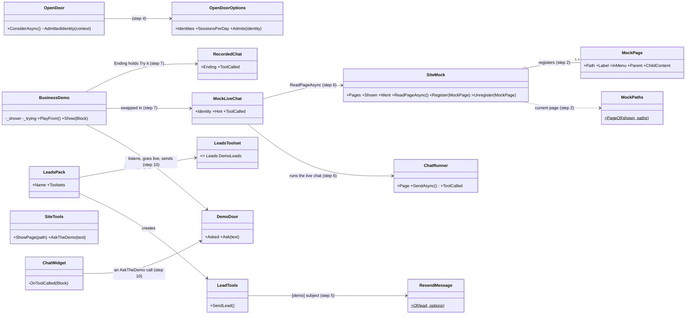
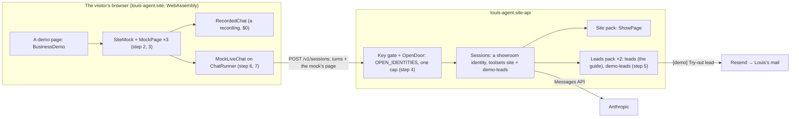
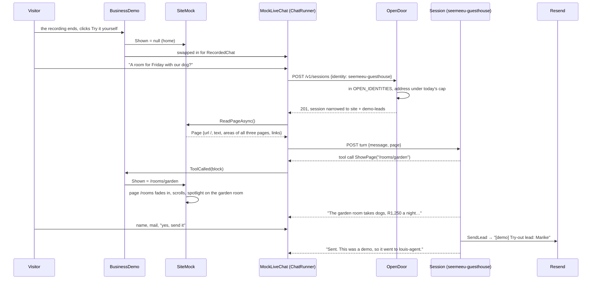
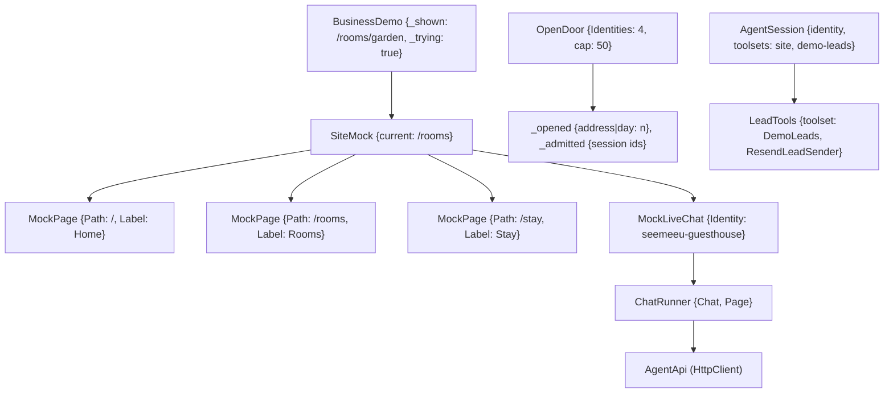

# F127.2 The demos as working websites a visitor can try

> **Plan** (2026-11-10), the second child of F127 *A site's areas in the framework*, after F127.1's showroom (PR #300).
> Drafted from Louis's picks of 2026-11-10 and the findings of the same day, and approved by Louis the same day
> ("approved"). Built on `feature/F127.2-interactive-demos`, and it changes only under *Approved during the build*.
> Its mockups are in [F127.2-mockups/](F127.2-mockups/).

## Context

Louis, 2026-11-10: "the demos must be interactive, 3 pagers with working pages and sections, agents must demonstrate
navigation between pages and sections. when the demo finishes there should be a button try it yourself. Where the
user can interact with the agent on the demo website so the websites must be working examples." For the law
practice: "navigate to the will and estates page, this one is good for page transition".

Today each mock website is one long page. Its agent's ShowPage scrolls that page to a section, and the conversation
is a recording, so nothing runs while a visitor watches. The showroom is the site's selling point ("effort needs to
be invested"). A visitor who can click through a business's website and then talk to its agent themselves sees
what they would buy.

**Louis's picks** (2026-11-10):

| Question | Pick |
|---|---|
| A try-out booking | Mails Louis, marked [demo] |
| What a try costs | The guide's open door only: no sign-in, the same daily cap per address, no cap of its own |
| The three pages | Home · offer · visit: the guesthouse *Home, Rooms, Stay*; the restaurant *Home, Menu, Visit*; the law practice *Home, What we do, Consultations*, with *Wills and estates* its own page |
| Order | F127.1 closed and merged first (done, #300) |
| How a site writes its pages | **Pages register** with the mock, Microsoft's TabSet pattern |
| The door and the businesses | **A list, one cap:** `OPEN_IDENTITIES` |
| How a lead knows it's a demo | **A named demo pack:** the leads pack registered a second time as `demo-leads` |
| What "Try it yourself" gives | **Live in the same widget,** a fresh conversation, with a way back to the recording |
| The phone check's two fixes | Held for this plan: **a shorter chat** on a narrow mock, **the chat above all** of the mock |
| The spotlight's ring cutting the photo above it | **Ring starts at its line:** its top on the section's own line (`inset: 0 -8px -8px`), the spacing as it is (chosen from the four drawn in mockup 6) |
| The chat in the mockups "looks a bit too flat" | **It pops:** a glow in the brand colour, a gradient header with an online dot, answers in bubbles, a rounded composer |
| The three brands | Louis, 2026-11-10: "rework the branding to be world class and fancy". **A brand each**, drawn in mockup 0: Seemeeu a coastal boutique, Wheatfield a Swartland farm bistro, Koringland an established country firm |
| How the brands' faces load | **Self-hosted** woff2 files with their OFL licences, on the demo pages only |
| The guide and the live demo | Louis, 2026-11-10: the tour knows the live demo, helps the visitor use it, and may send a message to it. **The guide sends after a yes** (`AskTheDemo`), and **in F127.2 as step 10**, past the ten-step limit by one, by Louis's choice |
| The guesthouse's line | "should say beach": **A weekend by the beach, with the dog** |
| A way back from a demo to the demos | Asked for 2026-11-10 ("should also have a button back to demos"): **← All demos** in the showroom's bar |

**Done when:**
- Each of the three mock websites has three pages a visitor can click through: the menu, a card that opens its own
  page, and back.
- Each recording shows its agent opening a page and then a section on another page. The law practice's agent goes to
  the Wills and estates page.
- When a recording ends, *Try it yourself* opens a live chat with that business's agent, in the same corner of its
  website, through the open door under the shared cap. Its ShowPage moves the website as the recording's does.
- A try-out booking reaches Louis's mail with `[demo]` in its subject, and the agent tells the visitor it was a demo.
- On a 390 px phone the chat leaves the website's upper part in view, and nothing in the mock draws over the chat.
- The spotlight's ring never covers a neighbouring section.
- Every demo page has a way back to all the demos.
- Each business wears its reworked brand: its mark, its faces and its palette, as mockup 0 draws them.
- On a demo page, the guide knows the demo and its state, helps the visitor try it, and, after the visitor says yes,
  sends a question to the live agent itself, whose answer shows in the demo.

## Design

### What changes, in plain words

- **A mock website has pages.** A site writes each page as `<MockPage Path="/rooms" Label="Rooms">…</MockPage>` inside
  the mock. Each page registers with its `SiteMock` through a cascading value, as Microsoft's TabSet example does
  ([cascading values](https://learn.microsoft.com/aspnet/core/blazor/components/cascading-values-and-parameters#pass-data-across-a-component-hierarchy)),
  so the mock draws its menu from them. Every page is rendered, and only the current one shows. The page reading for
  the live chat then sees every page's places, and a page change needs no re-render of its content.
- **The shown address picks the page.** The current page is the longest page path the shown address starts with
  (`/practice/wills/after-divorce` is on `/practice/wills`, `/stay/breakfast` on `/stay`, `/` is home). That rule is
  a small pure class, `MockPaths`, with its own tests. A page change fades the old page out and the new one in (still,
  for less motion). The mock's own page goes to the top, and then to the section, as today.
- **The hero is home's.** The hero and the facts strip belong to the home page. Another page opens with its own heading.
  The menu words come from the pages, so `NavItems` goes.
- **A visitor can click.** The mock's menu items are buttons, and a card with its own page (Wills and estates) opens it.
  A page that isn't in the menu has a back link to its parent ("← What we do"). Clicks work while the recording plays
  and while trying it live: the website is a working example either way.
- **Try it yourself.** The recorded chat's `Ending` slot (it exists) holds the button. Clicking it swaps the recorded
  chat for `MockLiveChat`: a live chat on the framework's `ChatRunner`, opened as the business's identity, with the
  website back home and a hint with a first question. *Watch the recording* swaps back. Each turn sends the mock's page
  as the guide's widget sends a page:
  - the current page's address, its title and its visible text;
  - every page's places as areas, by their addresses;
  - the menu as links.

  A ShowPage call in the stream moves the mock exactly as a recorded one does. The chat keeps its own store key, so a
  try never mixes with the guide's chats.
- **The door takes a list.** `OPEN_IDENTITY` becomes `OPEN_IDENTITIES` (no alias, ADR 0049): the guide and the three
  businesses. A visitor's sessions per address per day stay one cap across them all. The door marks the identity it
  admitted, and the session handler narrows the session to that identity's own toolsets.
- **Demo leads.** `LeadsToolset` gains `demo-leads`, and `LeadsPack` takes the toolset it is. The site registers it
  twice ([named options](https://learn.microsoft.com/aspnet/core/fundamentals/configuration/options#named-options-support-using-iconfigurenamedoptions),
  in spirit), and the showroom identities list `demo-leads`.
  - A demo lead's mail subject is `[demo] Try-out lead: {Name}`.
  - Its reply to the model says the request went to louis-agent, not to a real business, and to tell the visitor so
    (a tool text, not a prompt rule: ADR 0080).
- **The fixes found on 2026-11-10:**
  - The spotlight's ring starts at its section's own top line (`inset: 0 -8px -8px`), so it never reaches into the
    section above. The spacing stays as it is.
  - `.mock-widget` gets `z-index: 3`, above the banner words' 2 and the photo badge's 1.
  - Below the mock's 760 px the chat is capped at about 40% of the page.
  - The showroom's bar gets **← All demos** (`/demos`) beside *← Back to the site*, on every page but the start.

### Interface design



The signatures, read from the code where the type exists today:

```csharp
// src/web/louis-agent.web/Components/Site/Showroom/Mock/Website/ (new, step 2)
public partial class MockPage : IDisposable                       // registers with the SiteMock that cascades itself
{
    [CascadingParameter] private SiteMock Mock { get; set; }
    [Parameter, EditorRequired] public string Path { get; set; }  // "/", "/rooms", "/practice/wills"
    [Parameter, EditorRequired] public string Label { get; set; } // "Rooms", the menu's word and the page's heading
    [Parameter] public bool InMenu { get; set; } = true;          // false: Wills and estates, opened from its card
    [Parameter] public string? Parent { get; set; }               // its back link: "/practice"
    [Parameter] public RenderFragment? ChildContent { get; set; }
}
public static class MockPaths { public static string PageOf(string? shown, IEnumerable<string> pages); }
// SiteMock (changed, step 2; the page read in step 6). NavItems and Places go.
[Parameter] public RenderFragment? Pages { get; set; }
[Parameter] public EventCallback<string> Went { get; set; }       // a visitor clicked to a page
internal void Register(MockPage page); internal void Unregister(MockPage page);
public Task<Page?> ReadPageAsync();                               // step 6: what the live agent reads
// src/web/louis-agent.web/Components/Site/Showroom/Mock/Live/ (new, step 6)
public partial class MockLiveChat : IAsyncDisposable
{
    [CascadingParameter] private SiteMock Mock { get; set; }
    [Parameter, EditorRequired] public string Identity { get; set; }  // "seemeeu-guesthouse"
    [Parameter] public string Hint { get; set; } = "";                // a first question to ask
    [Parameter] public EventCallback<Block> ToolCalled { get; set; }  // the same hook the recording has
}
// src/hosts/louis-agent.api (changed, step 4)
public sealed record OpenDoorOptions(IReadOnlyList<string> Identities, int SessionsPerDay)
{ public bool IsOpen { get; } public bool Admits(string? identity); }   // OPEN_IDENTITIES, OPEN_SESSIONS_PER_DAY
internal static string? OpenDoor.AdmittedIdentity(HttpContext context); // the mark carries the identity
// packs/tools/louis-agent.pack.leads (changed, step 5)
public enum LeadsToolset { [WireName("leads")] Leads, [WireName("demo-leads")] DemoLeads }
public sealed class LeadsPack(LeadsOptions options, LeadsToolset toolset = LeadsToolset.Leads,
    ILoggerFactory? loggers = null, HttpClient? http = null) : IAgentPack;
public sealed record Lead(string Name, string Contact, string Wants, DateTimeOffset At, LeadsToolset Toolset);
public sealed class LeadTools(ILeadSender sender, TimeProvider time, LeadsToolset toolset);
// src/site/louis-agent.identity.showroom (changed, step 5)
public enum ShowroomPack { [WireName("demo-leads")] DemoLeads, Site }
```

### Architecture



### Communication: a visitor tries the guesthouse's agent



### Object diagram (during a live try)



### Namespace map

| Type | Folder | Namespace | Step |
|---|---|---|---|
| The spotlight ring (`SiteMock`), `MockWidget`'s z-index, phone cap and glow | `…/Showroom/Mock/` (scss only) | unchanged | 1 changed |
| `ShowroomShell` (+ `DemosHref`), `ShowroomText.AllDemos` | `…/Showroom/Shell/`, `…/Showroom/` | `LouisAgent.Web.Components.Site.Showroom(.Shell)` | 1 changed |
| `MockPage`, `MockPaths` | `src/web/louis-agent.web/Components/Site/Showroom/Mock/Website/` | `LouisAgent.Web.Components.Site.Showroom.Mock.Website` | 2 new |
| `SiteMock` (pages, menu, `Went`, the hero on home) | `…/Showroom/Mock/` | `LouisAgent.Web.Components.Site.Showroom.Mock` | 2 changed |
| `SeemeeuSite`, `WheatfieldSite`, `KoringlandSite` (from `…Places`, renamed in Rider) | `src/site/louis-agent.site/Components/Showroom/Websites/` | `LouisAgent.Site.Components.Showroom.Websites` | 3 renamed |
| The three demo pages (no `NavItems`) | `src/site/louis-agent.site/Pages/Agents/Showroom/` | unchanged | 3 changed |
| `recordings/pages/*.json` (the new addresses) | `src/site/recordings/pages/` | — | 3 changed |
| `OpenDoorOptions`, `OpenDoor`, `SessionHandlers` | `src/hosts/louis-agent.api/Config/`, `Endpoints/Routing/`, `Endpoints/Sessions/` | unchanged | 4 changed |
| `LeadsToolset`, `LeadsPack`, `Lead`, `LeadTools`, `ResendMessage`, `LeadsToolMessage` | `packs/tools/louis-agent.pack.leads/…` | unchanged | 5 changed |
| `ShowroomPack`, `SiteCatalog` | `src/site/louis-agent.identity.showroom/`, `src/site/louis-agent.site-api/` | unchanged | 5 changed |
| `MockLiveChat`; `SiteMock.ReadPageAsync` and `pageOf` in `SiteMock.razor.js` | `…/Showroom/Mock/Live/`, `…/Showroom/Mock/` | `LouisAgent.Web.Components.Site.Showroom.Mock.Live` | 6 new / changed |
| `BusinessDemo` (try mode), the try texts | `src/site/louis-agent.site/Components/Showroom/` | unchanged | 7 changed |
| `MockFont` (the brands' faces), `MockColours` (+ a label colour); the three demo pages' brands and marks | `…/Showroom/Mock/`, `src/site/louis-agent.site/Pages/Agents/Showroom/` | unchanged | 9 changed |
| `SiteTools.AskTheDemo`, `SiteToolMessage` | `packs/tools/louis-agent.pack.site/Tools/`, `Messages/` | unchanged | 10 changed |
| `AskTheDemoCall` | `src/web/louis-agent.web/Chats/` | `LouisAgent.Web.Chats` | 10 new |
| `DemoDoor` | `src/web/louis-agent.web/Components/Widget/Door/` | `LouisAgent.Web.Components.Widget.Door` | 10 new |
| `ChatWidget` (hands the call on), `ChatWidget.razor.js` (the demo's state); `DemoStage` (marks its demo); `BusinessDemo` (listens at the door) | `…/Components/Widget/`, `…/Showroom/Stage/`, `src/site/…/Components/Showroom/` | unchanged | 10 changed |
| The guide's voice, *On a demo page* | `src/site/louis-agent.identity.guide/prompts/…` | — | 10 changed |
| The three voices' *Showing your website* | `src/site/louis-agent.identity.showroom/prompts/…/voice.md` | — | 8 changed |
| Tests: `MockPagesTests`, `MockPathsTests`, `MockLiveChatTests` | `src/tests/web/louis-agent.web.tests/Components/Site/Showroom/Mock/{Website,Live}/` | `LouisAgent.Web.Tests.Components.Site.Showroom.Mock.{Website,Live}` | 2, 6 new |
| Tests: `OpenDoorTests` | `demos/puls/tests/louis-agent.api.tests/Endpoints/Routing/` | unchanged | 4 changed |
| Tests: `LeadToolsTests`, `ResendMessageTests`, `SiteCatalogTests` | `packs/tests/louis-agent.pack.leads.tests/`, `src/tests/site/…` | unchanged | 5 changed |
| Tests: `ShowroomPagesTests`, `ShowroomRecordingsTests`, `BusinessDemoTests` | `src/tests/site/louis-agent.site.tests/…` | unchanged | 3, 7, 8 changed |

### Folder tree (after)

```
src/web/louis-agent.web/Components/Site/Showroom/Mock/
├── Menu/          (as it is)
├── Places/        MockSection, MockCard (as they are)
├── Website/       MockPage.razor(.cs, .scss), MockPaths.cs            ← step 2
├── Live/          MockLiveChat.razor(.cs, .scss)                       ← step 6
├── MockColours.cs, MockFont.cs, MockLook.cs
├── MockWidget.razor(.cs, .scss)
└── SiteMock.razor(.cs, .js, .scss)
src/site/louis-agent.site/Components/Showroom/Websites/
└── SeemeeuSite.razor, WheatfieldSite.razor, KoringlandSite.razor      ← step 3, renamed
```

## Steps

1. **The fixes from 2026-11-10.**
   - The spotlight's ring keeps off its neighbour: it starts at its section's own top line.
   - The chat sits above the mock (`z-index: 3`), and is about 40% of the page on a narrow mock.
   - **← All demos** in the showroom's bar, on every page but the start.
   - The guesthouse says *beach*: "A weekend by the beach, with the dog", in its heading, its line in the demos' list
     and its search description.
   - The chat pops, as the mockups draw it:
     - a glow in the business's colour;
     - a one-colour gradient header with an online dot;
     - the agent's answers in bubbles;
     - a rounded composer with a send button in the brand colour.

   Tests first: `FrameworkStylesTests` (the ring's top, the z-index, the cap, the glow), `ShowroomShellTests` (the
   link is there on a demo, and not on the start).
2. **Pages in the mock.**
   - `MockPage` registers with `SiteMock` (TabSet), and the mock draws its menu from the pages.
   - `MockPaths.PageOf` picks the page (longest prefix).
   - The hero and the facts are home's; another page opens with its heading.
   - A fade between pages (none for less motion). The menu and a page's back link are buttons that raise `Went`.

   Tests first: `MockPathsTests` (`/`, a page, a section, a sub-page, an unknown address goes home), `MockPagesTests`
   (the menu lists the pages in order, only the current page shows, a menu click raises `Went`, the hero only on
   home).
3. **The three websites, three pages each.**
   - `SeemeeuSite`: Home, Rooms (the three rooms), Stay (breakfast, the beach, staying with us).
   - `WheatfieldSite`: Home, Menu (the courses, for the children, wine), Visit (finding us, the hours, booking).
   - `KoringlandSite`: Home, What we do (four cards), Consultations (the first consultation, what to bring), and
     Wills and estates as its own page under What we do. Its content is made up but true to South African law in
     outline, as mockup 2 draws it:
     - what a will covers, and how it is signed and witnessed;
     - without a will (the Intestate Succession Act);
     - after a divorce (the three-month rule);
     - married in community of property;
     - an estate, step by step;
     - the fees.
   - The recordings' page files take the new addresses.

   Tests first: `ShowroomPagesTests` (three menu pages each, the wills page opens from its card and goes back, the
   page files list exactly the mock's places). The old recordings' moved addresses go nowhere until step 8, which the
   test of the recordings says.
4. **The door takes a list.** `OPEN_IDENTITIES`, one cap across them, the session narrowed to the identity the
   door admitted. The site's settings, compose files, launch settings and Azure yaml; the coding demo's compose.
   Tests first in `OpenDoorTests`:
   - each listed identity passes;
   - one not listed is the key's business;
   - the cap counts across identities;
   - the session is narrowed to the identity asked for, never another.
5. **Demo leads.** `LeadsToolset.DemoLeads`, `LeadsPack` by toolset, the `[demo]` subject, the demo replies
   (`SentDemo`, `LoggedDemo`); `SiteCatalog` registers both; `ShowroomPack.DemoLeads`. Tests first:
   - a demo lead's subject and body;
   - the demo reply says it was a demo;
   - the guide's leads are unchanged;
   - the catalogue has both, and the showroom identities list `demo-leads`.

   The goldens that pin tool texts are regenerated and reviewed.
6. **The live chat on the mock.** `MockLiveChat` on `ChatRunner`, opened as its identity, with its own chat key.
   `SiteMock.ReadPageAsync` reads the current page's text, every page's places and the menu (`pageOf` in the mock's
   module). A ShowPage in the stream raises `ToolCalled`. Tests first with the fixture API:
   - the session is opened as the identity;
   - the first turn carries the mock's page;
   - a ShowPage block raises `ToolCalled`.
7. **Try it yourself.** In `BusinessDemo`: the button in the recording's `Ending`, the swap, the website home, the
   hint, and *Watch the recording* back. Tests first in the site's tests:
   - the button shows only once the play has ended;
   - clicking it swaps the chat and sends the website home;
   - *Watch the recording* swaps back.

   Checked by hand on the PC (a live try each, from the $250 credit, the cost reported after).
8. **The voices and the recordings.** Each voice's *Showing your website* learns pages and sections: open the page,
   then the place. Three conversations are recorded again, and each opens a page and then a section on another page.
   The law practice's opens the Wills and estates page. The cues are re-pointed. Tests first in
   `ShowroomRecordingsTests`: each recording shows at least two pages and one section.

   Paid, from the credit, the cost reported after. A recording's booking runs with `SEND_MAIL` off unless Louis says
   to mail.
9. **The three brands, reworked** (mockup 0). Each business gets:
   - a new mark;
   - a wordmark in a display face;
   - a text face and a face for small capitals;
   - a palette of four named colours;
   - its header's own treatment.

   The brands:

   | Business | Look | Faces | Palette |
   |---|---|---|---|
   | Seemeeu | A coastal boutique | Cormorant Garamond and Jost | Atlantic, sea glass, sand, salt |
   | Wheatfield | A Swartland farm bistro | Gloock, Lora and Josefin Sans | Olive, wheat, harvest, linen |
   | Koringland | An established country firm, its shield with a wheat ear | Bodoni Moda and Hanken Grotesk | Midnight, brass, vellum, parchment |

   `MockFont` gains the faces, and `MockColours` a label colour. The faces are **self-hosted** (Louis's pick,
   2026-11-10):
   - each one's woff2, the Latin subset, about 200 KB for all seven;
   - each with its SIL Open Font License file;
   - in the framework's `wwwroot`, loaded by `@font-face` with `font-display: swap` on the demo pages only.

   No third party sees a visitor. Downloading the files is covered by the pick. Tests first: each face's class and
   its stack, each demo's brand. Checked by eye at 1920×1080 and 390 px.
10. **The guide helps with the live demo** (Louis: "our tour should also know of the live demo and should be able to
    help the user use the AI, should even be able to send a message to the live instance to show the user how it
    works, if the user wants it").
    - **The guide sees the demo.** The stage marks the demo it holds: the business, its identity, and whether the
      play is running, ended or live. The guide's page reading adds it to what the guide reads, with the live chat's
      last lines.
    - **`AskTheDemo(text)`** goes in the site pack, a tool the browser carries out, as ShowPage is. Its description
      says to call it only after the visitor said yes to the question it will send (Louis's pick, the way SendLead
      works). The browser hands the text to a `DemoDoor`, a door like the `GuideDoor`, and `BusinessDemo` swaps to
      live and sends it. The business's answer then shows in the demo's chat and moves the website as usual.
    - **The guide's voice** gets a section *On a demo page*: what the demo shows, how to try it, offering to show by
      asking one question for the visitor, and asking first.

    Tests first:
    - the tool's address check and its texts (the goldens regenerated);
    - `AskTheDemoCall` reads a call;
    - the widget hands an `AskTheDemo` call to the `DemoDoor`;
    - `BusinessDemo` goes live and sends the text;
    - the page carries the demo's state.

    Checked by hand: one guided try per business, from the credit.
11. **Docs.**
   - ADR 0116 *A showroom's demos can be tried live, through the open door*: the list under one cap, demo leads
     marked. ADR 0099 links to it.
   - The project docs (web, site, API, the leads pack, the showroom identity) and `.env.example`.
   - The films, if their hash moved.
   - The write-up's F127.2 section, the work log's row, the TODO.
   - The full suite. This plan is deleted.

## Verification

- **Each step:** the tests it touches; `core.tests` when a folder or a name is added (steps 2, 3, 6).
- **By hand, free:**
  - The site container rebuilt.
  - Each demo at 1920×1080, paging through.
  - Each at 390 px in DevTools' device mode (Louis turns it on, since the extension pins the page's width).
  - The menu, the wills card and the back link clicked.
  - The ring beside a photo section.
- **Paid, from the credit, reported after:** one live try per business (step 7), and the three recordings (step 8).
  A lead mail to Louis only with his yes at that step.
- **Full suite** once, in step 11.

## Concepts, and where they sit in GOAL.md

- **Tool design** (skill 4): ShowPage stays a pure tool. The browser acts on the call, so the same tool moves the real
  site and a mock of a customer's site. A demo lead's reply tells the model the truth.
- **Context engineering** (skill 7): the page a live agent reads is built in code from what is on screen: the current
  page's text, every page's places, the menu.
- **Cost** (skill 13): a live try spends real tokens. One cap per address across all the open identities keeps the
  door's worst day what it is today.
- **Safety** (skill 15): the door is an allow-list, closed by default. A visitor's session is narrowed in code to the
  identity it asked for and that identity's packs.
- **Extensibility** (skill 20): one pack, two named instances. A site's pages compose by registering with their mock.

## Approved during the build

- **Step 1, the chat minimises and maximises** (2026-11-10, Louis: "we should have an minimize and maximize"). The
  mock's chat gets two buttons in its head, as a chat window has:
  - minimised, it folds to its head and the whole website shows;
  - maximised, it covers the mock to read the conversation;
  - each button says *Restore* while its size is on.

  One size at a time is held by `MockWidgetSize`, and the words are `ShowroomText`'s.
- **The guide's chat minimises and maximises too** (2026-11-10, Louis, of the guide's widget on the landing: "should
  also have minimize and maximize"). Its own commit after step 2. The buttons and the one-size-at-a-time rule are
  shared with the mock's chat, not copied. Docked in the showroom's rail column they're hidden (Louis: "minimize and
  maximise do not make sense here"), since the guide already fills the column there.
- **Step 2 keeps a mock without pages drawing as it did**, its `NavItems` and `Places`, so each commit stays green
  while the three websites still have one page. Step 3 moves them onto pages and deletes both.
- **Step 3, as built:**
  - The three websites moved with `git mv`, not Rider's rename: they are markup-only components, and Rider finds no
    symbol in them. Each had one use.
  - A card opens a page of its own with a *Read more →* under its words (`MockCard.Opens`). Each home page uses it
    for its other two pages, and What we do for Wills and estates.
  - The wills page's fee line keeps the practice's real first consultation, 30 minutes for R650, not the hour for
    R850 the mockup drew.
  - The law practice's voice learns what the wills page says, in this step rather than step 8, since a test holds
    every price on a website to its agent's voice. It may name and open a part of the page, and never apply it to
    anyone's case.
  - The recordings' page files list the pages too, marked "(page)", before the places on them.
- **A page change loads like a browser** (2026-11-10, Louis: "we need a clear transition effect when this happens";
  his pick of three). The new address glows in the bar, a loading line in the business's colour runs under it, and
  the old page fades as the new one slides up, in about 0.6 s, still for less motion. Its own commit after step 4.
- **Step 5, demo leads by the identity, not a second pack** (2026-11-10, Louis's pick of three, then "why not 2"). The
  catalogue refused the planned second registration of the leads pack: two tools named `SendLead`, and tool names are
  unique so packs stay convertible to MCP. Instead:
  - `IAgentIdentity.IsDemonstration` is false unless an identity says so, and the showroom's three say true;
  - core holds who a turn runs as in `TurnIdentity` (ambient, as `UserPlace`), and the API's turn sets it from the
    session;
  - the leads pack reads it, so a demonstration's lead is marked `[demo] {identity}: {name}` and the model hears it
    was a demonstration.

  One leads pack, `SendLead` everywhere, no setting. The plan's `demo-leads` toolset, `ShowroomPack.DemoLeads` and
  `LeadsPack(options, toolset)` are not built.
- **Step 8 comes right after step 5** (2026-11-10, Louis's pick of three, after "no navigation" and "navigated to the
  main page should have gone to stay"). The recordings from before step 3 show the old addresses, so the agents don't
  move the websites. Recording them after step 5 carries the demo booking reply, in one run. The steps keep their
  numbers. The order is 5, 8, 6, 7, 9, 10, 11.
- **Step 1's style tests** sit in a new `MockStylesTests` beside the mock's other tests, not in
  `FrameworkStylesTests`, since they read the mock's own component styles. The widget's buttons are in
  `MockWidgetTests`, and the guesthouse's *beach* in the site's `ShowroomPagesTests`.

- **Step 10, the guide presses the demo's buttons** (2026-11-10, Louis: "let him click the buttons", after the guide
  answered "I can't press play from here"). The guide gets **a tool per button** (Louis's pick of three):
  - `PlayTheDemo(turn?)`: Play it again, or a cue's *watch from here*;
  - `TryTheDemo()`: Try it yourself;
  - `WatchTheRecording()`: back to the recording;
  - `AskTheDemo(text)`: as planned, still only after a yes.

  The browser carries out all four through the one `DemoDoor`, and the guide's voice says when to use each.

---
[Docs index](../README.md) · [Plans](README.md) · Previous: F127.1 (done, PR #300)
