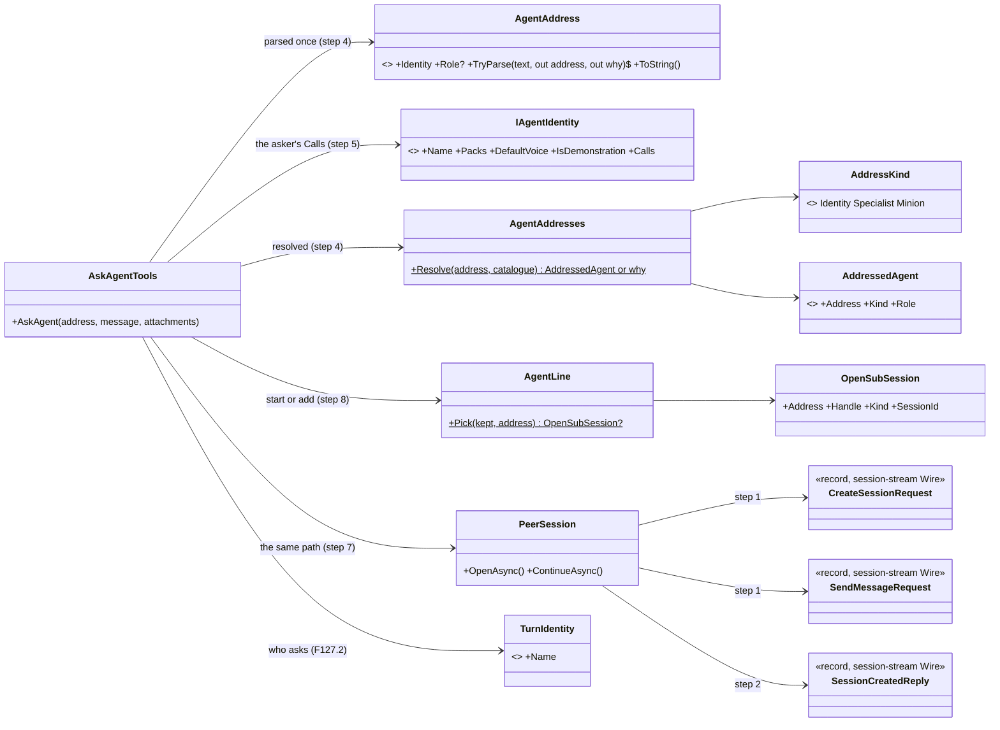
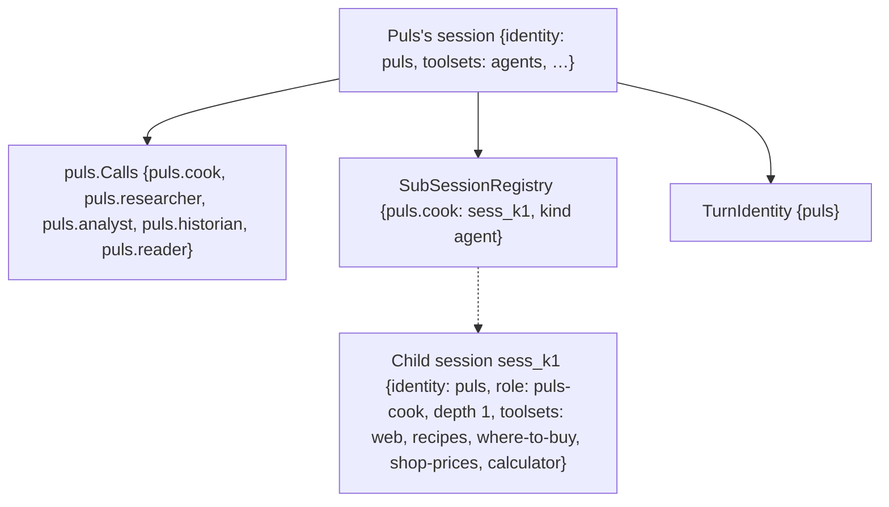

# F127.3 One address for every agent call, and AskAgent

> **Plan**, drafted 2026-11-10 on `feature/F127.3-one-address`, awaiting Louis's approval. F127's third child; the
> decision is [ADR 0117](../adr/0117-one-address-for-every-agent-call.md), drawn on
> [the plan page](https://claude.ai/artifact/TdTWru63EMWhCC7EiJjQk9). It changes only under *Approved during the
> build*. F127.4 (the guide mentors on a live demo) and F127.5 (the minions on the address) get their own plans.

## Context

**What Louis asked (2026-11-10):** "you should be able to call an identity --> identity, identity -->
identity.specialist, identity --> specialist, identify --> minion", "puls could call louis-agent.cook?", "we already do
it with puls so what is different", and his picks: one tool that starts or adds (`AskAgent`), `StartMinion` apart on
the same address, the session wire as shared records in `louis-agent.session-stream`, the toolset named `agents`.

**What exists:**

- `SpecialistTools` (core's `specialists` toolset): `StartSubSession(toolsets, message, agent, role, attachments,
  llm)` opens a session on a peer in `AGENT_PEERS` at depth 1 and asks it; `ContinueSubSession(handle, …)` adds to a
  kept one. Both on `PeerSession`, which writes its requests as anonymous objects and reads the reply by property name.
- The API opens a session with `identity` and `role`, and looks the role up **at the level the depth names**: depth 0
  an agent's mode, 1 a specialist, 2 a minion (`AgentSessions.Create`, `SkillLoader.ToolsetsOf(role, (RoleLevel)depth)`).
- Puls's voice tells its model to call `StartSubSession(toolsets, message, role: "puls-cook")`, naming the toolsets
  itself. The cook's header lists `recipes, where-to-buy, shop-prices, calculator` but not `web`, which its text says
  it has (FX129).
- The browser writes its own create body (`CreateSessionBody`); the API's request records are `internal`.
- About 75 files outside the replay data name `StartSubSession` or `ContinueSubSession`: core, the API's stream, the
  web's delegation card and its fixtures, the evals' tool checks, Puls's voice and evals, the site's detailed film,
  and the docs. Puls's 989 stored replay answers name them too (git-ignored).

**Not in this plan:** the guide calling the businesses (F127.4), the visitor's address on a guided start (F127.4),
`StartMinion` on the address (F127.5), an address on another instance (pick 2).

## Design

### What changes, in plain words

- **An address names who answers:** `{identity}` or `{identity}.{role}`, read once into `AgentAddress` (a Value
  Object, in `louis-agent.composition`). Core resolves it against the catalogue: the identity in its default voice, a
  specialist (`specialists/{identity}-{role}.md`) or a minion role (`minions/{identity}-{role}.md`). The role part is
  the role file's name without its identity's prefix: `puls.cook` is `puls-cook`, `puls.minion-find-recipe` is
  `puls-minion-find-recipe`.
- **An identity says whom it may call:** `IAgentIdentity.Calls`, none unless it says so. Puls lists its specialists.
  An address it doesn't list is refused with the reason and the ones it may call.
- **One tool asks:** `AskAgent(address, message, attachments)` in core's `agents` toolset, which replaces
  `specialists`. It adds to this chat's session with that address if there is one, else starts one at depth 1. No
  peer, toolsets, role or model to pick: the role's header brings its toolsets.
- **A role's level is where its file is** (pick 1): depth stays how deep the call is (a child can't call further),
  and the prompt level comes from the role's own folder, so a business's voice can be asked as a child.
- **The session wire is shared records** in `louis-agent.session-stream/Wire/`: the API reads them, core's
  `PeerSession` and the browser write them, and the replies are read typed.
- **Puls moves onto it:** its voice says `AskAgent("puls.cook", …)`, the cook's header gains `web` (FX129), the
  web's delegation card and the evals read `AskAgent`, and `SpecialistTools` goes.

### Picks for Louis

**1. How a business's voice can be asked as a child** (the API ties a role's level to the depth today).

| Option | Pattern | What it changes | Cost |
|---|---|---|---|
| **A. A role's level from its file, the depth apart** (recommended) | Separate two concerns that were one (Fowler, *Split Phase* in spirit) | The API finds a role's level by the folder its file sits in; depth stays the nesting count and its guards (no `agents` at depth 1, minions at 2) | One lookup and its tests, and a new test that no role name sits in two levels (none does today) |
| B. Open an identity's voice at depth 0, a `parent` tag naming the asker | — | No change to how roles load | The child loses the depth guard: only `Calls` stops it calling further |
| C. Give each askable identity a specialist copy of its voice | — | Nothing in the API | A second voice per identity to keep in step with the first |

**2. Where an address reaches.**

| Option | What it changes | Cost |
|---|---|---|
| **A. This instance's catalogue only** (recommended) | The address is checked against the catalogue the host runs; the call goes to this instance, the one peer in `AGENT_PEERS` (as Puls names itself today) | Nothing for a future no plan names (ADR 0055); another instance is a later pick |
| B. An address may name a peer, `peer:identity.role` | One more part to parse and test | A peer prefix every model must get right |
| C. A setting maps identities to peers | A second setting beside `AGENT_PEERS` | A map to keep true |

**3. The measure of Puls's move** (a live eval waits for Louis's go, ADR 0029).

| Option | What it changes | Cost |
|---|---|---|
| **A. The recipes eval before (on main) and after, and Puls's replays recorded again** (recommended) | Proves the cook answers as well through `AskAgent`; the replays work again | Two paid runs and a recording, from the credit, reported after |
| B. After only, against the last recorded run | One paid run | The last run is older; a difference could be anything since |
| C. No eval: the tests and one live question by hand | Free but for one question | Nothing measures the cook's answers |

### Interface design



```csharp
// src/engine/louis-agent.composition/Agents/ (new, step 4)
public sealed record AgentAddress(string Identity, string? Role)                  // Value Object
{ public static bool TryParse(string? text, out AgentAddress? address, out string? why); public override string ToString(); }
// src/engine/louis-agent.composition/Packs/IAgentIdentity.cs (changed, step 5)
IReadOnlyList<string> Calls => [];                                                 // the addresses it may call

// src/engine/louis-agent.core/Delegation/Addresses/ (new, step 4)
public enum AddressKind { Identity, Specialist, Minion }
public sealed record AddressedAgent(AgentAddress Address, AddressKind Kind, string Role);   // Role: the file's name
public static class AgentAddresses { public static AddressedAgent? Resolve(AgentAddress address, AgentCatalog catalogue, out string? why); }

// src/engine/louis-agent.core/Delegation/ (new, steps 7 and 8; SpecialistTools deleted in step 9)
public sealed class AskAgentTools(AgentOptions options, AgentCatalog catalogue, IUsageSink? usageSink = null)
{ public async Task<string> AskAgent(string address, string message, string[]? attachments = null, CancellationToken cancel = default); }
internal static class AgentLine { public static OpenSubSession? Pick(SubSessionRegistry kept, AgentAddress address); }
public enum CoreToolset { Agents, Minions, Skills }                                // Specialists goes (step 9)

// src/engine/louis-agent.session-stream/Wire/ (moved, steps 1 and 2), public, snake_case on the wire as today
public sealed record CreateSessionRequest(string? Task, string? Run, string? Service, List<string>? Toolsets = null,
    int Depth = 0, string? Parent = null, string? Location = null, string? TimeZone = null, string? Llm = null,
    string? Tool = null, string? Role = null, string? Stream = null, ReplayRequest? Replay = null, string? Identity = null);
public sealed record SendMessageRequest(string? Message, List<AttachmentRequest>? Attachments, PageRequest? Page = null);
public sealed record SessionCreatedReply(…);                                       // from louis-agent.api.contracts
// the API keeps what reads them: CreateSessionRequestReading.RoleOrNull(), .IdentityOrNull(), .StreamFormatOrNull(), .Place()

// src/hosts/louis-agent.api/Sessions/AgentSessions.cs (changed, step 6): a role's level from its file
private static RoleLevel LevelOf(string role, int depth);
```

### Architecture

```mermaid
flowchart LR
    subgraph asker["An identity's session (depth 0)"]
        model["The model: AskAgent(\"puls.cook\", …)"]
        tools["AskAgentTools (core, agents toolset): parse, resolve, check Calls, start or add"]
        model --> tools
    end
    peer["PeerSession: shared Wire records, the key, limits, usage roll-up"]
    tools --> peer
    subgraph api["The API (this instance, AGENT_PEERS)"]
        create["POST /v1/sessions {identity, role, depth 1}"]
        level["AgentSessions: the role's level from its file (step 6)"]
        child["The child: puls in the role puls-cook, its header's toolsets"]
        create --> level --> child
    end
    peer --> create
    child -. "sub_session events, live" .-> browser["The browser's delegation card (reads AskAgent, step 9)"]
```

### Communication: Puls asks its cook, then follows up

```mermaid
sequenceDiagram
    participant M as Puls's model
    participant T as AskAgentTools
    participant C as Catalogue
    participant P as PeerSession
    participant A as The API
    participant K as puls as puls-cook
    M->>T: AskAgent("puls.cook", "Plan three dinners under R400")
    T->>T: AgentAddress.TryParse: identity puls, role cook
    T->>C: resolve: specialists/puls-cook.md, a specialist; puls's Calls lists it
    T->>T: AgentLine: no session with puls.cook in this chat, start one
    T->>P: CreateSessionRequest {identity: puls, role: puls-cook, depth: 1}
    P->>A: POST /v1/sessions, then POST …/messages {message}
    A->>K: the turn, with the cook's header toolsets (web, recipes, …)
    K-->>A: events, live
    A-->>M: sub_session events (the card), then the answer, kept under puls.cook
    M->>T: AskAgent("puls.cook", "Swap the fish for chicken")
    T->>T: AgentLine: this chat has puls.cook, add to it
    T->>P: POST …/messages on the kept session
```

### Object diagram (after the first ask)



### Namespace map

| Type | Folder | Namespace | Step |
|---|---|---|---|
| `CreateSessionRequest`, `SendMessageRequest`, `AttachmentRequest`, `PageRequest` (+ its parts), `ReplayRequest` | `src/engine/louis-agent.session-stream/Wire/` | `LouisAgent.SessionStream.Wire` | 1 moved from the API |
| `CreateSessionRequestReading` (the API's reads of the request) | `src/hosts/louis-agent.api/Sessions/Requests/` | `LouisAgent.Api.Sessions.Requests` | 1 new |
| `SessionCreatedReply` and the other session replies, `SessionJson` | `src/engine/louis-agent.session-stream/Wire/` | `LouisAgent.SessionStream.Wire` | 2 moved from `louis-agent.api.contracts` |
| The cook's header (`web`), a test holding every role's header to its text | `demos/puls/identity/…/prompts/specialists/`, Puls's tests | — | 3 changed (FX129) |
| `AgentAddress` | `src/engine/louis-agent.composition/Agents/` | `LouisAgent.Composition.Agents` | 4 new |
| `AddressKind`, `AddressedAgent`, `AgentAddresses` | `src/engine/louis-agent.core/Delegation/Addresses/` | `LouisAgent.Core.Delegation.Addresses` | 4 new |
| `IAgentIdentity.Calls`; `PulsIdentity.Calls` | `src/engine/louis-agent.composition/Packs/`; `demos/puls/identity/…` | unchanged | 5 changed |
| `AgentSessions` (a role's level from its file) | `src/hosts/louis-agent.api/Sessions/` | unchanged | 6 changed |
| `AskAgentTools`, `CoreToolset.Agents`, `prompts/toolsets/agents.md`, `SubSessionToolMessage` | `src/engine/louis-agent.core/Delegation/`, `Agent/Toolsets/`, `prompts/toolsets/` | unchanged | 7 new |
| `AgentLine`, `OpenSubSession.Address` | `src/engine/louis-agent.core/Delegation/`, `Sessions/SubSessions/` | unchanged | 8 new / changed |
| `SpecialistTools`, `specialists.md` (deleted); Puls's voice; `Delegation` (the web); the evals' tool checks; the site's detailed film; the stream fixtures; the goldens | core, `demos/puls/…`, `src/web/…/Chats/`, `src/evals/…`, `src/site/…/Movies/` | unchanged | 9 changed |

### Folder tree (after)

```
src/engine/louis-agent.composition/Agents/      AgentAddress.cs                              ← step 4
src/engine/louis-agent.session-stream/Wire/     the session requests and replies             ← steps 1, 2
src/engine/louis-agent.core/Delegation/
├── Addresses/   AddressKind.cs, AddressedAgent.cs, AgentAddresses.cs                         ← step 4
├── AskAgentTools.cs, AgentLine.cs                                                            ← steps 7, 8
├── MinionTools.cs, CallSlots.cs, ShownReport.cs, AgentTools.cs (as they are)
└── SubSessions/ (as they are, PeerSession on the Wire records)
src/engine/louis-agent.core/prompts/toolsets/   agents.md (specialists.md deleted)             ← steps 7, 9
```

## Steps

One commit each, test first (seen failing), a stop after each.

1. **The requests are shared records.** `CreateSessionRequest`, `SendMessageRequest` and what they hold move to
   `session-stream/Wire/`, public; the API reads them through `CreateSessionRequestReading`; `PeerSession` writes them
   instead of anonymous objects; the browser's `CreateSessionBody` goes for `CreateSessionRequest`. Tests: the JSON
   each writes is pinned (snake_case, the names as today); the API's session tests unchanged.
2. **The replies are shared records.** The session replies and `SessionJson` move from `louis-agent.api.contracts` to
   `Wire/`; `PeerSession` reads `SessionCreatedReply` typed, not by property name. Tests: a reply read back from the
   JSON the API writes; core's sub-session tests unchanged.
3. **A role's header names all it uses (FX129).** The cook's header gains `web`; a test reads each role's text for the
   toolsets it says it has and holds them to its header. The FX129 row closes.
4. **The address.** `AgentAddress.TryParse` (`{identity}` or `{identity}.{role}`, lowercase letters, digits and
   dashes) and `AgentAddresses.Resolve` against the catalogue (the identity's voice, a specialist, a minion role; the
   reason when it's none). Tests: each form, an unknown identity or role, a role file not named for its identity.
5. **Who may call whom.** `IAgentIdentity.Calls`, none by default; Puls lists its five specialists. Tests: a listed
   address passes, any other is refused naming the ones it may call, an identity without `Calls` calls nothing.
6. **A role's level from its file** (pick 1, A). The API looks a role up by the folder its file is in, the depth
   apart. Tests: an identity's voice opens at depth 1 with its own packs and no `agents`; a specialist still opens as
   one; no role name sits in two levels, across every identity's prompts.
7. **`AskAgent` starts.** `AskAgentTools` in the `agents` toolset (`CoreToolset.Agents`), its guide `agents.md`:
   parse, resolve, check the asker's `Calls` (`TurnIdentity`), open on `PeerSession` at depth 1 with the identity
   and the role, keep it by address. Tests: the create body for each kind, a refusal for each check, the limits, the
   usage roll-up, the live events.
8. **`AskAgent` adds.** `AgentLine` finds this chat's kept session by address and adds to it; a 409 tells the model
   to wait. Tests: which session it picks, the follow-up's body, the 409.
9. **Puls moves onto `AskAgent`.** `SpecialistTools`, its tests and `specialists.md` go; Puls's voice and routing
   name addresses; the web's delegation card reads `AskAgent` (a continue is an ask to a kept address); the evals'
   tool checks, the stream fixtures, the site's detailed film and the goldens follow. Tests: the card from a recorded
   `AskAgent` turn, the evals' checks, Puls's prompt tests, the goldens reviewed.
10. **Measured, and the docs** (pick 3). The recipes eval before (on main, before step 9 merges) and after, compared;
    Puls's replays recorded again. ADR 0117's status; `AGENT_COMMUNICATION.md`, the core, API and Puls project docs,
    the glossary; the write-up; the work log; this plan deleted.

## Verification

- **Each step:** the tests it touches; `core.tests` when a folder or a name is added (steps 1, 2, 4, 7, 8).
- **By hand, free:** Puls's chat on the PC shows a delegation card for an `AskAgent` call, and a follow-up adds to it.
- **Paid, after Louis's go** (pick 3): the recipes eval before and after, the replays recorded again, the cost
  reported after.
- **Full suite** once, in step 10.

## Concepts, and where they sit in GOAL.md

- **Multi-agent orchestration** (skill 10): one way to name every agent a call can reach; who answers (an identity)
  against what job it does (a role).
- **Tool design** (skill 4): one narrow tool over a general one, the choices fixed in code and the role's header.
- **Safety** (skill 15): an allow-list each identity declares, refused in code whatever the model asks.
- **Contracts** (skill 20): the session wire as shared records, so a renamed field fails at compile time.
- **Measurement** (skill 13): a refactor of a working agent proven by its eval before and after.

## Approved during the build

(None yet.)

---
[Docs index](../README.md) · [Plans](README.md) · Previous: F127.2 (done, PR #302)
