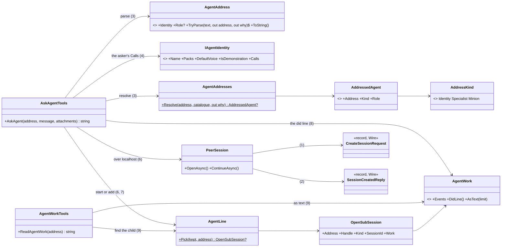
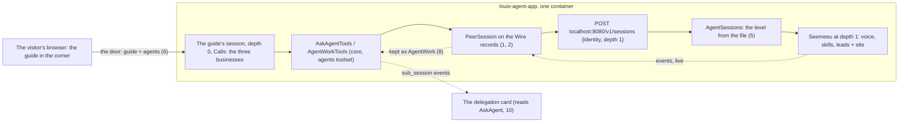
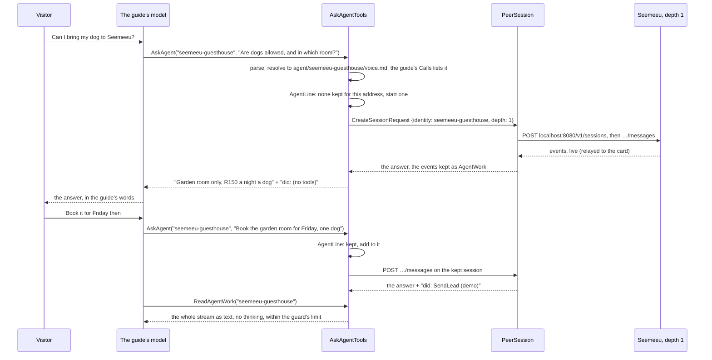
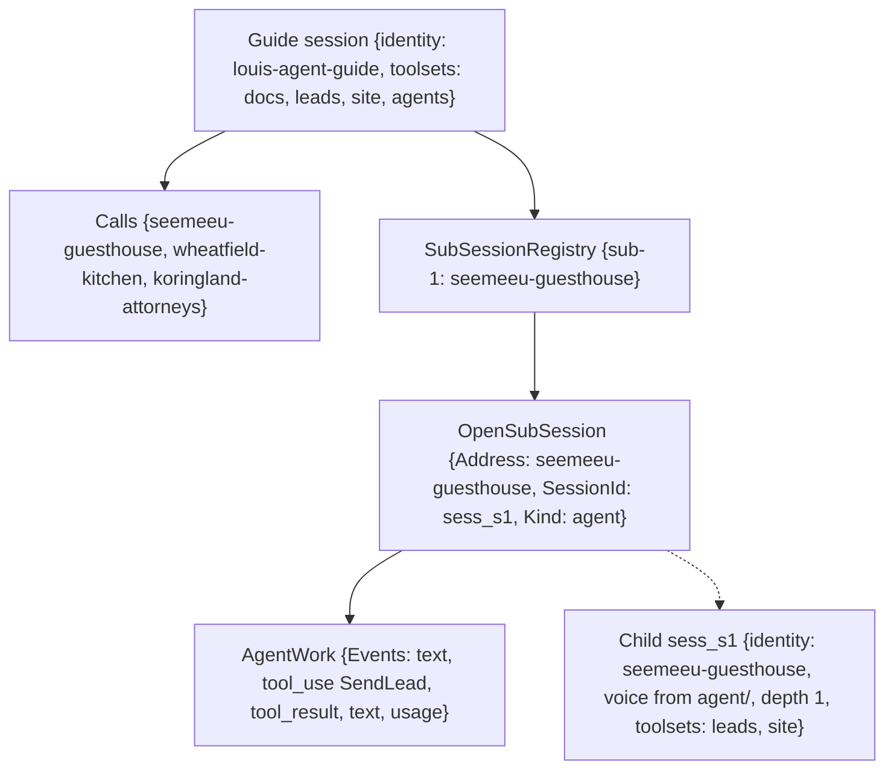

# F127.3.1 Ask an agent on this instance

> **Plan**, F127.3's first child, drafted 2026-11-11 from Louis's picks in [the parent](F127.3-one-address.md), awaiting
> his approval. Branch `feature/F127.3.1-ask-an-agent`. It changes only under *Approved during the build*.

## Context

The parent holds the why, the picks and what exists. In short: the site's guide should ask a demo business a question,
see its work live, read its answer and what it did, and follow up, all on one container. Today the guide has no line
to call on (`AGENT_PEERS` is unset), and the API would look for a business's voice in `specialists/` and refuse it.
Puls moves with the framework but gets no new tests, evals or checks by hand (paused, 2026-11-11).

## Design

### What changes, in plain words

- **The session wire is shared records** in `louis-agent.session-stream/Wire/`: the API reads them, `PeerSession` and
  the browser write them, and the replies are read typed. A renamed field then fails at compile time.
- **An address** is `{identity}` or `{identity}.{role}`, read once into `AgentAddress` (a Value Object) and resolved
  against the catalogue: the identity's voice, a specialist (`specialists/{identity}-{role}.md`) or a minion role.
- **`IAgentIdentity.Calls`** lists the addresses an identity may ask. The guide lists
  `seemeeu-guesthouse`, `wheatfield-kitchen` and `koringland-attorneys`.
- **A role's level is where its file is** (pick 1 A). The API asks the catalogue which folder holds the role; depth
  stays the nesting count with its guards (no `agents` below depth 0, a minion only from a specialist). Seemeeu at
  depth 1 opens from `agent/` with its voice, its skills and its own packs, as the door already gives them.
- **`AskAgent(address, message, attachments)`** in core's `agents` toolset starts a child at depth 1, or adds to this
  chat's child with that address. The site sets `AGENT_PEERS=self=http://localhost:8080`, so the call stays in the
  container. The door gives a visitor's session the `agents` toolset when its identity lists any `Calls`.
- **What the child did** (pick 4, b+). The kept child holds the events it streamed (`AgentWork`). Under the answer the
  model reads one line built in code from them ("did: SendLead, ShowPlace"). `ReadAgentWork(address)` gives the whole
  stream as text, without the thinking, held to the context guard's limit (ADR 0005).
- **The guide's chat shows the child as today's delegation card**, reading `AskAgent`. F127.4, next, shows the
  conversation in the business's window on the page and narrows the card to the work (picks 7 and 8, L2 and C2).
- **`SpecialistTools` goes.** Puls's voice and checks are renamed onto `AskAgent` so it builds and its tests pass;
  nothing of Puls is added or measured.

### Interface design



```csharp
// src/engine/louis-agent.session-stream/Wire/ (moved, steps 1 and 2), public, snake_case on the wire as today
public sealed record CreateSessionRequest(string? Task, string? Run, string? Service, List<string>? Toolsets = null,
    int Depth = 0, string? Parent = null, string? Location = null, string? TimeZone = null, string? Llm = null,
    string? Tool = null, string? Role = null, string? Stream = null, ReplayRequest? Replay = null, string? Identity = null);
public sealed record SendMessageRequest(string? Message, List<AttachmentRequest>? Attachments, PageRequest? Page = null);
public sealed record SessionCreatedReply(…);                                   // from louis-agent.api.contracts

// src/engine/louis-agent.composition/Agents/AgentAddress.cs (new, step 3)
public sealed record AgentAddress(string Identity, string? Role)              // Value Object
{ public static bool TryParse(string? text, out AgentAddress? address, out string? why); public override string ToString(); }
// src/engine/louis-agent.composition/Packs/IAgentIdentity.cs (changed, step 4)
IReadOnlyList<string> Calls => [];

// src/engine/louis-agent.core/Delegation/Addresses/ (new, step 3)
public enum AddressKind { Identity, Specialist, Minion }
public sealed record AddressedAgent(AgentAddress Address, AddressKind Kind, string Role);
public static class AgentAddresses { public static AddressedAgent? Resolve(AgentAddress address, AgentCatalog catalogue, out string? why); }

// src/engine/louis-agent.core/Delegation/ (new, steps 6 to 9)
public sealed class AskAgentTools(AgentOptions options, AgentCatalog catalogue, IUsageSink? usageSink = null)
{ public async Task<string> AskAgent(string address, string message, string[]? attachments = null, CancellationToken cancel = default); }
public sealed class AgentWorkTools { public string ReadAgentWork(string address); }
internal static class AgentLine { public static OpenSubSession? Pick(SubSessionRegistry kept, AgentAddress address); }
// src/engine/louis-agent.core/Sessions/SubSessions/ (new and changed, step 8)
public sealed record AgentWork(IReadOnlyList<SubSessionEvent> Events)
{ public string DidLine(); public string AsText(int limit); }                  // no thinking in either
public sealed record OpenSubSession(…) { public AgentAddress? Address { get; init; } public AgentWork Work { get; init; } }
public enum CoreToolset { Agents, Minions, Skills }                            // Specialists goes (step 10)

// src/engine/louis-agent.core/Skills/Roles/RoleFiles.cs (changed, step 5): the level from the file
internal static RoleLevel? LevelOf(AgentOptions agent, string role);
```

### Architecture



### Communication: the guide asks Seemeeu, reads its work, follows up



### Object diagram (after the follow-up)



### Namespace map

| Type | Folder | Namespace | Step |
|---|---|---|---|
| `CreateSessionRequest`, `SendMessageRequest`, `AttachmentRequest`, `PageRequest` (+ parts), `ReplayRequest` | `src/engine/louis-agent.session-stream/Wire/` | `LouisAgent.SessionStream.Wire` | 1 moved from the API |
| `CreateSessionRequestReading` | `src/hosts/louis-agent.api/Sessions/Requests/` | `LouisAgent.Api.Sessions.Requests` | 1 new |
| `SessionCreatedReply` and the other session replies, `SessionJson` | `src/engine/louis-agent.session-stream/Wire/` | `LouisAgent.SessionStream.Wire` | 2 moved from `louis-agent.api.contracts` |
| `AgentAddress` | `src/engine/louis-agent.composition/Agents/` | `LouisAgent.Composition.Agents` | 3 new |
| `AddressKind`, `AddressedAgent`, `AgentAddresses` | `src/engine/louis-agent.core/Delegation/Addresses/` | `LouisAgent.Core.Delegation.Addresses` | 3 new |
| `IAgentIdentity.Calls`; `GuideIdentity.Calls`; `PulsIdentity.Calls` | `src/engine/louis-agent.composition/Packs/`; `src/site/louis-agent.identity.guide/`; `demos/puls/identity/…` | unchanged | 4 changed |
| `RoleFiles.LevelOf`, `AgentSessions` | `src/engine/louis-agent.core/Skills/Roles/`, `src/hosts/louis-agent.api/Sessions/` | unchanged | 5 changed |
| `AskAgentTools`, `CoreToolset.Agents`, `prompts/toolsets/agents.md`, `SubSessionToolMessage`; the door's `agents`; the site's `AGENT_PEERS` (yaml, compose, launch settings) | `src/engine/louis-agent.core/Delegation/`, `Agent/Toolsets/`, `prompts/toolsets/`; `src/hosts/louis-agent.api/Endpoints/Sessions/`; `src/site/deploy/azure/`, `src/site/docker/`, `src/site/louis-agent.site-api/Properties/` | unchanged | 6 new / changed |
| `AgentLine`, `OpenSubSession.Address` | `src/engine/louis-agent.core/Delegation/`, `Sessions/SubSessions/` | unchanged | 7 new / changed |
| `AgentWork`, `OpenSubSession.Work` | `src/engine/louis-agent.core/Sessions/SubSessions/` | `LouisAgent.Core.Sessions.SubSessions` | 8 new / changed |
| `AgentWorkTools` | `src/engine/louis-agent.core/Delegation/` | `LouisAgent.Core.Delegation` | 9 new |
| `SpecialistTools`, `specialists.md` (deleted); Puls's voice and checks (renamed); `Delegation`, `DelegationCard` (the web); the evals' tool checks; the site's `DetailedMovie`; the stream fixtures; the goldens | core, `demos/puls/…`, `src/web/louis-agent.web/`, `src/evals/…`, `src/site/louis-agent.site/Components/Movies/` | unchanged | 10 changed |

### Folder tree (after)

```
src/engine/louis-agent.composition/Agents/      AgentAddress.cs                               ← step 3
src/engine/louis-agent.session-stream/Wire/     the session requests and replies              ← steps 1, 2
src/engine/louis-agent.core/Delegation/
├── Addresses/   AddressKind.cs, AddressedAgent.cs, AgentAddresses.cs                          ← step 3
├── AskAgentTools.cs, AgentLine.cs, AgentWorkTools.cs                                          ← steps 6, 7, 9
├── MinionTools.cs, CallSlots.cs, ShownReport.cs, AgentTools.cs (as they are)
└── SubSessions/ (as they are, PeerSession on the Wire records)
src/engine/louis-agent.core/Sessions/SubSessions/  AgentWork.cs, OpenSubSession.cs (changed)   ← step 8
src/engine/louis-agent.core/prompts/toolsets/   agents.md (specialists.md deleted)             ← steps 6, 10
```

## Steps

One commit each, test first (seen failing), a stop after each. Eleven, one over the usual ten: the last is docs only.

1. **The requests are shared records.** `CreateSessionRequest`, `SendMessageRequest` and their parts move to
   `session-stream/Wire/`, public; the API reads them through `CreateSessionRequestReading`; `PeerSession` writes them
   instead of anonymous objects; the browser's `CreateSessionBody` goes. Tests: the JSON each writes is pinned
   (snake_case, the names as today); the API's session tests unchanged.
2. **The replies are shared records.** The session replies and `SessionJson` move to `Wire/`; `PeerSession` reads
   `SessionCreatedReply` typed. Tests: a reply read back from the JSON the API writes; core's sub-session tests unchanged.
3. **The address.** `AgentAddress.TryParse` (`{identity}` or `{identity}.{role}`, lowercase letters, digits and
   dashes) and `AgentAddresses.Resolve` (the voice, a specialist, a minion role; the reason when none). Tests: each
   form, an unknown identity or role, a role file not named for its identity.
4. **Who may call whom.** `IAgentIdentity.Calls`, none by default; the guide lists the three businesses; Puls lists
   its five (no Puls test). Tests on a sample identity: a listed address passes, any other is refused naming the ones
   it may call, an identity without `Calls` calls nothing; the guide's list resolves against the site's catalogue.
5. **A role's level from its file** (pick 1 A). `RoleFiles.LevelOf` finds the folder; `AgentSessions` uses it for the
   prompt, the toolsets and the skills, and the depth for the guards. Tests: Seemeeu opens at depth 1 from `agent/`
   with leads and site and no `agents`; a specialist still opens as one; no role name sits in two levels.
6. **`AskAgent` starts.** `AskAgentTools` in `agents` (`CoreToolset.Agents`), its guide `agents.md`: parse, resolve,
   check the asker's `Calls`, open on `PeerSession` at depth 1, keep it by address. The door adds `agents` to a session
   whose identity has `Calls`; the site sets `AGENT_PEERS=self=http://localhost:8080`. Tests: the create body, a
   refusal for each check, the limit of three a turn, the usage roll-up, the live events, the door's toolsets.
7. **`AskAgent` adds.** `AgentLine` finds this chat's child by address and adds to it; a 409 tells the model to wait.
   Tests: which child it picks, the follow-up's body, the 409.
8. **What the child did, under the answer** (pick 4). The kept child holds its events as `AgentWork`; the answer
   carries `DidLine()`, built in code from its tool calls. Tests: the line for no tools, one, several and a failed one;
   no thinking in it; the events kept across a follow-up.
9. **`ReadAgentWork`.** `AgentWorkTools` gives a kept child's work as text, without thinking, cut to the context
   guard's limit with the cut said. Tests: the text of a recorded stream, an unknown address, the cut.
10. **The old tool goes.** `SpecialistTools`, its tests and `specialists.md` go; Puls's voice and routing name
    addresses (renamed, no new test); the web's delegation card reads `AskAgent`; the evals' tool checks, the stream
    fixtures, the site's detailed film and the goldens follow. Tests: the card from a recorded `AskAgent` turn, the
    goldens reviewed; Puls's tests pass as they are.
11. **The docs.** ADR 0117's status and the picks; `AGENT_COMMUNICATION.md`, the core, API and site project docs, the
    glossary; the write-up (skill 10); the work log; this plan deleted. The full suite.

## Verification

- **Each step:** the tests it touches; `core.tests` when a folder or a name is added (steps 1, 2, 3, 6, 8, 9).
- **By hand, free, on the PC:** the site's API and page; ask the guide about a dog at Seemeeu: a delegation card,
  the answer, a follow-up that books (a demo lead), and the guide using `ReadAgentWork` when asked what Seemeeu did.
  Checked at desktop and phone width before the push.
- **No paid run** (pick 3). Puls's tests pass; nothing of Puls by hand.
- **Full suite** once, in step 11.

## Concepts, and where they sit in GOAL.md

- **Multi-agent orchestration** (skill 10): one agent asks another by name; who answers apart from the job it does.
- **Tool design** (skill 4): one narrow tool, the choices fixed in code; the detail on demand (Lazy Load).
- **Context engineering** (skill 7): what the asker's model reads of the child, and why the rest stays out until asked.
- **Safety** (skill 15): an allow-list in code; the depth guard; a child's text read only within the guard's limit.
- **Protocols** (skill 11): the session wire as shared records.

## Approved during the build

- **Five writers, not three** (step 1, Louis's pick A, 2026-11-11): besides the API, core and the browser, the evals
  client (its own `SessionWire` records, snake_case without nulls) and the orchestrator (anonymous objects) write the
  session requests. A new step 2 moves both onto the shared records and deletes `SessionWire`'s copies; the replies
  become step 3, and every later step moves one down: twelve steps.
- **The requests are camelCase, not snake_case** (step 1): the API reads them with .NET's web defaults and only
  `time_zone` is spelled out; the records keep exactly that. They write every field, the nulls included, where the
  anonymous objects left some out; the API reads a missing field and a null alike.
- **`Wire/Requests/` and `Wire/Replies/`** (step 1): six request records now and the replies in step 3 would put about
  a dozen files in one folder, so each side has its own (namespace `LouisAgent.SessionStream.Wire.Requests`).
- **One set of options for the requests** (step 2): the evals client sends the shared records with .NET's web
  defaults, as core and the browser do, not its snake_case without nulls, so the same record is the same bytes from
  every sender; a null `web`, `of` or `location` still leaves the API's default. `EvalJson.SnakeCaseNoNulls`, used
  for nothing else, goes. The orchestrator still sends no body when it has no tags or toolsets.
- **The replies in `Wire/Replies/`, one type a file** (step 3): the five session replies and `SessionJson` leave
  `louis-agent.api.contracts`, whose `Sessions/` folder goes. The evals client keeps its own toolsets and error
  replies, which are no session's. The orchestrator's client crossed 200 lines; Louis's pick A: it and its three
  records move to `Client/` (`LouisAgent.Orchestrator.Client`), one type a file, with Rider's move to namespace.
- **The address, read and resolved** (step 4): `AgentAddress.TryParse` only says yes or no, and ignores case and the
  spaces around, so a model's `Puls.Cook` reads; the reason the model gets is the resolver's. The resolver takes the
  identities this instance runs, not `AgentCatalog`: `Delegation/` sits below `Agent/` in core's layers, and the
  identities are composition's. Its reasons list roles as addresses (`acme.cook`), what the model writes next.
- **Who may call whom** (step 5): `IAgentIdentity.Calls` is a list of addresses, matched whole and case ignored, so
  `acme.cook` lets an identity ask the cook, not acme in its own voice. The guide names the three businesses through
  its own `GuideCall` enum (ADR 0043). Puls's list waits for step 11, when its voice moves onto `AskAgent`: until
  then nothing in Puls reads it (paused, 2026-11-11).
- **A role's level from its file, narrowly** (step 6): the one new case is an identity's voice asked at depth 1, which
  opens as a voice from `agent/`, with its own packs when none are sent (`AgentCatalog.ToolsetsOf`, which the door
  now uses too); every other mix of depth and folder is as before, so a specialist's role is still refused at depth 0
  and a minion opens only at 2. `RoleCatalog.LevelOf` says which folder holds a role; a test holds that no name sits
  in two. The API's test of the old rule (a voice refused at depth 1) now holds the new one.
- **`AskAgent` starts** (step 7): `ToolsetContext` carries the identities the instance runs, from the catalogue, so
  the toolset can find the asker (`TurnIdentity`) and resolve the address; the child opens at depth 1 with no
  toolsets sent and the role resolved, on `PeerSession`, kept with its address. `agents` was the specialists'
  name before CL9; two tests that held the old name gone now hold the new toolset. The coding agent's routing names
  `agents` (its router test asks for every toolset). The door adds `agents?`, optional, so a site with no
  `AGENT_PEERS` still opens the identity. The tests of asking moved to `Delegation/Agents/` (six files a folder).
- **`AskAgent` adds** (step 8, Louis's picks A, A, A): `AgentLine` and `AskAgentTools` sit in `Delegation/Agents/`,
  as their tests do, since `Delegation/` held its six files; `AgentWorkTools` joins them in step 10. A 409 (the child
  still answering) keeps the child for every kind and tells the model to wait (`SubSessionBusy`): the specialists get
  it too until step 11. A child the peer dropped (404) is started again in the same call, and its answer says it is a
  new conversation (`AgentAnswerAnew`), so the model needs no second call. The tool's description and the agents guide
  say a second ask carries on.
- **What the child did** (step 9, Louis's pick A): `AgentWork` stays a record, and after each follow-up the registry
  swaps the kept entry for one with the reply's events added (`SubSessionRegistry.Update`), under its lock. The
  messenger hands every reply's events back (`SubSessionReply.Events`). `AgentWork` reads them into typed calls
  (`Calls()`), and the words of the line are `DidLine` in `Delegation/Agents/`, from the message enum, so
  `Sessions/` still uses nothing of `Delegation/`. The line under an answer is that reply's alone ("did: SendLead,
  FetchUrl ×2 (1 failed)", "did: no tools"), and the agents guide tells the model to say what the agent did from it
  only.
- **`ReadAgentWork`** (step 10, Louis's pick A): the latest 12,000 characters, the toolsets' usual cap, under a line
  that says how much of the start was cut, since what is asked about is mostly the latest work and the result stays
  in the asker's history. `AgentWork.Steps()` retells the work as typed steps (an answer begun, said, called,
  returned), and `AgentWorkTools` in `Delegation/Agents/` writes them from the message enum, as `DidLine` does. Only
  an address this chat asked can be read, so `Calls` was checked when it was asked.
- **The old tool goes in four steps** (step 11, Louis's pick B, "all of it now, in more steps"): the map found the
  triage identity on `specialists` and about 75 recorded Puls transcripts naming `StartSubSession`, which the plan
  hadn't counted. So step 11 is 11a, the triage manager asks its roles by address (`TriageCall`:
  `triage.sorter`, `triage.investigator`, `triage.reviewer`, held to reach its role files in the coding catalogue's
  tests); 11b, the web's card and the API's stream read `AskAgent`; 11c, the evals' tool checks and Puls (its voice,
  graders and transcripts) move to `AskAgent`; 11d, `SpecialistTools`, its guide, its toolset and the coding agent's
  routing row go. The feature grows past the ten-step rule, knowingly.
- **The browser's message stays its own** (step 1): only its opening (`CreateSessionBody`) goes for the shared record;
  `MessageBody` keeps the web's `Page` and `Attachment`, which the chat components use.

---
[Docs index](../README.md) · [Plans](README.md) · Parent: [F127.3](F127.3-one-address.md) · Next: F127.3.2
