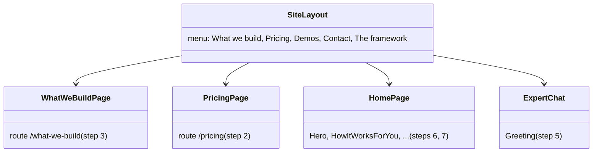
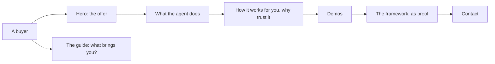
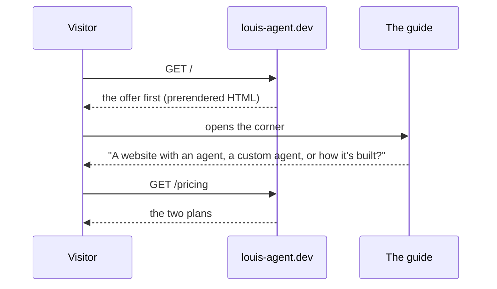
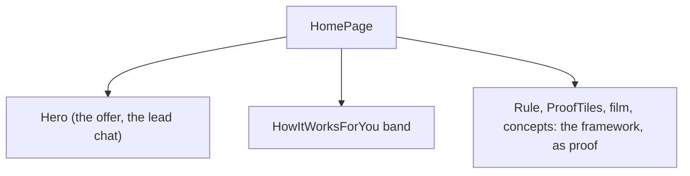

# F128.1 The site sells

> **Plan** (2026-11-09), the first child of [F128](F128-the-site-sells.md), built unattended (Louis: "go for it
> unattended and keep the container up after each step so I can test"). Branch `feature/F128.1-the-site-sells`. It
> changes only under *Approved during the build*.

## Context

The parent's picks 1A, 2A, 3A, 5A, 6A and 7A, and the facts the review found wrong. The demos (4A) are F128.2.

**Done when:** the facts are right; the menu reads What we build · Pricing · Demos · Contact · The framework; the
two new pages say what we build and what each plan includes; the guide's greeting asks what brings the visitor; the
landing opens with the offer and runs offer, what the agent does, how it works for you, why trust it, demos, the
framework as proof, contact; every step on 127.0.0.1:5080 straight after it.

## Design

- **Words, not machinery.** Every change is the site's own pages and components (`src/site/louis-agent.site`); the
  framework's web is untouched. A claim stays held to the repo by a test, as ADR 0100 asks.
- **Two new pages,** `/what-we-build` (the website with an agent, and custom agents) and `/pricing` (the two plans,
  the build fee, what is included and what is quoted), each with its `PageHead`, in the sitemap and the guide's map.
- **The landing re-ordered,** its parts as they are where they still fit (the lead chat moves into the hero), a new
  band for "how it works for you" and the trust facts, and the framework's sections (the rule, the numbers, the film,
  the concepts) after the offer.
- **The guide's greeting** is `ExpertChat`'s `Greeting`; tap-to-ask suggestions wait for F125's `Offer` tool.

| Type or file | Folder | Namespace | Step |
|---|---|---|---|
| `PricingPage` | `src/site/louis-agent.site/Pages/Business/` | `LouisAgent.Site.Pages.Business` | 2 |
| `WhatWeBuildPage` | `src/site/louis-agent.site/Pages/Business/` | `LouisAgent.Site.Pages.Business` | 3 |
| `SiteLayout` | `Layout/` | `LouisAgent.Site.Layout` | 4 |
| `ExpertChat` | `Components/Guide/` | `LouisAgent.Site.Components.Guide` | 5 |
| `Hero`, `HowItWorksForYou` | `Components/Landing/` | `LouisAgent.Site.Components.Landing` | 6, 7 |

## Steps

1. **The wrong facts.** Where it runs (the film's last scene, Architecture, How it works), Puls not live, the guide's
   three packs and its own host, the ADR count, the coding agent's chat no longer public. Tests first where a fact can
   be held to the repo (the ADR count to the folder, the guide's packs to `GuidePack`).
2. **`/pricing`:** the two plans, the build fee, what's included and what is quoted; the contact page and the
   guide's voice say the same. Tests: the page, its description, the voice's words.
3. **`/what-we-build`:** the website with an agent and the custom agent, in a buyer's words. Tests as step 2.
4. **The menu:** What we build · Pricing · Demos · Contact · The framework (with Measured, Built on it and What's
   coming inside). `SiteLayoutTests` first.
5. **The guide asks what brings the visitor.** `ExpertChatTests` first.
6. **The hero sells:** the offer, from R500, "Ask for yours" and "See one work", the lead chat beside it.
7. **The landing's order and the trust band:** offer, what the agent does, how it works for you (three steps and the
   buyer's facts), the demos, the framework as proof, contact; the last strip speaks to businesses.
8. **Docs:** an ADR (the site sells first, the framework is the proof), the site's design doc, the guide's page map,
   the work log, the write-up; the plan deleted.

## Verification

The site's tests per step; the full unit suite after step 7; after every step the site's container rebuilt and the
changed page looked at in Chrome at 1920×1080 and at phone width.

## Concepts

Skill 18 (shipping): a site is a product's shop window, and its claims are held to the repo by tests; skill 16
(human in the loop): the guide reads the person before it answers.

## Approved during the build

- **2026-11-09, the framework gets its own site later** (Louis: "we will make a framework focused version at
  framework.louis-agent.dev"). That is F130, after F128. Until then the framework's sections stay on this site behind
  *The framework* in the menu (step 4) and as the proof on the landing (step 7). They are built so they can move whole.
- **2026-11-09, the short film re-exported** (Louis: "make new videos if you need to"). Its last scene said two
  Container Apps and a VM. A selling film waits for F128.2's recorded demos.
- **2026-11-09, step 1b: the page names and addresses** (Louis: "the page names must change now", option A of three).
  The landing, the demos and the contact page get selling titles. The framework's eight pages move under `/framework`
  (`/proof` becomes `/framework/measured`), and their old addresses answer 301 to the new, section and all.
  `/csharp-ai-agent-framework` stays where search found it.
- **2026-11-09, the guide is open on purpose** (Louis: "our agent is quite open if compared to how other online agents
  is configured, but that is on purpose"). Noted in the guide's design doc.

---
[Plans](README.md) · Related: [F128](F128-the-site-sells.md)
