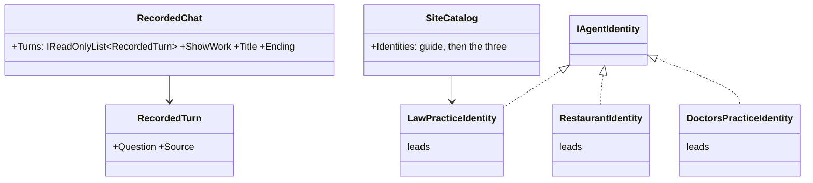
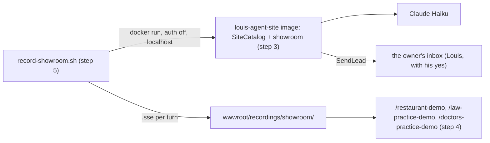
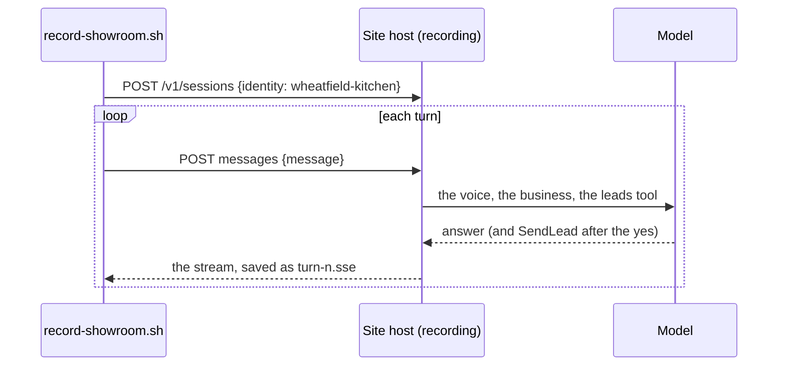
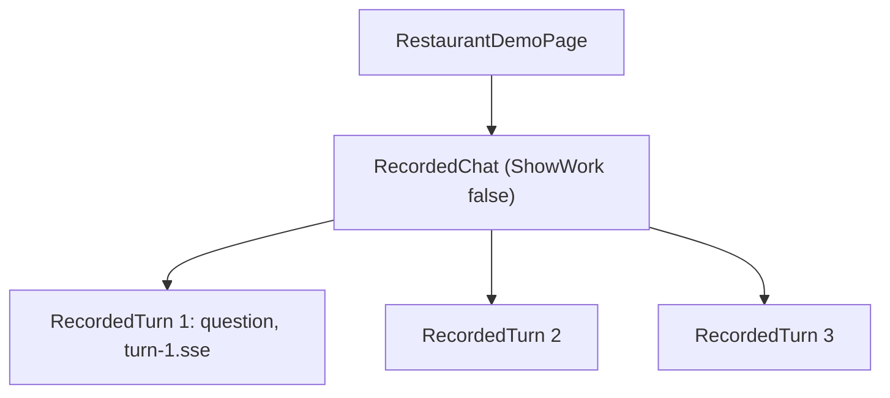

# F128.2 Three business demos

> **Plan** (2026-11-09), the second child of [F128](F128-the-site-sells.md), built unattended (Louis: "unattended"
> after F128.1 merged). Branch `feature/F128.2-business-demos`. It changes only under *Approved during the build*.

## Context

The parent's pick 4A: recorded demos, "not a bakery, say a laywers practice, restaurant, and a doctors practice". The
law and doctor agents never advise, they book and pass on. Done when: each business has a made-up site's agent,
recorded answering a customer and booking, played on its own demo page, first on the demos list.

**Picks made unattended, each the recommended of three** (Louis may change any):

| Finding | Pick | The others |
|---|---|---|
| How a demo books | **The leads pack**: a booking request is a lead (name, contact, what they want) mailed to the owner after the customer's yes | A new bookings pack (more to build, and the plans promise no bookings); no tool, words only (a demo that pretends) |
| The leads pack names Louis ("Sent to Louis", "a website with an agent") | **Made neutral**: "the owner", what the person wants; the guide's voice says who the owner is | An owner setting (one host, one owner, so still wrong for a showroom); a second pack |
| A conversation of several turns | **`RecordedChat` plays a list of turns**, each its question and its recording | One stuffed message per demo (unnatural); a scripted animation (not a real run) |
| Where the agents live | **One identity project, `src/site/louis-agent.identity.showroom`**, three identities, on the site's host behind its key (only Louis is open) | A demo of their own (a host and config for three voices); one identity with three voices (a voice can't name its packs) |
| How they are recorded | **A script running the site's image** with the site's env files, auth off on localhost, Claude Haiku | The site container as it runs (needs its key, which isn't read here); the coding demo's script (reads secrets itself) |
| Their work on the page | **Hidden**, as on a customer's site: `RecordedChat` takes `ShowWork` | Shown (a developer's view, not a customer's) |

## Design



```csharp
public sealed record RecordedTurn(string Question, string Source);                 // louis-agent.web, step 2
[Parameter] public IReadOnlyList<RecordedTurn> Turns { get; set; }                 // RecordedChat, replaces Source and Question
[Parameter] public bool ShowWork { get; set; } = true;                             // RecordedChat
public sealed class RestaurantIdentity : IAgentIdentity { /* Name "wheatfield-kitchen", Packs ["leads"] */ }  // step 3
```







| Type or file | Folder | Namespace | Step |
|---|---|---|---|
| `LeadsToolMessage`, `LeadTools` (texts) | `packs/tools/louis-agent.pack.leads/` | unchanged | 1 |
| `RecordedTurn`, `RecordedChat` | `src/web/louis-agent.web/Components/Recorded/` | `LouisAgent.Web.Components.Recorded` | 2 |
| `LawPracticeIdentity`, `RestaurantIdentity`, `DoctorsPracticeIdentity`, `ShowroomIdentityName`, `ShowroomPack` | `src/site/louis-agent.identity.showroom/` | `LouisAgent.Identities.Showroom` | 3 |
| `SiteCatalog` | `src/site/louis-agent.site-api/` | `LouisAgent.SiteApi` | 3 |
| `RestaurantDemoPage`, `LawPracticeDemoPage`, `DoctorsPracticeDemoPage` | `src/site/louis-agent.site/Pages/Agents/Showroom/` | `LouisAgent.Site.Pages.Agents.Showroom` | 4 |
| `record-showroom.sh`, the `.sse` files | `src/site/recordings/`, `wwwroot/recordings/showroom/` | — | 5 |

## Steps

1. **The leads pack names no one:** "Sent to the owner", "tells the owner what this person wants". Goldens regenerated.
2. **`RecordedChat` plays turns and can hide its work;** the coding page passes its one turn.
3. **The showroom identities:** Wheatfield Kitchen (a restaurant), Van der Merwe & Mostert Attorneys (a law practice)
   and Graanveld Family Practice (a doctor's practice), made up, each a voice with its business's facts and the
   leads pack; on the site's catalogue after Louis.
4. **The three demo pages**, each a recording in the chat's window beside what it shows, then the offer; first on the
   demos list, the menu and the landing's demos band; in the sitemap and Louis's page map. Played from placeholders
   until step 5.
5. **The recordings:** the script, a run per business (a few cents each), read for anything private.
6. **Docs:** the site's design doc, the showroom's design doc, the work log, the write-up; the plan goes.

## Verification

The touched projects' tests per step; the full unit suite before the PR; the pages at 127.0.0.1:5080 after each step.

## Concepts

Skill 4 (tool design): a pack names no owner, so one tool serves a guide and a practice. Skill 15 (safety): an agent
for a practice books and passes on, never advises, held in its voice and shown in its recording.

## Approved during the build

- **2026-11-10, step 3: the law practice is Koringland Attorneys**, not a surname firm: two common Afrikaans
  surnames could name a real practice, and a page may never pass for a real business. Every name is plainly made up
  and every page says so.
- **2026-11-10, step 5: the recording** (Louis: "run it send a mail we need it"): one run with mail on, three booking
  mails to the owner's inbox. On the way the script learned two things: a set key is always asked for, so it blanks
  `AGENT_API_KEY` beside `AGENT_AUTH=off` on localhost, and a session opens with the toolsets it names, so it names
  `leads`.

---
[Plans](README.md) · Related: [F128](F128-the-site-sells.md)
