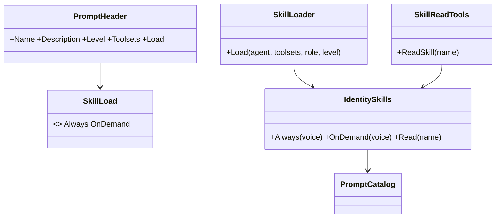
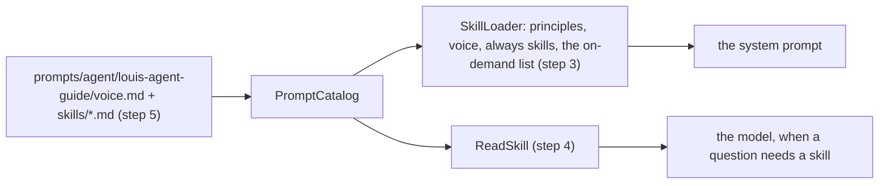
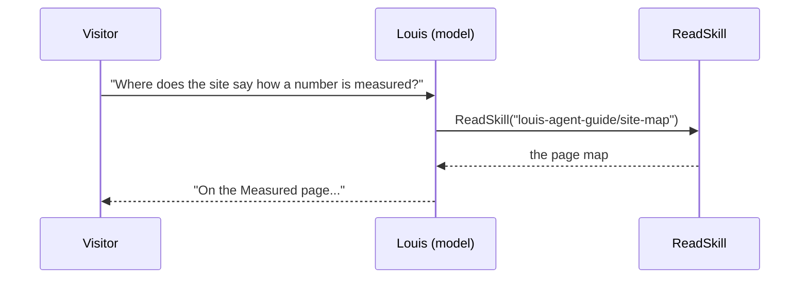
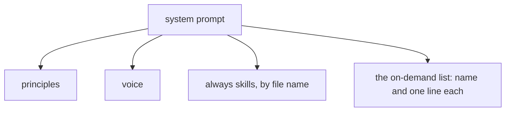

# F129 An identity's skills, and `prompts/`

> **Plan** (2026-11-10), built unattended (Louis: "finish unattended"). Branch `feature/F129-skills-and-prompts`. It
> changes only under *Approved during the build*.

## Context

Louis, 2026-11-09: "split the skills from the voice file prompts/agent/skills/*.md and rename Prompt to prompt".
His picks, each of three, 2026-11-10: **both** (a skill is always in the prompt or read on demand, by its own header),
**beside its voice** (`prompts/agent/{identity}/skills/*.md`), and **every `Prompts` folder renamed**, the
identities', the packs' and the engine's.

**Done when:** every `Prompts/` folder is `prompts/`; a skill file says `load: always` or `load: on-demand`; the
always skills follow the voice in the prompt, the on-demand ones are listed there by name and line and read with an
engine tool; Louis's voice is split into skills and he still answers as before, checked live.

**Picks made unattended** (the recommended of three each): only Louis's voice is split now, since it is 296 lines and
the others 50 to 116 (the rest split when a section earns a file); the reading tool is the engine's own, `ReadSkill`,
registered for every session as `GetToday` is (it needs the identity's prompts, which only the engine holds); a skill
is named `{identity}/{skill}` so one name reads one file.

## Design



```csharp
public enum SkillLoad { [WireName("always")] Always, [WireName("on-demand")] OnDemand }        // step 2
public sealed record PromptHeader(string Name, string Description, RoleLevel? Level,
    IReadOnlyList<string> Toolsets, SkillLoad? Load);                                          // step 2
public static class IdentitySkills { /* Always, OnDemand, Read, from PromptCatalog */ }       // step 3
public sealed class SkillReadTools { public string ReadSkill(string name); }                   // step 4
```







| Type or file | Folder | Namespace | Step |
|---|---|---|---|
| every `Prompts/` | `prompts/` | unchanged | 1 |
| `SkillLoad`, `PromptHeader`, `PromptHeaders` | `src/engine/louis-agent.core/Skills/Headers/` | `LouisAgent.Core.Skills.Headers` | 2 |
| `IdentitySkills` | `src/engine/louis-agent.core/Skills/` | `LouisAgent.Core.Skills` | 3 |
| `SkillLoader` | `src/engine/louis-agent.core/Hosting/Prompts/` | unchanged | 3 |
| `SkillReadTools`, its messages | `src/engine/louis-agent.core/Agent/EngineTools/Skills/` | `LouisAgent.Core.Agent.EngineTools.Skills` | 4 |
| Louis's skills | `src/site/louis-agent.identity.guide/prompts/agent/louis-agent-guide/skills/` | — | 5 |

## Steps

1. **`Prompts/` becomes `prompts/`** everywhere: the folders, the projects' embedded globs, the providers' roots,
   the tests and the docs.
2. **A skill's header says how it loads:** `metadata.load`, `always` or `on-demand`, parsed once.
3. **The loader adds an identity's skills:** the always ones after the voice, then the on-demand list.
4. **`ReadSkill`**, the engine's own tool, reads an on-demand skill by name; goldens regenerated.
5. **Louis's voice split into skills:** who he is and how he answers stay in, the docs map and the site's page map
   are read on demand.
6. **A live check:** the same questions before and after, the prompt's size and the answers compared.
7. **Docs:** an ADR, the identity guide, core's guide, the write-up, the work log; the plan goes.

## Verification

The touched projects' tests per step, the full unit suite before the PR, the live check in step 6.

## Concepts

Skill 7 (context engineering): what is always in the prompt and what is read when needed, and what each costs.

## Approved during the build

- **2026-11-10, after step 2:** Louis asked whether loading on demand is the usual practice, and on hearing it is
  (progressive disclosure, Anthropic's Agent Skills), "then we should make it an ADR": ADR 0114 is written before
  step 3, not in step 7, which keeps the guide, the write-up and the work log.
- **2026-11-10, step 1:** "prompts", Louis: "if the was an enum we would not have had this problem": the folder's
  name is one constant, `EmbeddedPrompts.Folder`, and `PromptFolderTests` refuses it written anywhere else.
- **2026-11-10, step 3, unattended pick (Louis's "finish unattended"):** `Skills/Headers/` would have held eight
  files, over the folder rule's six. Of three ways (a subfolder `Headers/Identities/`; a new `Skills/Identities/`
  with the Skills rule loosened to let it use `Headers/`; or moving `SkillLoad` and the skill types out of `Skills/`)
  the pick is the subfolder: `IdentitySkill` and `IdentitySkills` read the catalogue's headers, so they sit under
  them, and no architecture rule changes. The on-demand list is a `SkillReadToolMessage`, so the golden pins it.

---
[Plans](README.md)
