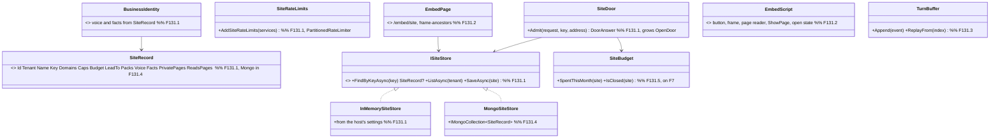
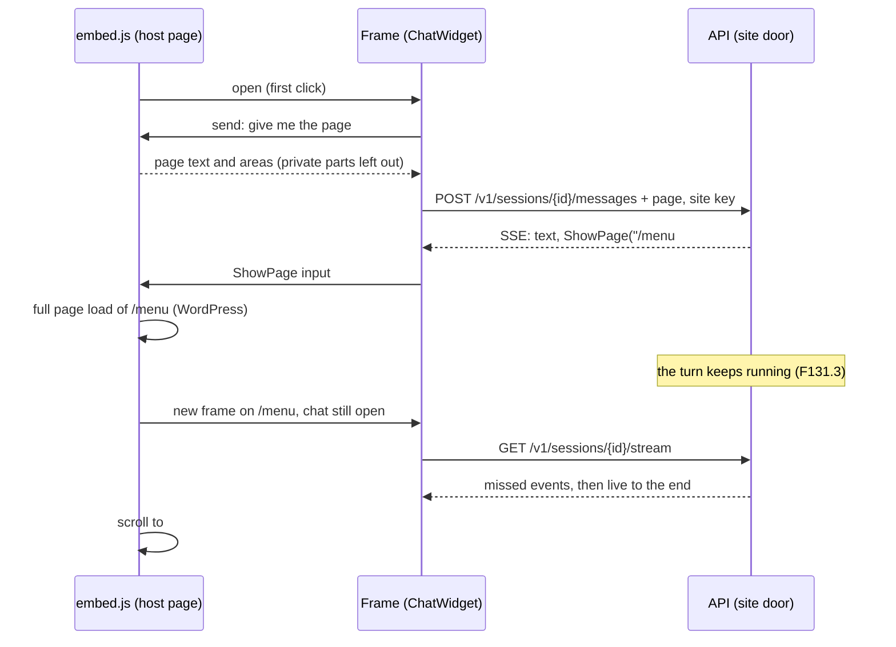

# F131 The chat on any website: one script tag, our widget in a frame, nothing lost

> **Plan, approved by Louis on 2026-11-10** (thread "Plan an embeddable chat widget for any website", "merge plan").
> A parent with seven children, each its own plan, branch and PR when it starts (the development guide, rule 2).
> Nothing here is built. Every choice below was put to Louis with three options and picked by him on 2026-11-10; the
> research with its sources is the doc [F131 research: the chat on any website](https://claude.ai/artifact/RnJpxkt2aTptbtyJGfGE2u).
> It changes only under *Approved during the build*.

## Context

**What Louis asked.** "We will have to investigate how we would plug our chat agent into other websites, be it
wordpress, static http etc. It needs to be generic without losing functionality" (2026-11-10), and on the first pick:
"we must not lose any functionality, we will need to plug into any web infrastructure". The likely first use is the
clients of Swartland Digital, a web studio in the Swartland that Louis asked to partner with him.

**What exists.** `ChatWidget` (F109.3, `src/web/louis-agent.web/Components/Widget/`) is a button and a panel built
from the chat's own list, composer and runner, with the identity and its words as parameters. Each message may carry
the page (ADR 0104, `pageText()` in `ChatWidget.razor.js`); `ShowPage` moves and lights up the page (ADR 0105); the
open door lets a visitor open one identity without a key, under a cap per address (ADR 0099, `OpenDoorOptions`); the
showroom's businesses are one line of C# and a voice each (F128.2); the leads pack sends to one `LEADS_TO` per host.
All of it runs only inside our own Blazor sites. The repo has no CORS, no general rate limiter and no store of sites.

**What the others do.** Chatbase, Intercom, Dify and OpenAI's ChatKit put a script tag on the page that injects an
iframe from their own domain and talk to it through `postMessage`; their site ids are public, guarded by a domain
allowlist and limits. Stripe's publishable key and Algolia's search-only key are public by design, safe for what they
can't do plus rate and referrer limits. The Vercel AI SDK resumes a chat stream after a reload without cancelling the
generation. WordPress allows a plugin that fronts a service (guidelines 6 to 8); 10up's Action ships a git tag to the
directory's SVN; `wp-env` runs WordPress in Docker for tests.

## Design

### The shape, in plain words

- **One script tag (D1 A).** A customer's page loads `https://louis-agent.dev/embed.js` with the site's public key.
  The script draws the button inside a Shadow DOM and, on the first click, opens an iframe of `/embed/{site}`: our
  `ChatWidget`, unchanged, on our origin. Streaming, tool cards, approvals, the lead and the session run as they do
  today, and the API needs no CORS. The script and the frame talk only through `postMessage`, each checking the other's
  exact origin.
- **The page crosses the frame.** On each send the frame asks `embed.js` for the page. It builds the areas itself
  from the page's h1 to h3 and any ids already there (in memory, nothing written into their page), skips parts marked
  `data-louis-private`, pages a site marks private and every form field's typed value, and posts the text in. `ShowPage`
  goes the other way: the frame posts the call's input out, `embed.js` navigates within the site's domains (or through
  the site's own router hook on a single-page app), scrolls, and draws the glow as a box over the area from its own
  Shadow DOM. A site's pages come from its sitemap, read once a day.
- **A door per site (D2 A, D4 A).** A site's key opens a session on the one agent API as that site's identity,
  narrowed to its packs, tagged `site:{name}` on the ledger, its lead mailed to the site's own address. `/embed/{site}`
  answers with `Content-Security-Policy: frame-ancestors` set to the site's domains, so the browser frames it nowhere
  else. The API names no customer (ADR 0037): sites are data.
- **Sites in the store, per tenant (D3 C, D3b C).** A site is a typed MongoDB record (ADR 0048) owned by a tenant:
  key, domains, caps, budget, lead address, packs from a safe list, voice, facts, private pages, page reading on or
  off. One generic business identity reads it, so there is no C# per customer. The admin screen is a described screen
  (ADR 0086). F43's tenants come first; until then the door reads its sites from an in-memory store a host fills from
  its settings, held to the same contract test as the Mongo store.
- **Caps and cost (D5 C).** ASP.NET Core's rate limiter with a token bucket per site and address (the key from our own
  record, never a caller's header), a sessions-per-day ceiling per site, and a monthly rand budget per site from the
  ledger, which needs F7.
- **An answer survives a page change (D7 A).** A disconnect no longer cancels a turn; only `/cancel` or a cap does.
  The session keeps the running turn's events, and `GET /v1/sessions/{id}/stream` replays them and then follows live,
  so the frame on the next page picks the answer up. `embed.js` keeps the chat's open state in the host page's
  `sessionStorage` and reopens at once.
- **WordPress (D6 C).** Our own plugin, in this repo, published on wordpress.org: a settings page with the site key
  and `wp_enqueue_script` with `defer`. It is the project's one piece of PHP, recorded in an ADR as an exception; a C#
  integration test drives it through `wp-env`, Plugin Check runs in CI, and a `wordpress-v*` tag ships it with 10up's
  Action. Every other platform pastes the same script line.

### Interface design



### Architecture


### Communication: a visitor asks, the guide moves them, the answer carries on



### Objects in memory: one embedded session


### Folder trees (proposed; each child's plan settles them)

```
Today                                     After
src/hosts/louis-agent.api/                src/hosts/louis-agent.api/
  Config/OpenDoorOptions.cs                 Sites/            SiteDoor, ISiteStore, InMemorySiteStore, SiteRateLimits (F131.1)
  Sessions/                                 Sessions/Resume/  TurnBuffer, the stream route (F131.3)
src/web/louis-agent.web/Components/Widget/  src/web/louis-agent.web/Components/Embed/  EmbedPage (F131.2)
                                          src/web/louis-agent.web/wwwroot/embed/       embed.js and its modules (F131.2)
src/site/                                 src/site/louis-agent.identity.business/      BusinessIdentity (F131.1)
                                          src/integrations/wordpress/louis-agent-chat/ the plugin (F131.6)
```

### Namespace map (proposed; each child's plan settles it)

| Type | Folder | Namespace | Child |
|---|---|---|---|
| `SiteRecord`, `ISiteStore`, `InMemorySiteStore`, `SiteDoor`, `SiteRateLimits` | `src/hosts/louis-agent.api/Sites/` | `LouisAgent.Api.Sites` | F131.1 |
| `BusinessIdentity` | `src/site/louis-agent.identity.business/` | `LouisAgent.Identities.Business` | F131.1 |
| `EmbedPage` | `src/web/louis-agent.web/Components/Embed/` | `LouisAgent.Web.Components.Embed` | F131.2 |
| `TurnBuffer` | `src/hosts/louis-agent.api/Sessions/Resume/` | `LouisAgent.Api.Sessions.Resume` | F131.3 |
| `MongoSiteStore`, the sites screen | `src/hosts/louis-agent.api/Sites/` | `LouisAgent.Api.Sites` | F131.4 |
| `SiteBudget` | `src/hosts/louis-agent.api/Sites/` | `LouisAgent.Api.Sites` | F131.5 |
| `WordPressPluginTests` | `src/tests/hosts/louis-agent.wordpress.integration-tests/` | `LouisAgent.WordPress.IntegrationTests` | F131.6 |

## The children, in build order

| Child | What | Done when |
|---|---|---|
| F131.1 | A door per site: `ISiteStore` (in memory first), the business identity from a site's voice and facts, `SiteDoor` growing the open door, the `site:{name}` ledger tag, the lead to the site's address, the rate limiter per site and address and a daily session cap; an ADR | A wrong key is a 401, another identity is refused, past the limit is a 429, the ledger rows carry the tag, the lead goes to the site's address |
| F131.2 | The widget on any page: `/embed/{site}` with `frame-ancestors`, `embed.js` (Shadow DOM button, frame on first click, origin-checked messages, open state across loads, full screen on phones, focus and Escape), the page read from headings with private parts and form fields left out, `ShowPage` across the frame within the site's sitemap and domains (a router hook for single-page apps), a plain HTML test site in compose | A Playwright test with the host page on a second origin opens the chat, sends the page, is moved and lit by `ShowPage`, and never sees a private part; another origin can't frame it; the first-open time and download size measured |
| F131.3 | An answer survives a page change: no cancel on disconnect, a buffer per running turn, `GET /v1/sessions/{id}/stream` | A turn whose client drops still finishes and is charged once; a second client sees every event once; a tour across two pages of the test site runs whole |
| F131.4 | Sites in MongoDB per tenant and the sites screen (after F43's tenants) | A tenant's user sees and edits only their own sites; a new site answers without a deploy; the store contract test passes on both stores |
| F131.5 | A monthly rand budget per site (after F7) | A site past its budget shows its "closed for the month" message with its contact details; a warning goes out before |
| F131.6 | The WordPress plugin: settings page, `wp_enqueue_script` with `defer`, readme naming the service, Plugin Check in CI, a `wordpress-v*` tag shipping it with 10up's Action; an ADR for the PHP exception | The C# test through `wp-env` finds the script with the saved key on the home page; Plugin Check passes; the directory accepts it |
| F131.7 | The first customer's site: the guide *Put the chat on a site* (the snippet, the plugin, the CSP lines a strict site adds), the privacy line in the panel, an eval per business site, the write-up | A Swartland Digital client's site answers from its facts, knows its page, takes a lead; the eval runs on Louis's go |

F131.1 to F131.3 need neither F43 nor F7 and can start now; F131.4 waits for F43's tenants and F131.5 for F7's budgets.

## Verification

Each step's test first (the development guide). The Playwright tests run the host page and our frame on two origins,
so the origin checks are real. The resumed stream is checked by a test client that drops mid-turn and a second one
that re-attaches. The plugin's test starts WordPress with `wp-env` in CI. Free checks: the test site in a browser,
the frame refused on an unlisted domain, the WordPress test site. The eval per business site is a paid run, on Louis's
go. The first-open time with and without the lazy frame is measured and recorded in F131.2's doc.

## Concepts, and where they sit in GOAL.md

| Child | Concept | Skill |
|---|---|---|
| F131.1 | Public keys guarded by what they can't do, limits per partition, cost per tag | 15 Safety and security, 13 Cost |
| F131.2 | Context from the visitor's page, kept private where it must be; a client-side effect across a frame | 7 Context engineering, 4 Tool design, 15 |
| F131.3 | Resumable runs | 14 Reliability, 9 Sessions and state |
| F131.4 | Tenants and durable configuration | 9 Sessions and state, 15 |
| F131.5 | A budget that stops | 13 Cost and token economics |
| F131.6 | Shipping to someone else's platform | 18 Testing and shipping |
| F131.7 | Evals per customer | 12 Evaluation |

## Decisions taken (Louis, 2026-11-10)

1. **D1 A:** a script tag plus an iframe of our own widget; no functionality may be lost on any web infrastructure.
2. **D2 A:** a public site key, the site's domains through `frame-ancestors`, caps; a server-minted token is for
   signed-in visitors later, a human check for the day abuse shows.
3. **D3 C:** sites in the database with an admin screen (over a folder per site, the recommendation).
4. **D3b C:** full tenants first, F43 before the sites screen (over a studio role on its own sites, the recommendation).
5. **D4 A:** the one agent API with a door per site; a gateway when there are many sites.
6. **D5 C:** the rate limiter, a daily cap and a monthly rand budget per site (over the limiter and cap alone).
7. **D6 C:** our own WordPress plugin, published on wordpress.org (over the snippet first); in this repo, tested from
   C# through `wp-env`, shipped by a tag.
8. **D7 A:** an answer survives a page change: the turn runs on and the new page's frame picks it up.
9. `embed.js` is served from louis-agent.dev; page reading has a switch per site, private pages and parts the studio
   marks, and never a form field's value; pricing is settled when we get there.

## Approved during the build

(Nothing yet.)

---
[Plans](README.md) · Related: [ADR 0099](../adr/0099-the-guide-answers-without-a-sign-in-within-a-cap.md) · [ADR 0104](../adr/0104-a-message-may-carry-the-page.md) · [ADR 0105](../adr/0105-the-guide-acts-on-the-page-through-a-tool-the-widget-hears.md) · [ADR 0037](../adr/0037-one-agent-api-products-get-a-front-door.md)
