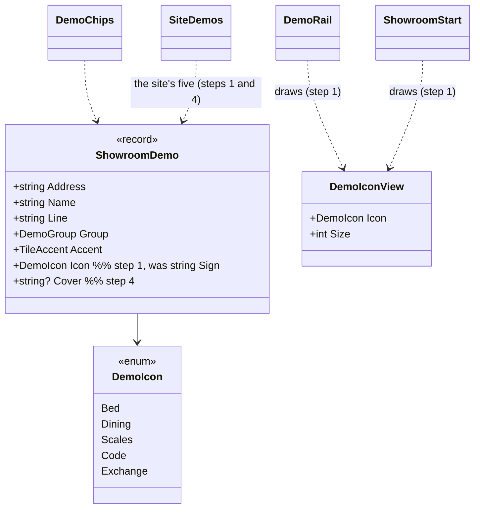
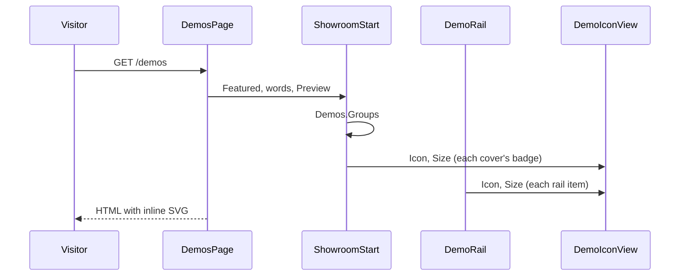

# F134: The showroom looks modern

**Status:** approved 2026-11-11 (Louis: "merge the plan with designs into todo"). **Branch:** `feature/F134-the-showroom-looks-modern`.
**Mockups:** [F134-mockups/](F134-mockups/), plain HTML: [b-showcase-with-photos.html](F134-mockups/b-showcase-with-photos.html)
is the look Louis picked; [a-tidy-and-lift.html](F134-mockups/a-tidy-and-lift.html) and
[c-bento-grid.html](F134-mockups/c-bento-grid.html) are the two he didn't, kept for the record. Open one in a browser
from the repo so its photos load.

## Context

Louis, 2026-11-11, of the demos index and the guesthouse demo on louis-agent.dev: "I want this redesign to be modern
this looks off and those icons", and "everything is a bit too flat". F127.1 built the showroom (ADR 0115). Reading its
code turned up four causes:

1. **The icons are emoji.** `ShowroomDemo.Sign` is a string (`"🛏"`, `"🍽"`, `"⚖"`, `"{ }"`, `"⇄"` in the site's
   `SiteDemos`). Each system draws emoji in its own font. On Windows they come out as small black glyphs of different
   sizes and weights, so no two look alike.
2. **The signs crowd their words.** The rail's sign is a 44px pastel square, only 11px from the name, and the line
   under the name wraps.
3. **The index has no column.** `.start-covers` fills the width with 210px tracks, so five small cards sit on the left
   with empty space to their right. The feature's photo is a 240px-high strip.
4. **Everything is flat.** The covers are solid pastel fills on a flat card. No surface has a light top edge or a
   shadow to lift it, and the one photo is small.

Louis picked **B · Showcase with photos** of three looks (2026-11-11). The other two were A, tidy and lift, and C, a
bento grid with no rail on the index.

## Design

**What changes.** Only the showroom's look and one field of its demo record. The stage, the mock website, the
recordings and the words stay as they are.

- **Line icons, not emoji.** `Sign` becomes `DemoIcon Icon`, an enum (ADR 0024) with one inline SVG per value, drawn
  by a small `DemoIconView` component in the demo's colour, one stroke width, at any size. The paths come from
  **[Tabler Icons](https://tabler.io/icons)** (MIT, Louis's pick 2026-11-11), five icons copied in, with no package or icon
  font (ADR 0055, ADR 0030), and one line in `THIRD-PARTY-NOTICES`.
- **A cover photo per demo.** `ShowroomDemo` gains `string? Cover`, a photo from the site's own `images/showroom`
  (the photos are already there). A demo without one (the coding agent, the triage team) shows its icon large on a
  dark lit panel.
- **Depth from one surface.** A `surface` mixin in `web/tools` gives a raised card three things: a dark gradient, a
  light top edge (an inset highlight) and a soft shadow below. The rail's icon tile, the covers and the feature all
  use it, so depth is decided once.
- **The index in a column.** The start sits in a centred column (`max-width` about 980px). The feature becomes the
  guesthouse photo full-bleed under a dark scrim, with the words on it. The covers become three columns: photo on
  top, icon badge over its edge, then name and line.
- **The rail breathes.** A 36px icon tile on the surface, 14px from the words, and the line on one line. The current
  demo gets a thin ring in its colour instead of a full tint.

**The patterns:**
- *Card gallery with media*: a photo on top and the words below, as in Material's card anatomy and in template
  galleries.
- *Hero image with a gradient scrim*: words over a photo with a dark fade behind them, so they stay readable.
- *Elevation*: layered surfaces with light from above, as in Material's elevation and Apple's materials.

Each class that carries one names it in its `<remarks>` (ADR 0050).

### Interface design



### Architecture


### Communication (a visitor opens /demos)



### Objects (the index in memory)


### Folder tree (after step 1)

```
src/web/louis-agent.web/Components/Site/Showroom/
  Icons/                 # new, step 1
    DemoIcon.cs
    DemoIconView.razor
    DemoIconView.razor.cs
    DemoIconView.razor.scss
  Shell/ Start/ Stage/ Mock/   # as today
src/web/louis-agent.web/Styles/web/tools/
  _surface.scss          # new, step 2
```

### Namespace map

| Type or file | Folder | Namespace | Step |
|---|---|---|---|
| `DemoIcon` | `Components/Site/Showroom/Icons` | `LouisAgent.Web.Components.Site.Showroom.Icons` | 1 |
| `DemoIconView` | the same | the same | 1 |
| `ShowroomDemo` (`Sign` → `Icon`, `+ Cover`) | `Components/Site/Showroom` | `LouisAgent.Web.Components.Site.Showroom` | 1, 4 |
| `DemoIconViewTests` | `src/tests/web/louis-agent.web.tests/Components/Site/Showroom/Icons` | `LouisAgent.Web.Tests.Components.Site.Showroom.Icons` | 1 |
| `_surface.scss` | `Styles/web/tools` | (Sass module `web/tools/surface`) | 2 |

## Steps

Each step is one commit with its test, written first and seen failing. Stop after each for Louis's review.

1. **Line icons for the demos.** Add `DemoIcon` and `DemoIconView`. Change `ShowroomDemo.Sign` to `Icon`. The rail,
   the chips' dot and the start's covers draw the view. `SiteDemos` names the five icons, and the notice gets its line.
   *Test:* every `DemoIcon` value draws an `svg` with a path and `aria-hidden`. The rail and the covers hold an `svg`
   and no text sign (`ShowroomShellTests`, `ShowroomStartTests` updated).
2. **One raised surface.** Add the `surface` mixin: the gradient, the top highlight and the shadow, all from existing
   colour tokens. The covers and the feature use it in place of their flat fills. *Test:* none first (styles only);
   the scoped-styles tests stay green.
3. **The rail breathes.** A 36px icon tile on the surface, 14px gap, the line on one line, and a ring for the current
   demo. *Test:* the current demo is still marked `aria-current="page"` and lit; the rest of the change is styles.
4. **Photos on the covers, the index in a column.** Add `ShowroomDemo.Cover`. A cover with a photo shows it with the
   icon as a badge; one without shows the icon large. The start sits in a centred column, and the feature is the
   photo full-bleed under a scrim. `SiteDemos` gives the three business photos. *Test:* a cover with `Cover` has an
   `img` with an empty `alt` (decorative) and the badge; one without has no `img` and a large icon.
5. **Phones, docs and done.** Check at phone width (the chips, one column of covers, the feature stacked). Update
   ADR 0115's *Decision* with one line on icons and covers, the showroom's design doc and the work log. Delete this
   plan. *Test:* none (docs).

## Verification

- `louis-agent.web.tests` for each step, the full suite once after step 4.
- Free manual checks: `/demos` and `/guesthouse-demo` in Chrome on Windows at full width and at 390px. The icons must
  look the same on Windows and on a phone, and nothing should crowd. No paid run.

## Concepts

This is front-end craft, not an AI skill. It sits under GOAL.md skill 18 (*Testing and shipping*), as the showroom
is how the agents are shown and sold: a component's data (an enum, not a free string) decides what it draws, and a
markup test holds it.

## Approved during the build

(empty)
