# F134.12: Flows and component diagrams in the shared look

> **Plan.** A child of [F134](F134-the-showroom-looks-modern.md): the `flow` and the `components` pictures were the
> first two kinds redone, and the three kinds after them settled on a look they don't have. This brings them in
> line: glass and a small title, a decision as a box with pointed ends, and on a light page whites that are a
> little less white.

**Status:** approved 2026-11-14 (Louis: "approve go"). **Branch:** `feature/F134.1-the-start-is-a-stage`, where
F134.7 to F134.11 were built. **Design:** [m-look.html](F134-mockups/m-look.html), opened in a browser from the
repo.

## Context

Louis, 2026-11-14: "then next will be 134.12 we need to now just make the theme of the flow and component diagrams
resemble the others, it is now a bit out of date." He was shown three real pictures with only their look changed.
Of the diamonds in it he said "these look a bit weird, can we do something", was shown two other ways to draw a
decision, and sent back the one with pointed ends with its key marked: "changed". Of the light scheme: "composite
diagrams white is too white", then, of the fix, "better but all whites overall can be a tad darker. approve go".

**What was looked up.**

- *The code.* Both kinds draw every part by a class name on one shared look, `PictureLook`, with a few rules of
  their own in `FlowStyle` and `ComponentsStyle`. `PictureParts` draws what both share: the ground's dot grid, the
  large title with a line of capitals under it, and a panel with its sheen and its marker bar. So the look is in
  three small places, and no layout knows it.
- *What today's look has that the others don't.* A panel tinted with its tone, edged in its tone, with a drop
  shadow and a sheen. A dot grid on the ground. A large title. A glow round a shape.
- *The pictures.* 91 flows and 1 component diagram. 6 flows hold the 18 decisions.
- *A decision.* `NodeShapes` gives a diamond twice its words' width and height, since words only fit a diamond's
  middle. That is why it is wide and flat. The same class says where an arrow ends on a shape's outline, and the
  key draws its sample of a shape from it.
- *The light scheme.* The cards, the sequence and the class chart share `MarqueeLook`'s glass, which on a white
  page is 3.5% of a dark blue at its top. The flow's and the component diagram's panels are white and a pale
  grey by turns.
- *The site.* `GraphView` draws the site's flows with the same layout and its own styles, the site's. It reads a
  shape's outline from `NodeShapes`, so a decision changes there too.
- *The rules that will run.* `DocsDiagramsTests` holds each SVG to its JSON, and every flow and class chart to
  clear words and lines. One test holds that both schemes set every variable a look reads.

**His picks.**

- *A decision is a box with pointed ends*, option 2 of three, and the key shows that shape.
- *On a light page the whites are a tad darker, overall.* Read as: every kind's panels and glass on a light page,
  and not the ground, which is the site's own white.

**What could not be confirmed.** Whether "all whites overall" includes the ground. This plan leaves the ground as
it is and says so when the step is shown.

## Design

**What changes in a flow and a component diagram.**

- *The title* is one small line in the top left corner, the whole title as it is written. The room above the
  drawing shrinks to what that line needs.
- *The ground* has no dot grid. A soft light stands behind the top of the picture.
- *A box* is a panel with a hairline edge: no tint of its tone, no edge in its tone, no drop shadow, no sheen and
  no marker bar. Its badge stays filled with its tone, so the tone still says what a box is.
- *A shape*, a data box's slant, a start or end's pill and a decision, keeps a thin outline in its tone, with no
  glow. Without it a shape is too faint to read as one.
- *A decision is a box with pointed ends*, as tall as its words and no wider than they need plus its two points.
- *A group's frame* is a panel like a box.
- *A flow's key* stands under a faint lit rule, and its tone swatches are filled. A component diagram's key stays
  beside its drawing, with no rule.

**What stays.** Every place the layout gives, but a decision's. A flow's line in the colour of the box it leaves.
The dots that run along a line, the word in its pill, a component's pins.

**A panel has body.** A component diagram nests panels four deep, and glass on white stays white at any depth. So
a panel in these two kinds is filled with a little of the page's ink, the same at every depth, and nested panels
add up: each depth is a step deeper. On a dark page it is a little of white, and each depth a step lighter.

**On a light page, a tad darker.** The shared glass of the cards, the sequence and the class chart gets a little
more of its dark blue on a light page, and its hairline a little more, so their cards read as cards on white.
The dark scheme is not touched.

**The site's flows keep the site's look.** `GraphView` is styled by the site. It gets the decision's new shape
from the layout, and nothing else of this.

**No ADR is added or changed.**

### Interface design

### Architecture

### Communication (one flow is drawn)

### Objects (a flow with a decision, placed)

### Namespace map

| Type | Folder | Namespace | Step |
|---|---|---|---|
| `NodeShapes` (a decision's room, outline and where an arrow ends on it) | `Flow/Shapes` | as today | 2 |
| `PictureLook` (a panel's body, no tint, no shadow), `PictureParts` (the small title, the light, a plain panel) | `Svg/Theme/Looks`, `Svg/Renderers/Parts` | as today | 3 |
| `FlowDrawing`, `FlowKey`, `FlowStyle` | `Svg/Renderers/Parts`, `Svg/Theme/Looks` | as today | 3, 4 |
| `ComponentsRenderer`, `ComponentsKey`, `ComponentsStyle` | `Svg/Renderers`, `Svg/Renderers/Parts`, `Svg/Theme/Looks` | as today | 3, 5 |
| `MarqueeLook` (a light page's glass) | `Svg/Theme/Looks` | as today | 6 |
| Their tests, and the goldens `flow-look.svg` and `components-start.svg` | `louis-agent.diagrams.tests`, in the folders that mirror the source | as today | 2 to 6 |

No type is added.

### What is reused

- The whole layout, but for a decision's shape. `MarqueeLook`'s light and its accent edge. `SvgWriter`'s paints.
- No new package.

## Steps

One commit each, test first, a stop after each. A step that turns out too large to review in ten minutes is built
as two commits, and the plan says so.

1. **The plan**, its four pictures, the design in `F134-mockups/`, and its rows in the TODO, the work log and the
   plans' index. *Test:* none (docs).
2. **A decision is a box with pointed ends.** `NodeShapes` gives it its room, its outline of six corners, and
   where an arrow ends on a slanted end. The key's sample follows by itself. The 6 pictures with a decision are
   redrawn, still in today's look. *Test:* a decision is as tall as its words and no wider than they need with
   its points; an arrow into a slanted end stops on the outline; every flow still keeps its words and lines
   clear.
3. **The look.** `PictureLook` and `PictureParts`: a panel with body and a hairline, the small title, the light,
   no dot grid, no sheen, no marker bar. Both kinds change at once, since they share the parts. The 92 pictures
   are redrawn. *Test:* the shared look has no rule for what went; both goldens; both schemes set every
   variable a look reads; every redrawn picture looked at on a sheet.
4. **The flow's own.** A shape's thin outline with no glow, a group's frame as a panel, the key under its rule
   with filled swatches. *Test:* the flow's style and key tests; the golden.
5. **The component diagram's own.** Its pill without its glow, its key as it stands with filled swatches, and
   whatever of its own rules the new panel makes wrong. *Test:* its style tests and its golden.
6. **A light page, a tad darker.** `MarqueeLook`'s glass and hairline on a light page. The cards, the sequences
   and the class charts are rewritten as text, in their style only. *Test:* the look's variables test; each
   picture's shapes are the same before and after; a sheet of each kind looked at on a light page.
7. **The site.** The site's flows are looked at with a decision's new shape, and `louis-agent.web.tests` run.
   *Test:* the web's tests; a page looked at.
8. **Documented and done.** *Draw a diagram* and its skill, the diagrams' design doc, the write-up and the work
   log follow. F134's plan says this child is built, and this plan is deleted.

## Verification

- Each step runs `louis-agent.diagrams.tests` and `louis-agent.doc-diagrams.tests`, and `louis-agent.core.tests`
  when it adds a folder or a file. Steps 2 and 7 also run `louis-agent.web.tests`.
- Each redrawn picture is looked at as an image, light and dark, before its step is committed.
- The full suite of unit tests runs before the pull request, with `main` merged in.
- No paid run.

## Concepts

- Step 3: a look that lives in one shared place changes two kinds in one step, which is what F134.8 paid for
  when it moved what a flow and a component diagram share into `PictureLook`. Skill 20 (extensibility).
- Step 2: a shape as three answers in one class, its room, its outline and where a line meets it, so a new
  shape is changed in one place and the key and the site follow. Skill 20.
- Step 6: a change that is only style, proved by the shapes not moving. Skill 18 (testing and shipping).

## Approved during the build

- **2026-11-14, unattended from step 1.** Louis: "continue unattened until 134.12 done and you show me 134.13
  designs, then wait." No stop after a step; every pick is recorded here.
- **2026-11-14, F134.13 is a composite structure diagram.** Louis, of my reading that it was the component
  diagram redone: "no do research", with UML's own line for it, "the internal parts, ports, and connectors of
  a structured class", and the list of UML's structural diagrams. It is a new kind, researched after this child.
- **2026-11-14, step 2: a decision is a box with pointed ends.**
  - *Its room is a plain box's, a point wider:* `NodeShapes.Point` is 22. A plain box keeps 14 clear each side
    of its words, more than half a point, so the words fit between the two slanted ends at any height.
  - *Its outline has six corners,* a tip at half its height each side and two corners above and under, a
    point's length in from the tips. Its top and bottom are flat, so an arrow from above or below meets a flat
    edge, where a diamond gave it one tip.
  - *A small one has shorter points,* half its height at most, so the key's sample doesn't cross itself. Seen
    in the first redrawn picture, where the key showed two chevrons.
  - *A decision still shows its words centred and no icon,* as the diamond did, with its small bar in its
    tone above them.
  - *7 docs pictures are redrawn, in today's look:* each holds a decision. The plan said 6; a seventh is this
    plan's own objects picture. The flow's golden holds a decision too and is drawn anew.
  - *The site follows by itself:* `GraphView` reads the outline from `NodeShapes`. Its test counted a
    diamond's eight numbers and now counts twelve.
- **2026-11-14, a long line runs straight: a step added after step 2.** Louis, of the F36 picture, with a
  dashed line marked that stepped right, down, right, down: "can we fix this here since we are here". And of
  its "no" line, which swung out past its target and back: "and why did it take a longer route? and why is
  that line not straight". While it was built he asked "are you fixing it by hand?". No picture is edited by
  hand: the change is in the layout, and the tool redraws the pictures from their JSON.
  - *Why the dashed line stepped.* The layout looked at each long line once, in the order written. The line it
    arrives on was judged taken by a neighbour that had not yet moved to a line of its own. Now the long lines
    are looked at again while one still moves.
  - *Why the "no" line went the long way.* A long line was only moved when one line was clear the whole way.
    Here the line it leaves on is used further down by another line, and the line it arrives on is blocked by
    two boxes. Now it may run on the leaving line as far as it must and the arriving line from there, and if
    that can't be either, on a third line past the boxes in its way: between two of a column, or 18 beside one.
  - *The pick, made unattended, and his to overrule.* Three ways were weighed. The one built lists the ways a
    line could run, best first, and takes the first clear one (generate and test), on three lines at most. A
    shortest path worked out column by column (dynamic programming) finds ways with more steps too, for more
    code, and no picture needs one. Changing where a long line is ordered among a column's boxes reaches every
    flow and class chart.
  - *A line beside a box keeps 18 from every box of its column,* and stands only beside a box of no group. The
    first form let it stand 8 from the next box, and in F134.1's objects picture two lines that had shared one
    line then ran 5 apart. With the rule tightened that picture is as it was.
  - *18 pictures are redrawn,* flows and class charts, under `src/`, `packs/` and `demos/`. Each was looked at
    before beside after. Several lose a wide loop round the outside. In F39's the "valid" line now runs down
    the open right side and crosses two lines where it crossed four.
  - *The tests* are built from F36's own boxes and arrows: the dashed line turns twice at most, and the "no"
    line turns four times at most and never passes outside its two boxes.
- **2026-11-14, step 3: the look.** While it was built Louis saw a half-done picture and said "keys still
  needs to be done". They are steps 4 and 5, as planned.
  - *The title and the light are the other kinds' own,* `MarqueeLook`'s, drawn by one shared part. So a flow
    and a component diagram can't drift from the cards, the sequence and the class chart in them.
  - *The room above the drawing is 44 in every picture,* as a class chart's is. The design showed 44 for a
    title that had a line under it, and 42 for one that had none.
  - *A panel's body on a light page is 6.5% of the page's ink,* where the design showed 5.5%, for his "all
    whites overall can be a tad darker". On a dark page it is 4.5% of white, as shown.
  - *A panel wears no depth and no tone.* The rules for a colour a depth and for a tint a tone are gone, and
    so are the dots, the highlight, the large title, the shadow and a box's marker bar.
  - *A component diagram's title is its title and its subtitle on one line,* with a colon between, as the
    design showed it. Its root stands 44 under the top, where it stood 76.
  - *A component's name is 14 bold,* as the design showed.
  - *All 263 pictures are rewritten.* 93 flows and the component diagram are drawn anew: the plan counted 91
    flows, and this plan's own two are the others. Each was looked at on a sheet, dark and light. The other
    169 change only in the text of their style, since every kind's file carries the shared look. That was
    checked: each is the same as before once its style is taken out.
  - *Left for the refactor:* a cards picture, a sequence and a class chart each draw the light themselves, by
    the same steps the shared part now has.
- **2026-11-14, step 4: the flow's own.** Louis had said of the flow's key in today's look: "these do not look
  like the other graphs".
  - *The key is laid out as the other kinds' keys are:* a faint rule across the picture, the heading 22 under
    it, the first row 34 under it and 28 a row. Its words are in the page's ink at 12, where they were grey.
  - *A tone's sample is a small badge filled with the tone,* 18 square, as in a class chart's and a
    sequence's key. The design showed a filled pill. A badge is what says a box's tone now that no panel is
    tinted, so the key shows that.
  - *A shape's outline is 1.25 wide at 80%,* grey for a shape with no tone and in its tone's colour for one
    that has one. The design left a shape with no tone, as most decisions are, a hairline, and it read too
    faintly as a shape.
  - *A group's frame is a panel,* drawn by the shared part, so the flow's style has no rule for one, and a
    box in a group is a step deeper by itself. The design showed glass, which on white is white.
  - *The flow's style is the same for every theme,* so it is a constant now, as the cards' is.
  - *A badge's corner is 9,* as the design showed.
  - *The shared look sets two variables fewer:* a group's ground and the shadow, which nothing reads now. A
    test holds that every variable set is read.
  - *93 flows are drawn anew,* each looked at on a sheet, dark and light. The other 170 pictures change only
    in the text of their style.
- **2026-11-14, step 5: the component diagram's own.** Louis, of the three tone swatches in its key, marked in
  a picture half-way: "old look".
  - *A tone's sample is the same small filled badge as in a flow's key,* 18 square. The key stays beside the
    drawing with no rule over it, as planned.
  - *What a key's item means is one rule of the shared look,* for both kinds, in the page's ink at 12. Step 4
    had written it in the flow's own style, and a second copy for a component would have let the two drift.
    The 93 flows change in that class's name and in nothing else, which was checked.
  - *The pill has no glow.* Its tint, its outline and its pulsing dot stay. The style is a constant now, the
    same for every theme.
  - *Nothing else of a component's own was made wrong by the new panel:* the golden and the docs' one
    component diagram were looked at, dark and light.
- **2026-11-14, step 6: a light page, a tad darker.**
  - *On a light page the glass shows 6% of its dark blue at a card's top and 3.5% at its foot,* where it showed
    3.5% and 1.5%, and its hairline 18%, where it was 13%. The dark scheme is not touched, and a test holds
    its numbers.
  - *Every picture is rewritten, in its style's text only.* Each is the same as before once its style is taken
    out, which was checked for all 263 and the goldens. A flow and a component diagram carry the rule too,
    since they wear the look's title and light.
  - *Looked at on a light page:* the cards' and the class chart's goldens at full size, and three of six
    sheets, on which each of the three kinds stands. The other three sheets were not looked at: the change is
    one rule, the same in every picture.
  - *The ground is left as it is,* the site's own white, as the plan said it would be.

---
[Docs index](../README.md) · Related: [F134](F134-the-showroom-looks-modern.md) ·
[louis-agent.diagrams](../projects/louis-agent.diagrams.md) · [Plans](README.md)
