# F134.8: Flows in the new look

> **Plan.** A child of [F134](F134-the-showroom-looks-modern.md): the flow, our most drawn kind of picture, brought
> up to the flowchart's own rules and into the look the component diagram has. Its lines run side by side instead
> of joining, and a box may have a shape where the shape means something. Only the flow: every other kind stays as
> it is.

**Status:** approved 2026-11-14 (Louis: "go, commit and start step 2"). **Branch:**
`feature/F134.1-the-start-is-a-stage`, where F134.7's tool work is. **Before it:** F134.7's steps 1 to 7 and its
first picture. **After it:** F134.7's steps 8 to 10, so the remaining component pictures are drawn once, beside
flows in the same look.

## Context

Looking at the web's architecture picture after the first component diagram was committed, Louis marked two lines
that join before they reach `AgentApi`, and said: "next step we do the flow. we must also bring it up to our
standards and look the new look. 137.8 is this. First research if we do our flow diagrams correctly, and then also
see if you can improve on getting parallel lines." When the outline reached past the flow: "ignore we only doing
flow now".

**What was looked up.**

- *Whether we draw a flow correctly.* Against the flowchart standard, ISO 5807, read through its preview and
  secondary guides, since the standard's own text could not be got. We keep its direction (left to right, or top
  to bottom), its solid lines with arrowheads and its rule that lines should not cross. We do not keep its shapes:
  a rectangle for a step, a diamond for a decision, a slanted box for data, a rounded one for a start or an end.
  Every box here is one rounded rectangle, told apart by its tone and icon. Most of our flows are not procedures.
  They show parts and what calls what, where one shape with a tone is a fair convention.
- *How right-angle lines are routed in layers.* The gap between two columns is a channel of parallel tracks. Lines
  that would lie on one another take neighbouring tracks, each line has a point of its own on a box's side, and two
  lines that must cross do so as a real crossing (Hegemann and Wolff, *A Simple Pipeline for Orthogonal Graph
  Drawing*).
- *What our router does today* (`EdgeRouter`, by [ADR 0103](../adr/0103-a-diagram-is-data-on-a-row-grid.md)).
  - A box has one line out, which branches where it bends. That is already a trunk.
  - Several boxes that feed several boxes across one gap already bend on a track each, 18 apart.
  - When every arrow in a gap feeds one box, they share one track.
  - Every arrow into a box arrives at one point, the middle of its side. This is what joined in Louis's picture.
  - An arrow back to an earlier column runs in a lane under the drawing, one lane and one entry a target.
- *What the change reaches.* Counted in the repo today:
  - 91 flow pictures in the docs, 64 of them running down. A picture that runs down is laid out to the right and
    turned, so its arrows arrive on a box's top.
  - 58 class charts. `ClassesRenderer` turns a chart into a flow and hands it to `FlowRenderer`, so anything the
    flow's renderer or router changes would reach them.
  - Seven pages of the site, which lay out with the same `GraphLayout` through `GraphView` and draw in the site's
    own stylesheet.
  - Any flow a page shows through `DrawnCard`, which draws with the same renderer.
- *How many arrows arrive at one box.* Of the 664 boxes in those 91 pictures that have an arrow in, 119 have more
  than one, eight have four or more, and one has nine.
- *Which rules reach it.* `DocsDiagramsTests` holds every SVG to its JSON byte for byte, and holds a flow's words
  clear of its lines. `FolderSizeTests` allows six files a folder: `Flow/Spec` and `Svg/Theme` are full.
  `EdgeRouter` holds 181 lines of code of the 200 a file may.

**What could not be confirmed, and the step that will.**

- Whether one order of tracks keeps every picture free of two lines on one another. Step 4 counts, over the 91
  pictures, the crossings and the pieces two lines share, before and after. Shared pieces must be none, and the
  crossings may not rise.
- How the new look sits on a flow: where its key stands, what a group's frame and an arrow's word look like in it.
  Louis picked the look by its name, with no drawing of a flow in it. Step 2 draws one for his go.

## Design

**Lines: a trunk for each box, a track for each source, a point for each arrow** (Louis's pick of three).

- *A trunk.* A box's arrows leave as one line and branch at its track, as today.
- *A track for each source, always.* Two boxes that send arrows across the same gap bend on two tracks side by
  side, also when both feed the same box. The gap grows by a step for each source after the first.
- *A point for each arrow.* Each arrow into a box arrives at its own point on that side, in the order of the boxes
  it comes from, the upper source at the upper point. The points are a step (18) apart, centred on the side. A
  side too short for its points makes the box grow, as it grows for its words. One arrow alone still arrives at
  the middle.
- *Where two lines must cross, they cross* at a right angle, and never share a piece.
- *Back arrows stay as they are*, one lane and one entry a target (accepted with the outline).

**Shapes: only where a shape means something** (his pick of three). A box may name a `shape`: `decision` (a
diamond), `data` (a slanted box) or `terminal` (a pill, for a start or an end). Left out, it is the box it always
was, so a picture of parts and calls does not change. An arrow ends on the outline of the shape it reaches, and a
shape is as big as its words need inside it.

**The look: the same as the component diagram** (his pick of three). The picture's own title, no navy bar and no
legend, the ground of dots, panels lifted and tinted in their tone, names in a sans face, lines whose dots march
the way the arrow points, and a key, "how to read it", with a row for each tone, shape and line style the picture
really uses. The note bar under the picture stays.

**Only the flow.** A class chart keeps its lines and its look, byte for byte.

- *The lines* are drawn by a rule the layout is handed (Louis's pick of three). The rule is an interface,
  `IArrowRule`, which says how much room a gap's tracks need, which track an arrow bends on and where it arrives.
  It has two implementations: `JoinedArrows` is ADR 0103 as it is, `ApartArrows` is the new rule. This is the
  Strategy pattern (Refactoring.Guru): one job done two ways, each way a class of its own, and the router asks
  whichever it was handed without knowing which.
- *The look.* Today's drawing moves out of `FlowRenderer`, whole, to `PlainFlowDrawing`, and `ClassesRenderer`
  draws through it with `JoinedArrows`.
- *Until all are replaced.* `JoinedArrows` and `PlainFlowDrawing` stay only while a kind still draws with them.
  When the last kind has its turn, both are deleted.
- *It also lets the work be built behind the rule.* Steps 3 to 6 change no drawn picture. Step 7 hands the docs'
  flows the new rule and the look, and step 9 the site.

**One look, shared.** The parts of the component diagram's style that a flow also wears (the ground, the panels,
the title, the faces, the marching dots, the key) move to a shared style, and both renderers use it. Their class
names lose the `cmp-` prefix, so the component diagram's two SVGs are redrawn. They must look the same, pixel for
pixel.

### Interface design, the lines

### Interface design, the look

### Architecture

### Communication (an arrow is routed)

### Objects (one gap of the web's picture)

### Namespace map

| Type | Folder | Namespace | Step |
|---|---|---|---|
| `IArrowRule`, `JoinedArrows`, `ApartArrows` | `louis-agent.diagrams/Flow/Routing` | `LouisAgent.Diagrams.Flow.Routing` | 3 |
| `GraphLayout` (`+ rule`), `EdgeRouter` (`+ rule`) | `Flow`, `Flow/Routing` | as today | 3 |
| `ApartArrows` (a track for each source) | `Flow/Routing` | as above | 4 |
| `NodeShape`, `NodeShapes` | `Flow/Shapes` | `LouisAgent.Diagrams.Flow.Shapes` | 5 |
| `GraphNode` (`+ Shape`) | `Flow/Spec` | as today | 5 |
| `PictureLook`, `ComponentsStyle` (moved, the rest of it) | `Svg/Theme/Looks` | `LouisAgent.Diagrams.Svg.Theme.Looks` | 6 |
| `PictureKey` (from `ComponentsKey`) | `Svg/Renderers/Parts` | as today | 6 |
| `KeyRow`, `KeyRowKind`, `PlacedKey` (moved) | `Keys` | `LouisAgent.Diagrams.Keys` | 6 |
| `PlainFlowDrawing` | `Svg/Renderers/Parts` | as today | 6 |
| `FlowRenderer`, `TitledFrame` | `Svg/Renderers`, `Svg` | as today | 7 |
| `GraphView` | `louis-agent.web/Components/Graphs` | as today | 9 |
| `JoinedArrowsTests`, `ApartArrowsTests` | `louis-agent.diagrams.tests/Flow/Routing` | `LouisAgent.Diagrams.Tests.Flow.Routing` | 3, 4 |
| `NodeShapesTests` | `louis-agent.diagrams.tests/Flow/Shapes` | `LouisAgent.Diagrams.Tests.Flow.Shapes` | 5 |
| `FlowRendererTests` (new golden), `TitledFrameTests` | `louis-agent.diagrams.tests/Svg` | as today | 7 |
| `DocsDiagramsTests` (the rule it hands the layout) | `louis-agent.doc-diagrams.tests` | as today | 7 |

### What is reused

`GraphLayout`, `Ranks`, `Bands`, `Detours` and the row grid as they are. The component diagram's style, its key
and its marching dots. `SvgWriter`, `SvgTheme` and its tones, `ToneMeanings`. No package is added.

## Steps

One commit each, test first, a stop after each.

1. **The plan**, its five pictures, its place in F134's row in the TODO and the work log, and its row in the
   plans' index. *Test:* none (docs).
2. **The design.** The web's architecture picture drawn by hand in the new look, with the new lines and one of
   each shape, light and dark, in `F134-mockups/`. It settles where the key stands and how a group and a word
   look. *Test:* none. Louis's go on it comes before step 7.
3. **A point for each arrow.** The rule becomes an interface. `JoinedArrows` takes today's rule out of
   `EdgeRouter`, unchanged, and `ApartArrows` gives each arrow its point. *Test:* with `ApartArrows`, two arrows
   into one box arrive a step apart, the upper source above, one arrow arrives at the middle, and a box with more
   points than its side holds has grown. With `JoinedArrows`, every docs picture is drawn byte for byte as before.
4. **A track for each source, always.** `ApartArrows` gives every source its track, also when all feed one box.
   *Test:* two boxes that feed one bend on two tracks. No two lines of different sources share a piece. Measured
   over the 91 pictures: shared pieces none, crossings not more than today, both numbers in the commit.
5. **Shapes.** The field, the outline of each shape, the room its words need, and an arrow that ends on the
   outline. *Test:* each shape's outline holds its words, an arrow's last point lies on it, and a name that is no
   shape is refused with the shapes there are.
6. **One look, shared, and today's drawing named.** The shared style and key move out of the component diagram's.
   Today's flow drawing moves to `PlainFlowDrawing`. *Test:* every flow and class chart is drawn byte for byte as
   before. The component diagram's golden is redrawn and compared with the old one as an image.
7. **The flow in the new look.** `FlowRenderer` draws it, with `ApartArrows`. `TitledFrame` gives a flow no bar and no
   legend. ADR 0103's rule on connectors is amended, as proposed below. The 91 pictures are redrawn by the tool.
   *Test:* a golden, light and dark. A flow's words inside its drawing. No class chart's SVG changed. Every
   redrawn picture looked at on a sheet.
8. **The pictures.** Each flow that is a procedure with a decision, a start or an end gets its shapes, from a
   list shown to Louis first. What a picture lost in the redraw is put right in its JSON. *Test:* the docs'
   picture tests.
9. **The site's pages.** `GraphView` lays out with `ApartArrows` and draws a shape's outline, in the site's own look.
   *Test:* `GraphView`'s tests and the seven pages'. Looked at, at 1920 and at 390.
10. **Documented and done.** *Draw a diagram* and its skill teach the shapes and the key. The diagrams' design
    doc, the web's, the write-up and the work log follow. F134's plan gains this child, and this plan is deleted.

**ADR 0103, the amendment proposed for step 7.** The rule *Connectors, one track per gap* becomes:

> **Connectors, a track for each source and a point for each arrow.** An arrow is straight pieces that turn at
> right angles, each bend rounded. A box has one line out, which branches at its own track in the gap. Two boxes
> that send arrows across one gap bend on two tracks, side by side. Each arrow into a box arrives at its own point
> on the box's side, in the order of the boxes it comes from. Two lines that must cross do so at a right angle and
> share no piece. A kind that has not had its turn is still drawn joined: one track a gap, one point a box.

Its consequence "the drawing shows that the group feeds the group, not which one feeds which" goes. In its place:
a gap is as wide as its tracks need, and a box as tall as its points need, so a busy picture is larger.

## Verification

- Each step runs `louis-agent.diagrams.tests` and `louis-agent.doc-diagrams.tests`, and `louis-agent.core.tests`
  when it adds a file or a folder. Step 9 runs `louis-agent.web.tests` and `louis-agent.site.tests`.
- After every step, `git status` shows no class chart's SVG changed.
- Pictures are looked at as images, light and dark, before their step is committed.
- No paid run.

## Concepts

- Steps 3 and 4: a layout as a pure function of data, proved with numbers and counted over real pictures. Skill 18
  (testing and shipping).
- Step 3: the Strategy pattern, one job done two ways behind an interface, so the old way is deleted without
  touching the router. Skill 20 (extensibility).
- Steps 3 to 7: a change built behind a rule and handed over in one step, so nothing a reader sees is half
  changed. Skill 18.
- Step 5: data that carries meaning (a shape) checked where it is read, as a tool's input is. Skill 18.
- Step 6: one shared part under two renderers, so a new kind takes the look without copying it. Skill 20
  (extensibility).

## Approved during the build

- **2026-11-14, before the plan: the three picks.** Louis, each of three options: "A trunk a source, parallel
  between sources", "A shape only where it means something", "Same as the component diagram".
- **2026-11-14, before the plan: the order and the back arrows.** Put to him with the outline, and accepted with
  "go, write the plan": F134.8 before F134.7's remaining pictures, and back arrows left as they are.
- **2026-11-14, before the plan: only the flow.** Louis: "ignore we only doing flow now". The outline's step for
  class charts is gone, and they are kept byte for byte.
- **2026-11-14, with the plan: two strategy classes, until all are replaced.** How class charts are kept apart
  was put to him with three options: a rule as an enum, two strategy classes, or class charts taking the new
  lines. Louis: "2.0 until all are replaced", confirmed as the second. So the rule is `IArrowRule` with
  `JoinedArrows` and `ApartArrows`, and the old rule and the old drawing are deleted when the last kind is
  replaced.

---
[Docs index](../README.md) · Related: [F134](F134-the-showroom-looks-modern.md) ·
[F134.7](F134.7-component-diagrams.md) · [Plans](README.md)
