# F151 Two themes, each light and dark

A plan: how the framework's web gets two themes a visitor can pick between, glass and flat, each in a light and a
dark style, and how every page and component we have today comes to wear them. It is a parent with eight
children. This file holds what all eight share: what was decided, how a theme works, what the two themes look
like, what they must cover, and what each child delivers. Each child has its own plan with its own steps.

## Context

Louis asked for the rest of the site to be brought up to the showroom's standard, with the agent's bar on it
(2026-11-15: "we need to update the rest of the website to a more modern design also with the new agent chat
widget as a new feature"). The designs went through many rounds that day, as pages he opened and marked up, and
ended in two looks he kept both of: "then i will keep both, you will be able to choose your theme, it defaults to
glass, light", "2 themes, 2 styles light and dark. each theme in it's own package which then gets wired into
core.web", "The plan must include all current pages. and the themes must cater for all our current components."

The two designs are kept beside this plan as pages you can open, and they are the reference for every look in it:
[glass](F151-mockups/glass.html) and [flat](F151-mockups/flat.html). Each has the two switches in its header, so one
page shows a theme in both styles. Where this plan and a mockup disagree about a size or a colour, the mockup is
right, and where a mockup shows something this plan rules out, the plan is right.

Before the plan was written, seven choices were put to Louis, and one was changed afterwards.

| The choice | Louis's pick |
|---|---|
| How a theme reaches every component | A theme is only values. Components keep one set of rules and read named values. |
| Who picks, and where it is kept | The visitor picks both the theme and the style, and the browser remembers ("we should just have the user pick, I mean we are running framework we also advertise", "the user picks and the browser rememebrs"). This replaced an admin switch with a file on the host. |
| What a first visit gets | Glass, light, whatever the device's own setting is. |
| What the packages are | `src/web/louis-agent.web.theme.glass` and `src/web/louis-agent.web.theme.flat`, areas a site opts into. The contract is in `louis-agent.web`, which is what "core.web" meant. |
| The mark | It follows the theme: the glass ball in glass, the flat disc in flat. The flat disc always for the tab icon, the app icon and the share card, which change in F151.6 with the site. |
| The purple | Ultraviolet for both themes, and the diagrams' violet follows. |
| The other sites | Every site on the framework gets the themes. Code-review's own picker is replaced by the framework's, with retro kept as that demo's third theme. Puls keeps its brand colours on top and only has to build and stay green. |

He also asked whether remembering the pick needs a cookie notice. What was found says no, not for this alone: it
is the visitor's own choice, kept only in their browser, sent nowhere, and about no one. A notice belongs to F145,
where a visitor's IP is kept.

The work is handed to another model to build, so each child's plan gives every step its own picture.

## Design

### 1. What a visitor gets

A visitor opens any page and sees it in glass, light. In the header, beside the menu, are two small switches:
Glass or Flat, and Dark or Light. Pressing one changes the page at once, with no reload, and the browser keeps
the choice, so the next page and the next visit open the same way. Nothing is sent to the host. A signed-in
visitor and an admin get the same two switches and nothing more.

### 2. A theme is only values

Today the framework's web has one look. Its colours are named once, in `Styles/web/settings/_colours.scss`, and
almost every component already reads those names: of the 115 stylesheets in `louis-agent.web` only two name a raw
colour, and none of the 77 in the accounts and evals libraries do. The shared tools in `Styles/web/tools/` draw a
frame, a card and a field from the same names. The repo already says how a site makes a look of its own, in
`tools/_themed.scss`: by setting values, never by copying a rule.

A theme follows that rule. It is two sheets of values, one for its dark style and one for its light, and nothing
else. It never names a component. A component never names a theme. What joins them is the list of names.



The colour names we have are not enough to say "glass". A glass card has a fill you can see through, an edge line
that is brighter at two corners, a light inside those corners and a blur of what is behind it. So the list grows
by a small set of surface names, and the shared tools learn to draw from them. Flat sets most of them to nothing.
The names are below, under *The names a theme sets*.

### 3. A theme is an area

A site already names what it uses in one call, as areas: its admin, its showroom, its accounts. A library above
the framework's web describes its own area, and the admin's home card was added to an area the same way. A theme
is one more slot on an area. Each theme package adds its area, and the site's areas hand back the themes in the
order the site named them. The first one named is the site's default.


The members on `SiteArea`, `SiteAreas`, `SiteAreasBuilder`, `SiteShell` and `Orb` in the picture are the ones the
code has today, with `Theme`, `Themes` and `DefaultTheme` added. The other types are new.

### 4. The page says which theme and style are on

The page's `<html>` element carries two attributes, `data-theme` and `data-style`. The site's stylesheet has one
block of values for each pair, so the attributes pick the block. The site's `index.html` writes the defaults. A
small script the framework already loads in the head, `first-paint.js`, runs before the first paint and applies
what the browser remembers, so a returning visitor never sees the default flash by. The switch in the header
writes the attributes and the two remembered words.



Here is the main case from start to end: a first visit, then Dark, then Flat, then the next visit.



And what is held in memory while one page is open.



### 5. What the two themes look like

These are the rules of the look. Each came from Louis marking up a mockup, and his words are beside it where they
settle a doubt. A child that draws something not covered here follows the mockup, and asks when the mockup does
not show it.

| The rule | What it means | Louis |
|---|---|---|
| Black, white, purple | Dark: black is the base, then white, then purple. Light: white, black, purple. | "black our base color, then white, then purple" |
| The mark is the only ball | Nothing else on a page is ball-shaped, and nothing stands behind the page. | "our ball is the star", "take away all the background bubbles" |
| Glass: only cards are glass | The header, the footer, buttons, chips, the agent's bar and tags are plain solid pieces. The agent's words count as a card. | "only glass cards", "also not glass buttons" |
| Glass is white | No violet in a pane. Violet is the mark's, and the colour of what is the brand's to press. | "no pink glass exept brand" |
| A glass card | Thin and almost clear, one fine bright edge line that is brightest at the bottom left and the top right, a soft light inside those corners. | his reference, "glossy glassmorphism shapes" |
| What a glass card never has | Stripes across it, light outside its edge, a light that follows the pointer, a thick side, grain. | "these stripes don't work", "they should not glow on the outside", "take the glow out, pointer glow, everywhere" |
| Glass, light | The page is a pale wash of the brand's violet with soft violet lights behind. The cards are white glass on it, with a soft shadow under each. | "i liked the purple backround on the light glass" |
| Flat | One solid colour for each surface and a hairline round it. No gradient, shadow or blur anywhere. | "simple flat logos, let's also try that look" |
| Flat, light | The page is white and a card is clearly darker than it. | "if the background goes white the cards must go darker" |
| The mark follows the theme | The glass ball in glass, a flat violet disc with a white l in flat. The outline mark is violet, l and ring. The one-ink mark is white with a black l on a dark page and black with a white l on a light one. | "blue l with blue outline", "prob black with white l?" |
| The mark in the name | The ball is the o of louis-agent, with no letter on it. Alone, it carries the l. | "the orb must be the o in the name" |
| An icon on a violet tile | White, always. | "this gray does not work just should be white" |
| You and the agent | A visitor's mark is white on a dark page and black on a light one. The agent's is violet. Hover is a dashed edge, a pick is a solid ring and a chip over the bar, the agent's is a violet ring with a light running round it and the rest of the page dimmed. | "none of the cards have select states or ai select states" |
| The agent's words | Where a card stands beside the one the agent shows, the words take that card's place exactly. | "should it not fit over the other card?" |
| The showroom, and a demo inside it | The showroom's own styles, its stage, its rail and its windows, are the framework theme's. A demo business's website runs on an implementation of the theme: it is drawn through the same names, and its own look is a starter sheet of values for them, kept as files in the site. | "showroon styles is frameworktheme and demo styles is ony a starter, demos styles sits as files under .sites", "which means the demos run on a implementation of the theme" |
| Header and footer | Each runs the whole width of the window. | "must be the whole width as our current website footer also" |
| Pictures of screens | The product window, the small films, the stage the mark stands on and a terminal stay dark in the light style. | from the light mockups |
| Motion | The mark breathes at rest and shows listening, thinking and answering. Rings stay inside the agent's bar. | "ring animation must fit in the container, perfectly" |

### 6. What the themes must cover

Every route we have today is in this plan. There are 40.

| Where | Routes | Child |
|---|---|---|
| louis-agent.dev, selling | `/`, `/what-we-build`, `/pricing`, `/contact`, `/not-found` | F151.6 |
| louis-agent.dev, the showroom | `/demos`, `/guesthouse-demo`, `/restaurant-demo`, `/law-practice-demo`, `/triage-demo`, `/coding-agent` | F151.6, recorded again in F151.8 |
| louis-agent.dev, the framework | the eight under `/framework/`, and `/csharp-ai-agent-framework` | F151.6, their pictures in F151.7 |
| louis-agent.dev, the CV | `/cv`, `/admin/resume` | F151.6 |
| The admin, in `louis-agent.web` | `/admin`, `/admin/overview`, `/admin/packs`, `/admin/imports`, `/admin/screens/{Name}`, `/admin/screens/{Name}/rows/{Id}`, and the page for an address nothing answers | F151.4 |
| The account pages | `/login`, `/register`, `/profile`, `/confirm-email`, `/forgot-password`, `/reset-password` | F151.5 |
| The eval studio | `/admin/evals`, `/admin/review`, `/admin/studio`, `/admin/prompts`, `/admin/runs/{RunId}` | F151.5 |

And every component. The counts are components and stylesheets, as they are on `main` today.

| Project | Its families | Components / stylesheets | Child |
|---|---|---|---|
| `louis-agent.web` | Site 34/26, Chat 24/18, Admin 8/7, Widget 8/7, Screens 7/5, Staging 7/7, Editing 7/7, Blocks 4/4, Paper 2/1, Graphs, Icons, Imports and Recorded one each, Layout and Pages 7/3 | 117 / 115 | F151.4 |
| `louis-agent.web.accounts` | the account pages and their parts | 24 / 6 | F151.5 |
| `louis-agent.web.evals` | the eval studio | 82 / 71 | F151.5 |
| the packs' views, `packs/web` | a pack's own screens | 19 / 3 | F151.5 |
| `louis-agent.site` | Components 41/11, Pages 20/1, Admin 5/3, Layout 3, Errors 1 | 72 / 29 | F151.6 |
| code-review, Puls, the starter | each site's own few | 9/4, 31/13, 8/2 | F151.5 |

### 7. The names a theme sets

A theme sets every colour name the framework sets today, about sixty of them in `settings/_colours.scss`, once
for dark and once for light. It also sets the surface names below, which F151.1 adds with today's look as their
values, so adding them changes nothing. The list may grow in F151.4 when a component needs a value no name says,
and a name is always added in the framework first.

| Name | What it is | In glass | In flat |
|---|---|---|---|
| `--web-pane-fill` | What a card or panel is filled with | clear white glass | one solid colour |
| `--web-pane-edge` | Its border | none, the rim draws it | a hairline |
| `--web-pane-rim` | An image drawn as its edge line | bright, brightest at two corners | none |
| `--web-pane-light` | The light inside its corners | the two flares | none |
| `--web-pane-shadow` | What it throws under it | soft, only in the light style | none |
| `--web-pane-blur` | How it blurs what is behind it | a blur | none |
| `--web-pane-radius` | Its corner | the mockup's | the mockup's |
| `--web-bar-fill`, `--web-bar-edge`, `--web-bar-blur` | The header, the footer and the agent's bar | solid, a hairline | solid, a hairline |
| `--web-press-fill`, `--web-press-ink`, `--web-press-edge` | The main button, and the second one's outline | solid violet, white words | the same |
| `--web-mark-fill`, `--web-mark-gloss`, `--web-mark-ink` | The mark's disc, its gloss and its letter | the glass ball | a flat violet disc |
| `--web-you`, `--web-agent` | A visitor's mark, and the agent's | white or black by style, violet | the same |
| `--web-violet-0` to `--web-violet-4` | The purple, five steps light to dark | Ultraviolet: `#e2dfff`, `#9282ff`, `#6b4dff`, `#3a22c4`, `#110a40` | the same |

### 8. The folders, today and after

Today `src/web` holds five projects.

```
src/web/
  louis-agent.web/             the framework's web
  louis-agent.web.accounts/    the account pages, a site opts in
  louis-agent.web.evals/       the eval studio's pages, a site opts in
  louis-agent.diagrams/
  louis-agent.diagrams.engine/
```

After F151.2 it holds seven, and `src/tests/web` two more test projects beside the three it has.

```
src/web/
  louis-agent.web/
    Components/Areas/Themes/   SiteTheme, SiteStyle, SiteLook            (F151.1)
    Components/Site/Looks/     LookSwitch, in every site's header        (F151.3)
    Styles/web/settings/       _colours.scss, _surfaces.scss             (F151.1)
    Styles/web/tools/          _surface.scss, read by every pane         (F151.4)
  louis-agent.web.theme.glass/ GlassTheme.cs, Styles/theme-glass/        (F151.2)
  louis-agent.web.theme.flat/  FlatTheme.cs, Styles/theme-flat/          (F151.2)
  louis-agent.web.accounts/
  louis-agent.web.evals/
  louis-agent.diagrams/
  louis-agent.diagrams.engine/
src/tests/web/
  louis-agent.web.theme.glass.tests/                                     (F151.2)
  louis-agent.web.theme.flat.tests/                                      (F151.2)
```

### 9. The namespace map

This is the parent's map, of the types the children share. Each child's plan has the full map of what it adds.

| Type | Folder | Namespace | Child |
|---|---|---|---|
| `SiteTheme`, `SiteStyle`, `SiteLook` | `src/web/louis-agent.web/Components/Areas/Themes/` | `LouisAgent.Web.Components.Areas.Themes` | F151.1 |
| `SiteArea.Theme`, `SiteAreas.Themes`, `SiteAreas.DefaultTheme` | `src/web/louis-agent.web/Components/Areas/` | `LouisAgent.Web.Components.Areas` | F151.1 |
| `ThemeSheet` | `src/tests/web/louis-agent.web.testing/Styles/` | `LouisAgent.Web.Testing.Styles` | F151.1 |
| `GlassTheme` | `src/web/louis-agent.web.theme.glass/` | `LouisAgent.Web.Theme.Glass` | F151.2 |
| `FlatTheme` | `src/web/louis-agent.web.theme.flat/` | `LouisAgent.Web.Theme.Flat` | F151.2 |
| `LookSwitch` | `src/web/louis-agent.web/Components/Site/Looks/` | `LouisAgent.Web.Components.Site.Looks` | F151.3 |

### 10. What is reused

Nothing here needs a new package from outside.

| For | What we have |
|---|---|
| The names | `settings/_colours.scss` and the `colours.both` and `colours.numbers` tools that write each colour's two forms |
| A look made of values | `tools/_themed.scss` and the chat form that already reads its look that way |
| A theme switch | The code-review demo's picker: a theme as a file of values, the choice in the browser, an id checked against letters, digits and hyphens, and another tab following along. F151.3 lifts it into the framework and F151.5 removes the demo's copy. |
| Before the first paint | `wwwroot/js/first-paint.js`, which every site already lists in its head |
| A library's styles reaching a site | Each site's `sasscompiler.json` lists the library's `Styles` folder and its `app.scss` forwards the sheet, as it does for accounts, evals and the packs |
| An area that plugs in | `SiteArea`, `SiteAreasBuilder.Add`, and the way the accounts and evals libraries add theirs |
| Holding a sheet to the framework's names | Puls's `SiteColoursTests` reads a stylesheet's blocks and the names each sets. F151.1 builds a helper that reads a theme's sheet the same way, for any theme's tests. |
| Pictures | Our diagram tool, for every picture in these plans and in the docs they change |

### 11. The rules and tests that reach this work

These run against what the children change, so no step should be surprised by one. In `louis-agent.web.tests`:
`BaseColoursTests` holds the framework's own colours to greys and five accents, which is why the themes' colours
live in their own packages and not in `_colours.scss`; `FrameworkStylesTests` and `ScopedStylesTests` hold the
shared sheets and the scoped ones; `SitesNameTheirAreasTests` and `SiteLinkCardTests` hold each site's program
and its `index.html`. Puls's `SiteColoursTests` makes Puls set every name the framework does, so every new name
needs a Puls value in the same step. Code-review's `ThemeTests` holds its two themes until F151.5 replaces them.
The film export keeps a hash of each film's own files, so a film whose styles change is exported again, in
F151.8. In `louis-agent.core.tests`, `SolutionLayoutTests`, `ArchitectureTests` and the size rules hold the two
new projects. A demo's website must say what its recording was sent, so the three businesses' pages are not
reworded here, only restyled, and their recordings are made again at the end.

## The eight children

Each is its own plan, branch and pull request to `main`, of at most ten steps, with its own done-when and
write-up. All eight plans are written, each with a picture for every step.

One rule runs through them. A merge to `main` is a release, and louis-agent.dev must look whole after every one.
Its parts do not all wear a theme until F151.5, so it names no theme until F151.6, whose pull request turns it
over in one go. Until then every surface name keeps today's look as its value, so the live site does not change,
and the starter is where each child's work is looked at. The starter is not deployed, and it names the chat, the
admin, the overview, the packs, the accounts and the evals, so every page the framework has is on it.



| Child | What it delivers | Done when |
|---|---|---|
| [F151.1 The theme contract](F151.1-the-theme-contract.md) | `louis-agent.web` knows what a theme and a style are: the types, the slot on an area, the surface names, the script that applies what the browser remembers, and a helper that holds a theme to the names. | A site can name a theme, a page's `<html>` says its style, a test can say which names a theme leaves unset, and no page looks different. |
| [F151.2 The two packages](F151.2-the-two-packages.md) | The two projects, each with its dark and its light values taken from the mockups, and the mark's values. The starter names both. | Setting the two attributes by hand turns the starter into each of the four looks, as far as today's components read the names, each theme's test finds no name unset, and louis-agent.dev is unchanged. |
| [F151.3 The two switches](F151.3-the-two-switches.md) | `LookSwitch` in the header of every site, drawn by the frame itself, with the choice remembered and other tabs following. | On the starter a visitor switches theme and style on any page with no reload, and a new visit opens the same way before the first paint. A site that names no theme shows no switch. |
| [F151.4 The framework's components](F151.4-the-frameworks-components.md) | The shared tools draw every pane, bar and button from the surface names, and each family in `louis-agent.web` uses them: the site's parts, the widget and the mark, the chat, the admin and its screens, the staging and the rest. | Every component of `louis-agent.web` is right in all four looks, a rule test finds no surface drawn by hand, and the admin's seven routes are checked by eye. |
| [F151.5 The libraries and the other sites](F151.5-the-libraries-and-the-other-sites.md) | The account pages, the eval studio and the packs' views. The starter, which is also the template `dotnet new` makes a site from, code-review with retro as a third theme and its own picker gone, and Puls with its brand on top. | The eleven account and eval routes are right in all four looks, and the three other sites build and their tests pass. |
| [F151.6 louis-agent.dev's pages](F151.6-louis-agent-devs-pages.md) | The site names its themes and its 22 routes take the new design: the name with the mark as its o, the header and footer across the window, the pages in five groups, the phone layouts, and the flat disc as the tab icon, app icon and share card with the brand guide rewritten. Its pull request turns the live site over. | Each of the 22 routes is checked beside its mockup, in all four looks, at 1920 by 1080 and at a phone's width. |
| [F151.7 The pictures follow](F151.7-the-pictures-follow.md) | The docs' diagrams and the cards the agent draws follow the page's style where they follow the device's setting today, and their violet becomes Ultraviolet. | A picture on a page turns with the Dark and Light switch, and every drawn picture in the docs is redrawn by the tool. |
| [F151.8 Recorded again, and closed](F151.8-recorded-again-and-closed.md) | The three businesses' conversations recorded again and the films exported, the live site checked, the design docs, the ADR, the write-ups, and this plan deleted. | The showroom plays the new recordings in the new look, and louis-agent.dev is live in two themes, each light and dark. |

## Verification

Each step runs the tests of what it touches, and each child merges `main` in and passes the full unit suite
before its pull request. What a visitor sees is checked by looking, with the mockup beside the page, in all four
looks, at 1920 by 1080 and at a phone's width, and the real flow is walked three times before a child is called
done. The recordings in F151.8 are live runs that spend money, so they wait for Louis's go.

## Concepts

The whole feature teaches extensibility, skill 20 in [the goal](../GOAL.md): a look as a package a site opts
into, joined to the framework by a list of names. It also teaches testing and shipping, skill 18: a rule test
that holds a theme to those names, and a change this wide landing as eight small pull requests.

## The decision is an ADR

This plan decides something later work must follow, and Louis said yes to recording it. It is
[ADR 0124](../adr/0124-a-sites-look-is-a-theme-and-a-style.md): a site's look is a theme and a style; a theme is a
package of values and never names a component; a component reads names and never names a theme; the visitor
picks, and the browser remembers. It is committed with this plan, in F151.1's first step.

## Choices that are still Louis's

Four things could not be settled from the code or the mockups. Each is a stop in the child that meets it, where
it is put to him with three options before the step is built.

| The choice | Where it stops | Why it is his |
|---|---|---|
| A fifth state for the mark, Listening | F151.4, step 6 | The code has idle, thinking, showing and speaking. The mockups show resting, listening, thinking and answering. |
| What retro does about a light style | F151.5, step 7 | A theme sets both styles, and code-review's retro has only a dark look. |
| The landing: restyled, or rebuilt as the mockup's page | F151.6, step 4 | The mockups are a whole landing with words of their own, and the landing today has its own sections, addresses and tests. |
| The phone layouts | F151.6, step 9 | The mockups were drawn and checked at 1920 by 1080 only. |

Two things wait for his go and are not choices: the recording in F151.8, which sends him mail and spends money,
and every push and merge.

One thing is not known and is found out where it matters: the list of surface names is right for the mockups and
may grow in F151.4, where a name is always added in the framework first.

## Approved during the build

**The themes share one project** (Louis, 2026-11-15, during F151.2: "we should only have one project called themes
and add them there not seperately"). In place of `louis-agent.web.theme.glass` and `louis-agent.web.theme.flat`,
both themes live in `src/web/louis-agent.web.themes`, a folder each, with one test project beside the others in
`src/tests/web`. F151.2's plan has the layout, and rule 5 of ADR 0124 says so.

**Glass becomes crystal, and every state is light** (Louis, 2026-11-15, of the glass theme drawn again as SVG:
"lets focus on this style", "we need to try harder to make it look even more like glass", "everything must stay
just be made to look like glass", "redesign all states to fit with our glass, and make the glass like crystal
more", "that red is too much", and of the header, "this bar always stretches"). He saw the same parts in CSS
alone and said "does not look as good", "svg is just too power full so we have to go that route". Of three ways
for a drawn part to show the page behind it he picked the see-through one: "I want see through but can you add
more depth to the glass and make it more crystally, and then i want not a bright hover but maybe a slide image
light going around glass". Then "thinner edges", and "a bit more thinner".

The look he settled on is one page beside the mockups, [glass-crystal.html](F151-mockups/glass-crystal.html). It
holds real elements wearing the glass, every part in every state, and both marks, in the dark and in the light.
Each drawing on it is also saved on its own in [glass-crystal/](F151-mockups/glass-crystal/), a folder for dark
and one for light, named for its part and its state: `pane-hover.svg`, `press-pressed.svg`, `toggle-on.svg`,
`mark-c-thinking.svg`. Where that page and `glass.html` differ on how glass, a state or the mark looks, that page
wins. Flat is as it was.

A part is two layers. On top is the drawing, an SVG that holds the edge, the cut, the lights and the state. Under
it is a plain see-through layer the size of the glass, which blurs what stands behind it, so the real page shows
through. An SVG cannot see the page behind it, which is why the layer under it is needed.

It changes these rules of section 5, for the glass theme only.

| The rule in section 5 | What it is now |
|---|---|
| Glass: only cards are glass | Every surface is glass: the bar, both buttons, the chip, the field, the tag, the switch and the controls as well as the card. The main button is violet glass, since it is the brand's to press. |
| A glass card | Crystal, and see-through. It has a thin cut edge that catches light and a face set a little deeper than its edge, and the fine edge line is still brightest at the bottom left and the top right. The colour split at the edge is slight and violet, never red. |
| You and the agent | A state is light, never ink. Hover is not bright: a small light slides round the edge and the piece lifts a little. A pick fills the cut edge with light and sets a small cut stone with a tick on the corner. The agent's is a violet edge with a light running round it. No dashed edge and no black ring. |
| The mark follows the theme | In glass there are two marks. C is a clear bubble with the l inside, and it is the mark in the dark. B is the violet ball held inside a clear glass ball, and it is the mark in the light (Louis: "C for dark and B for white"). In both the ball turns slowly and the l stands still ("instead of the L moving can we make the bubble turn?", "Do the same with B"). Flat keeps its disc. |
| Not in section 5 | A press sinks when pressed, focus is a ring of split light round the piece, and a piece that is off is frosted and holds no lights. A field in focus has a violet edge. |

The mockup page has a switch between B and C, which he asked for "just as an experiment to see on the last
result how it will look". It is there to compare the two, and is not a switch a site gets.

The diagram engine does not draw this. He first asked for "a glass library in diagrams", and then, with the
drawings made, said "no diagrams needed", "save each svg accordingly since you built it already". So the saved
drawings are what the glass theme is built from.

Four things are his to settle before a step builds them. The cut edge stands beside "never a thick side". The
round knobs of the toggle, the slider and the dial stand beside "the mark is the only ball". The pressed, focus
and off states were in no mockup. And the saved drawings each have one size, while a card or a button on a page
can be any size, so how a drawing is made to fit its piece is not known yet.

It is built in [F151.4](F151.4-the-frameworks-components.md), the next child, and that plan says how under its
own *Approved during the build*.

**A thin cut edge is glass, a thick side is not** (Louis, 2026-11-15, his pick "A" of three, the first of those
four). Section 5's "what a glass card never has" keeps "a thick side", and a glass piece may have a thin cut edge
that catches light, as the crystal drawings draw it: a bevel of a few pixels, 4 at most today, with the face set a
little deeper. Chosen over drawing every piece again without the edge, which loses the crystal he asked for, and
over the edge on panes only.

**A control's knob may be a ball** (Louis, 2026-11-15, his pick "B" of three, the second of those four). Section
5's "the mark is the only ball" now reads: nothing else on a page is ball-shaped, except a control's knob. The
switch, the slider and the dial keep their round, lit knobs as the crystal drawings have them, and nothing is drawn
again. Chosen over a knob drawn as a flat disc, and over a knob as a rounded square.

**Pressed, focus and off, in both themes** (Louis, 2026-11-15, his pick "A" of three, the third of those four).
Glass has them as he drew them: a pressed piece sinks and the tool makes it a little smaller, focus is its own
drawing of split light laid 7 pixels outside the piece so it goes with any state, and a piece that is off is
frosted and holds no lights. Flat answers the same three in its own plain way: a pressed piece is a step darker and
as much smaller, focus is a solid 2 pixel violet ring 3 pixels outside the piece, and a piece that is off is
dimmed and does not answer a pointer. F151.4 builds both, flat's as values in its two sheets. Chosen over one state
look the tool gives both themes, which drops glass's state drawings, and over leaving flat's to its family's step.
The last of the four, how a drawing of one size fits a piece of any size, F151.4 settled: a drawing stretches.

---
[Docs index](../README.md) · Related: [Plans](README.md) · [F151.1, the first child](F151.1-the-theme-contract.md)
