# F151.2 The two packages

A plan: how the two themes come to exist as packages, each with its dark and its light values, and how one site,
the starter, comes to wear them. It is the second child of
[F151 Two themes, each light and dark](F151-themes-and-styles.md), and it builds on
[F151.1](F151.1-the-theme-contract.md). It has eight steps, each with its own picture.

## Context

F151.1 left the framework's web knowing what a theme is and which names one must set, with no theme in it. This
child makes the two: glass and flat. Louis's words for it are "each theme in it's own package which then gets
wired into core.web", and the looks themselves are the two mockups, [glass](F151-mockups/glass.html) and
[flat](F151-mockups/flat.html), each with its Dark and Light switch.

The code was read for how a library above the framework's web is set up. The accounts library is the model for
the project file: it sits on `louis-agent.web`, turns the Sass watcher off, keeps its `sasscompiler.json` out of a
publish, and links its own design doc. It joins a site through an extension on `SiteAreasBuilder` that adds one
`SiteArea`. A library's shared stylesheet reaches a site the way the triage pack's does: the site's
`sasscompiler.json` lists the library's `Styles` folder and the site's `app.scss` forwards the sheet by name.

One thing shapes the order. A merge to `main` is a release, and louis-agent.dev must look whole after every one.
Its components do not read the surface names until F151.4, so if it named a theme now it would be half dressed.
So louis-agent.dev names no theme until F151.6, and the starter, which is not deployed, is the site that wears
the themes from this child on. The starter names the chat, the admin, the overview, the packs, the accounts and
the evals, so every page the framework has can be looked at there.

## Design

### 1. A package is one class and two sheets

Each package holds one small class and two sheets of values. The class has an extension method, `Glass()` or
`Flat()`, that adds an area carrying the theme. The sheets are two blocks, one for each style, that set every name
the framework lists. Nothing in a package names a component.



### 2. Where the packages sit


### 3. The main case

The starter names glass first, so glass is its default. Its `index.html` writes that pair, and the block for the
pair answers. Changing `data-style` by hand in the browser's own tools gives the other block, since the switch is
not built until F151.3.




### 4. Where the values come from

Every value is read from the mockups, which hold them as CSS in their `<style>`. The glass mockup's dark values
are under *Finish one: glass cards*, its light ones under *Glass cards, in the light*, and what both finishes
share in the light is under *The light mode*. The flat mockup's are under *Finish two: flat* and *Flat, in the
light*. The purple is Ultraviolet in all four: `#e2dfff`, `#9282ff`, `#6b4dff`, `#3a22c4`, `#110a40`.

A theme sets about sixty colour names and the surface names. Most colour names map plainly: the page, a panel,
the words, the quiet words, a hairline. A few have no twin in a mockup, such as the sign-in providers' colours,
which are the providers' own and are not a theme's to set, and the code colours in a chat. For a name the mockup
does not show, the theme takes the nearest step of its own greys or violets and the step says which, so it can be
looked at in F151.4 when that component is on the screen.

### 5. The namespace map

| Type or file | Folder | Namespace | Step |
|---|---|---|---|
| `GlassTheme` | `src/web/louis-agent.web.theme.glass/` | `LouisAgent.Web.Theme.Glass` | 2 |
| `GlassThemeTests` | `src/tests/web/louis-agent.web.theme.glass.tests/` | `LouisAgent.Web.Theme.Glass.Tests` | 2 |
| `FlatTheme` | `src/web/louis-agent.web.theme.flat/` | `LouisAgent.Web.Theme.Flat` | 3 |
| `FlatThemeTests` | `src/tests/web/louis-agent.web.theme.flat.tests/` | `LouisAgent.Web.Theme.Flat.Tests` | 3 |
| `_dark.scss`, `_light.scss` | `src/web/louis-agent.web.theme.glass/Styles/theme-glass/` | stylesheets | 4, 5 |
| `GlassSheetTests` | `src/tests/web/louis-agent.web.theme.glass.tests/` | as `GlassThemeTests` | 4, 5 |
| `_dark.scss`, `_light.scss` | `src/web/louis-agent.web.theme.flat/Styles/theme-flat/` | stylesheets | 6 |
| `FlatSheetTests` | `src/tests/web/louis-agent.web.theme.flat.tests/` | as `FlatThemeTests` | 6 |
| `WebsiteAreas` (changed) | `demos/starter/web/louis-agent.starter/` | `LouisAgent.Starter` | 7 |

### 6. The folders after

```
src/web/
  louis-agent.web.theme.glass/
    GlassTheme.cs
    Styles/theme-glass/_dark.scss  _light.scss
    louis-agent.web.theme.glass.csproj
  louis-agent.web.theme.flat/
    FlatTheme.cs
    Styles/theme-flat/_dark.scss  _light.scss
    louis-agent.web.theme.flat.csproj
src/tests/web/
  louis-agent.web.theme.glass.tests/
  louis-agent.web.theme.flat.tests/
src/docs/projects/
  louis-agent.web.theme.glass.md
  louis-agent.web.theme.flat.md
```

### 7. What is reused

The project file follows the accounts library's. The area follows `AccountArea`. The sheets reach a site as the
triage pack's does. Each colour is written with the framework's `colours.both` and `colours.numbers` tools, as
code-review's retro theme writes its own, so each has its two forms. The sheets are held by `ThemeSheet` from
F151.1. No new package.

## Steps

Each step is one commit with its test, written first and seen failing on an assertion. Stop after each for
Louis's review.

### Step 1: the plan is kept


A docs-only step. This plan and its pictures are committed on the child's branch, and its row in the plans' index
says it is approved.

### Step 2: the glass project



The test comes first, in a new test project: naming `Glass()` on a site's areas lists one theme whose id is
`glass` and whose name is `Glass`, and naming it twice still lists it once.

Then the project, set up as the accounts library is, without what a project with no components does not need.
`GlassTheme` holds the id, the area and the extension method. The area's name is `theme-glass`, it registers
nothing and brings no pages. The project joins the solution, gets its design doc with the pictures its kind of
project must show, and is listed in the projects' index and in the repo map. `louis-agent.core.tests` holds the
solution's layout and the dependency rules, so run it with the new tests.

### Step 3: the flat project


The same as step 2, for flat: `FlatTheme`, the id `flat`, the name `Flat`, the area `theme-flat`.

### Step 4: glass, in the dark



The test comes first. `GlassSheetTests` compiles the sheet as the other style tests compile one, and asks
`ThemeSheet.Missing` for glass in the dark style, against the names the framework's own block sets. It fails
first with every name.

Then the sheet, one block under `:root[data-theme="glass"][data-style="dark"]`. The page is black, the words
white, the purple Ultraviolet. A pane is almost clear, has no border of its own, takes its edge from the rim
image, which is brightest at the bottom left and the top right, has the two lights inside those corners, blurs
what is behind it and throws no shadow. A bar is solid with a hairline. A press is solid violet with white words.
The mark's three names draw the glass ball. A visitor's colour is white and the agent's is violet. The block also
says `color-scheme: dark`.

### Step 5: glass, in the light


The test comes first: the same question for the light style.

Then the block under `:root[data-theme="glass"][data-style="light"]`. The page is a pale wash of the violet, made
from the second violet step so it follows the purple. The words are black. A pane is white glass, brighter than
the page, with a white rim, a fine dark line outside it and a soft shadow under it. A visitor's colour is black.
What is a picture of a screen stays dark, which F151.4 and F151.6 see to where those parts are drawn. The block
says `color-scheme: light`.

### Step 6: flat, dark and light


The test comes first, for both styles.

Then the two blocks. In both, a pane is one solid colour with a hairline, and its rim, light, shadow and blur are
none. The mark's names draw a flat violet disc with a white letter. In the dark the page is black and a pane a
near-black grey. In the light the page is white and a pane is clearly darker than it, since Louis's rule is "if
the background goes white the cards must go darker".

### Step 7: the starter names both


The tests come first. `StarterSiteTests` asks that the starter's areas list glass then flat, and
`SitesSayTheirLookTests` from F151.1 then asks the starter's `index.html` for `data-theme="glass"`.

Then the starter. `WebsiteAreas.Name` ends with `.Glass().Flat()`. The starter's project references the two
packages, its `sasscompiler.json` lists their `Styles` folders, and its `app.scss` forwards the four sheets after
the framework's colours and surfaces. Its `index.html` says `data-theme="glass"`. The starter is also the
template a new site is made from, so check that `dotnet new louis-site` still makes a site that builds.

By eye, on the starter: it opens in glass, light, as far as today's components read the names, which is the
colours. Setting `data-style` and `data-theme` by hand in the browser's own tools gives the other three. The
panes are not glass yet, since no component draws from the surface names until F151.4.

### Step 8: the docs, and the pull request



The two projects' design docs are complete, the guide to starting a site says a new site opens in glass, light,
and the write-up's section is added. `main` is merged in, the solution builds, the full unit suite passes, and
the pull request is opened on Louis's word. louis-agent.dev names no theme, so it looks as it did.

## Verification

The tests named in each step, then the full unit suite. By eye, the starter in the four looks as step 7 says,
and louis-agent.dev on this PC unchanged. No run that spends money.

## Concepts

Steps 2 and 3 are the plug-in point from F151.1 in use: a library joins a site by adding one item to a list,
which is extensibility, skill 20 in [the goal](../GOAL.md). Steps 4 to 6 show design tokens: a whole look
written as values for a list of names, held to the list by a test, which is testing and shipping, skill 18.

## Approved during the build

**One themes project, a folder per theme** (Louis, 2026-11-15, after step 2 built the glass project: "we should
only have one project called themes and add them there not seperately"; then his pick A of three for its layout).
The two themes live in one project, `src/web/louis-agent.web.themes`, with one test project,
`src/tests/web/louis-agent.web.themes.tests`, in place of a project and a test project for each. Each theme is a
folder: `Glass/GlassTheme.cs` in `LouisAgent.Web.Themes.Glass` and `Flat/FlatTheme.cs` in
`LouisAgent.Web.Themes.Flat`, their tests in `Glass/` and `Flat/` under `LouisAgent.Web.Themes.Tests`, and their
sheets in `Styles/theme-glass/` and `Styles/theme-flat/` as this plan has them. One design doc,
`louis-agent.web.themes.md`. Step 2's glass project was renamed to it, and step 3 adds flat to it rather than a
project of its own. Chosen over both classes at the project's root, which would set a theme's class apart from its
sheets, and over one class holding both themes, which a third theme would have to edit. Rule 5 of ADR 0124 says so.

**The themes project compiles a sheet for its tests** (Louis, 2026-11-15, his pick "a" of three). No test in the
repo compiled Sass, and a theme's names exist only once compiled, since `colours.both` writes two names from one
line. So the themes project takes the Sass compiler the sites and the accounts library already use, with a
`sasscompiler.json` that finds the framework's `Styles`, and its build compiles `Styles/themes.scss`, the
framework's colours and surfaces and then every theme's sheets, to `wwwroot/css/themes.css`, kept out of git. The
sheet tests read that file. No site loads it. Chosen over testing through the starter's compiled CSS, which would
tie the themes' tests to a demo's build, and over a Sass package compiling in the test, a new package and an
outside process. Dart Sass writes `[data-theme=glass]` without the quotes, so `ThemeSheet` now finds a theme's
block in both spellings. From step 5 the entry sheet is `Styles/app.scss`, compiled to `wwwroot/css/app.css`, the
name a web app's compiled sheet has, so the file-size rule reads the Sass and not what the build made.

---
[Docs index](../README.md) · Related: [Plans](README.md) · [F151, the parent](F151-themes-and-styles.md)
