# F151.3 The two switches

A plan: how a visitor comes to pick the theme and the style, with two small switches the framework draws in every
site's header, and how the browser remembers the pick. It is the third child of
[F151 Two themes, each light and dark](F151-themes-and-styles.md), after
[F151.2](F151.2-the-two-packages.md). It has seven steps, each with its own picture.

## Context

After F151.2 the starter has two themes and four looks, but the only way to change one is to edit an attribute by
hand. This child gives the visitor the two switches the mockups show in their header: Glass or Flat, and Dark or
Light. Louis's words: "the users may switch styles", then "we should just have the user pick", "the user picks
and the browser rememebrs".

The code-review demo already has a theme picker, and it is the nearest solved problem. Its script, `theme.js`,
writes the choice on the page's root element, keeps it in the browser under one key, checks an id against
lower-case letters, digits and hyphens, and listens for the browser's storage event so a pick made in another tab
is followed. This child lifts that way of working into the framework. The demo's own copy is removed in F151.5.

A site's frame, `SiteShell`, has a header with the brand, the menu and a slot for the site's actions. A chat page
has its own frame, `ChatShell`, with a slot for settings, which is where code-review's picker stands today. The
rule that nothing is wired by hand from the framework means a site must get the switch without writing a line,
so the frames draw it themselves.

## Design

### 1. One component, drawn by the frames

The switch is one component in the framework's web. It asks the site's areas for the themes. With two or more it
shows a group of buttons, one per theme, by name. With at least one it shows a second group, Dark and Light. With
none it shows nothing, so louis-agent.dev, which names no theme until F151.6, does not change. The button that is
on says so to a screen reader as well as to the eye.

### 2. Where it stands

### 3. The main case

A press writes three things and sends nothing: the attribute on the page, the remembered word, and which button
is on. Another tab of the same site hears of it from the browser and follows.

### 4. The namespace map

| Type or file | Folder | Namespace | Step |
|---|---|---|---|
| `LookSwitch` | `src/web/louis-agent.web/Components/Site/Looks/` | `LouisAgent.Web.Components.Site.Looks` | 2 |
| `LookSwitchTests` | `src/tests/web/louis-agent.web.tests/Components/Site/Looks/` | `LouisAgent.Web.Tests.Components.Site.Looks` | 2 |
| `LookSwitch.razor.js` | beside the component | a script module | 3 |
| `LookSwitchScriptTests` | beside `LookSwitchTests` | the same | 3 |
| `SiteShell` (changed) | `src/web/louis-agent.web/Components/Site/` | as it is | 4 |
| `ChatShell` (changed) | `src/web/louis-agent.web/Components/Chat/Shell/` | as it is | 5 |

### 5. What is reused

The way of working is code-review's `theme.js`. The keys, the attributes and the default style are `SiteLook`'s,
from F151.1, read by the tests so the script cannot drift from them. The component's script is a module beside
it, loaded as the other components load theirs. Components are tested as the others in `louis-agent.web.tests`
are, with the recording script runtime from the tests' shared library. The words Dark and Light come from the
web's own texts, as every word a person reads does. No new package.

## Steps

Each step is one commit with its test, written first and seen failing on an assertion. Stop after each for
Louis's review.

### Step 1: the plan is kept

A docs-only step. This plan and its pictures are committed, and its row in the plans' index says it is approved.

### Step 2: the switch is drawn

The tests come first, in `LookSwitchTests`. With no theme named the component draws nothing. With one theme it
draws the style group alone. With two it draws both groups, the themes in the order named and by their names.
Each group says what it is to a screen reader, and exactly one button in each says it is pressed: the default
theme and the default style, until the script says otherwise.

Then the component, its code-behind and its stylesheet. The stylesheet draws the groups from the names a theme
sets, so the switch itself wears the theme. Its look is the mockups': a small pill with two buttons, the one that
is on filled in violet.

### Step 3: the switch writes in the browser

The test comes first. `LookSwitchScriptTests` reads the module and holds that it uses the two keys and the two
attributes `SiteLook` names, that it sets a style only when the word is `light` or `dark`, that it sets a theme
only when the id passes the same check `SiteTheme` makes, and that it listens for the storage event.

Then the module. It can say which pair is on, by reading the page's root element. It can pick a theme and pick a
style, each of which sets the attribute and remembers the word, inside a `try`, since a browser may refuse to
store anything. And it follows a change another tab made. The component calls it when a button is pressed, and
once when it is first drawn, to learn which pair the first-paint script already put on.

### Step 4: the frame draws it

The test comes first: in `SiteShellTests`, the switch stands in the header's actions, before whatever the site
put there, and a site that gives no actions still gets it.

Then `SiteShell`. Sites whose pages are held by golden files will see their header change where they name a
theme, which today is the starter alone. Run the starter's tests, and louis-agent.dev's and code-review's to see
theirs do not change.

### Step 5: the chat has it too

The test comes first: in `ChatShellTests`, the switch stands in the settings, before the site's own.

Then `ChatShell`. Code-review's chat page then shows the framework's switch and its own picker side by side until
F151.5 removes the picker. Code-review names no theme yet, so the framework's draws nothing there, and its golden
page does not change.

### Step 6: on a phone

Under 720 pixels `SiteShell` lays its header out differently and keeps a bar at the foot of the screen. Read
those rules first. The two groups must stay reachable and must not push the menu off the screen. The test is a
styles test for the rule that places them. If neither the header nor the foot has room for both groups, that is a
choice for Louis, shown as a picture, not settled here.

### Step 7: the docs, and the pull request

By eye, on the starter: press through all four looks on a page, on a chat page and in the admin. Reload, and the
page opens as it was left, with no flash of the default. Open a second tab, press in one, and the other follows.
Then the framework web's design doc gains the switch, with the component's own picture as a project doc of its
kind must show one. `main` is merged in, the full unit suite passes, and the pull request is opened on Louis's
word.

## Verification

The tests named in each step, then the full unit suite. By eye, the starter as step 7 says, and louis-agent.dev
on this PC unchanged, with no switch in its header. No run that spends money.

## Concepts

Step 4 is the one to study: a feature every site gets because the frame draws it, with no line in any site. That
is extensibility, skill 20 in [the goal](../GOAL.md), seen from the framework's side. Step 3 is a contract shared
by two languages and held by one test, which is testing and shipping, skill 18.

## Approved during the build

**The admin has the switch too** (Louis, 2026-11-15, his pick "A" of three). The plan gave the switch to the site's
frame and the chat's, and the admin's frame, `AdminShell`, had none, so a person who opened the admin first could
not pick a look there. A new step 7 draws the switch at the foot of the admin's sidebar, above the way back, and
the foot draws for either. The docs and the pull request become step 8. Whether a site offers a theme is asked in
one place, `SiteAreas.OffersThemes`, by the site's frame and the admin's. Chosen over leaving the admin to wear the
pick made elsewhere, and over leaving it to F151.4.

---
[Docs index](../README.md) · Related: [Plans](README.md) · [F151, the parent](F151-themes-and-styles.md)
