# F151.4 The framework's components

A plan: how every component of the framework's web comes to wear a theme, by drawing its surfaces through one
shared tool that reads the names a theme sets. It is the fourth child of
[F151 Two themes, each light and dark](F151-themes-and-styles.md), after
[F151.3](F151.3-the-two-switches.md). It has nine steps, each with its own picture.

## Context

After F151.3 the starter has two themes and two switches, and pressing them changes the colours, since the
components already read the colour names. It does not yet change what a card is made of. A glass card needs a
fill you can see through, an edge line, a light in two corners and a blur, and no component draws those. This
child teaches the shared tools to draw them from the surface names, and moves each family of components onto the
tools. Louis's words: "the themes must cater for all our current components".

The code was read for how surfaces are drawn today. Four small tools draw one: `tools/_window.scss` a frame and
its bar, `tools/_chat-card.scss` a chat card, `tools/_field.scss` a field, `tools/_pressed.scss` a pressed look.
Fifteen stylesheets include them. Everything else draws its own, from the colour names. Counting the lines that
set a background, a border, a shadow or a blur gives the size of each family: Site 213 lines in 26 sheets, Widget
116 in 7, Staging 59 in 7, Chat 49 in 18, Editing 41 in 7, Blocks 16 in 4, Admin 12 in 7, Screens 2 in 5, and
the shared sheets under `Styles/web/chat/` and `Styles/web/layout/` about 180 between them.

The mark today is a silver disc drawn in `Orb.razor.scss`, and it has four states in the code: idle, thinking,
showing and speaking. The mockups show four as well, named resting, listening, thinking and answering, and they
do not line up one for one. That is a choice for Louis, and it is asked before step 6.

Until F151.6, louis-agent.dev names no theme. Every surface name has today's look as the framework's own value,
so a site with no theme must look exactly as it did after every step of this child. That is checked on
louis-agent.dev on this PC at each step, as well as the four looks on the starter.

## Design

### 1. One tool draws every kind of surface

The new tool, `tools/_surface.scss`, has a mixin for each kind of surface the mockups have. A pane is a card or a
panel. A bar is the header, the footer or the agent's bar. A press is the main button, and a quiet press the
second one. A chip is a small thing to press that is not a button in a form. A tag is a label that sits on a
piece. A well is what is set into a pane, such as the small films and tiles. Each reads its names and nothing
else. The pane is the one with structure: it draws the rim as a line round its edge from an image, on a
pseudo-element, and when a theme sets the rim to none the line is not there.

### 2. The families follow, biggest first

A rule test keeps the work honest. It lists every stylesheet in the framework's web that still draws a surface by
hand, and the list may only shrink. Each family's step takes its sheets off the list, and the last step leaves it
empty. What counts as drawing by hand is settled in step 2 and written in the test's own summary, so nobody has
to guess it later.

### 3. A card's states, and the agent's words

The widget draws what a visitor and the agent leave on a card. A visitor's mark is in their colour, white on a
dark page and black on a light one, which is one name, so the components do not ask which style is on. The
agent's mark is violet. The agent's words stand where the card beside the lit one stands, with its size and its
corners, when there is a card beside it, and beside the piece as today when there is none.

### 4. The showroom, and a demo inside it

Louis's rule for the showroom is in his words: "showroon styles is frameworktheme and demo styles is ony a
starter, demos styles sits as files under .sites", "which means the demos run on a implementation of the theme".
So the stage, the rail, the start and a window's frame are the framework theme's. A made-up business's website
inside a window is not outside the theme either: it runs on an implementation of it. Its parts, the sheets under
`Site/Showroom/Mock/`, draw through the tools and read the names like every other part, and the business's own
look is a starter set of values for those names. Today the site's page hands the mock its values as `--mock-`
colours, set on it from the page's data. In this child the mock's parts move to the tools and those values keep
arriving the same way, mapped onto the names at the mock's own root. F151.6 then moves each business's values
into a starter sheet in the site's files. One thing does stay dark in the light style: a picture of a screen,
such as a window that plays a recorded session or a terminal, which sets the dark values for what is inside it,
as the mockups do.

### 5. The namespace map

| Type or file | Folder | Namespace | Step |
|---|---|---|---|
| `_surface.scss` | `src/web/louis-agent.web/Styles/web/tools/` | a stylesheet | 2 |
| `SurfacesAreDrawnByTheToolsTests` | `src/tests/web/louis-agent.web.tests/Rules/Styles/` | as `FrameworkStylesTests` beside it | 2 |
| `_window.scss`, `_chat-card.scss`, `_field.scss`, `_pressed.scss` (changed) | `src/web/louis-agent.web/Styles/web/tools/` | stylesheets | 3 |
| `OrbState` (changed, on Louis's pick), `OrbStates` (changed) | `src/web/louis-agent.web/Components/Widget/Orb/` | `LouisAgent.Web.Components.Widget.Orb` | 6 |
| every component stylesheet of `louis-agent.web` | where it is | a stylesheet | 4 to 8 |

### 6. What is reused

The four tools that draw a surface today stay, and draw through the new one, so the fifteen sheets that include
them need no change. The list that only shrinks follows `WriteUpsTests`, which keeps such a list. The states'
motion is the orb's own, with its rule for a visitor who asked for less motion. No new package.

## Steps

Each step is one commit with its test, written first and seen failing on an assertion. Stop after each for
Louis's review. After each step, look at the starter in all four looks and at louis-agent.dev unchanged.

### Step 1: the plan is kept

A docs-only step. This plan and its pictures are committed, and its row in the plans' index says it is approved.

### Step 2: the surface tool, and the list that shrinks

The test comes first. `SurfacesAreDrawnByTheToolsTests` reads every stylesheet of the framework's web, finds the
ones that draw a surface by hand, and holds that each is on its list and that the list names no sheet that is
clean. Its summary says what counts. It starts with every such sheet on the list.

Then the tool, with its seven mixins. Nothing includes it yet, so no page changes.

### Step 3: the four old tools follow

The test comes first, in `FrameworkStylesTests`: each of the four tools includes the surface tool for what it
draws. The chat card and the field keep reading a site's own look where it set one, through `themed`, as they do
today.

Then the four tools. The fifteen sheets that include them now wear the themes. This is the first step where a
card on the starter turns to glass, so look closely: the chat's cards, the form in the chat, a window's frame.

### Step 4: the site's parts

The Site family is everything a site's pages are built from: the bands, the cards and their deck, the tiles, the
hero, the strip, the slides, the menu, the section index and the pieces. Read each sheet before changing it. A
card becomes a pane, a button a press or a quiet press, a small label a tag. The frame's header and footer become
bars, across the whole width as they are today. The Site family's sheets leave the list, bar the showroom's,
which are the next step.

If the family is too much for one commit to review in ten minutes, split it by folder into two commits, and say
so when the step is shown.

### Step 5: the stage and its windows

The showroom's stage, its rail and its start, and the staging family: the decks, the docks and the windows. A
window's frame is a pane and its bar a bar. The mock website's parts move to the tools here too, so a business's
website is drawn from the names. Read `SiteMock.razor.cs` and the mock's sheets first: how the `--mock-` values
the site hands over map onto the names is the first thing to work out, and it is done at the mock's own root so
no part below it knows. If a business's look cannot be said in the names, that is put to Louis, not worked round.
`ShowroomShellTests`, `DemoStageTests` and the mock's own tests hold what the parts draw, and a business's
website must look as it does today when this step is done.

### Step 6: the widget and the mark

**A choice for Louis before this step.** The code's mark has four states: idle, thinking, showing and speaking.
The mockups show resting, listening, thinking and answering. Resting is idle and thinking is thinking. Answering,
rings going out while the words arrive, is nearest to speaking. Listening, a ring in the visitor's colour while
they type or have picked a piece, is not in the code. Put it to him with three options and wait: add `Listening`
as a fifth state and keep the other four as they are; keep four states and show listening as idle; or rename the
states to the mockups' and fold showing into answering. The picture and the map above show the first, which is
the one this plan recommends, since it adds what the mockups have and changes nothing that works.

The tests come first. `OrbTests` holds that the orb draws from the mark's three names and wears a class for each
state. `CaptionBesideTests` gains the new rule: with a card beside the lit one the words take that card's place,
its size and its corners, and with none they stand beside the piece as today. `AgentBarMotionTests` holds that the
rings stay inside the bar.

Then the widget. The mark is drawn from `--web-mark-fill`, `--web-mark-gloss` and `--web-mark-ink`, so it is the
glass ball in glass and the flat disc in flat. The bar is a bar, its chips are chips, the tag on a piece is a tag
in the visitor's colour or the agent's. The sizes are the glass mockup's: a mark of 46 pixels with 14 of room
round it in a bar 74 high.

### Step 7: the chat

The chat family and the shared sheets under `Styles/web/chat/` and `Styles/web/layout/`: the conversation, the
bars, the interaction, the panels, the shell and the phone rules. A chat page is a full screen of its own, so
look at it on the starter's chat in all four looks, with a real turn on it, a tool call open and the work panel
open.

### Step 8: the admin and the rest

The admin's parts, the packs' screens and their forms and tables, the inline editor, the blocks, and the base
elements in `Styles/web/base/_elements.scss`. The test's list is then empty, and the test changes from keeping a
list to refusing any sheet that draws a surface by hand.

### Step 9: the docs, and the pull request

By eye, on the starter: the admin's home, its overview, its packs, its imports, a pack's screen and a row of it,
and the page for an address nothing answers, each in all four looks. The framework web's design doc says how a
surface is drawn, and its pictures are redrawn where they changed. `main` is merged in, the full unit suite
passes, and the pull request is opened on Louis's word.

## Verification

The tests named in each step, then the full unit suite. By eye after every step: the starter in four looks, and
louis-agent.dev on this PC unchanged. Before the pull request the starter's real flow is walked three times: a
page, a question to the agent, a card shown, a card picked. No run that spends money beyond a test question to
the agent, whose cost is reported.

## Not known yet

Whether Bootstrap's own `data-bs-theme` must follow the style is looked at in step 7, where the chat's offcanvas
sidebar, which is Bootstrap's, is on the screen. If it must, the switch from F151.3 sets it, and that is put to
Louis as a change to that child's work.

## Concepts

Step 2 is the one to study: a rule test with a list that may only shrink, which lets a change this wide land in
small steps without ever being half done in secret. That is testing and shipping, skill 18 in
[the goal](../GOAL.md). The tool itself is the seam between a theme and a component, which is extensibility,
skill 20.

## Approved during the build

**In glass, a surface is a drawing over a see-through layer** (Louis, 2026-11-15: "make sure the glass is used
for the glass theme", "no diagrams needed", "save each svg accordingly since you built it already"). The parent's
plan has the look and his words for it, under *Glass becomes crystal, and every state is light*. The page that
shows it is [glass-crystal.html](F151-mockups/glass-crystal.html), and each part's drawing is in
[glass-crystal/](F151-mockups/glass-crystal/), one file for each part and state, dark and light.

For this child it means three things. The surface tool of section 1 still has a mixin for each kind of surface,
and in glass each one draws its piece from that part's saved drawing, with the see-through layer under it. A
state, which the plan left to the widget in step 6, is now part of every surface that can be pressed or picked:
resting, hover, pressed, focus, off, picked and the agent's. And the mark of step 6 is drawn from the two saved
marks, C in the dark and B in the light, each with its four moving states saved beside it.

Three things are not settled, and each is put to Louis with three options before step 2 is built. The first is
how a theme hands a component a drawing, since a theme is only values and a component never names a theme (ADR
0124). The second is how a drawing of one size fits a piece of any size. The third is the bending of the page
behind the glass: on the mockup page a script makes it, it works in Chrome and Edge only, and other browsers get
the blur without the bend.

The plan's pictures are not drawn again for this.

**A drawing stretches to the piece that wears it** (Louis, 2026-11-15, of the second of those three choices: "why
don't we just make them strectable and sizeable?"). A drawing is an SVG with no size of its own. Its shapes are
written against its own edges, such as "as wide as I am, less two pixels, with a 22 pixel corner", so the browser
draws it fresh at whatever size the piece is, and the edge, the corners and the lights stay crisp. A pill's
corner is half the drawing's own height, written as `50vh`, which inside a drawing used as an image means its own
height. The drawing is held in a CSS value and laid over the see-through layer as a background, and a state is
another drawing in another value. The light that slides round the edge on hover runs inside the drawing.

[glass-crystal-stretch.html](F151-mockups/glass-crystal-stretch.html) shows it, with every part at more than one
size and a card that can be dragged to any size. The drawings are in
[glass-crystal-stretch/](F151-mockups/glass-crystal-stretch/), 32 for dark and 32 for light (Louis: "make them
all stretchable", "all the controls"). This table says what each is for.

| The drawing | What wears it |
|---|---|
| `pane-rest`, `-hover`, `-picked`, `-showing` | A card or a panel, with a 22 pixel corner, at any size. |
| `press-rest`, `-hover`, `-pressed`, `-disabled` | The main button, a pill of any height and width. |
| `quiet-press-rest`, `-hover`, `-pressed`, `-disabled`, `-picked` | The second button and the chip. |
| `field-rest`, `field-focus` | A field. |
| `toggle-on`, `-off`, `-on-disabled`, `-off-disabled` | A switch of any size, with its knob. |
| `focus-pill`, `focus-pane` | The focus ring. It is its own drawing, laid 7 pixels outside the piece, so it goes with any state. |
| `slider-track`, `slider-fill`, `knob` | A slider's groove, its filled part and its knob. |
| `well` | What is set into a pane. |
| `tag`, `tag-you`, `tag-agent` | A plain label, a visitor's and the agent's. |
| `status`, `group`, `bar`, `gem` | The live label, the pill that holds a switch's choices, the header, and the cut stone on a picked piece. |

A pressed button is also made a little smaller by the tool, and a piece's shadow under it is the tool's too,
since a drawing cannot draw outside its piece. The knob and the cut stone are round or fixed shapes, so they
scale and do not stretch. The marks, the gauge and the dial are still in `glass-crystal/`: a mark is round and
scales as it is, and a gauge and a dial show a number, which a drawing held as a picture cannot be given, so
their arcs are drawn by their own component.

It was looked at in Chrome only. Firefox and Safari were not on the machine that drew it, so whether the sizing
written in the drawing's style and the sliding light hold there is not known, and the step that first uses a
drawing checks both before more is built on it.

**A theme hands a component its drawing as a value** (Louis, 2026-11-15, his pick "A" of three for the first of
those three choices). Each part's drawing, and each of its states, is a name the theme sets to `url(…)`, and flat
sets it to `none`. The surface tool lays it on the piece as a background stretched to the piece's size, over the
see-through blur, and a state swaps the name. So a theme stays only values, a component names no theme, and no
component's markup changes, as ADR 0124 says. The drawings are served from the themes project, which therefore
becomes a library that serves static files. A proof was drawn in Chrome, one pane at 220 by 140, 320 by 180 and
640 by 300, its hover light seen at two moments, and it held. Louis then said it needs no more proof: "no need to
prove already proven", so the check of Firefox and Safari above is not a step of this child. Chosen over drawing
the glass as SVG markup in every component, and over the drawings written into the theme sheets as data addresses.

**The glass does not bend the page behind it** (Louis, 2026-11-15, his pick "A" of three for the third of those
choices). On the mockup page a script built a lens filter the size of each piece and set it as its
`backdrop-filter`, in Chrome and Edge only. The glass is the drawings and the see-through blur alone, the same in
every browser, with no script. Chosen over the bend as a Chromium-only extra switched on by the theme, which needs a
module that measures every piece and rebuilds its lens, and over a fixed set of lens files, whose edge would rarely
sit where the piece's edge is.

**A new step 2: the drawings are names, and the themes serve them** (Louis, 2026-11-15, his pick "A" of three).
Before the tool can read a drawing, the drawing must be a name in the framework's contract and a file a site can
fetch. So a step comes first that adds one name for each of the 32 drawings to `_surfaces.scss`, each `none` as
the framework's own value, makes the themes project a Razor class library so its `wwwroot` is served, copies the
glass drawings there, and has glass set each name to its drawing and flat to none. The list of drawings is written
once, in the themes project's `_theme-art.scss`. The surface tool and the list that shrinks become step 3, and the
plan has ten steps. Chosen over all of it in the tool's step, which would be far past ten minutes to review, and
over a tool that reads the drawings through a fallback with no name in the contract.

---
[Docs index](../README.md) · Related: [Plans](README.md) · [F151, the parent](F151-themes-and-styles.md)
