# F151.6 louis-agent.dev's pages

A plan: how louis-agent.dev itself comes to wear the two themes, on all 22 of its routes, and how its pull request
turns the live site over. It is the sixth child of
[F151 Two themes, each light and dark](F151-themes-and-styles.md), after
[F151.5](F151.5-the-libraries-and-the-other-sites.md). It has ten steps, each with its own picture.

## Context

Until now louis-agent.dev has named no theme, so it has looked as it does today through five children. Every
part it is built from already wears the themes, on the starter. This child has the site opt in, brings the
site's own thin layer of styles over, puts the new mark in its name, and checks every route beside the mockups.
Louis's words: "The plan must include all current pages", and of the look, the rules in the parent's table.

The site's own layer was read. Its pages are mostly the framework's parts: 20 pages and 41 components, with 29
stylesheets of its own. Fourteen of those are shared sheets under `Styles/`: the one that lists the rest, the
site's tokens and its base elements, the sign-in providers' colours, the landing's three, the films' three, the
showroom's, the guide's form, the phone rules and the CV's print sheet. Fifteen sit beside components: ten for
the CV, three for the CV's editor in the admin, one for a film's frame and one for a business's demo. Seven of
the 29 name a raw colour.

Two things about the site's content are fixed by tests and are not this child's to change. A demo's website must
say what its recording was sent, so the three businesses' pages are restyled and not reworded, and they are
recorded again in F151.8. And every claim on the site is held to the repo by a test, so a page's words change
only where Louis picks that in step 4.

This child's pull request is the one that turns the live site over: a merge to `main` is a release. So nothing in
it is merged until every route has been looked at.

## Design

### 1. The site opts in, and its own layer follows

The site names glass, then flat, where it names its other areas, so glass is its default. Its tokens today are a
handful of its own values: a hairline, a faint grey, a steel gradient, a glow, two corners, a gutter and a
measure. The ones that are colours become readings of the theme's names, so the site's own sheets follow the
switch without knowing a theme exists.

### 2. The name, with the mark as its o

The header and the footer show the name with the mark in place of its o, as the mockups do. That is a part any
site could draw with its own name, so it goes in the framework's web: a small component that takes what stands
before the mark and what stands after it, and draws the mark between with no letter on it.

### 3. The routes, in five groups

### 4. The moment the site turns over

### 5. What stays dark, and what stays paper

A film is a picture of a screen, so the three film sheets and the film's frame keep their dark look in the light
style. A printed CV is black on white paper whatever is on the screen, so the print sheet is not touched. And a
demo business's website is not themed by the visitor's pick alone: it runs on its own implementation of the
theme, a starter sheet in the site's files, which step 6 writes.

### 6. The namespace map

| Type or file | Folder | Namespace | Step |
|---|---|---|---|
| `LouisAgentDevAreas` (changed) | `src/site/LouisAgent.Site/` | `LouisAgent.Site` | 2 |
| `_tokens.scss`, `_elements.scss` (changed) | `src/site/LouisAgent.Site/Styles/site/settings/`, `.../base/` | stylesheets | 2 |
| `Wordmark` | `src/web/LouisAgent.Web/Components/Site/Brand/` | `LouisAgent.Web.Components.Site.Brand` | 3 |
| `WordmarkTests` | `src/tests/web/LouisAgent.Web.Tests/Components/Site/Brand/` | `LouisAgent.Web.Tests.Components.Site.Brand` | 3 |
| `SiteLayout`, `ShowroomLayout`, `AdminLayout` (changed) | `src/site/LouisAgent.Site/Layout/` | as they are | 3 |
| the site's pages and their sheets | where they are | as they are | 4 to 9 |
| the brand's files | `src/site/LouisAgent.Site/wwwroot/`, `src/docs/brand/` | files | 10 |

### 7. What is reused

Everything the pages are made of is the framework's, already themed in F151.4. The mark is the framework's
`Orb`. The site reaches the two themes' sheets as the starter does since F151.2. No new package.

## Steps

Each step is one commit with its test, written first and seen failing on an assertion. Stop after each for
Louis's review. Each route is looked at beside its mockup in all four looks at 1920 by 1080.

### Step 1: the plan is kept

A docs-only step. This plan and its pictures are committed, and its row in the plans' index says it is approved.

### Step 2: the site names its themes

The tests come first. `SitesSayTheirLookTests` asks the site's `index.html` for glass once its areas name it. A
styles test holds that the site's tokens and base elements name no raw colour.

Then `LouisAgentDevAreas` ends with `.Glass().Flat()`, the site's project references the two packages, its
`sasscompiler.json` lists their folders, its `app.scss` forwards their sheets, and its `index.html` says
`data-theme="glass"`. The site's colour tokens become readings of the theme's names. From here the site on this
PC wears the themes and the live one does not, until the merge.

### Step 3: the frame and the name

The tests come first. `WordmarkTests` holds that the part draws what stands before, the mark with no letter, and
what stands after, and that a screen reader is told the whole name once. `SiteLayoutTests` holds that the site's
three layouts use it.

Then the part, in the framework, and the three layouts. The header and the footer already run the whole width of
the window in `SiteShell`, so what changes is what stands in them. The tagline and the footer's two lines keep
their words.

### Step 4: the landing

**A choice for Louis before this step.** The mockups are a whole landing page with words of their own: the mark
and its states at the top, "Ask the website.", a product window, four cards of what the agent does, the three
demos, where it runs, the price, and how the agent uses the page. The landing today has its own sections and
words, each with an address, and tests that hold its claims. Put it to him with three options and wait: the
landing keeps its sections and words and takes the new look; the landing is rebuilt as the mockup's page, its
sections and words, with the tests and addresses that go with them rewritten; or the top of the landing becomes
the mockup's, the mark with its states and the headline, and the rest keeps its words. This plan recommends
asking with the two pages side by side, and builds none of the three until he has picked.

Whatever he picks, the test comes first: the landing's own tests, its places' addresses, and the claims' tests,
changed to what the landing will say.

### Step 5: the selling pages

`/what-we-build`, `/pricing`, `/contact` and `/not-found`. These are built from the framework's bands, cards and
tiles, so most of the look is there already. Look for what is the site's own on each: the price's figure, the
contact form's fields, and the guide's form sheet.

### Step 6: the showroom

`/demos`, `/guesthouse-demo`, `/restaurant-demo`, `/law-practice-demo`, `/triage-demo` and `/coding-agent`. The
stage and its windows are the showroom's, so they wear the framework theme since F151.4. Each business's website
runs on an implementation of the theme, and this step gives each its own: a starter sheet in the site's files,
one for the guesthouse, one for the restaurant and one for the law practice, that sets the names for that
business under its own window. The colours the site's page handed the mock as data move into those sheets, and a
test holds that each business's sheet sets what the page used to hand over. A starter is only that, a start: it
sets the business's own colours and type and leaves the rest of the names to the theme. Whether a business's
website then turns with the Dark and Light switch, or sets both styles the same, is put to Louis with the three
demos open, before the sheets are written. The films stay dark. `ShowroomPagesTests` and `BusinessDemoTests` must
pass unchanged, since no question and no place may change here.

### Step 7: the framework's pages

The eight pages under `/framework/` and `/csharp-ai-agent-framework`. They are built from the site's own
architecture parts, which is where most of the site's 41 components are. Where one of these pages shows a
picture the diagram engine drew, it follows the device's setting until F151.7 makes it follow the page, so it
may be dark on a light page for one child. Say so when the step is shown.

### Step 8: the CV

`/cv` and `/admin/resume`: ten sheets for the CV and three for its editor. The editor draws the same view the
public page does, so they change together. `ResumePrintTests` must pass unchanged, and a printed CV is checked by
printing it to a PDF from the browser in each look: it is the same white page in all four.

### Step 9: at a phone's width

**A choice for Louis before this step.** The mockups were drawn and checked at 1920 by 1080 only. The header
with its two switches, the cards and the agent's bar all need a phone layout that nobody has drawn. Draw them
first as pages he can open at 390 pixels wide, for the landing, a demo and a framework page, and wait for his
pick.

Then the phone rules, tested as the site's phone rules are, and every route opened at that width.

### Step 10: the brand, and the pull request

The mark is new, so the brand's files are. The tab icon, the app icon, the home-screen icon and the share card
become the flat violet disc with the white l, which Louis picked for every small size. The site's own mark file
and the files in the brand's folder follow, and the brand guide is rewritten: it describes three slabs today, and
it must describe the ball, the two ways it is drawn, the name with the mark as its o, the purple and the rules of
the look. `SiteLinkCardTests` holds the share card's size and address, so read it before drawing the card. How
the PNG files were made is not written down in the repo, so that is found out first, and said in the guide.

Then every one of the 22 routes is opened beside its mockup, in all four looks, wide and at a phone's width, and
the site's real flow is walked three times: a page, a question to the guide, a card shown, a demo opened. The
site's design doc is brought up to date. `main` is merged in, the full unit suite passes, and the pull request is
opened on Louis's word. He merges it, and the live site turns over.

## Verification

The tests named in each step, then the full unit suite. By eye, every route as step 10 says. A question to the
guide is a paid call, a small one, and its cost is reported. After the deploy the live site is looked at in
F151.8, with the new recordings.

## Concepts

Step 3 is a question the repo asks of every new part: whose is it? The name with a mark in it is something any
site could draw, so it goes in the framework and names no site. That is the framework and its sites kept apart,
which is extensibility, skill 20 in [the goal](../GOAL.md). The whole child is testing and shipping, skill 18: a
change a visitor sees, checked by looking at it beside its design before it is released.

## Approved during the build

**Step 4, the landing (Louis, 2026-11-16).** Asked how the landing takes the new look, with three options, he
picked "Mockup's top, rest keeps its words": the top becomes the mark with its states and "Ask the website.", and
the sections below keep their words, addresses and tests and take the look.

**Step 6, a business's website and the switch (Louis, 2026-11-16).** Asked what a demo business's website does when
the page switches between Dark and Light, with the three demos open in both, he picked "One look, its corner its
own too": the business's site and its agent corner keep the business's colours in both styles, like a picture of
a customer's site, with one sheet per business.

**The guide is the design's bar on every page (Louis, 2026-11-16).** With a picture of the hero's "Take the tour"
and the corner's "Tour this page" circled: "these button must go we will use the same guide as in design chat
widget everywhere", "every component in the design takes over", "eeven the chat widget and how it follows the age
and explain the page", "guide must never lose context across pages", "or navigation". So both buttons go, every
layout places the guide as its bar, and where a piece of the site differs from the design's piece, the design's
wins on the pages still to come. Asked what the guide does with its talk when the browser reloads the page, with
three options, he picked "A reload picks the talk up": the guide reads its saved talk when the page loads and
carries on while the server still keeps the session, and after that the next question starts a new talk.

**The design page is built as it is (Louis, 2026-11-16).** Shown the branch running, he said it was not his design:
"this do not look like our design nothing looks like our desing", "the is no glass nothing", "buttons still the
smae", and of his own page, "you should just take the mocjup design and implement is as is in the desing". The page
he meant is newer than the copy this folder held, so [glass.html](F151-mockups/glass.html) is now that page, and it
is the one design: its drawings replace the theme's, and its mark, its bar with the sunk box, its chips, its
buttons, its plain header and the lined page behind the glass are built as that page has them. What he asked to
keep from the site stays in the bar: the price with its press, and the talk that is kept. Of a note that the
page's moving lights cost paint time, he said "do not do that test from the coordinator", so the lights are built
as the page has them and nothing is measured for it here.

**Glass that is fast: no blur, a still page, ribbons, and a lens only where it is looked at (Louis, 2026-11-16).**
Shown that the glass made the page slow, with three ways to keep the bend, he picked way 2: "yes keep it 0 blur",
and the bend only on the card under the pointer, or the one picked or shown, every other card clear glass. Asked
for three backgrounds that work behind glass he picked C, the silk ribbons, then approved the sharper ones
("background updated"); the page's lights hold still. Of the agent's answer floating over a card: "just the overlay
one need more frosting", so that one piece is frosted. Asked where the lens lives, with three options, he picked
"Framework, a theme switches it on". Of the final glass page: "yes I want it and make it more frost when openening
like this", "more frosty", "then done take it", and then "just give the overlay this white", "with glass", "clear":
every card at rest carries a painted still bend at its edge, the ribbons are that page's, and the answer is clear
glass with no blur over the soft body of a quiet press.

**The phone's header (Louis, 2026-11-16).** Shown the header taking a quarter of a phone's screen, with sketches of
three ways, he picked "A: one row and a menu": the site's name and a menu button in one slim row, and a sheet that
holds the links, the CV, both switches and "Ask for yours".

---
[Docs index](../README.md) · Related: [Plans](README.md) · [F151, the parent](F151-themes-and-styles.md)
