# F151.7 The pictures follow

A plan: how a picture the diagram engine draws comes to follow the page's light or dark where it is drawn into a
page, and how the pictures' violet becomes the brand's. It is the seventh child of
[F151 Two themes, each light and dark](F151-themes-and-styles.md), after
[F151.6](F151.6-louis-agent-devs-pages.md). It has six steps, each with its own picture.

## Context

After F151.6 the live site wears the themes, and a visitor can turn a page dark. One thing does not turn with
it. A picture the diagram engine draws carries its own style, with one set of values for light and one for dark,
and it chooses between them by the device's setting, not by the page's switch. So a visitor whose phone is dark
and who picks Light gets a dark card on a light page. Louis's pick for the purple was Ultraviolet for both
themes, "and the diagrams' violet follows".

The engine was read for where this is decided. `SvgStyle` writes each picture's style: the light values on the
picture, then the dark ones inside a rule that asks the device. The violet's values are in `SvgTheme`, three for
the dark set and three for the light: a fill, a line and an ink. A card the agent draws in the chat is such a
picture, put into the page as the engine wrote it by `DrawnCard`, and its style reads the page's own `--ticket-`
names first and the engine's after. The other drawing on a page, `GraphView`, is a component with a stylesheet of
its own, so it took the themes in F151.4 with the rest.

The docs' pictures are files, about three hundred of them, read on GitHub, where there is no page of ours and no
switch. For those the device's setting is the right thing to follow, and it stays.

## Design

### 1. One more rule in every picture's style

A picture's style gains a rule keyed on the page's `data-style`, written after the device's rule so it wins
where both apply. In a file on GitHub nothing carries that attribute, so the rule matches nothing and the device
decides, as today. Drawn into one of our pages, the page's attribute decides. The attribute's name is the one
`SiteLook` holds.

The engine is a library the docs' tool uses too, and it must not come to depend on the framework's web for one
word. So the attribute's name is written in the engine and held equal to `SiteLook`'s by a test in the web's
tests, which can see both.

### 2. Two places a picture is seen

### 3. The violet

The violet's three values in each set become Ultraviolet's. In the dark set the line is the second step,
`#9282ff`, and the ink the first, `#e2dfff`, on a fill as deep as the fifth, `#110a40`. In the light set the fill
is as pale as the first, the line the third, `#6b4dff`, and the ink the fourth, `#3a22c4`. Those are where to
start, and the redrawn pictures are shown to Louis before they are committed, since every picture in the docs
changes.

### 4. The namespace map

| Type or file | Folder | Namespace | Step |
|---|---|---|---|
| `SvgStyle` (changed) | `src/web/louis-agent.diagrams.engine/Svg/Theme/` | `LouisAgent.Diagrams.Engine.Svg.Theme` | 2 |
| a test that the two names agree | `src/tests/web/louis-agent.web.tests/Rules/Styles/` | as `FrameworkStylesTests` beside it | 2 |
| `SvgTheme` (changed) | `src/web/louis-agent.diagrams.engine/Svg/Theme/` | the same | 3 |
| every `diagrams/*.svg` | under `src/docs`, `packs/docs` and each demo | pictures | 4 |
| `DrawnCard` (changed) | `src/web/louis-agent.web/Components/Blocks/` | `LouisAgent.Web.Components.Blocks` | 5 |

### 5. What is reused

The engine's own way of writing a style, with one more rule. The tool that draws every picture, which writes
only the ones that changed. The ticket's `--ticket-` names, which already put the page's values before the
engine's. No new package.

## Steps

Each step is one commit with its test, written first and seen failing on an assertion. Stop after each for
Louis's review.

### Step 1: the plan is kept

A docs-only step. This plan and its pictures are committed, and its row in the plans' index says it is approved.

### Step 2: a picture follows the page

The tests come first. `PictureLookTests` and `MarqueeLookTests` already read the style a picture writes and hold
what its dark rule sets. They gain: the style has a rule for a page that says dark and one for a page that says
light, each sets the same names the device's rule does, and both come after it. A test in the web's tests holds
that the attribute the engine writes is the one `SiteLook` names.

Then `SvgStyle`. Every picture's SVG changes by those few lines, so the tool is run and every picture is
redrawn in this same commit, since a test compares each SVG with what its JSON draws.

### Step 3: the violet is Ultraviolet

The test comes first: the theme's own tests hold the violet's three values in each set.

Then `SvgTheme`, and the tool is run. Before the commit, three pictures are shown to Louis in both settings, a
flow, a sequence and a class chart, since the violet is on almost every line of them.

### Step 4: every picture is redrawn

Steps 2 and 3 each redraw the pictures as part of their own commit. This step is the check that nothing was
missed: the tool is run with its check, which writes nothing and names any picture that is stale, and
`dotnet test src/tests/tools/louis-agent.doc-diagrams.tests` passes. The pictures under `packs/docs` and each
demo's folder are drawn by the same run. If nothing is stale, this step has no commit, and that is said when it
is shown.

### Step 5: the card the agent draws

The test comes first. `DrawnCardTests` and its golden page hold what the card's markup is. They gain: the card's
own stylesheet sets the ticket's names from the theme's, the paper from the pane's fill, the line from the
hairline, the ink from the words' colour, the accent from the agent's violet.

Then `DrawnCard`'s stylesheet. A card in the chat is then drawn on the theme's own surface: glass in glass, solid
in flat, and it turns with the Dark and Light switch. A card inside a business's window keeps reading that
business's brand, since the window sets the same names closer to it.

### Step 6: the docs, and the pull request

The diagrams' design doc says how a picture chooses its values, in a file and in a page. The guide to drawing a
picture says the same in a line, where it tells what the tool adds. `main` is merged in, the full unit suite
passes, and the pull request is opened on Louis's word.

By eye, on the live site after the deploy: ask the guide for something it draws as a card, and press Dark and
Light with the device set each way.

## Verification

The tests named in each step, then the full unit suite. The pictures are checked by the tool's own check and by
looking at three of them. A question to the guide is a paid call, a small one, and its cost is reported.

## Concepts

Step 2 is the one to study: one artefact that has to be right in two places with different rules, a file and a
page, solved by adding a rule that only one of them can match. And a name two projects must agree on, without
one depending on the other, held by a test that sees both. That is testing and shipping, skill 18 in
[the goal](../GOAL.md).

## Approved during the build

Nothing yet.

---
[Docs index](../README.md) · Related: [Plans](README.md) · [F151, the parent](F151-themes-and-styles.md)
