# F169 The framework's site, as the design review picked it

A plan: how the picks Louis made in the design review of framework.louis-agent.dev are built. It is a parent with
six children, each its own plan, branch and pull request, so `main` moves after every one and the site looks whole
after every merge.

## Context

On 2026-11-21 Louis asked for a review of the framework's site and the flat theme "from a branding and look and
feel perspective", "from a design perspective". The review measured the running site in flat, light and dark, at
1920 by 1080 and at 390 wide, and put thirteen findings to him one at a time, each with three options drawn on
the real pages. He picked on every one. The review page holds each finding, its measure and its pick, and the
pictures of the options and the scripts that drew them are in the project's files under
`reviews/framework-site-design/`. Then he said: "I want you to rhoroughly plan this".

A pick is a design choice, and this plan is how the picks are built. Nothing in it reopens a pick. Where building
one turns up a choice the pick did not make, the plan says so, and that choice goes to Louis on its own when the
child that holds it starts.

Three things were read before this was written. The code on `main` at `36222b5b`, for where each value and rule
lives today. The tests that hold the theme and the stylesheets, so no step is stopped by one it did not expect.
And the theme's own rule: F151's plan, section 5, says of flat "One solid colour for each surface and a hairline
round it. No gradient, shadow or blur anywhere", and ADR 0124 says a theme is values and a component reads names
and never names a theme.

## Design

### 1. Whose each change is

The site itself is small. Its own project, `LouisAgent.SiteFramework`, holds a layout, the docked Orbi and the
list of its areas. Everything else it shows comes from the framework: the pages from `LouisAgent.Web.Framework`,
the menu and the page turn from `LouisAgent.Web.Docs`, every control and rule from `LouisAgent.Web`, the values
from the flat theme in `LouisAgent.Web.Themes`, and the pictures from the diagrams engine. So almost every pick
is a change to the framework, and a change there reaches every site that is built on it.

That decides how each pick is built. A pick about a colour or a line is a value in flat's two sheets, and reaches
only a page that wears flat. A pick about a rule, such as how a chip takes its line, is the framework's, and the
other themes are looked at too: glass on louis-agent.dev, and retro on code review. A pick about the docs page's
own shape belongs to the docs layout, so louis-agent.dev's slides keep theirs. Only the footer's row and the
mark above the Overview's first words are the site's own.

The interface, communication and object pictures are each child's own, drawn at its scale, since the parent adds
no type of its own.

### 2. The six children, in their order

The order runs from what is cheapest and safest to what changes most. Values come first: they are a few lines
each, a test holds every one, and the site reads better the same day. The docs page's type follows, since it is
the biggest change a visitor sees. The brand's parts and the depth are next. The phone is the largest piece of
work and comes fifth, when the page it lays out has settled. The share card is last, since it stands alone and
needs a hole in the host's page shell.

| Child | What it builds | The picks | Done when |
|---|---|---|---|
| F169.1 Flat's lines and inks | Dark's hairline a step firmer, the faint grey readable with a test that holds it, the keyboard's ring whole, the topic line readable in the dark, a quiet control on the hairline, a code word in the page's ink on a grey chip, in Orbi's answers too | 4 and its follow-up, 6, 7, 11 | Every text on a flat page reads at 4.5 to 1 or more on the ground it stands on, the ring at 3 to 1, and a test holds flat's inks to its grounds |
| F169.2 The docs page's type and edges | Headings at 74, 40 and 28, the rows reading as the steps do, the three slips fixed, Orbi's panel at the window's corner, the four corner sizes named, a step's number as a squared label | 1, 8, 9, 12b | The nine pages show three heading sizes and no other, every block of words ends on the page's edge, and no step wears a disc |
| F169.3 The brand's parts | The mark on Orbi's button, its panel and its phone button, the mark standing large above the Overview's first words, the name's ball the header's size everywhere, the footer in one row with its three links | 5, 12a, 12c | The mark is the only ball on the site, the name's ball is .41 of its letters wherever the name stands, and the footer leads to GitHub, the licence and louis-agent.dev |
| F169.4 Flat has no depth | The search window set apart by its hairline and a dimmed page, the typing box and the send button with no shadow, blur or glow, and a picture on a flat page drawn with no fade and no blur | 3, 13 | No element on a flat page computes a shadow, a blur or a gradient, pictures included, and glass looks as it did |
| F169.5 The phone | The nine pages in the header's menu sheet, the words 24 from the edge, a long code word wrapping, and a picture drawn again for a phone | 2 | At 390 wide no page scrolls sideways, the words take 342 of the 390, and every picture reads without zooming |
| F169.6 A card for each page | A share card per page in flat, the Overview wearing the framework's own card, each with its description | 10 | A link to any of the nine pages previews that page's own card, on its own address, with alt text |
| F169.7 The sequence drawn for a phone | The sequence on How it works drawn again for a narrow screen, its calls as steps down the page | 2 | On a 390 screen the sequence reads without sliding |

One piece is left out on purpose. Pick 8 found fourteen raw corner sizes across the framework. F169.2 names the
four sizes and moves the docs page onto them, and the rest is a cleanup of its own with its own id and plan,
since it touches every component and changes no look.

### 3. What each child still has to ask

A child's plan is written when the child starts, and a design choice it would have to make is put to Louis before
that plan is written. These are the choices the picks left open, so nobody meets them halfway through a step.

F169.1 asks nothing before its first step. It tells him three places where the fix is the framework's and so
reaches glass as well, each a gain there too.

F169.2 has three. Pick 1 gives a part's heading its own size, 28, and today a section and a part are both an
`h2` in a band, so the framework needs a way to tell them apart. The sizes must hold for the docs page without
changing louis-agent.dev's slides, where a band's heading is 74 on purpose, so where the docs page's scale lives
is a choice. And the four named corner sizes need a home: names a theme sets, or names the framework's own Sass
keeps.

F169.3 has two. The mark above the Overview's first words needs a control to draw it, since a page holds no HTML
of its own (ADR 0125). And the footer's Licence link needs a place to lead and its words, which `/write-the-copy`
writes.

F169.4 has one, and it needs pictures. Four places write their depth themselves and never ask the theme: the
search window's shadow, the blur behind it, the typing box's shadow and the send button's cast. The theme already
has names for what floats, but glass's values under those names are not what these four draw today. So either
they read the names there are and glass changes a little, or new names keep glass exactly as it is. Louis sees
both on louis-agent.dev before he picks.

F169.5 has two. A `cards` picture already lays itself out to a width, and the sequence and flow kinds do not, so
they need a narrow layout or a way to slide meanwhile. And the docs menu needs a way into the header's sheet,
which does not hold it today.

F169.6 has two. Where the nine pictures are drawn and kept, and how the host's page shell learns which picture a
page wears.

### 4. What is reused

Nothing new is brought in. The values go through the theme's two sheets and the names the framework already
lists, held by `ThemeSheet` and the tests in `LouisAgent.Web.Themes.Tests`. The rules go through the surface
tool, which already draws a chip, a pane and what floats. The option pictures of the review are the build's
reference: each child's steps name the script that drew its pick, so a step can be checked against the picture
Louis chose. The cloud way of looking at a page is in `/check-a-page`. No new package.

## Steps

The parent has no steps of its own beyond keeping this plan. Each child's steps are in its plan, one commit each
with its test written first, and a stop after each for Louis's review.

**Step 1: the plan is kept.** A docs-only step, on F169.1's branch. This plan, its pictures, F169.1's plan, the
row in the plans' index, the TODO's row with the six children and their done-whens, and the work log's open row
and its count.

## Verification

Each child is checked by its own tests and by eye on the running site, in flat light and dark, at 1920 by 1080 and
at 390 wide, with glass looked at wherever the framework's own rule changed. The review's measuring scripts are
run again at the end of each child, so the numbers in its done-when are measured and not assumed. No run that
spends money.

**Done when.** All six children are merged, the review's contrast script finds no text under 4.5 to 1 on any of
the nine pages in either style, no element on a flat page computes a shadow, a blur or a gradient, no page
scrolls sideways at 390 wide, and the brand guide, the theme's design doc and the framework site's design doc say
what the code now does.

## Concepts

The whole feature is one lesson in measuring before believing: a look is checked by reading the page's own
numbers and holding them with a test, which is the habit GOAL.md asks for under evaluation, skill 12, and
testing and shipping, skill 18. The children that change the theme show design tokens at work, a look written
as values for a list of names, which is extensibility, skill 20.

## Approved during the build

- **2026-11-21, F169.2's heading sizes on a phone.** Louis: "A: 40, 32, 24". At 390 wide the page's top heading
  is 40, a section 32 and a part 24, three of Geist's own heading steps, so the top heading never stands under a
  section's.
- **2026-11-21, F169.2's step number in glass.** Louis: "A: the theme decides". A step's number gets names of its
  own: flat sets the squared label, and glass and retro keep the circle they show today.
- **2026-11-22, F169.4's way of asking for depth.** Louis: "A: the names there are". The two windows and the talk
  read the names the themes already set, and no name is added for them. So F169.4's done-when changes in one
  place: glass does move where it draws these pieces, a visitor's message and a code block taking glass's small
  shadow in place of the deep ones, as the sheets showed.
- **2026-11-22, F169.5's flow and sequence on a phone.** Louis: "A: both drawn for a phone". The flow runs down
  in F169.5. The sequence needs a drawing of its own, its calls as steps down the page, so it becomes a seventh
  child, F169.7, and slides sideways at its own size until that merges.
- **2026-11-22, F169.5's docs menu in the header's sheet.** Louis: "A: the frame draws it in both places". The
  frame shows the menu a site hands it in the sheet on a phone and in the left column above that.
- **2026-11-22, F169.5's two drawings in a page.** Louis: "A: both in the page, CSS shows one". The figure holds
  a wide and a narrow drawing, and Bootstrap's display classes show the narrow one below 768 pixels.
- **2026-11-22, F169.6's share cards, where they are drawn and kept.** Louis: "A: our tool draws them, kept as
  files". The card tool draws the nine cards on a developer's machine, and they are committed in the site's web
  root.
- **2026-11-22, F169.6's way the host learns a page's picture.** Louis: "A: by where the file is". A picture
  named for the page's address, with a text file beside it for its description, is that page's card.
- **2026-11-22, F169.6's way a card is kept true to its page.** Louis: "A: a test checks the card's words". The
  text file beside a card holds its words, and a test draws each page and fails when the two differ.
- **2026-11-22, F169.7's step on a phone.** Louis: "A: an arrow between the two". A step of the sequence's phone
  drawing shows both names with the wide drawing's own line between them, a beam for a call and dashes for an
  answer.
- **2026-11-22, F169.7's style for the phone drawing.** Louis: "C: inside the sequence's own style". Its six rules
  are a second member of `SequenceStyle`, so the kinds' styles keep one file per kind (Fowler's *Inline Class*),
  over a subfolder for a sequence's two styles and over a style beside its drawing.

---
[Docs index](../README.md) · Related: [the plans' index](README.md), [F151 Two themes, each light and dark](F151-themes-and-styles.md)
