# F169.1 Flat's lines and inks

A plan: how four of the design review's picks become values and rules, so every word, line and ring on a flat
page can be read. It is the first child of
[F169 The framework's site, as the design review picked it](F169-the-design-reviews-picks.md), and it has nine
steps.

## Context

The review found that flat's quietest parts fall under what the web's guidelines ask. Louis's picks, each made on
2026-11-21 from three options drawn on the real pages:

- **Finding 7, "B: only dark's line firms up."** Dark's hairline goes from `#2b2b33` to `#404048`. Light stays,
  since its weight is his own earlier pick: "if the background goes white the cards must go darker".
- **Finding 11, "B: A, and a test holds it."** The faint grey goes a step firmer, `#5f5f6c` in the light and
  `#8c8c98` in the dark, and a test holds flat's inks to its grounds. With it, the keyboard's ring becomes full
  violet and dark's topic line the lighter violet, `#9282ff`.
- **Finding 6, "A: small ones take the hairline."** The search button and a code listing's Ask and Copy take the
  hairline. "Ask Orbi" keeps the one outline.
- **Finding 4, "A: page's words on the code grey"**, and its follow-up, **"C: the theme decides."** A code word
  on the page is the page's ink on the code grey with flat's hairline, where it is Bootstrap's pink today. In
  Orbi's answers the theme decides too: flat sets the same grey chip, and glass keeps its violet.

The code was read on `main` at `36222b5b` for where each of these lives, and what else reads it.

**Dark's line** is written nine times in `theme-flat/_dark.scss`. Eight are lines: the border colour, the
scrollbar, and the edges of a pane, of what floats, of a veil, an inset, a bar and a chip. The ninth is the fill
of your own messages, `--bs-success`, which is not a line and stays. `FlatFollowsItsDesignTests` pins `#2b2b33`
for three of the eight, so that test changes first.

**The faint grey** is `--bs-tertiary-color`. Today it is `#6c6c7a` in the light, 4.83 to 1 on the page and 3.85
on a pane, and `#7c7c88` in the dark, 4.74 on the page and 4.46 on a pane. The picked values give 5.87 and 4.69
in the light, 5.88 and 5.53 in the dark. One limit is said plainly: on the menu's grey, `#cdd0dc`, the picked
light value is 4.09. The review found no faint text on that ground, and step 3 checks it on the running page
before it writes the test's pairs.

**The ring** is set twice. The base sheet draws it whole, `focus-ring(var(--bs-primary), 2px)` in
`base/_elements.scss`. The chat's sheet, which every site forwards later, draws it again at 70 percent in
`chat/_finish.scss`, and the later rule wins on every page. That is why it measured 2.89 to 1 in the light and
2.43 in the dark. Whole, the violet is 4.75 on the light page and 3.84 on the dark one, and 3.6 or more on a
pane in either.

**The topic line** is `.topic` in the base sheet, in `--bs-primary`. The theme already has the name this needs:
`--web-purple`, which each sheet describes as the purple accent, "light enough to read on black" in the dark,
`#9282ff`, and "dark enough to read on white" in the light, `#6b4dff`. So no new name is needed.

**A quiet control** is drawn by the surface tool's `chip()`, which includes `quiet-press()` and so wears the
press's line, the black or white outline. The theme has `--web-chip-edge`, the hairline, and
`--web-chip-hover-edge` for under the pointer, and `floating-chip()` reads them already.

**A code word** on a page has no rule of ours, so Bootstrap's own colour shows. No page of the framework says
`data-bs-theme`, so it is Bootstrap's light pink, `#d63384`, in the dark style too, where the test run of the
review skill measured it at 4.34 to 1. In a chat it is `.markdown code`
in `chat/_conversation.scss`, drawn in the brand's pale violet with its deep violet ink. The names a theme sets
beside the colours are listed in `SurfaceNamesTests`, which holds the framework's sheet to exactly that list, and
`ThemeSheet.Missing` holds every theme to it: glass, flat, and code review's retro.

## Design

### 1. Values where a value will do, a rule where it is the framework's

Two of the picks are only values in flat's sheets: the line and the faint grey. Three are rules of the
framework, where a component must ask the theme and today does not: the ring, the topic line and the chip's
line. One needs new names, since no name says "a code word": its fill, its ink and its edge.

`Contrast` is the one new type. Today `LightAccentsTests` works the contrast sum out inside itself, against white
only. The new test needs it between any two colours, and what is known about a thing lives on a named type for
it (ADR 0123), so the sum moves to `Contrast.Between` in the shared test helpers and both tests call it. The two
numbers the web's guidelines ask for get names there too, `Contrast.ForWords`, 4.5, and `Contrast.ForARing`, 3.

`FrameworkStylesTests` is a partial class, and its one file is full, so the cases of steps 4, 5, 6 and 8 go in
a file of their own beside it, named for what they hold. The names of the new tests in the picture are a
proposal, and the builder may word them better.

### 2. Where each part sits

### 3. The main case

A visitor opens the framework's site in the dark and looks at a page's topic line, which is the case that shows
how a value reaches a word.

### 4. The three new names

| Name | Flat, light | Flat, dark | Glass, retro and the framework's own |
|---|---|---|---|
| `--web-code-word-fill` | `var(--web-code-bg)` | `var(--web-code-bg)` | `var(--bs-primary-bg-subtle)` |
| `--web-code-word-ink` | `var(--bs-body-color)` | `var(--bs-body-color)` | `var(--bs-primary-text-emphasis)` |
| `--web-code-word-edge` | `1px solid var(--bs-border-color)` | `1px solid var(--bs-border-color)` | `0 solid transparent` |

The last column is what a code word in a chat draws today, so a chat in glass or retro looks as it did. On a
flat page the ink on the code grey measured 14.65 to 1 in the light and 15.78 in the dark in the review.

### 5. What else each rule reaches

The three rules are the framework's, so they reach glass and retro too. Each is a gain there, and each is looked
at before its step is shown.

| Rule | What changes outside flat |
|---|---|
| The ring | Every site's ring goes from 70 percent violet to whole, and sits 2 pixels clear, not 3 |
| The topic line | In glass's dark style it goes from `#6b4dff`, 4.13 to 1 on its page, to `#9282ff`, 6.86. Glass's light style keeps `#6b4dff` |
| The chip's line | Glass does not change: its chip's edge and its press's edge are the same value. Retro's chips take its pane's edge. Under flat, the showroom's chips and the caption's take the hairline too |
| A code word | On a glass page it goes from Bootstrap's pink to the violet chip a chat already draws |

### 6. The namespace map

| Type or file | Folder | Namespace | Step |
|---|---|---|---|
| `FlatFollowsItsDesignTests` (changed) | `src/tests/web/LouisAgent.Web.Themes.Tests/Flat/` | `LouisAgent.Web.Themes.Tests.Flat` | 2 |
| `_dark.scss` (changed) | `src/web/LouisAgent.Web.Themes/Styles/theme-flat/` | stylesheet | 2, 3, 7 |
| `Contrast` | `src/tests/web/LouisAgent.Web.Testing/Styles/` | `LouisAgent.Web.Testing.Styles` | 3 |
| `FlatInksTests` | `src/tests/web/LouisAgent.Web.Themes.Tests/Flat/` | `LouisAgent.Web.Themes.Tests.Flat` | 3, 5 |
| `LightAccentsTests` (changed) | `src/tests/web/LouisAgent.Web.Themes.Tests/` | `LouisAgent.Web.Themes.Tests` | 3 |
| `_light.scss` (changed) | `src/web/LouisAgent.Web.Themes/Styles/theme-flat/` | stylesheet | 3, 7 |
| `_finish.scss` (changed) | `src/web/LouisAgent.Web/Styles/web/chat/` | stylesheet | 4 |
| `FrameworkStylesTests` (changed) | `src/tests/web/LouisAgent.Web.Tests/Rules/Styles/` | `LouisAgent.Web.Tests.Rules.Styles` | 4, 5, 6, 8 |
| `_elements.scss` (changed) | `src/web/LouisAgent.Web/Styles/web/base/` | stylesheet | 5, 8 |
| `_presses.scss` (changed) | `src/web/LouisAgent.Web/Styles/web/tools/surface/` | stylesheet | 6 |
| `SurfaceNamesTests` (changed) | `src/tests/web/LouisAgent.Web.Tests/Rules/Styles/Themes/` | `LouisAgent.Web.Tests.Rules.Styles.Themes` | 7 |
| `_surfaces.scss` (changed) | `src/web/LouisAgent.Web/Styles/web/settings/` | stylesheet | 7 |
| Glass's two sheets, retro's two (changed) | `theme-glass/`, and code review's `Styles/retro/` | stylesheets | 7 |
| `_conversation.scss` (changed) | `src/web/LouisAgent.Web/Styles/web/chat/` | stylesheet | 8 |

No project or folder is added, so there is no folder tree.

### 7. What is reused

`ThemeSheet.Values` and `CompiledThemes.Css` read what a theme sets, as `LightAccentsTests` does.
`FlatFollowsItsDesignTests` already pins flat's values, so the line's change is a change to that test.
`--web-purple`, `--web-chip-edge` and `--web-chip-hover-edge` are names the theme already sets. The surface tool
draws the code word's chip, so no sheet paints by hand (`SurfacesAreDrawnByTheToolsTests`). The review's scripts
measure and draw: `contrast.js`, `faint-values.js`, `weigh-pics.js`, `buttons-pics.js`, `code-pics.js` and
`chatcode-pics.js`, in the project's files under `reviews/framework-site-design/scripts/`. No new package.

## Steps

Each step is one commit with its test, written first and seen failing on an assertion. Stop after each for
Louis's review. A step that changes what a visitor sees is looked at with `/check-a-page` before it is shown: the
framework's site on 5085 in flat, light and dark, at 1920 by 1080 and at 390 wide, and where the table in
section 5 names another theme, that theme too.

### Step 1: the plan is kept

A docs-only step. The parent's plan, this plan and their pictures are committed on the branch
`feature/F169.1-flats-lines-and-inks`, with the row in the plans' index, the TODO's row for F169 with its six
children and their done-whens, and the work log's open row and its count.

### Step 2: dark's line firms up

The test comes first. In `FlatFollowsItsDesignTests`, the dark case of
`APane_UnderThePointer_OnlyChangesItsLinesColour` asks for `#404048`, and a new test asks each of the eight
names for it: `--bs-border-color`, `--web-scrollbar`, `--web-pane-shadow`, `--web-float-shadow`,
`--web-veil-edge`, `--web-inset-edge`, `--web-bar-edge` and `--web-chip-edge`. It also asks that `--bs-success`
is still `#2b2b33`, so the next reader knows it was left on purpose. It fails on the eight.

Then the eight values in `theme-flat/_dark.scss`. By eye: the dark pages against option B of
`finding-7/`, drawn by `weigh-pics.js`.

### Step 3: a test holds flat's inks, and the faint grey reads

First the pairs are read from the running page, with the review's `contrast.js`: which inks stand on which
grounds, in both styles. The review found the body ink, the quiet ink and the faint ink on the page and on a
pane, and the body and quiet inks on the menu's grey. If the faint ink turns up on the menu's grey, stop: the
picked light value is 4.09 there, and that is a finding for Louis, not a value to choose.

Then the test. `Contrast.Between` is written first with its own small test, on the two pairs the sum itself
fixes: black on white is 21 to 1, and a colour on itself is 1 to 1. W3C's technique pages give no worked pair
to test against. The sum is the one [W3C's technique G18](https://www.w3.org/WAI/WCAG22/Techniques/general/G18)
writes today, read on 2026-11-21, with its cut-off at 0.04045. `LightAccentsTests` has the older 0.03928, which
the same page says "has no practical effect", and it calls `Contrast.Between` in place of its own sum. `FlatInksTests` then asks, for flat in each
style, that every ink reads at 4.5 to 1 or more on every ground it stands on. It fails on the faint ink on a
pane, in both styles.

Then the two values, `--bs-tertiary-color: #5f5f6c` in the light and `#8c8c98` in the dark. By eye against
option B of `finding-11/`.

### Step 4: the keyboard's ring is whole

The test comes first, in `FrameworkStylesTests`: the framework's sheets draw the ring in one place, the base
sheet, and no later sheet draws it again. It fails on the chat's rule.

Then the chat's `:focus-visible` rule goes from `chat/_finish.scss`, with its comment, which still says the ring
is orange. By eye, with the keyboard: Tab through the header and a page on the framework's site in both styles,
and on louis-agent.dev in glass, since every site's ring changes.

### Step 5: the topic line reads in the dark

The test comes first. `FlatInksTests` asks that `--web-purple` reads at 4.5 to 1 or more on the page in both
styles of both themes, and `FrameworkStylesTests` asks that `.topic` takes its colour from `--web-purple`. The
second fails.

Then the one word in `base/_elements.scss`. By eye: a page's topic line in flat dark, and in glass dark on
louis-agent.dev, where it lightens too.

### Step 6: a quiet control takes the hairline

The test comes first, in `FrameworkStylesTests`: a chip's line is `--web-chip-edge`, and under the pointer
`--web-chip-hover-edge`. It fails, since a chip wears the press's line.

Then `chip()` in the surface tool sets its own line after it includes `quiet-press()`, as `floating-chip()`
does. By eye against option A of `finding-6/`, drawn by `buttons-pics.js`: the search button and a listing's Ask
and Copy on the hairline, "Ask Orbi" still outlined. Then the showroom's chips on louis-agent.dev under flat, and
code review's chips under retro if that site can be started here. What could not be looked at is said.

### Step 7: a code word's three names, set by every theme

The test comes first. `SurfaceNamesTests` lists `--web-code-word-fill`, `--web-code-word-ink` and
`--web-code-word-edge`. It fails on the framework's sheet, and once the sheet names them, the tests that hold
glass, flat and retro to the list fail in turn, each naming the three.

Then the names: in the framework's own `settings/_surfaces.scss`, and in the six sheets of glass, flat and
retro, with the values of section 4. Nothing reads them yet, so no page changes.

### Step 8: the page and Orbi read them

The test comes first, in `FrameworkStylesTests`: a code word on a site's page and a code word in an answer both
take their fill, ink and edge from the three names, and a listing's code, inside `pre`, does not. It fails on
both.

Then two rules. A code word on a site's page gets one in the base sheet, drawn by the surface tool, with the
corner 6 and the padding 1 by 6 of the pick. `.markdown code` in the chat's sheet reads the same names in place
of the two violets. A summary's code word has a colour of its own today, `--web-soft-text` in `Intro`: look at
it on the Overview, and say what it does.

By eye against option A of `finding-4/` and the grey chip of `finding-4-code-word-in-answers`: Features, How it
works and Getting started in both styles, then an answer of Orbi's with a code word. A local site's Orbi cannot
answer without a key, so the answer is looked at with the review's `chatcode-pics.js`, which lays one in. Then a
glass page on louis-agent.dev that holds a code word, where the pink becomes the violet chip.

### Step 9: the docs, the measure and the pull request

The theme's design doc says the three names and what flat sets for them, and the brand guide's part on flat says
the line and the faint grey as they now are. The write-up's section is added: how a look is measured and then
held by a test. Then the review's `contrast.js` is run over the nine pages in both styles, and its count of
texts under 4.5 to 1 goes into the pull request. `main` is merged in, the tests of what the branch touched pass,
and the pull request is opened on Louis's word. The full suite runs in its checks.

## Verification

The tests named in each step: `LouisAgent.Web.Themes.Tests`, `LouisAgent.Web.Tests`, and code review's tests for
retro's sheets. By eye as each step says. The measure of step 9. No run that spends money.

**Done when.** `contrast.js` finds no text under 4.5 to 1 on the nine pages in flat, light or dark. The ring
measures 3 to 1 or more on the page and on a pane in both styles. `FlatInksTests` fails when either faint value
is put back. The search button and a listing's buttons compute the hairline's colour. No code word on a flat
page computes Bootstrap's pink. Glass and retro look as section 5 says and no other way.

## Concepts

Steps 2 and 3 are design tokens held by a test: a look is a list of values, and a number the eye can't judge,
such as 4.5 to 1, is worked out and pinned, which is testing and shipping, skill 18 in [the goal](../GOAL.md).
Step 3's first half is measure before you assume: the pairs come from the running page, not from what the sheet
seems to say, which is evaluation, skill 12. Steps 4 to 6 show why a component reads a name and never draws for
itself: one rule fixed in the framework reaches every theme. Steps 7 and 8 are the plug-in point of a theme
growing by three names, with a test that makes every theme answer for them, which is extensibility, skill 20.

## Approved during the build

- **Step 2, pictures take the firmer line too** (Louis's pick A, 2026-11-21, of "pictures on a flat dark page take
  the firmer line too?"). The diagram engine keeps its own copy of flat's values: the palette in `SvgTheme.Flat` and
  a card's line in `PagePalettes`. Both still said `#2b2b33`. The palette's dark line becomes `#404048`, a card's
  line reads the palette's line rather than a copy of it, and `PicturesWearTheThemesTests` holds the palette's line
  to the sheet's `--bs-border-color` in both styles, so the copy can't drift again.
- **Step 3, code comments take the firmer faint grey too** (Louis's pick A, 2026-11-21). Flat's
  `--web-code-comment` was the old faint grey, 3.85 to 1 on the code grey in the light and 4.21 in the dark. It
  becomes `#5f5f6c` and `#8c8c98`, 4.69 and 5.22, and `FlatInksTests` holds the pair.
- **Step 3, the pairs as measured.** On the nine pages and in the search window, the faint words stand on the
  page, on the search window's ground (a pane's grey in the dark, white in the light) and on a key's light tint;
  never on the menu's grey, so the stop the step names did not come. The test's grounds are the page, a pane and
  the search window.
- **Step 5, glass light's purple deepens** (Louis's pick B, 2026-11-21, of "glass light's topic line reads 2.9 to
  1 on its violet page, fix it here?"). Glass light's `--web-purple` goes from `#6b4dff` to the brand's deep violet
  `#3a22c4`, its emphasis ink already: 5.43 to 1 on its page, 9.52 on white. `FlatInksTests` holds the purple on
  the page in both styles of both themes, and `Contrast` reads the `rgb()` in percentages Sass writes for glass's
  mixed page.

---
[Docs index](../README.md) · Related: [F169, the parent](F169-the-design-reviews-picks.md), [F151 Two themes, each light and dark](F151-themes-and-styles.md)
