# F169.2 The docs page's type and edges

A plan: how four of the design review's picks give a docs page three heading sizes, named corners, a step's
number each theme draws its own way, and edges that line up. It is the second child of
[F169 The framework's site, as the design review picked it](F169-the-design-reviews-picks.md), and it has ten
steps.

## Context

The review found that a docs page shouts. Every heading is 74 on a desktop, so a page's top, its sections and
the parts inside a section all look alike, and a reader can't tell which is which. It also found corners
written as bare numbers, with Orbi's panel on a size no other part has, rows of words that end at different
edges, and nineteen violet discs for
step numbers on a theme whose rule is that the mark is the only ball. Louis's picks, each made on 2026-11-21 from
three options drawn on the real pages:

- **Finding 1, "A".** Headings by rank: the page's top 74, a section 40, a part 28, and 56 of room over a section.
- **Finding 8, "B".** Orbi's panel goes from a corner of 14 to 18, the search window's, and the sizes get names:
  small 6, block 10, window 18 and pill.
- **Finding 9, "B".** A list of terms reads as a list of steps does, 721 wide in 17px words. With it, three slips
  that had one right answer each: the Overview's summary stands over its heading, the page turn is 48 wider than
  the page on each side, and the line beside the menu ends where the menu ends.
- **Finding 12b, "A".** A step's number is a squared label: the pane's grey, a hairline, the number in the code
  face, the small corner.

Building them turned up five choices the picks did not make. Each went to Louis on its own card the same day,
with three researched options, and he picked on each:

- **"A: a part is a real h3."** A band says which section it is a part of, and its title is then an `h3`. The
  parts are the Overview's five families. The Features page's seven areas stay sections.
- **"A: in the docs layout's own sheet."** The three sizes are the docs layout's, so a site of slides, such as
  louis-agent.dev, keeps its 74.
- **"A: names each theme sets."** The four corners are names in the framework's list beside the card's corner,
  and every theme sets them.
- **"A: 40, 32, 24."** The sizes on a phone, which are three of Geist's own heading steps. Without them a phone's
  top heading, 38 today, would stand under a section's 40.
- **"A: the theme decides."** The steps control is the framework's, and louis-agent.dev draws it in glass, where
  its number is the "purple glass circle" Louis asked for when it was built. So a step's number gets names of its
  own. Flat sets the squared label, and glass and retro keep what they show today.

The code was read on `main` at `f38c7167` for where each of these lives.

**A heading** is drawn by `BandTitle`, which asks the band it stands in where it is: the band at the page's top
gives the page's one `h1`, and every other band an `h2`. Its look is one rule in the base sheet,
`.band :is(h1, h2)`, which sets every heading to `clamp(38px, 4.8vw, 74px)`. So today there is no third rank at
all, in the markup or in the styles. The Overview draws its five families in a loop over `FrameworkFamily.All`,
each a band of its own with an `h2`.

**The docs layout** is `DocsColumns`, and its sheet already holds what a docs page does differently from a page
of slides: the page fills its column, and a band has no widest width. That is where the three sizes go.

**A corner** has one name today, `--web-pane-radius`, the card's. The framework gives it 12, glass and flat set
22, and code review's retro sets 4. `SurfaceNamesTests` holds the framework's sheet to exactly its list of names,
and each theme's own sheet test then holds that theme to the list. Every other corner is a bare number in a
part's sheet.

**A step's number** is `.step-number` in the steps control's sheet. It wears `surface.press()`, the main button's
drawing, as a circle, so it also answers the pointer as a button does, which a number should not.

**A list of terms** is 80 characters wide in 15px words, and a list of steps 64 characters in 17px.
**The page turn** stands in the page's column with no room at its sides, while a band keeps the site's gutter,
48, so the turn is 48 wider each side. **The menu's line** is drawn on the menu's own column, which is held in
view and is only as tall as the menu.

Three subjects were read at their source on 2026-11-21. For a heading's rank, W3C's page on headings and MDN's
on the heading elements. For the corners, Bootstrap's borders page, Atlassian's radius page, Material's shape
tokens and Nathan Curtis on naming tokens. For the phone's sizes, Vercel Geist's typography page, Utopia's type
calculator and W3C's page on reflow. Two things could not be confirmed: Material's own pages need JavaScript,
so its corner values come from Flutter's copy of its token file, and Utopia does not say why its step between
sizes is smaller on a small screen.

## Design

### 1. A band can be a part of a section

A band gains one parameter, `PartOf`, the id of the section it is a part of. `BandTitle` already asks its band
one question, whether it heads the page. It now asks a second, whether it is a part, and draws an `h3` when it
is. That `h3` carries a class of the framework's, `part-title`, before the site's own. It needs one, because a
band already holds other `h3`s that are not its title: a tile's, a panel's, a feature card's and an intro's each
draw one. A rule for "an `h3` in a band" would size all of those as headings of the page. The Overview says `PartOf="the-whole"` on each family's band, so a screen reader hears one section, "Every
project, in its family.", with five parts under it, where it hears six sections today.

The names of the new tests in the picture are a proposal, and the builder may word them better. The cases for
`FrameworkStylesTests` go in a file of their own beside the one F169.1 added, since that class is partial and
its first file is full.

### 2. Where each part sits

### 3. The main case

A visitor opens the Overview, and the page draws the first of its five families.

### 4. The three sizes

The sizes are written in the docs layout's sheet, under `.site-docs`. Each rank has its phone size as a floor
and its desktop size as a ceiling, and grows with the width in between, the way the one rule does today.

| Rank | The rule | On a phone, 390 wide | From about 1220 wide | At 1920 |
|---|---|---|---|---|
| The page's top, `h1` | `clamp(40px, 4.8vw, 74px)` | 40 | 59 and growing | 74 |
| A section, `h2` | `clamp(32px, 3.3vw, 40px)`, line height 1.08, letters -0.03em | 32 | 40 | 40 |
| A part, `.part-title` | `clamp(24px, 2.3vw, 28px)`, line height 1.15, letters -0.02em | 24 | 28 | 28 |

The top heading keeps today's slope, so it reaches 74 at 1542 wide as it does now. A section and a part reach
their desktop size by about 1220, so a laptop shows the picked 40 and 28. A band in the docs layout gets 56 of
room over it, where it has 88, at every width. The phone's own room, 48, is F169.5's to set.

The base rule changes by one word, to `.band :is(h1, h2, .part-title)`, so a part's heading has the shape of a
band's heading wherever a band is drawn: its weight, its balance, its width. No size was picked for a part on a
site of slides, so there it takes the base rule's size, a section's. No site of slides says `PartOf` today. The
class's name is a proposal, and the builder may word it better.

### 5. The four corner names

| Name | Value, in the framework's own sheet and in all six theme sheets | What reads it in this child |
|---|---|---|
| `--web-small-radius` | `6px` | A row of the docs menu, and a step's number in flat |
| `--web-block-radius` | `10px` | A code block, and the page turn's two cards |
| `--web-window-radius` | `18px` | The search window, and Orbi's panel, which is 14 today |
| `--web-pill-radius` | `999px` | A doc link, and a listing's Ask and Copy |

The names follow the one that is there, `--web-pane-radius`. Every theme sets the same four values, glass and
retro too, so the only corner a visitor sees change is Orbi's panel. Retro's card is tighter than the others, 4,
and whether its other corners should follow is retro's own question, for the cleanup of the raw corner sizes that
F169 leaves out.

If F169.1 wrote a page's code word with a corner of `6px`, that rule reads `--web-small-radius` too.

### 6. A step's number, in each theme

The surface tool gains one small tool, `step()`, which draws a step's number from six names. A theme's values
make it a label or a circle.

| Name | Flat, light and dark | Glass, retro and the framework's own |
|---|---|---|
| `--web-step-fill` | `var(--web-pane-fill)` | `var(--web-art-press-rest) center / 100% 100% no-repeat, var(--web-press-fill)` |
| `--web-step-ink` | `var(--bs-emphasis-color)` | `var(--web-press-ink)` |
| `--web-step-edge` | `1px solid var(--bs-border-color)` | `0 solid transparent` |
| `--web-step-shadow` | `none` | `var(--web-press-shadow)` |
| `--web-step-radius` | `var(--web-small-radius)` | `50%` |
| `--web-step-face` | `var(--bs-font-monospace)` | `var(--bs-font-sans-serif)` |

The last column is what `surface.press()` draws at rest today, so a step in glass or retro looks as it did. One
thing does change there: the number no longer answers the pointer, since the tool draws it at rest only.

### 7. What else each change reaches

Most of this child is the framework's, so each change is looked at wherever it lands.

| Change | Outside the framework's site |
|---|---|
| A part's `h3` | No page changes: only the Overview says `PartOf`, and the `h3`s a band already holds are not touched |
| The three sizes | No page changes: only the framework's site is in the docs layout. louis-agent.dev's headings are measured before and after, and must be the same |
| The corner names | Orbi's panel goes from 14 to 18 on every site that shows Orbi, in glass too. Nothing else changes by a pixel |
| A step's number | louis-agent.dev's free-websites page shows the squared label when a visitor picks flat. In glass, and under retro, the circle stays |
| The rows of terms | Every page that draws a list of terms: the framework's pages and the theme guide. The words go from 15 to 17 and the list from 80 characters wide to 64 |
| The page turn and the menu's line | Only the docs layout |

### 8. The namespace map

| Type or file | Folder | Namespace | Step |
|---|---|---|---|
| `BandTitleTests` (changed) | `src/tests/web/LouisAgent.Web.Tests/Components/Site/Bands/` | `LouisAgent.Web.Tests.Components.Site.Bands` | 2 |
| `Band`, `BandTitle` (changed) | `src/web/LouisAgent.Web/Components/Site/Bands/` | `LouisAgent.Web.Components.Site.Bands` | 2 |
| `OverviewPageTests` (changed) | `src/tests/web/LouisAgent.Web.Framework.Tests/Pages/` | `LouisAgent.Web.Framework.Tests.Pages` | 3 |
| `OverviewPage` (changed) | `src/web/LouisAgent.Web.Framework/Pages/` | `LouisAgent.Web.Framework.Pages` | 3 |
| `FrameworkStylesTests` (changed, a new file) | `src/tests/web/LouisAgent.Web.Tests/Rules/Styles/` | `LouisAgent.Web.Tests.Rules.Styles` | 4, 6, 8, 9 |
| `_elements.scss` (changed) | `src/web/LouisAgent.Web/Styles/web/base/` | stylesheet | 4 |
| `DocsColumns.razor.scss` (changed) | `src/web/LouisAgent.Web/Components/Site/Docs/` | stylesheet | 4, 9 |
| `SurfaceNamesTests` (changed) | `src/tests/web/LouisAgent.Web.Tests/Rules/Styles/Themes/` | `LouisAgent.Web.Tests.Rules.Styles.Themes` | 5, 7 |
| `_surfaces.scss` (changed) | `src/web/LouisAgent.Web/Styles/web/settings/` | stylesheet | 5, 7 |
| Flat's two sheets, glass's two, retro's two (changed) | `theme-flat/`, `theme-glass/`, and code review's `Styles/retro/` | stylesheets | 5, 7 |
| `DocsMenu.razor.scss`, `PageTurn.razor.scss`, `DocLink.razor.scss` (changed) | `src/web/LouisAgent.Web.Docs/Contents/` and `Links/` | stylesheets | 6, 9 |
| `CodeListing.razor.scss`, `ChatWidget.razor.scss`, `_panels.scss` (changed) | `Components/Site/Code/`, `Components/Widget/`, `Styles/web/layout/` of `LouisAgent.Web` | stylesheets | 6 |
| `_presses.scss` (changed) | `src/web/LouisAgent.Web/Styles/web/tools/surface/` | stylesheet | 8 |
| `Steps.razor.scss`, `TermList.razor.scss` (changed) | `src/web/LouisAgent.Web/Components/Site/Text/` | stylesheets | 8, 9 |

No project or folder is added, so there is no folder tree.

### 9. What is reused

`BandTitle` keeps its shape: it asks the band it was handed, as it does for the `h1`. The base heading rule
gives a part its shape, so the docs layout's sheet says only sizes. `--site-gutter`, with the band's own fallback
of 48, insets the page turn. `surface.rule()` draws the menu's line where it moves to. `SurfaceNamesTests` and
each theme's sheet test hold the new names with no new test class. The review's scripts measure and draw:
`phone-type-read.js` reads every heading's size on a page, `edges.js` where each block of words ends,
`corners.js` every corner on a page, and `steps-pics.js` and `step-theme-pics.js` a step's number in each theme.
They are in the project's files under `reviews/framework-site-design/scripts/`. No new package.

## Steps

Each step is one commit with its test, written first and seen failing on an assertion. Stop after each for
Louis's review. A step that changes what a visitor sees is looked at with `/check-a-page` before it is shown: the
framework's site on 5085 in flat, light and dark, at 1920 by 1080 and at 390 wide, and where the table in
section 7 names another site or theme, that one too.

### Step 1: the plan is kept

A docs-only step. This plan and its five pictures are committed on the branch
`feature/F169.2-the-docs-pages-type-and-edges`, with its row in the plans' index. Two lines go under the
parent plan's *Approved during the build*, with the date and Louis's words, since they change what its table says
of this child: the phone's sizes, "A: 40, 32, 24", and a step's number, "A: the theme decides". The TODO's
done-when for this child follows the *Done when* below.

### Step 2: a band can be a part

The test comes first, in `BandTitleTests`: a band that says `PartOf` draws its title as an `h3`, with
`part-title` and the site's class on it, and draws no `h2`. It fails, since the title is an `h2`.

Then `Band` gains `PartOf`, with its summary, and `BandTitle` its second question and its third branch. The
conditions stay flat, one after the other.

### Step 3: the Overview's families are parts, and its heading leads

The tests come first, in `OverviewPageTests`. `EachFamily_HasItsHeadingAndItsPicture` asks each family's section
for an `h3` with the family's name and for no `h2`. A new test asks that in the band at the top the `h1` stands
before the summary. Both fail.

Then two changes to `OverviewPage`. Each family's band says `PartOf="the-whole"`. The band at the top takes its
heading as `Title`, as every other band on the page does, where today it writes a `BandTitle` of its own after
the summary. By eye: the Overview's first screen, and a screen reader's list of headings, read from the page with
a script.

### Step 4: the docs layout sizes a heading by its rank

The tests come first, in `FrameworkStylesTests`: the base rule for a band's heading covers a part's title
and no other `h3`, and the docs layout's sheet gives each rank the rule of section 4. They fail.

Then the one word in `base/_elements.scss`, and in `DocsColumns.razor.scss` the three rules and the 56 of room
over a band. A tile, a panel and an intro on the framework's pages are looked at too: their own `h3`s must be
the size they were. By eye against option A of `figures/03-heading-options-light.jpg` and its dark twin, and the phone sheets in
`finding-1-phone/`. Then the
measure, with `phone-type-read.js`: at 1920 by 1080 the nine pages compute 74, 40 and 28 and no other size, at
390 wide 40, 32 and 24, and no page scrolls sideways at 390, 360 or 320. The same script on louis-agent.dev,
before and after: its headings compute what they did.

### Step 5: the four corner names, set by every theme

The test comes first. `SurfaceNamesTests` lists the four names of section 5. It fails on the framework's sheet,
and once the sheet names them, the tests that hold glass, flat and retro to the list fail in turn, each naming
the four.

Then the names, in `settings/_surfaces.scss` and in the six theme sheets. Nothing reads them yet, so no page
changes.

### Step 6: the docs page's corners read the names

The test comes first, in `FrameworkStylesTests`, one case for each rule in section 5's table: the rule reads its
name and writes no number for its corner. It fails on each.

Then the edits: the menu's row, the code block, the page turn's cards, the search window, the doc link and a
listing's two buttons, each with the value it has today behind its name. Orbi's panel is the one that changes:
its `float()` takes the window's corner, and so do its two top corners on a phone. By eye against
`finding-8/finding-8-corners.jpg`: Orbi's panel open in flat, light and dark, on a desktop and on a phone, then
on louis-agent.dev in glass. Then `corners.js` on the nine pages: every other corner computes what it did.

### Step 7: a step's number gets its names

The test comes first. `SurfaceNamesTests` lists the six names of section 6. It fails on the framework's sheet,
then on each theme in turn.

Then the names, in `settings/_surfaces.scss` with the last column's values, in flat's two sheets with flat's,
and in glass's and retro's with the last column's. Nothing reads them yet.

### Step 8: the steps control reads them

The test comes first, in `FrameworkStylesTests`: a step's number is drawn by the surface tool's `step()` and
does not wear the main button's drawing. It fails.

Then `step()` in the surface tool, beside the label tools, reading the six names, and `.step-number` includes it
in place of `press()`. Its size, 34 by 34, and its weight stay the control's own. The control's comment is
written again for what it now is, and Louis's words for glass, "a purple glass circle", stay in it.

By eye against option A of `finding-12/finding-12-step-numbers.jpg` on Getting started, Cost and evals and Build
your own, in both styles. Then louis-agent.dev's free-websites page against
`finding-12/finding-12-step-number-in-glass.jpg`: in glass, light and dark, the circle as it was, and in flat the
label. Code review's retro if that site can be started here. What could not be looked at is said.

### Step 9: the edges line up

The tests come first, in `FrameworkStylesTests`: a list of terms is as wide as a list of steps and its words as
large, the page turn keeps the site's gutter at its sides, and the docs layout draws its line on the page's
column and not on the menu's. They fail.

Then three small edits. `.terms` goes to 64 characters wide and its rows to 17px. `.page-turn` takes
`var(--site-gutter, 48px)` at its left and right. In `DocsColumns.razor.scss` the line moves from the menu's
right, which is only as tall as the menu, to the page column's left, which is as tall as the page, from 992 wide
up as today. By eye against option B of `finding-9/finding-9-line-length.jpg` and the fixes of
`finding-9/finding-9-three-slips.jpg`. Then `edges.js` on the nine pages: a list of terms and a
list of steps end at the same edge, and the page turn's cards start and end where a band's words do.

### Step 10: the docs, the measure and the pull request

The docs of each project this child touched say what is now true. The framework's web doc says a band can be a
part of a section and what its title then draws, how a step's number is drawn, and how wide a list of terms
reads. The docs project's doc says the three sizes of the docs layout, where the menu's line stands, and the
page turn's edges. The themes' doc lists the four corner names and a step's six under *A theme's values*, with
what each theme sets. The framework pages' doc says the Overview's families are parts of one section. The brand
guide says the three ranks and the four corners. The write-up's section is added: how a heading's rank is
markup first and size second. Then the measures of steps 4, 6 and 9 are run once more over the nine pages, and
their numbers go into the pull request. `main` is merged in, the tests of what the branch touched pass, and the
pull request is opened on Louis's word. The full suite runs in its checks.

## Verification

The tests named in each step: `LouisAgent.Web.Tests`, `LouisAgent.Web.Framework.Tests`,
`LouisAgent.Web.Themes.Tests`, and code review's tests for retro's sheets. By eye as each step says. The
measures of steps 4, 6 and 9. No run that spends money.

**Done when.** At 1920 by 1080 the nine pages compute three heading sizes, 74, 40 and 28, and at 390 wide 40, 32
and 24, and no other. The Overview has one `h1`, and its five families are `h3`s under one `h2`. Every theme sets
the four corner names and a step's six, and Orbi's panel computes a corner of 18. No step on a flat page wears a
disc, and a step on a glass page looks as it did. On the nine pages a list of terms and a list of steps end at
the same edge, the page turn's cards stand where a band's words do, and the line beside the menu reaches the
page's foot. louis-agent.dev's headings compute what they did before this child.

## Concepts

Steps 2 and 3 are structure before style: a heading's rank is said in the markup, where a screen reader and a
search engine read it, and the size only follows. That is the same rule the engine keeps for a model, which
reads a typed result and not its formatting, and it sits with tool design, skill 4 in [the goal](../GOAL.md).
Step 4 is scoping a rule to its layout, so one framework serves a docs site and a site of slides without either
naming the other. Steps 5 to 8 are a plug-in point growing: a theme is a list of values, a component reads
names, and a test makes every theme answer for each new name, which is extensibility, skill 20. Steps 4, 6 and 9
each end in a measure taken from the running page, not from what the sheet seems to say, which is evaluation,
skill 12, and the tests that pin each rule are testing and shipping, skill 18.

## Approved during the build

Nothing yet.

---
[Docs index](../README.md) · Related: [F169, the parent](F169-the-design-reviews-picks.md), [F151 Two themes, each light and dark](F151-themes-and-styles.md)
