# F169.3 The brand's parts

A plan: how three of the design review's picks put the mark on Orbi and above the Overview's first words, draw the
name's ball at one size wherever the name stands, and give the framework's site a footer that leads somewhere. It
is the third child of [F169 The framework's site, as the design review picked it](F169-the-design-reviews-picks.md),
and it has ten steps.

## Context

Louis reviewed the framework's site and the flat theme on 2026-11-21 and picked an option for each of thirteen
findings. This child builds three of those picks, the ones about the brand's own parts. They are quoted here from
the cards he tapped.

Pick 5 was "B: A, and the mark opens the page". Orbi has no face today: its button in the header is words alone,
its panel's head is words alone, and on a phone its button is a chat glyph with a question mark. He picked the mark
on all three, the phone's button with the words "Ask Orbi" on it, and the mark standing large above the Overview's
first words, 64 on a desktop and 48 on a phone.

Pick 12a was "B: the header's size, everywhere". The violet ball that stands for the o in the name is drawn at
three sizes on one page: 0.41 of the letters in the header, 0.50 in the footer, and about 0.75 under every picture.
He picked the header's 0.41 for all three.

Pick 12c was "A: one row, with three links". The footer is the name and one line of words that does not match the
header's, with no link anywhere. He picked one row: the name and the header's line on the left, and GitHub, the
licence and louis-agent.dev on the right.

On 2026-11-21 at 23:15 UTC he said of F169's remaining children: "do verything unattended delegation to oppus 5.5
medium". So this plan is built without a stop after each step, and its pull request merges on green checks. A design
choice still goes to him. Four were put to him on cards before this plan was written, and four of its steps wait for
his pick, each named in its step. The other steps do not hang on a card and are built first. Each pick, when it
comes, is added under *Approved during the build* with his words.

What was looked up for this plan, and where. The code as it is on `main` at `bd691757`, after F169.1 and F169.2
merged. The running sites, measured with the scripts in `/mnt/project-files/reviews/framework-site-design/scripts/`
(`glass-name-read.js`, `bullet-measure.js`). Microsoft's page on Blazor's templated components, PolyForm's own page
for the licence, GOV.UK's guidance on links, one university's rules for its wordmark, and an article on live text
against outlines in an SVG logo, all read on 2026-11-21 and linked from the cards' messages in the planning thread.
What could not be confirmed: how the fonts Windows and a Mac fall back to draw a bullet, since the measures are
from Geist and the three fonts of a cloud container.

## Design

### 1. The name's ball takes its size from the name

The name is drawn by the framework's `Wordmark`, which puts the framework's `Orb` between the letters. The theme
says how big that ball is with `--web-wordmark-o`, in em. The fault is in what em means there. The orb sets its own
`font-size: 17px` for the letter it can carry, so inside a name the theme's value is always a share of 17 pixels,
whatever the size of the name. Flat's `.5em` is 8.5 pixels in the header's 20.8 pixel letters and in the footer's
16.9 pixel ones. Glass's `.76em` is 12.9 pixels everywhere: 0.62 of the letters in louis-agent.dev's header, 0.58 on
its brand slide and 0.76 in its footer.

The fix is one line in the name's own sheet: inside a name the orb takes the name's font size, so the theme's value
is a share of the letters it stands among. The rule that sets the ball down on the line already reads the same
value, so the ball keeps standing on the line at any size. Flat then says `.41em`, the header's share, and the
footer's ball follows from 8.5 to 6.9 pixels.

Glass and retro say `.76em` today, and with the fix that becomes true of the letters: louis-agent.dev's header ball
would grow from 12.9 to 15.8 pixels. What glass says instead is the third card's pick, and step 8 sets it. Until
that step the branch draws glass at three quarters. Nothing merges before step 10, so no visitor sees that state.

### 2. Orbi wears the mark

The mark is the framework's `Orb`. In flat it is a violet disc with the brand's stepped l, drawn from the theme's
own drawing, and in glass it is the glass ball. The agent's bar on louis-agent.dev already draws it beside its box,
with the first letter of its title on it for a theme that shows a letter. This step does the same in the three
places Orbi has on the framework's site.

The header's button, `OpenAgentButton`, draws the orb before its words, 20 pixels across. The panel's head in
`ChatWidget` draws it before the title, 22 across, with the title's first letter as the bar does. Both stand still:
no ring breathes round them, as none does round the ball in the name, since a mark on a button is not an agent at
work. Both are hidden from a screen reader, which already hears the button's words and the panel's label.

On a phone the docked widget's folded button changes more, because the pick showed it so. Today it is a round violet
button with a chat glyph and a question mark. It becomes a quiet pill on the page's ground with the theme's
hairline, the orb 28 across, and the words the site gives it, "Ask Orbi". Only the docked layout's button changes.
The corner layout's button, the violet one other sites fold their chat to, stays as it is.

The brand's own rule holds in all three: its README says the mark on its own is never smaller than 16 pixels.

### 3. The mark above the Overview's first words

The pick puts the mark above the small topic line of the Overview's first section, 64 pixels across and 48 on a
phone. That place is inside the section, and a section, `Band`, draws its topic, its heading and its summary from
settings, with nothing above the topic. A page holds no HTML of its own (ADR 0125), so the framework has to give
that place. How it does is the first card's pick: a named slot on the section, as `CornerLink` and the site's frame
have, a setting on the section, or a control before it. Step 7 builds the pick.

Whatever the pick, what a visitor sees is the same, and the test is written to that: the Overview's first section
holds one orb before its topic, and no other section holds one.

### 4. The footer, one row

The framework site's layout fills the frame's `Footer` slot with the name and the words "an AI agent framework in
C#". It becomes two groups, which the footer's own rule already pushes to the row's two ends. On the left is the
name and the header's line, "The C# AI agent framework". On the right are the links: GitHub, to the repository, and
louis-agent.dev. They are quiet: the page's secondary grey, 22 apart, underlined only under the pointer or the
keyboard's ring. An outside link opens a new tab with `rel="noopener"`, as the repo's other outside links do.
The links' rule lives in the framework site's own sheet, so louis-agent.dev's footer keeps its look.

The third link is "Licence", spelt as the README and ADR 0127 spell it. Where it leads is the second card's pick,
and step 9 adds it between the other two.

### 5. The name under every picture

Every picture the diagrams' engine draws ends with the name at its foot, drawn by `PictureBrand` as one line of
text. The ball in it is the character `●` at 1.2 times the letters. Geist has no such character, so each reader's
machine borrows it from another font, and that is why it is large and stands above the line. The engine measures
no font, on purpose: its own note says a disc drawn apart would drift off its letters.

How the engine draws the ball at 0.41 of the letters and on the line is the fourth card's pick: Geist's own bullet
kept in the line of text, the whole name as outlines, or a drawn disc placed by measured widths. Step 6 builds it.
Whichever is picked, every picture in the repo is drawn again once, in that step's commit. The diagrams' tool counted 471 of them
when this was written, before this plan's own five.

One thing F169.1 left for this step. On a flat dark page the brand's ball in a picture, `#6b4dff` on `#0c0c0e`, is
3.84 to 1. A logo is exempt from the contrast rule, and the pick changes its size and not its colour, so it stays
the brand's violet.

### 6. The main case, and what is in memory

A visitor on a phone opens the framework's site. The layout draws the name in the header, and its ball asks flat
for its share of the letters. The first section draws the mark above its words. The docked Orbi, folded, is the
pill with the mark and "Ask Orbi". A tap opens the panel, and its head wears the mark before "Orbi · AI".

### 7. What else each change reaches

Most of this is the framework's, so it is worth saying plainly what another site gets.

| The change | Where else it shows |
|---|---|
| The ball takes its size from the name | Every site that draws its name with `Wordmark`: louis-agent.dev in glass and flat, and code review in retro. What glass and retro show is step 8's, by the card |
| Flat's ball is 0.41 of the letters | louis-agent.dev when a visitor picks flat: its header's ball stays 8.5 pixels, its footer's goes to 6.9 |
| The panel's head wears the mark | Every site whose chat is the corner or the docked panel. In this repo that is the framework's site alone, since louis-agent.dev's Orbi is the bar. Puls, in its own repository, gets it with the next package it takes |
| The header's button wears the mark | Any site that uses `OpenAgentButton`. Today only the framework's site |
| The docked button is a quiet pill | The docked layout only, which only the framework's site uses |
| The picture's ball | Every picture, on both sites and in every doc on GitHub |

### 8. The namespace map

No type is new unless a card's pick asks for one. What changes, where, and in which step. Paths are under
`src/web/LouisAgent.Web/` unless they start with another folder.

| What | File | Namespace | Step |
|---|---|---|---|
| The name's ball takes the name's size | `Components/Site/Brand/Wordmark.razor.scss` | (styles) | 2 |
| Flat's share, `.41em` | `src/web/LouisAgent.Web.Themes/Styles/theme-flat/_light.scss`, `_dark.scss` | (styles) | 2 |
| `WordmarkTests` | `src/tests/web/LouisAgent.Web.Tests/Components/Site/Brand/WordmarkTests.cs` | `LouisAgent.Web.Tests.Components.Site.Brand` | 2 |
| `FlatFollowsItsDesignTests` | `src/tests/web/LouisAgent.Web.Themes.Tests/Flat/FlatFollowsItsDesignTests.cs` | `LouisAgent.Web.Themes.Tests.Flat` | 2 |
| `OpenAgentButton`, with a sheet of its own | `Components/Widget/Door/OpenAgentButton.razor`, `.razor.scss` (new) | `LouisAgent.Web.Components.Widget.Door` | 3 |
| `ChatWidget`'s head | `Components/Widget/ChatWidget.razor`, `.razor.scss` | `LouisAgent.Web.Components.Widget` | 3 |
| `OpenAgentButtonTests`, `ChatWidgetTests`, the golden `ChatWidget.open.html` | `src/tests/web/LouisAgent.Web.Tests/Components/Widget/` | `LouisAgent.Web.Tests.Components.Widget` | 3 |
| `ChatWidget`'s folded button, docked | `Components/Widget/ChatWidget.razor`, `.razor.scss` | `LouisAgent.Web.Components.Widget` | 4 |
| `WidgetLook`, what the docked button wears | `Components/Widget/Layouts/WidgetLook.cs` | `LouisAgent.Web.Components.Widget.Layouts` | 4 |
| `FrameworkOrbi`, its button's words | `src/site/LouisAgent.SiteFramework/Components/Orbi/FrameworkOrbi.razor` | `LouisAgent.SiteFramework.Components.Orbi` | 4 |
| `ChatWidgetDockedTests` | `src/tests/web/LouisAgent.Web.Tests/Components/Widget/Layouts/ChatWidgetDockedTests.cs` | `LouisAgent.Web.Tests.Components.Widget.Layouts` | 4 |
| The footer's two groups and its links' rule | `src/site/LouisAgent.SiteFramework/Layout/FrameworkLayout.razor`, `Styles/app.scss` | `LouisAgent.SiteFramework.Layout` | 5, 9 |
| `FrameworkLayoutTests` | `src/tests/site/LouisAgent.SiteFramework.Tests/Layout/FrameworkLayoutTests.cs` | `LouisAgent.SiteFramework.Tests.Layout` | 5, 9 |
| `PictureBrand` | `src/web/LouisAgent.Diagrams.Engine/Svg/Renderers/Parts/PictureBrand.cs` | `LouisAgent.Diagrams.Engine.Svg.Renderers.Parts` | 6 |
| `PictureBrandTests`, and every picture drawn again | `src/tests/web/LouisAgent.Diagrams.Tests/Svg/Renderers/Parts/PictureBrandTests.cs`, every `diagrams/*.svg` | `LouisAgent.Diagrams.Tests.Svg.Renderers.Parts` | 6 |
| `Band`, by the card's pick | `Components/Site/Bands/Band.razor`, `.razor.cs`, and the heading rules in `Styles/web/base/_elements.scss` | `LouisAgent.Web.Components.Site.Bands` | 7 |
| `OverviewPage` | `src/web/LouisAgent.Web.Framework/Pages/OverviewPage.razor` | `LouisAgent.Web.Framework.Pages` | 7 |
| `BandTests`, `OverviewPageTests` | `src/tests/web/LouisAgent.Web.Tests/Components/Site/Bands/`, `src/tests/web/LouisAgent.Web.Framework.Tests/Pages/` | their folders' | 7 |
| Glass's and retro's share | `src/web/LouisAgent.Web.Themes/Styles/theme-glass/_light.scss`, `_dark.scss`, `demos/louis-agent/web/LouisAgent.CodeReview/Styles/retro/_light.scss`, `_dark.scss`, `Styles/web/settings/_surfaces.scss` | (styles) | 8 |

### 9. What is reused

Nothing is built that the repo has. The mark in every new place is the framework's `Orb`, drawn by the theme through
`surface.mark()` as it is in the agent's bar. The panel's head takes the title's first letter the way `AgentBar`
does. The footer is the frame's own `Footer` slot and its own row rule. The phone's pill is the surface tool's
quiet press, the one Orbi's button in the header wears already through `.btn-line`. No package is added.

## Steps

Each step is one commit with its test, written first and seen failing on an assertion. The build is unattended, so
there is no stop after a step. A step that changes what a visitor sees is looked at with `/check-a-page` before its
commit: the framework's site on 5085 in flat, light and dark, at 1920 by 1080 and at 390 wide, and where the table
in section 7 names another site or theme, that one too.

Steps 2 to 5 hang on no card and are built first. Steps 6 to 9 each wait for one card. A step whose card is not yet
picked is skipped, and the build comes back to it when the pick arrives. If every other step is done and a card is
still open, the build stops there and says which card it waits on. It does not choose.

### Step 1: the plan is kept

A docs-only step. This plan and its five pictures are committed, with its row in the plans' index. In Rider the
branch is `feature/F169.3-the-brands-parts`. A cloud thread is given its branch and carries the id in each commit's
scope, `feat(f169.3): step 2 - ...`.

### Step 2: the name's ball takes its size from the name

Test first, in `WordmarkTests`: the name's sheet gives the orb inside a name the name's own font size. It fails,
since the sheet has no such line and the orb keeps its 17 pixels. And in `FlatFollowsItsDesignTests`: flat's
`--web-wordmark-o` is `.41em` in light and dark. It fails on `.5em`. That test's name and summary say "glass's ball
without its bubble" today and are rewritten to say what holds now: the header's share, everywhere, Louis's pick
"B: the header's size, everywhere".

Then the code: `font-size: inherit` on the orb in `Wordmark.razor.scss`, and `.41em` in flat's two sheets with the
comment beside it brought up to date. Measure with `glass-name-read.js`: on 5085 the ball is 0.41 of the letters in
the header and in the footer.

### Step 3: Orbi wears the mark on its button and in its panel's head

Test first. In `OpenAgentButtonTests`: the button holds one orb, before its words, inside a part hidden from a
screen reader. In `ChatWidgetTests`: an open panel's head holds one orb before its title, carrying the title's
first letter. Both fail, since neither draws an orb.

Then the code. `OpenAgentButton` draws `Orb` before `@Text`, and gets a sheet of its own for the mark's size, 20,
its room from the words, 9, and its rings off. `ChatWidget`'s head does the same at 22 with 8 of room. In both the
letter keeps its share of the disc, 17 of 46, for a theme that shows one. The golden file `ChatWidget.open.html` is
regenerated, and its diff is that one orb.

### Step 4: on a phone, Orbi's button is the mark and its words

Test first, in `ChatWidgetDockedTests`: docked and folded, the button holds the orb and the words it was given, and
no chat glyph, and in the corner layout the button still holds the glyph. In `FrameworkLayoutTests`: the docked
Orbi's button says "Ask Orbi". Both fail: the docked button draws the glyph, and the site gives it no words, so it
says "?".

Then the code. `WidgetLook` says whether a layout's folded button wears the mark, so the markup asks it and works
nothing out (ADR 0123). The docked button's look is a rule under `.chat-widget.is-docked`: the quiet press, 48
high, the orb 28 across, the words in 600 at 15. `FrameworkOrbi` sets `ButtonText` to `OrbiAsks.Open`, the same
words as the header's button, so they are written once.

### Step 5: the footer is one row

Test first, in `FrameworkLayoutTests`: the footer's first group is the name and the header's own line, and its
second holds a link to the repository named "GitHub" and one to `https://louis-agent.dev` named "louis-agent.dev",
each opening a new tab with `rel="noopener"`. It fails: the footer is one group with other words and no link.

Then the code, in the layout and the site's sheet. The header's line is written once and read by the header and
the footer. The repository's name is written once in the site today, in `FrameworkAreas`, where the doc links get
their address. The footer does not write it a second time: the name becomes one constant that both read.

### Step 6: the picture's ball (waits for the fourth card)

Test first, in `PictureBrandTests`: the brand's ball is 0.41 of its letters and stands on their line, in the terms
of the picked way. For the bullet that is the character, its size of 1.41 times the letters and its drop of a tenth
of a letter with the letters after it lifted back. The test `TheBrand_IsTheSitesWordmark_AtTheRight` changes with
it. Then `PictureBrand`, its summary and remarks rewritten to say why this way was picked and over what (ADR 0050).
Then every picture is drawn again with `dotnet run --project src/tools/LouisAgent.DocDiagrams`, and the diagram
tests pass. The pictures the tests keep as golden files are regenerated in the same commit.

### Step 7: the mark above the Overview's first words (waits for the first card)

Test first, in `OverviewPageTests`: the first section holds one orb before its topic, hidden from a screen reader
since the name is in the header, and no other section holds one. In `BandTests`: a section given a mark draws it
before its topic, and a section given none draws nothing there. Then the section and the page, in the picked way.
The mark is 64 across, 48 from Bootstrap's small breakpoint down, with 20 between it and the topic, and it stands
still.

### Step 8: glass's and retro's ball (waits for the third card)

Test first, beside the glass theme's other tests: glass's `--web-wordmark-o` is the picked share in light and
dark, and the framework's own default and retro's two sheets say the same. Then the six values. If the pick is to
leave glass alone, the step is instead a fixed size that keeps today's 12.9 pixels, and the build shows what the
drop on the line becomes before it commits. Measure on 5083 with `glass-name-read.js`, in the header, on the brand
slide and in the footer.

### Step 9: the Licence link (waits for the second card)

Test first, in `FrameworkLayoutTests`: the footer's second group holds "Licence" between "GitHub" and
"louis-agent.dev", leading to the picked place. Then the link. If the pick is a place on the site itself, that
place is new content and is not in this plan: the build says so and stops for a plan of its own.

### Step 10: the docs, the measure and the pull request

The docs of what was touched are brought along (`/finish-a-feature`): the brand's README, where "about three
quarters of a letter's height" becomes what each theme now says, and where the mark on Orbi and above the
Overview is told; the design docs of `LouisAgent.Web` (the name, the widget's head and docked button, the open
button), `LouisAgent.Web.Themes` (the name's share), `LouisAgent.Diagrams` (the picture's brand),
`LouisAgent.Web.Framework` (the Overview) and `LouisAgent.SiteFramework` (the footer). The write-up goes into the
write-up of skill 20. The TODO's and the work log's rows are updated, and this plan and its pictures are deleted.

Before the push, `main` is merged in and these run in the thread: the tests of every project touched, and the
repo-wide rule tests that a touched-only run misses,
`dotnet test src/tests/engine/LouisAgent.Core.Tests --filter "FullyQualifiedName~RepeatedName|FullyQualifiedName~FileSize|FullyQualifiedName~FolderSize|FullyQualifiedName~Docs"`.
The full suite runs in the pull request's checks, and the merge waits until they are green on the last push.

## Verification

The tests named in the steps, each seen failing first. By eye and by measure, on 5085 in flat and on 5083 in glass,
light and dark, at 1920 by 1080 and at 390 wide. No paid run.

**Done when:**

- The mark is on Orbi's button in the header, in its panel's head, and on its phone button beside the words "Ask
  Orbi", and none of the three is smaller than 16 pixels.
- The Overview's first section opens with the mark, 64 across at 1920 and 48 at 390, and no other page or section
  has one.
- In flat the name's ball is 0.41 of its letters in the header and in the footer, and under every picture it is
  0.41 and on the line. In glass and retro it is what the third card picked, wherever the name stands.
- The footer is one row, with the header's line on its left and GitHub, Licence and louis-agent.dev on its right,
  and each link leads where it says.
- On a flat page the mark is the only ball: no step, button or chip is a violet disc.
- louis-agent.dev's agent bar, and the corner layout's folded button, look as they did.

## Concepts

Each step teaches a part of skill 20, extensibility, in [the goal's skill map](../GOAL.md): one framework control
serves every site, so a change to it is weighed by who else draws it. Step 2 is the plainest case, a unit that
meant something other than it said until one line made it true for every theme. Steps 3 and 4 are composition: the
button and the panel take the mark by drawing the control that already is the mark, and a type answers what a
layout wears. Step 6 is about a contract with what you cannot see, a font on someone else's machine. Step 10 is
skill 18, testing and shipping: a touched-only test run misses a repo-wide rule, so those run before the push.

## Approved during the build

The four cards' picks, each with its date and the words of the option Louis tapped.

- **Step 6, 2026-11-22: "A: Geist's own bullet, in the line".** `PictureBrand` writes Geist's bullet in the one
  line of text, at 1.41 times the letters, set down a tenth of a letter (1.5 of 15 pixels), and the letters after
  it lifted back by as much. Every picture in the repo was drawn again, 476 of them.
- **Step 7, 2026-11-22: "A: a Mark slot on the section".** `Band` takes a named `Mark` slot above its topic, as
  `CornerLink` and the site's frame take theirs, and the Overview's first section hands it the orb. Its size grows
  with the screen's width from 48 to 64, so no breakpoint is written in our Sass.
- **Step 8, 2026-11-22: "A: the header's share, everywhere".** Glass, retro and the framework's default say `.62em`,
  so the ball is 0.62 of the letters wherever the name stands: louis-agent.dev's header stays 12.9 pixels and its
  footer goes from 12.9 to 10.5.
- **Step 9, 2026-11-22: "A: the README's Licence section".** The footer's Licence link leads to
  `https://github.com/bosbevk/louis-agent#licence`, in a new tab like the other outside links.

---
[Docs index](../README.md) · [Plans](README.md) · Parent: [F169](F169-the-design-reviews-picks.md)
