# F169.4 Flat has no depth

A plan: how two of the design review's picks take the last shadows, blurs and fades off a flat page. The two windows
that open over a page, and the talk inside Orbi's panel, stop writing their own depth and ask the theme for it. A
picture drawn into a flat page loses its glow and its fades. It is the fourth child of
[F169 The framework's site, as the design review picked it](F169-the-design-reviews-picks.md), and it has ten steps.

## Context

Louis reviewed the framework's site and the flat theme on 2026-11-21 and picked an option for each of thirteen
findings. This child builds two of those picks, and one more he made on 2026-11-22. They are quoted here from the
cards he tapped.

Pick 13 was "A: its hairline and the dimmed page". The plan for the themes says of flat: "One solid colour for each
surface and a hairline round it. No gradient, shadow or blur anywhere." The nine pages keep that. The search window
does not: it throws a shadow 80 pixels deep and blurs the page behind it. Orbi's typing box throws a shadow and
blurs what is behind it, and its send button glows violet. He picked the window set apart by its hairline and the
dimmed page alone, and the typing box and the send with no shadow, blur or glow, the violet line and its pale ring
kept.

Pick 3 was "A: no fade, no blur, the six colours kept". A picture on a flat page already wears flat's cards and
lines, but its rails fade from violet to blue with a blurred glow behind them, and its badge fades too. He picked
those gone on a flat page, and the six tone colours kept, since each says what a box is.

The third pick is how the code gets there. The card was "Pick how the two windows ask the theme for depth", and on
2026-11-22 he chose "A: the names there are". The flat theme already says none for every shadow and blur it is asked
for. The fault is that these places never ask: they call tools that write the numbers themselves. With his pick,
each place reads a name the themes already set, the way the chat's other typing box has since F151.4, and no new
name is added for them.

On 2026-11-21 at 23:15 UTC he said of F169's remaining children: "do verything unattended delegation to oppus 5.5
medium". So this plan is built without a stop after each step, and its pull request merges on green checks. A design
choice still goes to him. Two small ones were found while this plan was researched, and he picked both on
2026-11-22: "A: plain words in flat" for the line that says Orbi is working, and "A: take it out everywhere" for
the faint grain laid over every page. So no step of this plan waits on a choice.

What was looked up for this plan, and where. The code as it is on `main` at `32f0faf2`, with the
brand's parts (F169.3) merged. The running sites, measured
on 2026-11-21 and again on 2026-11-22 with the scripts in `/mnt/project-files/reviews/framework-site-design/scripts/`:
`flat-breaks.js` lists every shadow, blur, filter and gradient on the nine pages and in the two windows,
`flat-breaks-390.js` does it at a phone's width, `talk-parts.js` puts every part of a talk into Orbi's panel by hand
and reads it, `paints.js` counts the fades and blurs in each picture, and `grain-diff.js` photographs a page with
and without its grain. For the first card: Atlassian's page on elevation, Bootstrap's page on its CSS variables and
Open Props' shadow file. For the pictures: W3C's *Use of Color*, Carbon's page on data visualization colours and
NN/g's article on flat design. For the working line: W3C's *Pause, Stop, Hide*, NN/g's *Skeleton Screens 101* and
Carbon's *Loading* pattern. All are linked from the cards' messages in the planning thread.

What could not be confirmed. The key in a cloud container is made up, so Orbi never answers there: the parts of a
talk were put in by hand, from the markup `TurnView` and `BlocksView` write. Code review's chat in retro was read in
its sheets and not photographed. Whether Puls's chat wears glass in its own repository is not known here.

## Design

### 1. What was measured, and what counts as depth

A flat page is allowed lines. A hairline round a pane is drawn as a shadow with no offset and no softness, and so
is the pale ring round a box that is typed in. So this plan counts a shadow as depth only when it is offset or soft,
and it counts a gradient as a fade only when it runs between two different colours. A link in an answer is
underlined with a gradient of one colour, and that is a line.

Counted that way, on the framework's site in flat, the nine pages draw no depth at all. The two windows and a talk
draw it in nine places, and one more thing fades.

In the search window: the window's own shadow, and the blur of the page behind it. In Orbi's panel: the typing
row's three shadows and the 14 pixel blur behind it, the shadow that comes when it is typed in, and the send's
violet glow, which also breathes and grows under the pointer. In a talk: a shadow and a faint fade on the visitor's
own message, a shadow under a code block, and a shadow under the pointer on a tool row, a suggestion and a card
that shows a helper at work. Orbi on the framework's site hides its work, so the last three never show there, but
they are the same rules and go the same way. The tenth is the line that says Orbi is working: a band of light runs
along its words.

On a phone the folded button's glow was an eleventh. F169.3 already took it off the docked button, so this plan
only measures that it is gone.

### 2. The windows and the talk ask the theme

Every one of those places draws through the framework's surface tool, as the rules ask. The tool has two kinds of
mixin. Most read a name a theme sets: a pane that floats reads the theme's floating shadow, a press reads the
press's shadow, a raised piece reads the small shadow. A few write the depth as numbers, and those are the ones
these places call. A theme can only switch off what reads its values.

So the change is in the tool and in the few lines that call it, and no theme gains a name. What each place reads
after it:

| The place | Today | After, the name it reads |
|---|---|---|
| The search window | `hovering()`: a shadow 30 down and 80 soft, and a faint violet ring | `hovering()` reads `--web-float-shadow`, the shadow a theme gives what floats |
| The page behind it | `frosted(4px)`: a blur of 4 pixels | `frosted()` takes a theme's blur, here `--web-veil-blur` |
| The typing row | `frosted()`: a blur of 14, and `depth()`: three shadows | `frosted()` reads `--web-pane-blur`, and the row's shadow is `hovering()`'s |
| The row, typed in | `typed-in()`: a pale ring and a shadow 18 down | `typed-in()` keeps the ring and reads `--web-float-shadow` beside it |
| The send | `cast()`: a violet glow, larger under the pointer, breathing | `--web-press-shadow`, the same at rest and under the pointer, and it stands still |
| The visitor's message | `spoken()`, `spoken-deep()` and `depth()`: three shadows | `spoken()` reads `--bs-box-shadow-sm`, the small shadow |
| A code block | `depth()` | `raised()`, which reads `--bs-box-shadow-sm` |
| A tool row and a suggestion, under the pointer | `depth()` | what stands under it: a tool row's `raised($more: true)`, which reads `--bs-box-shadow` |
| A helper's card | `depth()`, deeper under the pointer | what stands under it: `raised()`, and `raised($more: true)` under the pointer |

Three mixins have no caller left and go: `depth()`, `spoken-deep()` and the `breathe` animation's two frames.
`hovering()`, `frosted()`, `typed-in()` and `spoken()` stay, and now read. The ring round a typed-in row is written
once: `lit()`, which the chat's other box wears, includes `typed-in()` and adds its drawing.

In flat every one of those names says none, or a line. `--web-float-shadow` is flat's hairline drawn inside the
edge, `#a7aaba` in the light and `#404048` in the dark. So the search window and the typing row each get that line
with the border they have, and the line reads a little firmer, as the first card's sheet showed.

The fade on the visitor's message is the one thing a name does not switch off. `spoken()` fills the bubble with a
run from the theme's `--bs-success` into its `--web-success-deep`, and nothing else reads the second. Flat sets the
two apart by a shade: `#0b0b0e` into `#000000`, and `#2b2b33` into `#1a1a1f` in the dark. So flat's two sheets set
`--web-success-deep` to the same colour as `--bs-success`, and the bubble is one solid colour. A theme is values,
and this is a value.

### 3. What glass and retro show after it

The pick was made on two sheets that show glass, since flat ends the same whichever way the code goes. With the
names there are, glass moves where it draws these places.

The search window and the typing row are opened by no glass page in this repository today. The talk is: the
guide's bar on louis-agent.dev draws a turn with the same `TurnView`. There a visitor's message and a code block
take glass's small shadow, `0 2px 5px rgba(30, 16, 90, .12)`, in place of the deep ones, as the second sheet showed
in light and dark.

Retro, code review's theme, says none for every one of these names, as flat does. So code review's chat loses the
same shadows, its send stops glowing, and the top bar it shows under 992 pixels wide loses its 14 pixel blur. That
is retro following its own sheet, but it was not on either sheet Louis looked at, and it could not be photographed
for this plan. Step 10 photographs it before the pull request if the demo runs in the container, and says so
plainly in the pull request if it does not.

A site with no theme reads the framework's own values: a floating shadow of `0 18px 40px -16px`, a veil's blur of
10 pixels, and no pane blur.

### 4. A picture on a flat page

A picture is drawn by the diagrams' engine, and a page holds its own copy of it, with rules that give it the page's
theme and style. Those rules are in the engine's `PagePalettes`, which already gives a flat page flat's colours and
makes every card solid on any page. Flat's side gains three rules, the ones his pick was drawn with.

The glow behind a rail and behind a beam, the light behind the picture's top and the light along a panel's edge are
hidden. A ticket's light is the same kind of thing and goes with them. A rail, a beam, going or coming back, and a
card's badge are filled with the picture's violet line colour in place of their fades. A lifeline and the rule
under a title take the picture's hairline, at full strength. The swatch in a sequence's key is filled as a card is.

The six tone colours stay: a participant's badge, a box's tone and the key that explains them. Only a page's copy
carries these rules, so every picture file in the docs stays byte for byte as it is, and no picture is drawn again.

One test keeps it true later. For each kind of picture it reads the page's copy, finds every part its own style
fills with a fade or passes through a filter, and fails if flat's rules or the cards' rule do not name that part.
A fade added to a picture next year fails there until flat says what it becomes.

### 5. Two small things found on the way

The line that says Orbi is working has a band of light running along its words, from the page's secondary grey to
its strongest ink and back. It is a fade between two colours on a flat page, and no name governs it. The card was
"Pick what the line that says Orbi is working does on a flat page", and he chose "A: plain words in flat", over a
pulse in every theme and over keeping the light as a written exception. So the band's colour becomes one new
value a theme sets, `--web-working-light`. The framework's own sheet, glass and retro set it to the strongest ink,
which is what the band is today, so they look as they did. Flat sets it to the words' own grey, so the band has
nothing to show: the words stand still, and the small ring beside them still turns to say Orbi is at work.

The framework also lays a fine grain over every page of every site, a fixed layer at 5 percent, "so large areas
never look flat or digital" in its own words. It is not a shadow, a blur or a fade, but flat says one solid colour
for each surface. Measured, it moves 3 percent of a flat light page's pixels by at most 4 steps of 255, and 90
percent of a flat dark page's by at most 5, so the dark ground is `#0d0d0f` where flat says `#0c0c0e`. On
louis-agent.dev in glass it moves a pixel by one step or less on average. The card was "Pick what happens to the
faint paper grain laid over every page", and he chose "A: take it out everywhere", over a new name the theme
decides with and over leaving it. So the grain's rule goes, and every page's ground is the colour its theme says.

Two things about the grain's rule were read after the card went out, and they make the change smaller than the
card said. The card said the print rule goes with the grain, since it "exists only to hide it". That was wrong.
The print rule hides both of the page's layers, and the second is the theme's lights, which stay. Retro draws on
both layers too. So the print rule stays as it is, and only the grain's own rule goes.

And retro leans on the grain's rule without saying so. Retro's sheet draws its scanlines on the same layer, and
sets its own picture and place there, but not how strong it is: the 5 percent and the blend come from the grain's
rule. With that rule gone, retro's scanlines would be drawn twenty times stronger. The pick was about the grain,
so step 9 gives retro's own rule the two values it was borrowing, and code review looks as it did. Whether
retro's scanlines should be easier to see is retro's own question, and no part of this plan.

### 6. The main case, and what is in memory

A visitor on the framework's site, in flat, opens Orbi and asks a question. The panel draws the typing row, which
asks the tool for a floating shadow and a blur, and flat answers with its hairline and none. The message they send
is one solid colour with no shadow. The answer holds a code block and a picture. The block is raised by nothing,
and the picture's rail is one violet line.

### 7. What else each change reaches

The tool and the chat's sheets are the framework's, so it is worth saying plainly who else draws these places.

| The change | Where else it shows |
|---|---|
| The search window floats by the theme's shadow | The eval studio's two dialogs, which wear the same two classes, and the chat app's own search. Both run in code review, in retro: a dialog there is set apart by its border and the dimmed page |
| `frosted()` reads the theme's blur | Code review's top bar under 992 wide, which loses its blur in retro. Nothing on louis-agent.dev calls it |
| The typing row and the send | Every chat that draws `MessageBox`'s plain row: Orbi's panel, the showroom's "try it yourself" chat, and code review's chat |
| The visitor's message, a code block, a tool row, a helper's card | Every place `TurnView` draws a turn: the guide's bar on louis-agent.dev in glass, the chat app in retro, the eval studio's replays, and the showroom |
| `spoken()` reads the small shadow | The made-up website's own bubble in the showroom's window, which calls `spoken()` too |
| Flat's `--web-success-deep` | Only the visitor's bubble, on any site a visitor sets to flat |
| The working line reads `--web-working-light` | Every chat that shows the line. Glass, retro and a site with no theme set it to today's colour and look as they did. A site with a theme of its own, outside this repository, must set the new name, as it sets every other |
| The grain goes | Every page of every site: its ground becomes exactly its theme's colour. Retro's scanlines keep their strength, by two values moved into retro's own sheet |
| The pictures' flat rules | Every picture drawn into a flat page: the framework's nine pages, a picture in an answer of Orbi's, and louis-agent.dev's own when a visitor picks flat. No file |

Left as they are, on purpose: the chat app's own pieces that glow in the brand's colour, the button for a new chat,
the plus pill, the tab that brings the sidebar back and its menus. They call `cast()` too, but no page of the
framework's site draws them, and they are code review's look to review. A helper's card has a rim of light that
turns while the helper runs, and a helper's mark fades into a deeper shade. Orbi on the framework's site hides its
work, so no flat page draws either. The corner layout's folded button keeps its glow, since only the docked one
is the framework site's.

### 8. The namespace map

No type is new. What changes, where, and in which step. Paths are under `src/web/LouisAgent.Web/Styles/web/` unless
they start with another folder.

| What | File | Namespace | Step |
|---|---|---|---|
| `hovering()` reads the float's shadow | `tools/surface/_panes.scss` | (styles) | 2 |
| `frosted()` takes a theme's blur | `tools/surface/_lines.scss` | (styles) | 2 |
| The search window's backdrop | `layout/_panels.scss` | (styles) | 2 |
| `DepthIsTheThemesTests` (new, in a folder of its own, since `Surfaces/` holds six files) | `src/tests/web/LouisAgent.Web.Tests/Rules/Styles/Surfaces/Depth/DepthIsTheThemesTests.cs` | `LouisAgent.Web.Tests.Rules.Styles.Surfaces.Depth` | 2 to 5, 8 |
| `typed-in()` reads the float's shadow, and `lit()` includes it | `tools/surface/_talk.scss`, `_panes.scss` | (styles) | 3 |
| The typing row | `chat/_conversation.scss`, `layout/_responsive.scss` | (styles) | 3 |
| A mixin for the press's shadow alone, `press-shadow()` | `tools/surface/_presses.scss` | (styles) | 4 |
| The send, its hover and its breathing | `chat/_conversation.scss`, `chat/_interaction.scss` | (styles) | 4 |
| `spoken()` reads the small shadow; `spoken-deep()` and `depth()` go | `tools/surface/_talk.scss`, `_lines.scss` | (styles) | 5 |
| The message, the code block and the "more depth" block | `chat/_conversation.scss`, `chat/_finish.scss`, `layout/_responsive.scss` | (styles) | 5 |
| Flat's `--web-success-deep` | `src/web/LouisAgent.Web.Themes/Styles/theme-flat/_light.scss`, `_dark.scss` | (styles) | 5 |
| `FlatFollowsItsDesignTests` | `src/tests/web/LouisAgent.Web.Themes.Tests/Flat/FlatFollowsItsDesignTests.cs` | `LouisAgent.Web.Themes.Tests.Flat` | 5 |
| `SurfacesAreDrawnByTheToolsTests`, the cases of the mixins that go | `src/tests/web/LouisAgent.Web.Tests/Rules/Styles/Surfaces/SurfacesAreDrawnByTheToolsTests.cs` | `LouisAgent.Web.Tests.Rules.Styles.Surfaces` | 5 |
| `PagePalettes`, flat's rules for a picture's parts | `src/web/LouisAgent.Diagrams.Engine/Svg/Theme/Pages/PagePalettes.cs` | `LouisAgent.Diagrams.Engine.Svg.Theme.Pages` | 6, 7 |
| `PageSvgTests`, and the golden `DrawnCard.html` | `src/tests/web/LouisAgent.Diagrams.Tests/Svg/PageSvgTests.cs`, `src/tests/web/LouisAgent.Web.Tests/Components/Blocks/DrawnCard.html` | `LouisAgent.Diagrams.Tests.Svg` | 6, 7 |
| `shimmer()` runs to `--web-working-light` | `tools/surface/_talk.scss` | (styles) | 8 |
| The new name, set in seven sheets | `settings/_surfaces.scss`; `src/web/LouisAgent.Web.Themes/Styles/theme-glass/` and `theme-flat/`, `_light.scss` and `_dark.scss` each; `demos/louis-agent/web/LouisAgent.CodeReview/Styles/retro/_light.scss`, `_dark.scss` | (styles) | 8 |
| `SurfaceNamesTests`, the list of names a theme sets | `src/tests/web/LouisAgent.Web.Tests/Rules/Styles/Themes/SurfaceNamesTests.cs` | `LouisAgent.Web.Tests.Rules.Styles.Themes` | 8 |
| The grain's rule goes | `chat/_finish.scss` | (styles) | 9 |
| `ThePagesGroundTests` (new) | `src/tests/web/LouisAgent.Web.Tests/Rules/Styles/Themes/ThePagesGroundTests.cs` | `LouisAgent.Web.Tests.Rules.Styles.Themes` | 9 |
| The print test, renamed for what it holds now | `src/tests/web/LouisAgent.Web.Tests/Rules/Styles/FrameworkStylesTests.cs` | `LouisAgent.Web.Tests.Rules.Styles` | 9 |
| Retro's scanlines say their own strength | `demos/louis-agent/web/LouisAgent.CodeReview/Styles/retro/_terminal.scss`, held in `demos/louis-agent/tests/LouisAgent.CodeReview.Tests/Styles/ThemeTests.cs` | `LouisAgent.CodeReview.Tests.Styles` | 9 |

### 9. What is reused

Nothing is built that the repo has. Every name read is one the seven theme sheets already set and
`SurfaceNamesTests` already holds them to. The typed-in ring is the one the chat's other box wears. The small
shadow is the one a tool row wears. A picture's flat rules are written the way its cards' rule and its theme rules
already are, in the same class. No package is added.

## Steps

Each step is one commit with its test, written first and seen failing on an assertion. The build is unattended, so
there is no stop after a step. A step that changes what a visitor sees is looked at with `/check-a-page` before its
commit: the framework's site on 5085 in flat, light and dark, at 1920 by 1080 and at 390 wide, with the window or
the panel open, and where the table in section 7 names glass, louis-agent.dev on 5083 too.

No step waits on a card: every choice this plan rests on is picked, and each is quoted where it is built. If the
build turns up a choice the plan does not settle, it does not choose. It says so in the planning thread, carries
on with the steps that do not hang on it, and stops before the pull request if the choice is still open.

### Step 1: the plan is kept

A docs-only step. This plan and its five pictures are committed, with its row in the plans' index. The parent
plan gains his pick under its *Approved during the build*, since the pick changes the done-when its table gives
this child: glass does move, where the sheets showed. In Rider the branch is `feature/F169.4-flat-has-no-depth`. A
cloud thread is given its branch and carries the id in each commit's scope, `feat(f169.4): step 2 - ...`.

### Step 2: the search window floats by the theme's shadow

Test first, in the new `DepthIsTheThemesTests`: the tool's `hovering()` writes `box-shadow: var(--web-float-shadow);`
and no number of its own, `frosted()` writes no `blur(` of its own, and the search window's backdrop passes
`var(--web-veil-blur)`. It fails: `hovering()` writes a shadow 30 down and `frosted()` writes `blur($blur)`.

Then the code. `hovering()` reads the name. `frosted()` takes a theme's blur as a whole value, the pane's unless
another is given, and writes it with its `-webkit-` twin, as `veil()` does. The backdrop passes the veil's. Each
mixin's note says what it reads and why (Louis's pick "A: the names there are"). This step already takes the blur
from behind the typing row and from code review's top bar, since both call `frosted()` with nothing.

### Step 3: the typing row floats, and lights with a ring

Test first: the typing row's rule includes `surface.hovering()` and no `surface.raised(`, no sheet's rule for
`.input-row` includes `surface.depth(`, and `typed-in()` writes its ring beside `var(--web-float-shadow)` with no
other shadow. It fails on all three.

Then the code: the row's `raised($more: true)` becomes `hovering()`, its line in the "more depth" block goes, and
`typed-in()` reads the name. `lit()` includes `typed-in()` and keeps its drawing, so the ring is written once.

### Step 4: the send throws the press's shadow, and stands still

Test first: the send's rule includes the press's shadow mixin and no `surface.cast(`, its rule under the pointer
includes none, and no sheet holds a `breathe` animation. It fails on all three.

Then the code: a small mixin in the presses' file that writes `box-shadow: var(--web-press-shadow);` alone, for a
press that keeps its own fill; the send includes it; the glow under the pointer and the breathing go. The send
still lifts a little under the pointer and shrinks when pressed, since neither is a shadow.

### Step 5: the talk's pieces take the theme's small shadow

Test first, in `DepthIsTheThemesTests`: `spoken()` writes `box-shadow: var(--bs-box-shadow-sm);`, a code block's rule
includes `surface.raised()`, and no sheet of the framework's web includes `surface.depth(` or
`surface.spoken-deep(`. In `FlatFollowsItsDesignTests`: flat's `--web-success-deep` is its `--bs-success`, in light
and dark. All fail.

Then the code: `spoken()` reads the name, the six lines of the "more depth" block and the `spoken-deep()` line go
with their two mixins and their cases in `SurfacesAreDrawnByTheToolsTests`, a code block is `raised()`, and flat's
two sheets set the deeper shade to the message's own colour. The lines in that block that move a piece or time a
change stay.

### Step 6: a picture on a flat page has no glow and no light

Test first, in `PageSvgTests`: the page's copy of a cards picture and of a sequence holds a rule, under flat alone,
that hides `.crd-rail-glow`, `.seq-beam-glow`, `.mrq-light`, `.mrq-edge` and `.ticket-light`, and the file for the
docs holds none of it. It fails, since flat's rules only set colours.

Then `PagePalettes`: flat's rules for a picture's parts, named for the theme alone since they are the same in
light and dark, beside the cards' rule. Its summary and remarks say the pick and what it was chosen over (ADR 0050).

### Step 7: a picture on a flat page is filled with colours only

Test first, in `PageSvgTests`: under flat a rail, a beam and a badge are filled with `var(--violet-line)`, a
lifeline and a title's rule with the picture's hairline at full strength, and a key's swatch as a card is. And the
keeping test: for the cards, flow, sequence, classes and ticket kinds, every part the picture's own style fills
with `url(#` or passes through `filter:` is named by flat's rules or by the cards' rule. Both fail.

Then the rules. The golden file `DrawnCard.html` is regenerated, and its diff is flat's new rules alone. Measure
with `paints.js` on 5085: every picture on the nine pages counts no fade and no blur.

### Step 8: the working line is plain words in flat

His pick: "A: plain words in flat". Test first. In `SurfaceNamesTests`, `--web-working-light` joins the names a
theme sets, so the test that holds the framework's sheet to that list fails, and so do the ones that hold each
theme to it. In `DepthIsTheThemesTests`: `shimmer()` runs from `var(--bs-secondary-color)` to
`var(--web-working-light)` and back, and names no other colour. In `FlatFollowsItsDesignTests`: flat sets the name
to `var(--bs-secondary-color)`, in light and dark. All fail.

Then the code: the mixin reads the name, the framework's sheet, glass's two and retro's two set it to
`var(--bs-emphasis-color)`, and flat's two set it to the words' grey. The sheet that moves the band is left as it
is: in flat it moves one colour over itself, so nothing is seen to move. A new name in the colours' sheet once
failed the films' check and another site's rule (FX154). This one is a surface's name, in the seven sheets the
tests above name. If a check in the pull request still fails on it, the name is set where it is missing, and the
check is never loosened.

### Step 9: the page's grain goes

His pick: "A: take it out everywhere". Test first. In the new `ThePagesGroundTests`: no sheet of the framework's
web gives `body::before` a picture. In code review's `ThemeTests`: retro's rule for its scanlines says its own
`opacity: .05` and `mix-blend-mode: overlay`. Both fail: the grain is there, and retro borrows the two values.

Then the code: the grain's rule and its note go from the chat's finishing sheet, and retro's scanline rule gains
the two values with a line that says why. The print rule stays word for word, since it still hides the page's
lights and retro's two layers, and its test in `FrameworkStylesTests` is renamed and its summary rewritten for
what it holds now. Measure with `grain-diff.js` on 5085: a flat dark page's ground is `#0c0c0e`, flat's own colour.

### Step 10: the docs, the measure and the pull request

The docs of what was touched are brought along (`/finish-a-feature`). The brand's README gains its sentence after
"There is no rainbow": in a diagram a colour says what a box is. The design doc of `LouisAgent.Diagrams` says what
a flat page's copy hides and fills. The design docs of `LouisAgent.Web` and `LouisAgent.Web.Themes` say that the
windows and the talk read the theme's names, and what flat, glass and retro each show. The write-up goes into the
write-up of skill 20. The TODO's and the work log's rows are updated, and this plan and its pictures are deleted.

The measure is run on the finished branch and its output put in the pull request: `flat-breaks.js`,
`flat-breaks-390.js`, `talk-parts.js` and `paints.js` on 5085, light and dark. Code review's chat is photographed
in retro before and after if the demo runs in the container.

Before the push, `main` is merged in and these run in the thread: the tests of every project touched, and the
repo-wide rule tests that a touched-only run misses,
`dotnet test src/tests/engine/LouisAgent.Core.Tests --filter "FullyQualifiedName~RepeatedName|FullyQualifiedName~FileSize|FullyQualifiedName~FolderSize|FullyQualifiedName~Docs"`.
The full suite runs in the pull request's checks, and the merge waits until they are green on the last push.

## Verification

The tests named in the steps, each seen failing first. By eye and by measure, on 5085 in flat and on 5083 in glass,
light and dark, at 1920 by 1080 and at 390 wide. No paid run.

**Done when:**

- On the framework's site in flat, light and dark, at 1920 and at 390 wide, on its nine pages, with the search
  window open, and in Orbi's panel with every part of a talk in it, the measure lists no shadow that is offset or
  soft, no blur behind anything, no filter, and no gradient between two colours. A hairline or a ring drawn as a
  shadow is a line, and so is a link's underline.
- While Orbi works on a flat page, the line that says so is plain grey words beside a turning ring. In glass and
  in retro the band of light still runs along it.
- Every picture on the nine pages counts no fade and no blur in flat, and still shows its six tone colours.
- The search window is set apart by its hairline and the dimmed page, and the typing box keeps its violet line and
  pale ring when it is typed in.
- On louis-agent.dev in glass, a visitor's message and a code block in the guide's talk wear glass's small shadow,
  as the sheet showed, and no page there changed otherwise.
- No picture file in the docs changed: the diagrams' tests pass with every SVG as it was.
- No page of any site has a grain over it, a flat page's ground measures exactly its theme's colour, a page still
  prints light and without its layers, and retro's scanlines are as strong as they were.

## Concepts

Each step teaches a part of skill 20, extensibility, in [the goal's skill map](../GOAL.md): a theme can only reach
a piece that asks it. Steps 2 to 5 are the plain case. A tool that wrote its own numbers looked like every other
tool from the sheet that called it, and three themes that each said "no shadow" were ignored in the same nine
places. Reading a name there is one line, and it makes all three true at once, which is why the reach of each
change is weighed in section 7. Steps 6 and 7 are the same idea across a boundary: the diagrams' engine can't read
the web's names, so it keeps a palette of its own for each theme, and a test makes a new fade say what flat does
with it. Step 10 is skill 18, testing and shipping: the rule is held by a measure on the running page as well as by
tests, since a unit test reads what a sheet says and only a browser shows what a page draws.

## Approved during the build

Nothing yet.

---
[Docs index](../README.md) · [Plans](README.md) · Parent: [F169](F169-the-design-reviews-picks.md)
