# F169.5 The phone

A plan: how the framework's site reads on a phone, as the design review's second pick asks. The nine pages move
into the header's menu sheet, the words stand 24 pixels from the screen's edge, a long code word wraps, and a
picture is drawn again for a narrow screen. It is the fifth child of
[F169 The framework's site, as the design review picked it](F169-the-design-reviews-picks.md), and it has ten steps.

## Context

Louis reviewed the framework's site on 2026-11-21. Finding 2 was the phone, and he made two picks on it. The first
was the pages in the header's menu sheet: every option drawn for it also showed the words 24 pixels from the edge,
48 pixels of room above a section and a long code word wrapping, and he did not object to those. The second was a
picture drawn again for a phone, the same cards one under the other, over a picture that slides sideways and over
a picture that opens large.

Three smaller choices were left for this child, and he picked all three on 2026-11-22. They are quoted here from
the cards he tapped.

"Pick what the flow and the sequence pictures do on a phone": "A: both drawn for a phone". Ten of the twelve
pictures on the nine pages are cards. The other two are the flow on Cost and evals and the sequence on How it
works. The flow runs down the page in this child. The sequence needs a new drawing, its calls as steps down the
page, and that becomes a seventh child of F169, straight after this one. Until it merges the sequence keeps its
size and slides sideways.

"Pick how the docs menu gets into the header's menu sheet": "A: the frame draws it in both places". The frame
shows the menu a site hands it in the sheet on a phone and in the left column above that, so no site changes
anything and a phone keeps its one menu button.

"Pick how a page holds a picture's phone drawing": "A: both in the page, CSS shows one". The figure asks the
engine for a wide and a narrow drawing, and Bootstrap's display classes show one of them, the narrow one below
768 pixels. It is right from the first paint and needs no script. Its cost is size: every picture is in the page
twice.

On 2026-11-21 at 23:15 UTC he said of F169's remaining children: "do verything unattended delegation to oppus 5.5
medium". So this plan is built without a stop after each step, and its pull request merges on green checks. No
step waits on a choice.

What was looked up for this plan, and where. The code as it is on `main` at `32f0faf2`. The running site at 390
wide, measured on 2026-11-21 and 2026-11-22 with the scripts in
`/mnt/project-files/reviews/framework-site-design/scripts/`: `gutter.js` and `phone-type-read.js` read where the
words stand, `phone-pics.js` drew the three options for a picture, and `phone2-read.js` and `phone2-pics.js`
measured and drew the flow and the sequence. For the menu: Bootstrap's pages on its offcanvas and its display
classes. For the two drawings: Andy Clarke's article on adaptive SVGs (Smashing Magazine, 2025), Craig Morten on
server-rendered pages that differ by width (2023), web.dev's page on the picture element, and Sara Soueidan on
art-directing an SVG (2015). For the slide: Nielsen Norman's article on horizontal scrolling (2014) and Adrian
Roselli on scrolling containers (2025). Each is linked from its card's message in the planning thread.

What could not be confirmed. Whether the live site compresses its pages: the local one does not, so the sizes in
section 4 are given both ways. How a real phone's browser draws the pages: every look was taken in a desktop
Chromium set to 390 wide.

## Design

### 1. What a phone shows today

At 390 wide, measured on 2026-11-22. The nine pages stand in a block above every page, 175 pixels tall, before a
page's first words. The words are 222 pixels wide of the 390, since three paddings stack on each side: the grid's
12, the page's 24 and a section's 48. A long code word does not wrap: on Getting started the path in the first
step pushes the page 40 pixels wider than the screen, and 70 at 360 wide, so that page scrolls sideways. And a
picture is drawn about 900 wide and then shrunk to the 222 of the column. Its type is then a quarter of its
size: a cards picture's words are 2.5 to 3.7 pixels with its headline at 7.4, the flow's are 2.5 to 3.8, and the
sequence's 2.2 to 3.5.

### 2. The pages in the menu sheet

The site's frame, `SiteShell`, already has a sheet. On a phone the header is one row, the site's name and a
three-line button, and the button opens a sheet under the header that holds the site's links, its actions and its
settings. The docs layout hands the frame its menu as `Sidebar`, and the frame gives it only to the left column.

After this child the frame draws that same `Sidebar` twice. In the sheet it stands first, above the actions. In
the column it stands where it does. The frame's own sheet rules decide which is shown: at 720 wide and below, the
sheet's copy shows inside the sheet and the column is not drawn, and above that the sheet's copy is not drawn.
Both rules sit in the frame's sheet beside the rule that turns the header into a sheet, so the three change at
the same width. A copy that is not drawn is `display: none`, so a screen reader meets one menu.

A press on a page in the sheet shuts the sheet, as a press on any link in it already does: the frame shuts its
menu whenever the address changes.

One thing the pick does not change. The header becomes a sheet at 720 and the docs column folds at 992. Between
the two the pages still stand above the page, as today. That was said on the card, and it stays.

### 3. The words, 24 from the edge

On a phone the docs layout takes two of the three paddings away. The page's own side padding goes from 24 to 12,
which with the grid's 12 makes 24. A section's side padding goes to none, by setting the frame's own name for it,
`--site-gutter`, to zero inside the docs layout, so the row with the page before and after follows too, since it
reads the same name. A section's room above goes from 56 to 48, and below from 40 to 32, as the review drew it.
The words are then 342 of the 390.

A code word in running words is told it may break anywhere when it would not fit. That rule is the framework's,
for every site, since a long code word overflows a narrow column on any of them. A listing keeps its lines and
slides inside its own frame, as it does today.

### 4. A picture drawn again for a phone

A picture is data, and the engine draws it. So the same data can be drawn a second way. This is the largest part
of the plan, and it has three pieces: the engine learns to draw two kinds of picture downward, the engine is
asked for a drawing by its fit, and the figure on a page holds both.

**A cards picture can run down.** A flow already says which way it runs in its own data, to the right or down,
and a class chart does too. A cards picture gains the same word. Running down, each card is a row of its own, as
wide as the picture. The first row's card is the headline it is today. The cards that hang from a rail today
hang from a trunk instead: one line down the picture's left side, from the card above to the last linked card,
with a short branch to each. The quiet cards with no link stand under them, plain. This is the sketch his pick
was made on. The trunk wears the rail's own classes, so every theme's rules for a rail, flat's from F169.4
among them, reach it with nothing added.

All ten cards pictures on the nine pages have one rail, from the headline alone. A cards picture whose rail
leaves more than one card can't be drawn with one trunk without losing who is joined to whom, so the engine says
it has no narrow drawing for that one, and it slides, as the sequence does.

**The engine is asked for a fit.** A fit is wide or narrow, a choice of two, so it is an enum. The engine's
`NarrowFit` answers one question for any picture: its narrow form, or none. A flow's narrow form is the same flow
running down, with the columns and the row gap its author set for the wide drawing dropped. A cards picture's is
the same cards running down. Every other kind has none today. The narrow drawing is laid out 342 wide, the width
of the words on a 390 screen. Drawing for a page takes the fit beside the picture and draws the form that fits.

**The figure holds both.** `DiagramFigure` asks whether the picture has a narrow form. If it has, the figure
draws both, the narrow one in Bootstrap's `d-md-none` and the wide one in `d-none d-md-block`. The narrow drawing
is shown at its own size and never stretched, so its words are the size the engine drew them at on any screen
below 768, and it shrinks only if the column is narrower than it. If the picture has no narrow form, the figure
draws it once, and below 768 it keeps its own size inside a frame that slides sideways, with a slim bar under it.

What it costs, measured on 2026-11-22. The Overview's six pictures are 131 KB of its 147 KB, and 7 KB of its 11 KB
when compressed. A narrow drawing holds the same words in a smaller layout, so each page's pictures come to
about double. No other page has more than one picture, and each of those is 20 to 26 KB before compression.

### 5. The sequence, until its own child

The sequence on How it works has five lifelines, and they need width. Its narrow form is a different drawing,
the same calls as steps down the page, and that is F169.7. In this child it slides: below 768 it keeps the size
it was drawn at, 1009 wide, inside the figure's sliding frame. Step 1 adds F169.7 to the parent plan's table,
with its done-when: on a 390 screen the sequence reads without sliding.

### 6. The main case, and what is in memory

A visitor opens How the cost is counted on a phone. The header is the name and the menu button. The page's first
words are 24 pixels from the edge. The picture under them is the flow running down, six boxes one under another.
They press the button, the sheet opens with the nine pages first, they press Features, and the sheet shuts on
the new page.

### 7. What else each change reaches

Most of this is the framework's, so here is who else it touches.

| The change | Where else it shows |
|---|---|
| The frame draws its `Sidebar` in the sheet | Every site in the docs layout. Today that is the framework's site alone. A site in another layout hands the frame no sidebar and sees nothing |
| The docs layout's paddings on a phone | Every site in the docs layout, the same one |
| A code word may break anywhere | Every site, in running words only: louis-agent.dev, code review's pages, the starter. A code word that fits is drawn as it was |
| A cards picture can run down | Any picture's JSON may now say so, in the docs too. No picture says it today, so no picture file changes |
| `DiagramFigure` holds two drawings | Every page that draws a picture with it. Today those are the framework's own pages alone: no page of louis-agent.dev or of a demo draws one |
| A picture in an answer of Orbi's (`DrawnCard`) | Not changed. It is drawn into a panel, and a panel's width is not the screen's, so Bootstrap's classes can't choose for it |

### 8. The namespace map

What is added or changed, where, and in which step. Paths are under `src/web/` unless they start with another
folder.

| What | File | Namespace | Step |
|---|---|---|---|
| `SiteShell`: the sidebar in the sheet, and when the frame has a menu | `LouisAgent.Web/Components/Site/SiteShell.razor`, `.razor.cs`, `.razor.scss` | `LouisAgent.Web.Components.Site` | 2 |
| `SiteShellMenuTests`, `SiteShellDocsTests` | `src/tests/web/LouisAgent.Web.Tests/Components/Site/` | `LouisAgent.Web.Tests.Components.Site` | 2 |
| The docs layout's paddings on a phone | `LouisAgent.Web/Components/Site/Docs/DocsColumns.razor.scss` | (styles) | 3 |
| A code word may break | `LouisAgent.Web/Styles/web/base/_elements.scss` | (styles) | 4 |
| `TypeAndEdgesTests` | `src/tests/web/LouisAgent.Web.Tests/Rules/Styles/TypeAndEdges/TypeAndEdgesTests.cs` | `LouisAgent.Web.Tests.Rules.Styles.TypeAndEdges` | 3, 4 |
| `CardsSpec` gains its direction | `LouisAgent.Diagrams/Cards/CardsSpec.cs` | `LouisAgent.Diagrams.Cards` | 5 |
| `OverviewLayout` places a picture that runs down; `PlacedTrunk` (new), on `PlacedOverview` | `LouisAgent.Diagrams.Engine/Cards/OverviewLayout.cs`, `Cards/Placed/PlacedTrunk.cs`, `PlacedOverview.cs` | `LouisAgent.Diagrams.Engine.Cards`, `.Cards.Placed` | 5 |
| `OverviewLayoutTests` | `src/tests/web/LouisAgent.Diagrams.Tests/Cards/OverviewLayoutTests.cs` | `LouisAgent.Diagrams.Tests.Cards` | 5 |
| `OverviewTrunks` (new) draws a trunk; `OverviewDrawing` calls it | `LouisAgent.Diagrams.Engine/Svg/Renderers/Parts/Overview/` | `LouisAgent.Diagrams.Engine.Svg.Renderers.Parts.Overview` | 6 |
| `CardsRendererTests`, and a golden picture of cards running down | `src/tests/web/LouisAgent.Diagrams.Tests/Svg/Renderers/Parts/Overview/` | `LouisAgent.Diagrams.Tests.Svg.Renderers.Parts.Overview` | 6 |
| `PictureFit` (new, an enum) and `NarrowFit` (new), in a folder of their own, since `Svg/` holds five files | `LouisAgent.Diagrams.Engine/Svg/Fits/` | `LouisAgent.Diagrams.Engine.Svg.Fits` | 7 |
| `DiagramRenderers.RenderForPage` takes a fit | `LouisAgent.Diagrams.Engine/Svg/DiagramRenderers.cs` | `LouisAgent.Diagrams.Engine.Svg` | 7 |
| `NarrowFitTests` (new) | `src/tests/web/LouisAgent.Diagrams.Tests/Svg/Fits/NarrowFitTests.cs` | `LouisAgent.Diagrams.Tests.Svg.Fits` | 7 |
| `DiagramFigure` holds both drawings, and slides one that has no narrow form | `LouisAgent.Web/Components/Graphs/DiagramFigure.razor`, `.razor.cs`, `.razor.scss` | `LouisAgent.Web.Components.Graphs` | 8, 9 |
| `DiagramFigureTests` | `src/tests/web/LouisAgent.Web.Tests/Components/Graphs/DiagramFigureTests.cs` | `LouisAgent.Web.Tests.Components.Graphs` | 8, 9 |
| The pages' tests: every picture on the nine pages has a narrow form, but the sequence | `src/tests/web/LouisAgent.Web.Framework.Tests/` | as that project's folders | 8 |

### 9. What is reused

Nothing is built that the repo has. The sheet is the frame's own, with its button, its rules and the way it
shuts. A direction in a picture's data is the word a flow and a class chart already use, read by the same reader
into the same enum. Running a flow down is the engine's own turn of its layout. Hiding one of two copies is
Bootstrap's display classes, which every site loads. The trunk is drawn with the rail's classes and colours. No
package is added.

Four things here are shapes of code, and each follows what the repo already does nearest to it, so none went on
a card. They are listed at the top of this plan's page, so Louis can say no to one. A picture's direction is in
its data, as a flow's is. The fit is handed to the drawing beside the picture, as the geometry is. The fit's two
values are an enum (ADR 0024). And whether a picture has a narrow form is asked of the engine, never worked out
in the figure (ADR 0123).

## Steps

Each step is one commit with its test, written first and seen failing on an assertion. The build is unattended, so
there is no stop after a step. A step that changes what a visitor sees is looked at with `/check-a-page` before its
commit: the framework's site on 5085, at 390 wide and at 1920 by 1080, light and dark.

No step waits on a card. If the build turns up a choice the plan does not settle, it does not choose. It says so
in the planning thread, carries on with the steps that do not hang on it, and stops before the pull request if
the choice is still open.

### Step 1: the plan is kept, and the parent gains its seventh child

A docs-only step. This plan and its five pictures are committed, with its row in the plans' index. The parent
plan gains his three picks under its *Approved during the build*, and a row for F169.7, the sequence drawn for a
phone, in its table of children, with the same row in the TODO and the work log. In Rider the branch is
`feature/F169.5-the-phone`. A cloud thread is given its branch and carries the id in each commit's scope,
`feat(f169.5): step 2 - ...`.

### Step 2: the frame draws its sidebar in the sheet

Test first, with bUnit. In the docs layout with a `Sidebar`, the sheet holds the sidebar's content first, in a
part of its own, and the column still holds it. A frame with a `Sidebar` and no links, actions or settings still
draws the menu button. A frame in another layout draws no such part. And in the frame's sheet: at 720 and below
the column's copy is not drawn and the sheet's is, and above 720 the sheet's copy is not drawn. All fail: the
sheet does not hold the sidebar.

Then the code, in `SiteShell` and its sheet. The frame's markup is 120 lines today and its code 251, both near
their limits. If a size rule bites, the sheet's content moves to a component of its own in the same folder, and
the commit says so. Look: at 390 the pages are gone from above the page, the sheet opens with the nine pages
first and scrolls inside itself if it is taller than the screen, and a press on a page shuts it.

### Step 3: the words stand 24 from the edge

Test first, in `TypeAndEdgesTests`: under the frame's phone width the docs layout's page has 12 at each side, the
layout sets `--site-gutter` to zero, and a section has 48 above and 32 below. It fails: the page has 24, and
nothing sets the name.

Then the rule, in the docs columns' sheet. Measure with `gutter.js` at 390: the words are 342 wide on each of the
nine pages, and the row with the page before and after lines up with them.

### Step 4: a long code word wraps

Test first, in `TypeAndEdgesTests`: the rule for a code word in running words says it may break anywhere. It
fails. Then the one line, beside the rule that draws a code word. Measure at 390 and at 360: on each of the nine
pages the page is exactly as wide as the screen.

### Step 5: a cards picture that runs down is laid out

Test first, in `OverviewLayoutTests`, for a picture of a headline, three linked cards and two quiet ones that
says it runs down, placed 342 wide: every card is 342 wide and stands under the one before, the headline first;
there is one trunk, to the left of the linked cards, from the headline's foot to the last linked card's middle,
with a branch to each of the three; the quiet cards have none; and no rail is placed. And for a picture whose
rail leaves two cards: the layout says it can't run down, by the engine's own message for it. All fail: the spec
has no direction.

Then the code: the spec's direction, read from the JSON as a flow's is, and the layout's second way. The wide
layout is untouched, so every picture file stays byte for byte.

### Step 6: the trunk is drawn

Test first, in `CardsRendererTests`: the drawing of that picture holds one trunk drawn with the rail's classes, a
glow behind it as a rail has, a branch and a point at each linked card, and its headline as the wide drawing has
it. A golden file holds the whole drawing. It fails: nothing draws a trunk.

Then `OverviewTrunks`, beside `OverviewRails`. Look at the golden picture itself, in the light and the dark, as
`/draw-a-diagram` asks, and at 342 wide beside the sketch in `finding-2/finding-2-diagrams-light.jpg`.

### Step 7: the engine is asked for a fit

Test first, in the new `NarrowFitTests`: a flow's narrow form runs down and its boxes carry no column and no row
gap; a cards picture's runs down; a cards picture whose rail leaves two cards has none; a sequence, a class chart
and a ticket have none. And for drawing: `RenderForPage` with the narrow fit draws the cost flow no wider than
342 and taller than it is wide, and with the wide fit, or none said, draws what it draws today. All fail.

Then `PictureFit`, `NarrowFit` and the one more argument on `RenderForPage`. Their summaries and remarks name the
pick and what it was chosen over (ADR 0050).

### Step 8: the figure holds both drawings

Test first, in `DiagramFigureTests`: a figure of a cards picture holds two drawings, the narrow one inside
`d-md-none` and the wide one inside `d-none d-md-block`, and one caption; its sheet shows the narrow drawing at
its own size and never wider than its column. In the framework's pages' tests: every picture the nine pages draw
has a narrow form, but the one sequence, named. All fail.

Then the figure. The golden files that hold a page's markup are regenerated, and each diff is the second drawing
alone. Look at 390: each of the ten cards pictures reads, its words the size the engine drew them, and the cost
flow runs down. Look at 768 and at 1920: the wide drawing, as it was. Measure each page's size before and after,
and put the numbers in the pull request.

### Step 9: a picture with no narrow form slides

Test first, in `DiagramFigureTests`: a figure of a sequence holds one drawing and says it slides, and the sheet
gives a sliding figure, below 768, its drawing at its own width inside a frame that scrolls sideways. It fails.

Then the rule and the class. The frame that slides can be reached and scrolled with the keyboard, as a
scrolling region must be. Look at 390 on How it works: the sequence is readable at its own size, it slides, a
slim bar under it says so, and the page itself is still exactly as wide as the screen.

### Step 10: the docs, the measure and the pull request

The docs of what was touched are brought along (`/finish-a-feature`). The guide to drawing a diagram gains the
cards' direction, with a whole example. The design doc of `LouisAgent.Diagrams` says what a fit is, which kinds
have a narrow form and how a trunk is laid out. The design doc of `LouisAgent.Web` says that the frame draws its
sidebar in the sheet and the column, and that a figure holds two drawings. The write-up goes into the write-up of
skill 20. The TODO's and the work log's rows are updated, and this plan and its pictures are deleted.

The measure is run on the finished branch at 390 and at 360, light and dark, and its output put in the pull
request. Before the push, `main` is merged in and these run in the thread: the tests of every project touched,
and the repo-wide rule tests,
`dotnet test src/tests/engine/LouisAgent.Core.Tests --filter "FullyQualifiedName~RepeatedName|FullyQualifiedName~FileSize|FullyQualifiedName~FolderSize|FullyQualifiedName~Docs"`.
The full suite runs in the pull request's checks, and the merge waits until they are green on the last push.

## Verification

The tests named in the steps, each seen failing first. By eye and by measure on 5085, at 390, 360, 768 and 1920
wide, light and dark. No paid run.

**Done when:**

- At 390 and at 360 wide no page of the nine scrolls sideways.
- The nine pages are in the header's sheet and not above the page, the sheet shuts when one is pressed, and a
  phone still has one menu button.
- The words take 342 of the 390 on every page.
- Each of the ten cards pictures and the cost flow is drawn for a phone, and at 390 wide its words are the sizes
  the engine draws them at, none smaller than 10 pixels. The sequence slides at its own size, and F169.7 is on the parent's table for it.
- At 768 and wider every page looks as it did: the menu in its column from 992, and each picture its wide drawing.
- No picture file in the docs changed: the diagrams' tests pass with every SVG as it was.
- Each page's size before and after is in the pull request.

## Concepts

Each step teaches a part of skill 20, extensibility, in [the goal's skill map](../GOAL.md). A picture that is data
can be drawn a second way without anyone redrawing it: steps 5 to 8 add one word to a picture's data and one
argument to the call that draws it, and twelve pictures on nine pages gain a phone drawing with no page touched.
Step 2 is the same idea in the frame: a slot a site fills once can be drawn in two places, so the site is not
asked to know about phones at all. Steps 8 and 9 show the cost side of a design choice, weighed with a number:
two drawings in a page are right at first paint, and they are paid for in bytes. Step 10 is skill 18, testing
and shipping: the done-when is a measure at four widths, since a unit test can read a rule and only a browser
shows a page that scrolls sideways.

## Approved during the build

Nothing yet.

---
[Docs index](../README.md) · [Plans](README.md) · Parent: [F169](F169-the-design-reviews-picks.md)
