# F169.7 The sequence drawn for a phone

A plan: how the one sequence on the framework's site, on How it works, is drawn for a phone. Today it slides
sideways there at its own size. After this it reads as steps down the page, each step naming who calls whom, in the
342 pixels a phone's words take. It is the seventh child of
[F169 The framework's site, as the design review picked it](F169-the-design-reviews-picks.md), and it has eight
steps.



## Context

Louis reviewed the framework's site on 2026-11-21. Finding 2 was the phone. Its pictures were drawn about 900 wide
and shrunk into a 390 screen, so their words came out 2 to 4 pixels tall. F169.5 gave a picture a drawing for a
phone. On 2026-11-22 he was shown three ways for the two pictures that are not cards, and picked "A: both drawn for
a phone". The flow on Cost and evals could be told to run down, and it does since F169.5. The sequence could not:
five lifelines side by side need width, so its phone drawing is a new drawing, "its calls as steps down the page",
as the parent's table has it. That is this child. Until it merges the sequence slides at its own size, 1009 wide,
in a frame the keyboard can reach.

The sketch he picked from had one flaw. Each step read as a sentence, "You calls LouisAgent.Api", which is wrong
English. So one choice went to him on 2026-11-22 with three ways drawn side by side at 390 wide, and he picked on
the card.

"Pick how a step says who calls whom, on a phone": "A: an arrow between the two". Each step shows both names with
the wide drawing's own line between them, a beam for a call and dashes for an answer. It was picked over the words
"calls" and "answers", which need a verb that fits each name, and over five small lifelines beside each step's
words, which make a reader look up which line is which in the key. The sheet he picked from is
`reviews/framework-site-design/f169-7/f169-7-a-step-three-ways.jpg` in the project's files.

On 2026-11-21 at 23:15 UTC he said of F169's remaining children: "do verything unattended delegation to oppus 5.5
medium". So this plan is built without a stop after each step, and its pull request merges on green checks. No
step waits on a choice.

**What was looked up, on 2026-11-22.** Two tools that redraw a sequence were read. Capital One's architecture
viewer (Dan Jarvis, 2019) says a sequence diagram can "immerse the reader in low level details", and lists the
steps "as clickable links in the sidebar". IcePanel (2023) "shows you a list of steps" that a reader walks one at a
time. Both turn the sequence into an ordered list. Neither says how a step names its sender and its receiver, so
that part rests on Louis's pick and not on a source. The European Commission's data visualisation guide says "the
most radical way to adapt a visualisation for smaller screens is to change its visual encoding", and that is what
this child does. The W3C's tutorial on complex images (updated 8 April 2026) asks that a diagram's long
description stand "as part of the main content". A list of steps drawn as text in the page is close to that, and
it is still a picture, so the page's own words about a turn stay as they are.

- Capital One, [A better way to view sequence diagrams](https://www.capitalone.com/tech/open-source/view-sequence-diagrams-better)
- IcePanel, [Reimagining UML sequence diagrams](https://dev.to/icepanel/reimagining-uml-sequence-diagrams-in-icepanel-17i4)
- European Commission, [Responsiveness: changing visual encoding](https://data.europa.eu/apps/data-visualisation-guide/responsiveness-changing-visual-encoding)
- W3C, [Complex images](https://www.w3.org/WAI/tutorials/images/complex)

**What could not be confirmed.** The sizes on the sheet are a hand sketch's: 868 pixels tall for the picked way,
with words of 10 to 14 pixels. The engine's own numbers will differ a little, and step 7 measures the real ones.
No source was found that tested a step list against a small sequence diagram with readers.

## Design

### 1. What a phone shows today

The page draws its sequence through the framework's figure, which asks the engine whether a picture has a narrow
form. For a flow and for a cards picture the engine says yes, and the figure holds both drawings and lets
Bootstrap's display classes show the narrow one below 768 pixels. For a sequence the engine says no, so the figure
puts the wide drawing in a frame that slides. A test says so by name: the sequence slides "until F169.7".

Everything this child needs outside the engine is therefore there already. The figure asks, the page holds both
drawings, and the narrow drawing's head puts the type under the title, as Louis picked for F169.5. What is missing
is the narrow drawing of a sequence itself.

### 2. A step, as the picked sketch draws it

A sequence is a list of steps already: a call, an answer, a note, and a block that holds steps of its own. The
wide drawing spreads them over lifelines. The narrow drawing writes them down the page.

A call is two lines of text beside a short bar. The first line is its two ends: a small square in the sender's
tone, the sender's name, the wide drawing's beam with its arrowhead, a square in the receiver's tone and the
receiver's name. The second line is the call's words. The bar at the left is solid, in the look's accent. An
answer is the same with the wide drawing's dashes between the names, a dashed quiet bar, and quiet words. So a
call and an answer are told apart the way the wide drawing tells them apart, and the key under the picture, with
its "a call" and "an answer" samples, explains both drawings.

Two names and the line between them do not always fit one line inside three frames. When they do not, the receiver
goes to a second line that starts with the beam or the dashes. A call a participant makes to itself has one name
and the wide drawing's turn after it. When the picture's data asks for numbers, a step's number stands in its ring
before the sender's square, as it stands on the lifeline in the wide drawing.

A note is the wide drawing's glass panel, as wide as its words and no wider than its room. A block is the wide
drawing's frame: its kind in a pill, its label beside it, and its steps inside, a level in. Each other case of an
`alt` stands under a dashed divider with "else" in a quiet pill. A frame inside a frame is inset again, so the
words inside three frames have less room and wrap sooner.

No row of participants opens the picture. The names stand on every step, so there is nothing to look up, and the
key says what each tone means. That was settled without a card and is on the plan's page for Louis to see.

### 3. The layout, a second one for the same data


The wide drawing has a layout that decides every place and a drawing that decides none
(`SequenceLayout` and `SequenceDrawing`). The narrow drawing keeps that split. `StepListLayout.Place` takes the
sequence's data, a width and the measures, and hands back a `PlacedStepList`: each step with its box, its words
broken into lines and its two ends, each block with its frame, and the list's width and height. It is a pure
function of the data, as the wide layout is, so it is tested with numbers and no picture.

The steps are a tree, since a block holds steps and may hold blocks. The wide layout walks that tree with a small
class that keeps the rows and the frames as it goes (`SequenceRows`). The narrow one does the same in
`StepListRows`: a step is placed at the height it is handed, in the room it is handed, and a block lays its own
steps a level in and then frames what came back. This is the Composite pattern's walk
([Refactoring.Guru](https://refactoring.guru/design-patterns/composite)), the shape the wide layout already has.

The numbers are one record, `StepListMeasures`, as the wide layout's are `SequenceMeasures`: how wide the bar's
room is, how far a frame is inset, how tall a line of ends and a line of words are, the gap between two steps, and
how wide a square and the line between two names are. It also answers the two questions the layout asks of it:
a text's lines for a room, and how wide two names are on one line. This is a Parameter Object
([Fowler](https://refactoring.com/catalog/introduceParameterObject.html)), Louis's pick for the wide measures in
F134.10, so the layout holds no number of its own.

A block's frame is the record the wide layout already makes, `PlacedBlock`, with its label's lines, its cases and
its depth. So the wide drawing's frames draw it as it is. A step's record is new, `PlacedStep`, because the wide
one's is made of lifeline places. It holds its ends as a `PlacedEnds`, or none for a note.

### 4. The drawing

`StepListSteps` draws one step from its record: the bar, the two ends with the beam or the dashes between them,
the words, or a note's glass. The beam and the dashes are the wide drawing's own (`SequenceSteps.Beam` and
`SequenceSteps.Dashes`), the ones the key draws its samples with, so a step's line can't look other than the key's.
The beam is drawn without its running dots, as the key's sample is.

`StepListDrawing` puts the picture together with the builder every picture uses: the title, the type under it
because the fit is narrow, the frames back to front and then the steps, and the sequence's own key laid out for
the picture's width (`SequenceKeyLayout`). The frames are drawn by `SequenceFrames`, as they are. The styles are
the sequence's own, with the few rules the step list adds in a `StepListStyle` of its own: the bar, a name, and a
square in each tone.

A flat page draws a picture with no fade and no blur (F169.4), and a test fails when a part filled with a fade has
no flat rule. The beam and the frames are covered by the rules they have. A new part gets its flat rule in the
step that adds it.

### 5. The engine says a sequence has a narrow form

`NarrowFit` answers one question for any picture: its narrow form, or none. For a flow and a cards picture the
narrow form is the same data told to run down. A sequence's data has nothing to be told: its narrow form is the
same data, drawn by the other drawing. So `Of` hands a sequence back as it is, `Has` then says yes for every
sequence, and `Draw` gains one arm that calls `StepListDrawing`.

That is the whole change outside the two new folders. The sequence's data gains no field, so a picture in the docs
cannot ask for a step list. No plan names a doc that needs one, so none is built
([ADR 0055](../adr/0055-keep-it-simple.md)). This too was settled without a card and is on the plan's page.

### 6. The parts, and the main case


Everything new is in the diagram engine, in two folders: `Sequence/Listed` for the layout and
`Svg/Renderers/Parts/StepLists` for the drawing. The page, the sequence's data in `OneTurn` and the figure are not
touched.


The page is drawn once, for any screen. The figure asks whether the sequence has a narrow form, hears yes, and
asks for both drawings. The narrow one is laid out 338 wide (`PageSvg.NarrowLayout`), and with the page copy's 2
pixels of edge at each side it is 342, the width of the words on a 390 screen.


For the sequence on How it works the layout hands back one list with ten steps, nine calls and answers and one
note, and three frames, the loop and the two optional parts inside it.

### 7. What else each change reaches

| The change | What it reaches | What is done about it |
|---|---|---|
| `NarrowFit.Has` says yes for every sequence | Any page of any site that draws a sequence through `DiagramFigure`. Today that is one: How it works. | Step 6's test draws the narrow form of every shape a sequence can have, so a later page's sequence is covered. |
| `NarrowFitTests.OtherKinds_HaveNoNarrowForm` names a sequence | It fails once a sequence has one. | Step 6 takes the sequence out of its cases and adds its own test. |
| `PicturesOnAPhoneTests` says the sequence has none, "until F169.7" | It fails once a sequence has one. | Step 6 turns it round in the same commit: every picture the nine pages draw has a narrow form. |
| How it works holds the sequence twice | The page grows by the narrow drawing's size. | Step 7 measures the page before and after, raw and gzipped, and the pull request says both. |
| A new part filled with a fade or passed through a filter | The test that asks a flat rule of every such part. | The step that adds the part adds its flat rule. |
| The wide drawing's code | Nothing. No line of it changes. | The diagrams' tests pass with every SVG in the docs as it was. |
| The rules of the code: 200 lines a file, one concern a folder, a summary on every class and method | The two new folders. | The rule tests run before the push. |

### 8. The namespace map

| Type | Folder | Namespace | Step |
|---|---|---|---|
| `StepListMeasures` (new, a record) | `src/web/LouisAgent.Diagrams.Engine/Sequence/Listed/` | `LouisAgent.Diagrams.Engine.Sequence.Listed` | 2 |
| `StepListLayout` (new, static) | the same | the same | 2, 3 |
| `PlacedStepList`, `PlacedStep`, `PlacedEnds` (new, records) | `src/web/LouisAgent.Diagrams.Engine/Sequence/Listed/Placed/` | `LouisAgent.Diagrams.Engine.Sequence.Listed.Placed` | 2 |
| `StepListRows` (new, internal) | `src/web/LouisAgent.Diagrams.Engine/Sequence/Listed/` | `LouisAgent.Diagrams.Engine.Sequence.Listed` | 3 |
| `StepListSteps` (new, internal static) | `src/web/LouisAgent.Diagrams.Engine/Svg/Renderers/Parts/StepLists/` | `LouisAgent.Diagrams.Engine.Svg.Renderers.Parts.StepLists` | 4 |
| `StepListStyle` (new, internal static) | `src/web/LouisAgent.Diagrams.Engine/Svg/Theme/Looks/Kinds/` | `LouisAgent.Diagrams.Engine.Svg.Theme.Looks.Kinds` | 4 |
| `StepListDrawing` (new, internal static) | `src/web/LouisAgent.Diagrams.Engine/Svg/Renderers/Parts/StepLists/` | `LouisAgent.Diagrams.Engine.Svg.Renderers.Parts.StepLists` | 5 |
| `NarrowFit` (changed) | `src/web/LouisAgent.Diagrams.Engine/Svg/Fits/` | `LouisAgent.Diagrams.Engine.Svg.Fits` | 6 |
| `StepListLayoutTests`, `StepListBlocksTests` (new) | `src/tests/web/LouisAgent.Diagrams.Tests/Sequence/Listed/` | `LouisAgent.Diagrams.Tests.Sequence.Listed` | 2, 3 |
| `StepListDrawingTests` (new) | `src/tests/web/LouisAgent.Diagrams.Tests/Svg/Renderers/Parts/StepLists/` | `LouisAgent.Diagrams.Tests.Svg.Renderers.Parts.StepLists` | 4, 5 |
| `NarrowFitTests` (changed) | `src/tests/web/LouisAgent.Diagrams.Tests/Svg/Fits/` | `LouisAgent.Diagrams.Tests.Svg.Fits` | 6 |
| `PicturesOnAPhoneTests` (changed) | `src/tests/web/LouisAgent.Web.Framework.Tests/Pages/` | `LouisAgent.Web.Framework.Tests.Pages` | 6 |

The folders today and after, in the engine:

```
Sequence/                          Sequence/
  Keys/                              Keys/
  Placed/                            Placed/
  SequenceLayout.cs                  Listed/                      (new)
  SequenceMeasures.cs                  Placed/                    (new)
  SequenceRows.cs                        PlacedEnds.cs
                                         PlacedStep.cs
                                         PlacedStepList.cs
                                       StepListLayout.cs
                                       StepListMeasures.cs
                                       StepListRows.cs
                                     SequenceLayout.cs
                                     SequenceMeasures.cs
                                     SequenceRows.cs

Svg/Renderers/Parts/               Svg/Renderers/Parts/
  Lifelines/                         Lifelines/
  ...                                StepLists/                   (new)
                                       StepListDrawing.cs
                                       StepListSteps.cs
                                     ...
```

The tests stand where the wide drawing's stand: the layout's beside `SequenceLayoutTests`, in a folder of their
own, and the drawing's beside the folder that holds `SequenceDrawingTests`.

### 9. What is reused

The figure, the page and the fit are F169.5's, as they are: `DiagramFigure`, `PictureFit`, `RenderForPage`, the
narrow head of `PictureBuilder` and the 338 of `PageSvg.NarrowLayout`. The beam, the dashes, the turn's look, the
frames, the key and its layout, the glass of a note and the sequence's styles are the wide drawing's, as they are.
`PlacedBlock` and `PlacedCase` are the wide layout's records. Words are measured with the faces the wide drawing
measures them with, and wrapped with `TextWrap`. No package is added, and no message text: the picked way has no
words of its own.

## Steps

Each step is one commit with its test, written first and seen failing for the reason given. The tests of a step
are run with it, never the whole suite. Edits are made with the edit tool, never a script, and the C# files of a
commit are formatted before it.

### Step 1: the plan is kept

This plan, its five pictures and its row in the plans' index are committed on the branch. The parent's plan gains
this child's pick under *Approved during the build*, with the date and his words. `TODO.md` and the work log's
open table are checked, and F169's rows say the seventh child is being built. A docs step, so no test first; the
Docs tests are run.

### Step 2: a call and an answer, placed down a width

The measures, the three records and the layout for the steps that are not blocks. In `StepListLayoutTests`, with a
sequence written in the test: each step's box starts under the one before it, by the gap; no box is wider than the
width asked for; a step's words are broken so no line is wider than its room; two long names that do not fit one
line are `Wrapped`, and two short ones are not; a call to oneself is `Self`, with one name; the numbers run 1, 2,
3 over calls and answers when the data asks for them and are absent when it does not; a note has no ends. All fail
first, since `StepListLayout` does not exist. Then the code.

### Step 3: a block, its cases and a block inside a block

`StepListRows` walks the tree. In `StepListBlocksTests`: a block's frame holds every step inside it; the steps
inside start a level in from the frame's left, and end a level in from its right; a block inside a block is inside
its parent's frame, at depth 1; a label too long for its room beside the kind's pill wraps; each other case of an
`alt` has its divider's height between the two cases' steps; what follows a block starts under its frame. All fail
first, since step 2's layout skips a block. Then the code.

### Step 4: a step is drawn

`StepListSteps` and `StepListStyle`. In `StepListDrawingTests`, drawing a `PlacedStep` into a writer: a call
writes both names once, a beam between them and its words; an answer writes dashes and no beam; a wrapped step
writes the receiver on the second line; a call to oneself writes one name and a turn; a numbered step writes its
number; a note writes its words on glass and no name. Fail first, then the code. A part that is filled with a
fade gets its flat rule here, and the test that asks for those is run.

### Step 5: the picture, put together

`StepListDrawing`. In `StepListDrawingTests`, drawing the sequence of How it works and one with an `alt`: the text
parses as one SVG; no lifeline is drawn; the three frames are drawn, the outer before the inner; the key is there
with a call's, an answer's and a note's sample; the type is written under the title; the picture is 338 wide; no
style in it sets words smaller than 10 pixels. Fail first, then the code. Look at the SVG as a file at its own
size, light and dark, beside the sheet Louis picked from, and settle the measures by eye.

### Step 6: the engine says a sequence has a narrow form

`NarrowFit` gains its arm. In `NarrowFitTests`: a sequence has a narrow form, and it is the source itself; the
page's copy in the narrow fit is 342 wide and holds no lifeline; the page's copy in the wide fit is what it was;
and the sequence leaves the cases of `OtherKinds_HaveNoNarrowForm`. In the framework's pages' tests,
`PicturesOnAPhoneTests` is turned round in the same commit, so no commit leaves a test red: every picture a page
draws has a narrow form, the sequence too, and the test's name and summary say so. All fail first, since a
sequence has none yet. Then the code. The diagrams' own tests are run: every SVG in the docs is as it was.

### Step 7: the page, looked at and measured

No test first, since this step looks. On the running site at 5085: How it works at 390 and at 360 wide, flat and
glass, light and dark, and at 768 and 1920 to see the wide drawing as it was. Measure at 390: the page does not
scroll sideways, the picture is 342 wide at its own size, nothing in it slides, and its smallest words are 10
pixels or more. Measure the page's size before and after, raw and gzipped. What the look finds is fixed here, each
fix with its test first, and that is this step's commit. If it finds nothing, the step has none.

### Step 8: the docs, the write-up and the pull request

The engine's design doc says a sequence has a narrow form and how it is drawn, in *A page's copy can be drawn for
a phone*, and its structure table gains the two folders. The web's design doc says no picture on the nine pages
slides. The guide to drawing a diagram is checked for what it says of a sequence on a page. The write-up goes in
skill 20's file. The parent's table marks this child done, the TODO and the work log get their rows, and this plan
and its pictures are deleted, their lasting parts being in the two design docs and the write-up. Then `main` is
merged in, the rule tests and the Docs tests are run, the branch is pushed, and the pull request is opened with
the page's sizes and the pictures of step 7. It merges on green checks. After the deploy the live page is looked
at, at 390 wide.

## Verification

The tests named in the steps, each seen failing first. By eye and by measure on 5085, at 390, 360, 768 and 1920
wide, flat and glass, light and dark. No paid run.

**Done when:**

- At 390 and at 360 wide How it works does not scroll sideways, and nothing on it slides.
- The sequence is drawn as steps down the page, 342 wide at its own size, and its words are the sizes the engine
  draws them at, none smaller than 10 pixels.
- Each call and each answer shows both names, with the wide drawing's beam or its dashes between them, and the key
  under the picture explains both.
- Every picture the nine pages draw has a narrow form, and a test says so.
- At 768 and wider the sequence is the drawing it was.
- No picture file in the docs changed: the diagrams' tests pass with every SVG as it was.
- The page's size before and after is in the pull request.

## Concepts

Each step teaches a part of skill 20, extensibility, in [the goal's skill map](../GOAL.md). A picture that is data
can be drawn a second way without anyone redrawing it: steps 2 and 3 are a second layout over the same tree, and
they show why the wide layout was split from its drawing in the first place. Step 3 is the Composite pattern, a
block that is a step and holds steps. Steps 4 and 5 show reuse that keeps two drawings honest: the step list
draws its lines with the very functions the key draws its samples with. Step 6 is asking the type
([ADR 0123](../adr/0123-ask-the-type.md)): the page never works out which picture has a phone drawing, it asks.
Step 7 is skill 18, testing and shipping: a look is measured on the running page, not read off the code.

## Approved during the build

Nothing yet.

---
[Docs index](../README.md) · [Plans](README.md) · Parent: [F169](F169-the-design-reviews-picks.md)
