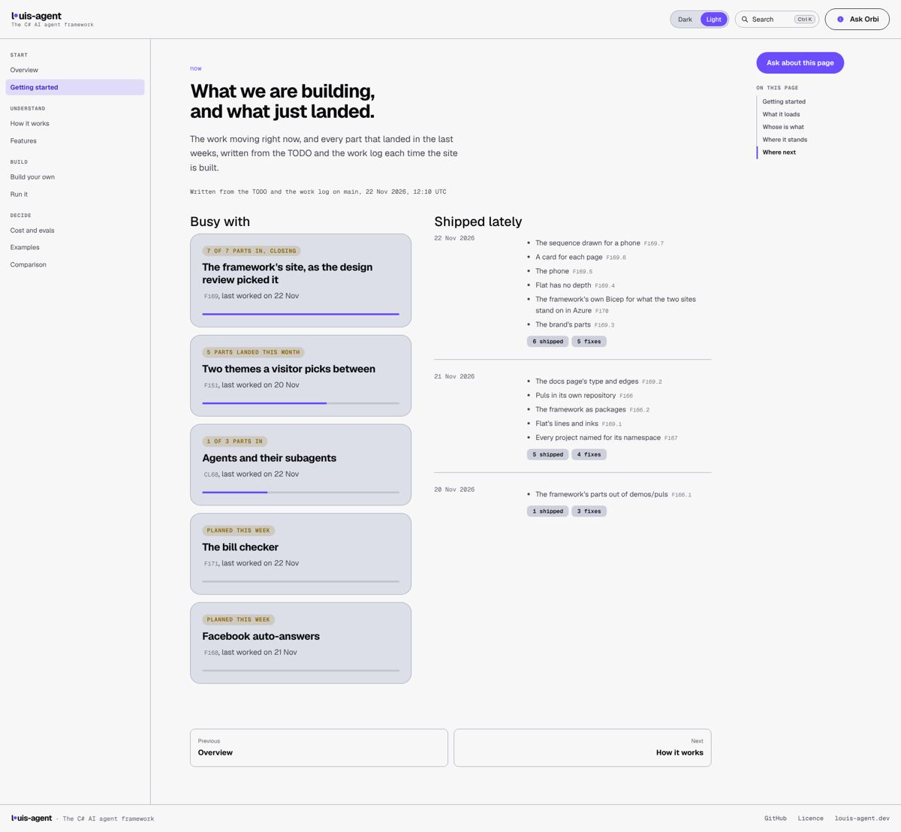
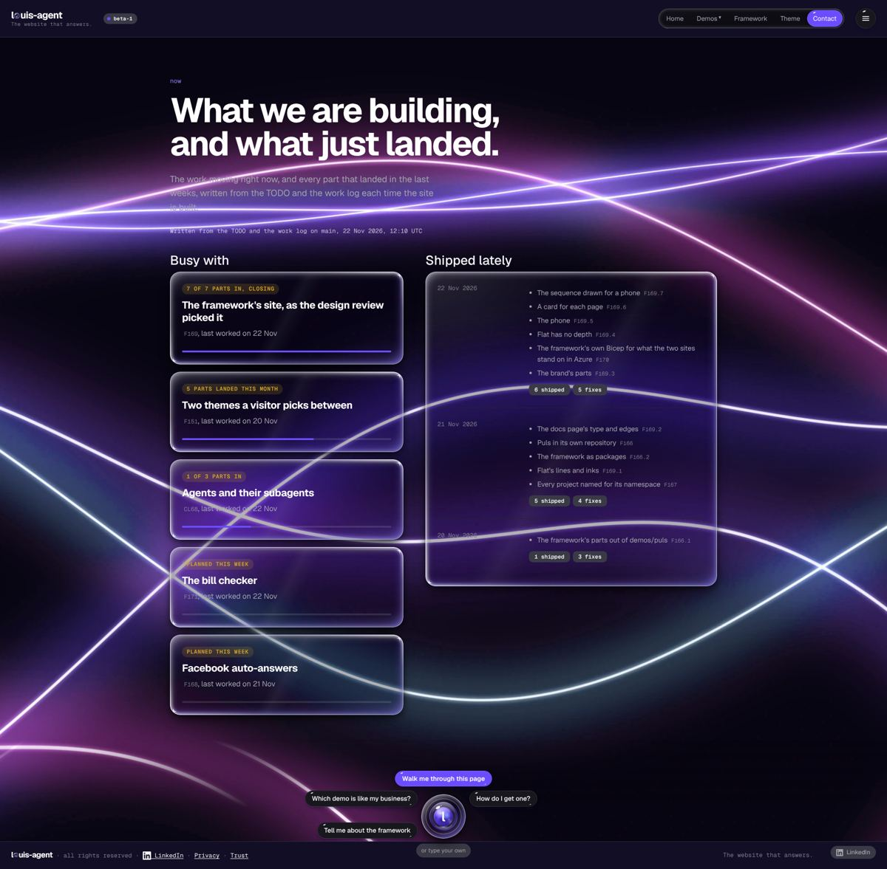
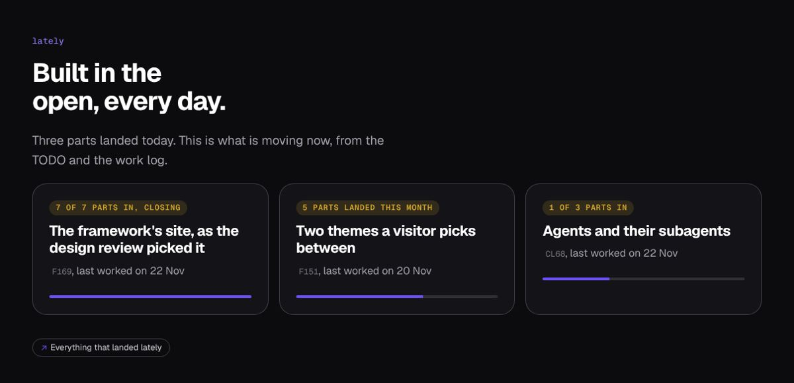

# F172 What we are building, and what just landed

A plan, for Louis's approval: a `/now` page on both sites that shows what we are busy with and what landed
lately, read live from the repository on GitHub, so it is never written by hand and never falls behind. Ten steps,
one commit each, on `feature/F172-what-we-are-building`. Louis made eight picks on 2026-11-22, one card each, and the
plan is drawn on them (*Louis's picks*).


## Context

Louis, 2026-11-22: "I want a section on the framework and public site which displays what we are actually busy
working on and what was implemented new recently. Can you design and plan this feature with branding. and page
designs".

The repository already says both things every day. The work log (`src/docs/work-log.md`) gets a dated row each time
a feature, a child of one, a fix or a cleanup finishes, and on 21 and 22 November alone it gained eleven feature
rows and nine fixes. The TODO (`TODO.md`) lists every open item. And since the start of November every working
commit names its item in its scope, `feat(f169)` or `refactor(cl68)`: 74 commits for F169, 29 for F166 and 8 for
CL68 in those three weeks. So the page needs no new writing, only a reader that turns those three into something a
visitor can take in at a glance.

**What was read in the repo.** The two sites' pages and frames (`LouisAgent.Site`, `LouisAgent.SiteFramework`,
the framework's pages in `LouisAgent.Web.Framework` and their menu in `FrameworkContents`), the controls a page is
built from (`Band`, `Tile` with its `TileStatus` badge, `Timeline` and `TimelineEntry` from the CV page, `Tape`,
`AnnouncementStrip`), how a site's own data is held (`Cv` reads `cv.json` once), how a host adds its own routes
(`MapSiteResume` on `MapLouisAgentHostGroup`), the work log's and the TODO's table shapes as `WorkLogTests` reads
them, and the commit scopes in `git log`. Both sites are Blazor WebAssembly pages served by an API host on the same
origin, so the page can ask its own host.

**What was read on the web, that day.** [Keep a Changelog](https://keepachangelog.com/en/1.1.0/): changelogs are
for humans, not machines; latest first, dated; a git log dump is "full of noise". Derek Sivers's
[/now page](https://sive.rs/now2): a page at `/now`, linked from the main menu beside About, saying what you are
focused on, with the date it was updated. Fider's
[board, roadmap and changelog](https://www.fider.io/blog/feedback-board-vs-roadmap-vs-changelog): a roadmap shows
status and works better without dates, a changelog is dated past work, and "an empty or stale page is worse than no
page". [Linear's changelog](https://linear.app/changelog): a date heading, a short title, then short lists by area.
GitHub's [REST rate limits](https://docs.github.com/en/rest/using-the-rest-api/rate-limits-for-the-rest-api): 60
unauthenticated requests an hour, counted per IP address, 5,000 with a token; back off until `x-ratelimit-reset`
after a 403 or 429. Microsoft's [Cache-Aside pattern](https://learn.microsoft.com/azure/architecture/patterns/cache-aside)
for keeping a slow, limited source behind a cache.

**What could not be confirmed.** Whether `raw.githubusercontent.com` counts against the REST limit is not said on
GitHub's page; step 6 measures it with the `x-ratelimit-*` headers and the plan holds either way, since a refresh
costs at most six calls. Whether the two Container Apps share one outbound IP is not known; even if they do, two
hosts refreshing every 15 minutes make about 48 calls an hour at most, under 60.

## Louis's picks

Each was one card with three options, the pictures drawn on the running sites for the look.

1. **The words** come from the work log's own headlines, generated: a row's words before its first colon, so F169.4
   reads "Flat has no depth". No new column of visitor sentences, since a prose column is what his rule of
   2026-11-07 keeps out of the records. (Over: a visitor line per row; GitHub's pull request titles.)
2. **"Busy with"** is an open TODO row that has had work in the last 21 days: a child landed in the work log, or a
   commit for it. (Over: Louis marks it by hand in the TODO; open pull requests.)
3. **Where:** its own `/now` page on both sites, in the menu, and on framework.louis-agent.dev a short band on the
   Overview too. louis-agent.dev's home stays as it is, since it sells to business owners. (Over: a band on both
   homes; the page only.)
4. **The look:** two columns, *Busy with* as status tiles with a bar for the parts done, *Shipped lately* by day on
   the Timeline. (Over: one timeline; the moving tape and cards.)
5. **A commit "for it"** is a commit whose scope names the item or one of its children, `feat(f169.7)` counting for
   F169. A sweep that touches every plan, like F167's rename of 6,139 files, no longer marks idle work busy. (Over:
   any change to the plan's file; the work log alone.)
6. **Read live from GitHub**, not a file made in the deploy or committed. (Over: made in the deploy; committed
   before each pull request.)
7. **Each site's host reads GitHub**, keeps the report 15 minutes and serves it at `GET /v1/now`. (Over: the
   visitor's browser asks GitHub; a workflow writes a file the sites read.)
8. **Where the code lives:** the board and its records in the framework, the GitHub reader in our own project in
   `src/site`, `LouisAgent.SiteNow`, which both hosts reference, so our own TODO and work-log tables stay out of
   the framework's packages. (Over: all of it in the framework; a copy of the reader in each host.)

## Design

### What a visitor sees

The page opens like every page of its site: the band's topic "now", the title "What we are building, and what just
landed.", a short summary, and one line in Geist Mono that says when the report was read from GitHub. Under it, two
columns. On the left, *Busy with*: one tile for each busy item, its badge in the theme's amber saying how far it is
("5 of 8 parts in", "Planned this week"), its headline as the tile's title, its id and the day it was last worked on
under it, and a thin violet bar for the parts done. On the right, *Shipped lately*: the Timeline, newest day first,
each day's headlines as a list with their ids quiet in Geist Mono, and two chips under it, "6 shipped" and "5
fixes". Fixes are counted, not listed, since their rows are whole sentences. On a phone the two columns stack, busy
first.

On glass the shipped column sits in one glass card, since on glass only cards are glass and plain text over the
moving lines was hard to read in dark (drawn and seen). On flat it sits on the page with no card, as flat has no
depth. Every colour is a theme name the controls already read; the board names no theme.

The framework's Overview gains one band, "Built in the open, every day.", with the first three busy tiles and a
link to `/now`. If GitHub has never answered since the host started, the page says so plainly and links to the work
log on GitHub instead of showing an empty board, since a stale or empty page is worse than none.

The pick, drawn over the running sites with their own controls and that day's real rows:







The rest are in [F172-mockups/](F172-mockups/): the three looks on each site that the pick was made from, both
sites in light and dark, and both at 390 wide.

The words on the page are drafts. Step 8 and step 9 write them with `/write-the-copy`, and the guide and Orbi are
told about the page in their page lists.

### How the report is made

The host's `NowCache` is asked for the report. If what it holds is younger than 15 minutes, it answers at once.
Otherwise it asks GitHub for three things: `TODO.md` and `src/docs/work-log.md` as raw files from `main`, and the
commits on `main` since 21 days ago from the REST API, a hundred to a page. Then four small readers do the rest,
each a pure function on text, so each is tested with no network.

`WorkLogReader` reads the dated rows of the features, fixes and cleanups tables, keeps the last 21 days, groups them
by day, and cuts each feature's or cleanup's words to its headline: the words before the first colon, or before the
first comma that ends the headline's clause, never more than 60 characters. Fixes are counted per day.
`TodoReader` reads the open table's rows with their ids and headlines, and the child ids each row names
(F171.1 to F171.8), which give the parts a bar counts. `CommitScopes` reads each commit subject's scope,
`feat(f169.7)`, as an id and keeps each item's latest day. `BusyRule` puts them together: an open row is busy when
a child landed in the window or a commit for it did, newest first, with "N of M parts in" when the row names its
children and the last day worked on.

If GitHub fails or limits us, the cache keeps the last good report and its time, waits until `x-ratelimit-reset`
before asking again, and logs why through `ILogger`. A report is never made up: when there is none, the route
answers 503 and the page says it couldn't reach GitHub.

### The five pictures


### Namespace map

| Type | Folder | Namespace | Step |
|---|---|---|---|
| `NowReport`, `BusyItem`, `ShippedDay`, `ShippedItem` | `src/web/LouisAgent.Web/Components/Site/Now/` | `LouisAgent.Web.Components.Site.Now` | 1 |
| `PartsProgress`, `Tile.Progress` | `src/web/LouisAgent.Web/Components/Site/Tiles/` | `LouisAgent.Web.Components.Site.Tiles` | 2 |
| `NowBoard`, `NowPart` | `src/web/LouisAgent.Web/Components/Site/Now/` | `LouisAgent.Web.Components.Site.Now` | 3 |
| `WorkLogReader` | `src/site/LouisAgent.SiteNow/Reading/` | `LouisAgent.SiteNow.Reading` | 4 |
| `TodoReader`, `OpenRow`, `CommitScopes`, `BusyRule` | `src/site/LouisAgent.SiteNow/Reading/` | `LouisAgent.SiteNow.Reading` | 5 |
| `GitHubRepo`, `NowCache`, `NowOptions` | `src/site/LouisAgent.SiteNow/` | `LouisAgent.SiteNow` | 6 |
| `NowRoute` (`MapSiteNow`) | `src/site/LouisAgent.SiteNow/` | `LouisAgent.SiteNow` | 7 |
| `NowPage`, the Overview's band, the menu entry | `src/site/LouisAgent.SiteFramework/Pages/` | `LouisAgent.SiteFramework.Pages` | 8 |
| `NowPage`, the menu and footer links | `src/site/LouisAgent.Site/Pages/About/` | `LouisAgent.Site.Pages.About` | 9 |
| Tests of each | `src/tests/web/LouisAgent.Web.Tests/`, `src/tests/site/LouisAgent.SiteNow.Tests/`, the two sites' tests | as their folders | 1 to 9 |

### Folder trees

Today `src/site/` holds the two sites, their hosts and the identities. After step 4:

```
src/site/
  LouisAgent.SiteNow/            new: our reader of GitHub, both hosts reference it
    Reading/                     WorkLogReader, TodoReader, CommitScopes, BusyRule
    GitHubRepo.cs  NowCache.cs  NowOptions.cs  NowRoute.cs
src/tests/site/
  LouisAgent.SiteNow.Tests/      new
```

### What is reused

`Band`, `Tile` and its status badge, `Timeline` and `TimelineEntry`, the tag chips, `DocLink`, `PartWords` for the
words, the host group the CV's routes already hang from, `HttpClient` and `IMemoryCache` from .NET, and the
Bootstrap grid for the two columns. No new package.

## Steps

Each step is one commit with its test, written first and seen failing, then a stop for Louis.

1. **The report's records.** `NowReport` and its parts in `LouisAgent.Web`, written and read as JSON through
   records. Test: a report goes to JSON and back unchanged, dates as ISO days.
2. **A tile's parts bar.** `Tile` takes an optional `PartsProgress` and draws a thin bar in the theme's violet,
   with its share for a screen reader. Test: 5 of 8 draws a bar at 62.5% with "5 of 8 parts in".
3. **The now board.** `NowBoard` draws a report in two Bootstrap columns, busy tiles and the shipped Timeline, or
   only the first three tiles for a band, its words from `PartWords<NowPart, string>`. Test: a sample report
   draws its tiles, its days in order and its chips; every part has its words.
4. **The work log's headlines.** The new project `LouisAgent.SiteNow` and `WorkLogReader`. Test: from a copy of
   today's rows, 22 November has six items and five fixes, and F169.4 reads "Flat has no depth".
5. **Busy with.** `TodoReader`, `CommitScopes` and `BusyRule`. Test: a fixed day and sample rows and subjects give
   F169, F151 and CL68 busy, F92 not, and `feat(f169.7)` counts for F169.
6. **Read live, kept 15 minutes.** `GitHubRepo` and `NowCache` over `HttpClient` and `IMemoryCache`. Test with a
   fake handler: one GitHub round in 15 minutes, the last good report kept on a 500, no call before
   `x-ratelimit-reset` after a 403. The headers of one real call are read once by hand to settle what the raw
   files cost.
7. **The route.** `MapSiteNow` on both hosts' groups, a named method returning `TypedResults`: 200 with the report,
   503 when none was ever read. Test: both answers.
8. **framework.louis-agent.dev.** Its `/now` page, a menu entry, the Overview's band, the sitemap, Orbi's page list
   and the page's own share card (F169.6). Test: the page and the band draw a sample report; the card's words match.
9. **louis-agent.dev.** Its `/now` page, linked from the menu and the footer beside Trust, the sitemap and the
   guide's page index. Test: the page draws a sample report; the links are there.
10. **Docs and close.** The design docs of `LouisAgent.Web` and both sites, a new design doc for `LouisAgent.SiteNow`
    with its pictures, the write-up, and the TODO and work-log rows (`/finish-a-feature`).

## Verification

The tests above, the touched projects' tests before each commit, and Core's rule tests (file and folder size,
repeated names) before the push. By hand, free: both sites run locally with the real GitHub, at 1920 and 390 wide,
light and dark, with `/check-a-page`. No paid run: nothing here calls a model.

**Done when** both sites show `/now` from GitHub, a merge to main shows up within 15 minutes of its deploy with
nobody touching the page, a GitHub failure shows the last good report and its time, and the framework's Overview
shows its band.

## Concepts

Steps 4 and 5 are parsing semi-structured text into typed records, the same move an agent's tool makes when it
reads a page's data before its words (ADR 0067), and step 6 is Cache-Aside in front of a rate-limited source,
which is skill 14 in [GOAL.md](../GOAL.md), reliability: a limit respected, a failure that serves the last good
answer and says when it was read. Steps 8 and 9 sit under skill 18, testing and shipping, since the page is the
project's own release notes, made from the records it already keeps. A natural next step, not in this plan, is
skill 4, tool design: a tool for the guide and Orbi over the same report, so "what are you working on?" is answered
from the facts rather than the prompt (ADR 0080).

## Approved during the build

Nothing yet.

## The records

Its row in [the plans' index](README.md), in `TODO.md` and in the work log's open table, added with this plan.

---
[Docs index](../README.md) · Related: [the work log](../work-log.md), [TODO](../../../TODO.md)
