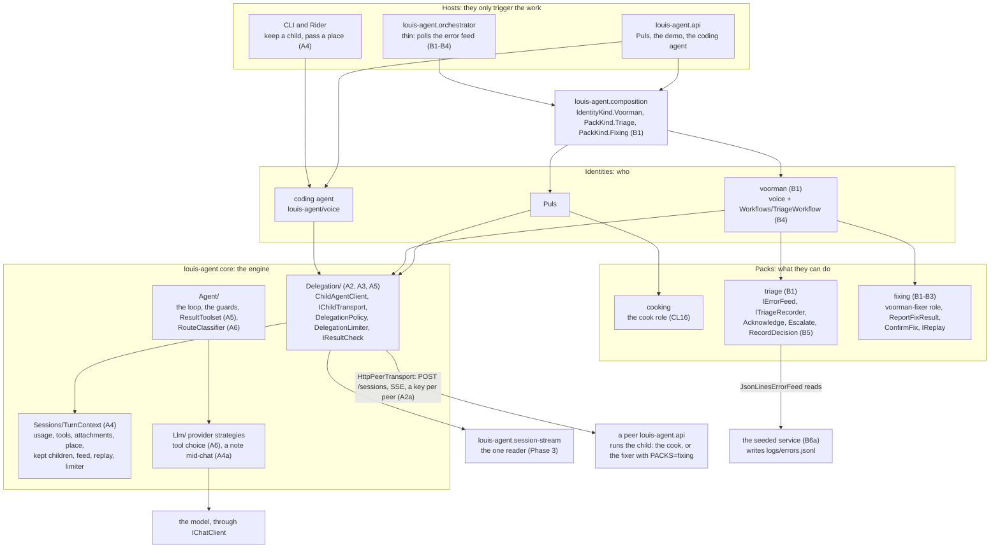
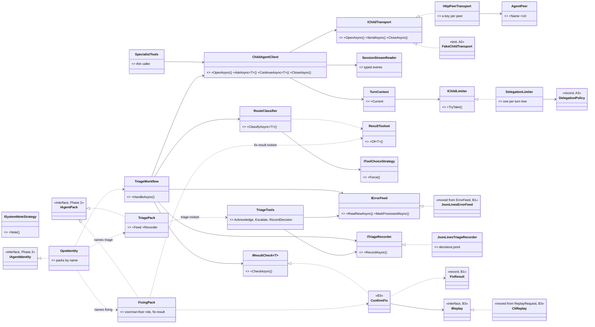
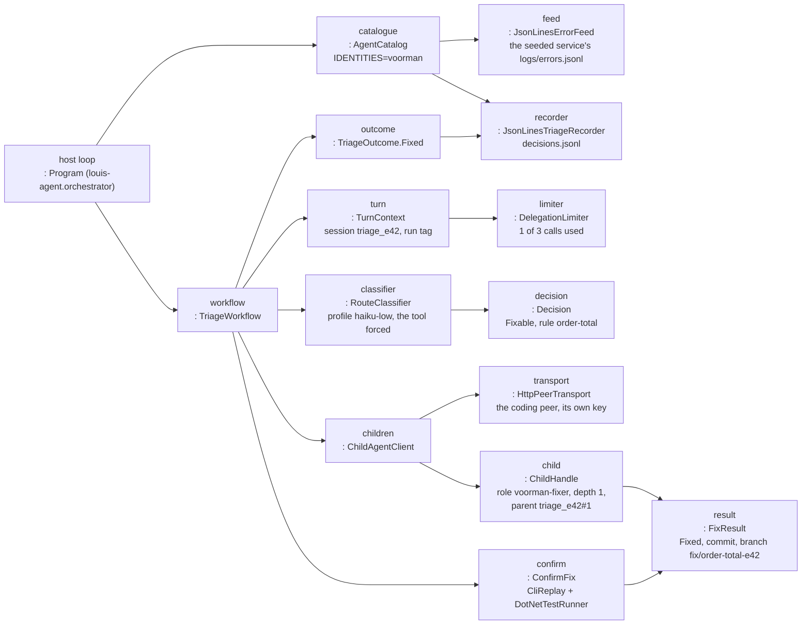
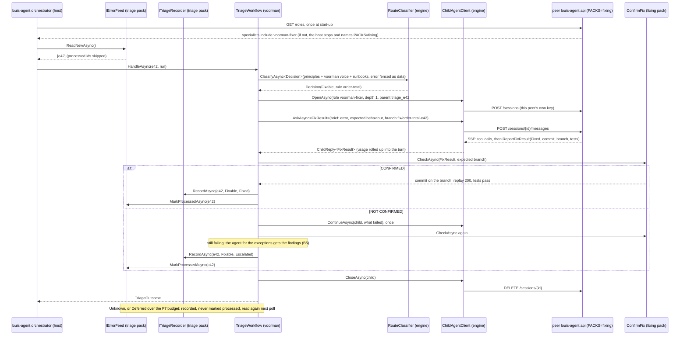
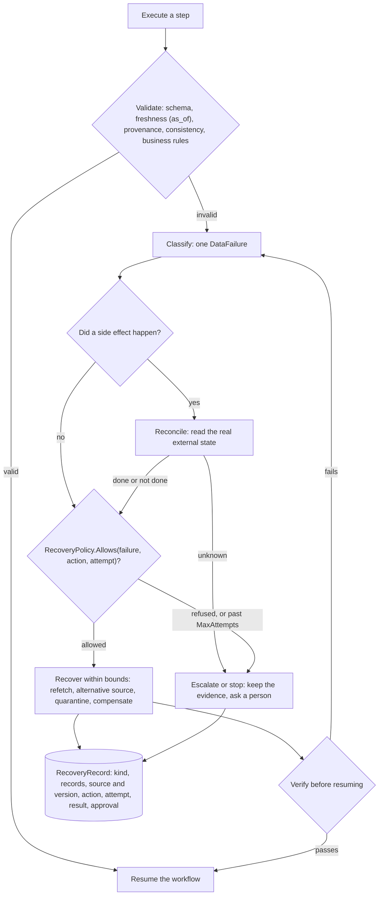

# Draft: F39 Orchestration (Phase 6)

> **Plan draft, not yet approved.** Moved whole out of the old platform plan on 2026-11-07 (CL56), lines 2005 to 3006 of `platform.md` at the tag `pre-roadmap`; the body below is as it was. When the work starts, this is rewritten into the plan Louis approves (the development guide, rule 3) and its TODO row names it. The sub-feature split of 2026-10-28 is the TODO's rows.

> **Added 2026-11-07** (Louis: a workflow is "how one agent can delegate to another, make decisions on that";
> "abandon the workflow identity idea"). F39 builds the framework's **fourth concept**, the workflow, as an engine
> capability ([F106](F106-framework-track.md)): Part A stays (delegation, hand-off to a named peer, typed results checked
> in code); **Part B's `voorman` identity is dropped**, and the triage case below survives only as a demo of Part A.
> Hand-off, with F43's conversations saved to Mongo, is a must the framework track takes right after the builder
> (F106.1). When this draft is rewritten into the approved plan, Part B is cut and ADR 0031's "the orchestrator is an
> identity" is amended. **The shape Louis gave on 2026-11-07:** a job polls a log or feed and *code* collects the
> errors; a *manager* identity decides which to investigate; an *investigator* identity reports back a typed result;
> the manager decides human intervention (an endpoint) or auto-handling, and delegates a fix to the *coder* (the
> coding identity), validates the changes and hands them to a *reviewer* identity; an unhappy review goes back to the
> coder *through the manager* until the reviewer is happy or the cap stops it; every result passes through the
> manager, who checks everyone (a hub, never agent to agent); a branch is left with the fix, **never a PR**. Code for the fixed steps, an agent only where the next step depends
> on what was found. This is F106.3, the framework's workflow demo.

### Phase 6 · F39 Orchestration: one delegation function, and the orchestrator as an identity

Branches `feature/F39-orchestration` (Part A) and `feature/F39-voorman-identity` (Part B). Before step A0 this section is
copied, as Louis approved it, into `docs/plans/F39-orchestration.md` on `feature/F39-orchestration`, with its four
diagrams, namespace map and folder trees; *Approved during the build* goes in that file, never in `platform.md` (Phase 0
step 1). Part A needs Phase 2's steps 1-2 and Phase 3's step 1 (the reader); Part B needs Phase 2's steps 1-2 and Part
A. F17 (*Orchestrator agent*) is merged into F39 as Part B (Phase 0 step 3), so Part B's branch carries F39's id, as
`docs/CLAUDE.md` asks of every branch. GOAL skills: 10, 5 and 6. Paid runs, all in B6 and each on Louis's go: one live
triage run against the seeded service (question 7), and one rerun each of Puls's routing and cook simulations, because
Part A touches the path Puls delegates through. The phase is done only when Louis has written its learning write-ups
himself, without the code open (B7).

Louis asked for it in the thread: "that is correct we need our own plan for a proper orchestrator function". The
orchestrator is both: the engine's delegation function (Part A), which every identity and every host uses, and the
`voorman` identity on a thin host (Part B). Question 12 asks Louis's yes to that answer, question 6 to the name `voorman`, and
question 8 to keeping it on `louis-agent.core` (ADR 0031, written in Phase 0, which closes ADR 0012's open Tool Runner
question).

The checks of this plan's first draft found it wrong in places, fixed here: the voorman identity took its packs as objects,
where Phase 2's contract names them; the sketch used three static classes (`MessageText`, `UsageReport`,
`SubSessionFeed`) as types; `TurnContext` carried five of the six values the API sets per turn; B1's proof compared
against a triage golden that doesn't exist; `DecisionKind` lacked the outcomes the diagram recorded; A0 redid Phase 0's
docs and pointed a build-mode decision here after Phase 0 cut build mode; Part B's branch was named after F17, which is
merged; no step built the seeded service that question 7's recommended answer needs; forcing one tool was marked
unverified, while the answer depends on the model and is stated below; B1 moved a `RecordDecision` tool that doesn't
exist yet; and `TurnContext` in `Sessions/` holding a type from the new `Delegation/` folder, which reads `TurnContext`,
would have made a folder cycle.

#### Context

##### Three orchestrators today, two ways of calling a child

| | What it does | How it calls a child | How the answer comes back | Limits live in |
|---|---|---|---|---|
| **The POC host** `src/louis-agent.orchestrator` | Polls one service's `errors.jsonl` (`OrchestratorOptions.cs:18-19`), triages each error with runbooks, has louis-agent fix it, checks the fix itself | Its own `LouisAgentClient`: `POST /sessions`, reads the SSE stream, `DELETE`; up to 3 "continue" messages, sent by `ServiceTools` (`ServiceTools.cs:26,77-80`) | `FIX-RESULT:` and `DECISION:` text lines found by a regex (`LouisAgentClient.cs:213`, `Program.cs:192`) | `ServiceTools` (one fix per error, 3 follow-ups), a 30-minute `HttpClient` timeout (`Program.cs:30`) |
| **Puls to specialists** (level 0 to 1) | Hands cooking to the cook on a peer | `SpecialistTools.StartSubSession` / `ContinueSubSession` (F5, F26) | Prose shaped by the role's prompt | `SpecialistTools` (3 a turn, 5 minutes, `SpecialistTools.cs:34,40`), `SubSessionRegistry` (3 kept, `SubSessionRegistry.cs:17`), the API host's `AgentSessions.Create` (`AgentSessions.cs:153-188`), six per-turn values the API sets (`src/louis-agent.api/Program.cs:287-292`) |
| **Specialist to minions** (level 1 to 2, F30) | Built, not in use yet (ADR 0021; `docs/features/F30-local-web-peer.md:3`). F30 stays (question 3: keep), and its minions are tested after this plan (*Later*) | `MinionTools`, the same child path as specialists at depth 2 | Prose | `MinionTools` (16 a turn, 2 minutes, `MinionTools.cs:31,34`), the API's `CheckMinion` (`AgentSessions.cs:196`) |

All three run on `AgentEngine` and treat a child's answer as a claim. But the child call, the retry rule, the cost
roll-up, the live feed, the result format and the limits each exist twice, and the limits sit in seven places
(`SpecialistTools`, `MinionTools`, `SubSessionRegistry`, `AgentSessions`, `ToolCallGuards`, `ServiceTools` and the
POC's `HttpClient`), one of them in the API host and two in the POC's, so only the API can delegate fully.

##### What's wrong with it (found by reading the code; not run)

- **Answers are text, read by a regex.** A decision the regex can't read becomes `unknown` (`Program.cs:168-173`) and
  is still written to `decisions.jsonl` and marked processed (`Program.cs:123-131`), so that error is never retried.
- **"Fixed only after all three checks pass" is only in the prompt** (`voice-orchestrator.md:28-37`); no code holds it.
- **Turn counters can hand a turn its slots again:** both clear every count once they hold 1,000 entries
  (`SpecialistTools.cs:411`, `MinionTools.cs:139`), whatever turn is still running. The 16-minion cap
  also counts per engine, not per user turn (`MinionTools.cs:58,136-142`): a cook and a researcher under one Puls turn
  would get 16 each.
- **Only the API delegates fully.** Outside it a delegation is one-shot: nothing is kept for a follow-up, and no
  attachments, minions or place travel (`SpecialistTools.cs:179-189`; `SubSessionRegistry.cs:7`: "With none current
  (an MCP call, the CLI) nothing is kept"), because five of the six per-turn values are set by the API alone; every host
  opens the usage scope (CLI `ConsoleChat.cs:63,90`, ACP `AcpServer.cs:237`, the POC `Program.cs:99`).
- **The POC's fix sessions open at depth 0 with no role and no parent tag** (its body carries task, run, service and
  toolsets only, `LouisAgentClient.cs:45-47`), so they get Louis's coding voice, skip FX14's prompt budget, which
  applies only to a sub-session (`ToolCallGuards.cs:90-104`), and skip the cost roll-up.
- **One key both ways.** `AGENT_API_KEY` is this deployment's own key and the key it sends to every peer
  (`AgentOptions.cs:168-169,243`); the POC sends `LOUIS_AGENT_API_KEY`, falling back to the same `AGENT_API_KEY`
  (`OrchestratorOptions.cs:24-25,60`). Nothing says who may delegate to whom (OWASP Agentic Top 10, ASI03 and ASI07).
- **A child's answer goes back whole and unfenced** into the parent's history (`ToolMessage.cs:768-769`).
- **A core prompt names the host's six tools** (`Prompts/agent/louis-agent/voice-orchestrator.md:7-16`), and the host
  is hard-wired to `order-service` and .NET (`OrchestratorOptions.cs:49,58`). Since CL10 the sample service is gone
  (commit `592e4e4`), and no compose file runs the orchestrator, so **the POC has nothing to watch**.

##### What was measured (Claude Haiku 5.5)

| Run | Result |
|---|---|
| POC baseline (M1, before CL10) | 10/10 fixes confirmed, $0.6586 a run, $0.0625 a fix (`docs/learning/13-cost-and-token-economics.md:26`) |
| POC with caching (F4) | $0.1334 a run (−80%); triage stayed uncached, about a quarter of the cached run's cost (`docs/learning/13-cost-and-token-economics.md:105,154`) |
| POC triage on local qwen3:4b | Free, 2.4× slower (`docs/GOAL.md:22`); in the local runs it made contradicting decisions in one reply, acknowledge and fix (`TODO.md:70-71`) |
| Puls delegating (F25/F29 checks) | 24 of 24 delegations routed by the table in the repeat run; delegating cost **+31%** on average against one agent (`docs/GOAL.md:31`); one wrong route cost $0.278 (`docs/learning/10-multi-agent-orchestration.md:78`, a draft by Claude, `:1-4`) |

##### What the outside sources agree on

- **Start simple:** a fixed workflow where the steps are known, an agent only where the next step depends on what was
  found (Anthropic, *Building effective agents*, Dec 2024; OpenAI's orchestration guide: "Start with one agent").
- **Multi-agent costs a lot:** about 15× the tokens of chat; it pays on parallel research and loses 39 to 70% on
  sequential work (Anthropic's research system, Jun 2025; Google Research, Jan 2026).
- **Children return short, structured results:** "often 1,000-2,000 tokens" or a reference, never a transcript
  (Anthropic, context engineering, Sep 2025).
- **Each agent its own credentials:** per-agent, scoped credentials, mutual authentication and typed message schemas
  between agents (OWASP Top 10 for Agentic Applications: ASI03 identity and privilege abuse, ASI07 insecure inter-agent
  communication).
- **MCP is for tools, A2A is between agents** (A2A's own docs; MCP's 2026-07-28 spec deprecates sampling).

The Anthropic and OWASP sources were re-read by the engine research (`engine-research-final.md`, change 9); the
OpenAI, Google Research and A2A ones, and the MCP specification's sampling note, were read for this plan's first draft
and not again (*unverified* since).

#### What "proper" means: one engine function, six verbs

| Verb | What it means | Where it lives |
|---|---|---|
| **Route** | Known cases are handled in code. Anything else gets one cheap request whose only tool is a typed decision, on its own model (Haiku at low effort, or the local qwen3:4b), forced where the model allows it. | Engine: `RouteClassifier` (`Agent/`), `IToolChoiceStrategy` (`Llm/`) |
| **Brief** | The role holds the job and the report's shape; the brief holds the goal, the context and the limits. The child sees nothing else. | Identities and packs: role files |
| **Delegate** | Agents as tools: the parent keeps ownership and writes the final answer. One writer per workspace; children run at once only when they only read (ADR 0026). Each peer has its own key, and the receiving side lists who may delegate to it. | Engine: `ChildAgentClient` behind `IChildTransport` |
| **Check** | A child's answer is a claim. Code checks it against the real thing (git, a replay, the tests). If it fails, one follow-up to the same child, then the agent for the exceptions or a person. | Packs: `IResultCheck<T>` implementations |
| **Decide** | The result is typed: the child ends with its role's result tool (`ReportFixResult`), its schema made from a C# record and its arguments checked in code; the workflow records its outcome through the triage pack's recorder. The text lines stay as a fallback. A role that reports to a person (the cook) keeps prose. | Engine: `ResultToolset`; packs: the records and the recorder |
| **Record** | One policy in code for depth, calls per turn tree, time, the prompt budget and money (F7, from Phase 5); one cost roll-up (ADR 0007); one live feed, whatever the host. | Engine: `DelegationPolicy`, `DelegationLimiter`, `TurnContext` |

**Honest about cost:** this won't make delegation cheaper. The +31% (`docs/GOAL.md:31`) comes from children starting
with an uncached prompt and the answer being written twice; F39 changes neither. What it gives is delegation that is
correct, typed, bounded, measured and the same in every host and identity. An orchestrated path stays only where the
simulations show quality held and cost per task is no worse than one agent.

**Not in F39:** a general multi-agent framework, hand-off meshes (one hand-off from an agent to a named peer is in, below), planners (Magentic), parallel writers, MCP sampling,
and an agent's self-check of its own answer (GOAL skill 6's planning and self-check, `docs/GOAL.md:27`; Part 5 says
where they go). Pull requests are CL17's. An error tracker behind `IErrorFeed` and a webhook beside polling
(`TODO.md:175-176`) are *Later*, after F39: Part B keeps the JSON-lines feed and polling.

**Hand-offs (added 2026-10-24, Louis: "say I want to do handoffs?"; `plans/one-agent-api.md`).** Beside delegation,
where the caller keeps the user, a hand-off gives the conversation to another agent: a typed
`HandOff(Peer, Role, Summary, Reason)` in `louis-agent.core/Delegation/`, and a `HandOffTo` tool checked against the
turn's `DelegationPolicy` (peer allowed, role offered there, summary within its cap) that ends the turn with a
`hand_off` stream event (CL18's format). The agent only asks; the move is the gateway's (Phase 9), so a model never
sends a person to a server of its choosing (OWASP Agentic ASI07). A simulation compares delegation and hand-off on the
same place questions (cost per turn, tokens, the grade): skill 10's *handoff patterns compared*, measured. Until
Phase 9 the harness plays the gateway's part.

#### Options considered (reuse before building)

| Option | Verdict |
|---|---|
| **A. F17 as written, inside the POC host** | Smallest, but keeps both child clients and both cost schemes, and nothing is reusable by Puls or the demo. |
| **B. One function in the engine, then voorman as an identity** | **Chosen.** Removes every duplication above, gives typed results (skill 5) and limits in one place; fits Phase 2's split. Largest, and it touches Puls's working delegation, so Puls's routing and cook simulations are rerun (B6). |
| **C. Microsoft Agent Framework Workflows** (`Microsoft.Agents.AI.Workflows` 1.25.0, MIT, on Microsoft.Extensions.AI 10.10.0 like ours) | Spike only, before `TriageWorkflow` (B4), and it also looks at the framework's checkpoints. Its workflows run in-process; remote agents come in only through A2A (`A2AAgent`, in `Microsoft.Agents.AI.A2A` 1.25.0-preview.261014.1) or an `AIAgent` we would write over `HttpPeerTransport`, and an agent as a tool takes one query string (`AsAIFunction`). Keep plain C# unless the spike shows a remote child with typed results through one of those. The spike's result is ADR 0030's *when to look again*. (Versions and licences as the standards check read them on nuget.org; not re-read here.) |
| **D. Anthropic's Tool Runner for the voorman orchestrator** | Rejected (ADR 0031, question 8): Anthropic only (against ADR 0002/0003), loses the free local triage and the shared ledger. |
| **E. Engine function only; delete the POC host** | Rejected: loses the only loop where a child's claim is checked in code. |

`IChildTransport` (open, send, close) has the shape of Phase 3's `ISessionClient`; A2 checks whether one serves both,
and the plan file says why not if it doesn't (*inferred* that they differ: a child carries a depth, a parent and a
role, a simulation's session a mode and a run tag).

#### Where each part lives (Phase 2's split)

- **The engine** (`louis-agent.core`) holds the mechanism, because every identity delegates: the child client and its
  transport, the policy and the limiter, the turn context, the result toolsets and checks, the classifier, and two
  provider strategies (forcing one tool; a note mid-chat, such as a change of town).
- **Packs** hold tools, checks and the fixer's role: `triage` (the error feed, the recorder, the decision tools) and
  `fixing` (the `voorman-fixer` role, its `fix-result` toolset, `ConfirmFix`).
- **The identity** `voorman` holds the voice and routing, and `TriageWorkflow` in plain C# over its two packs' public types
  (`IErrorFeed`, `ITriageRecorder`, `IResultCheck<FixResult>`), which ADR 0027 allows an identity and never a pack. It
  names its packs by name, so `louis-agent.composition` builds each once (`PackKind.Triage`, `PackKind.Fixing`), and the
  host hands the workflow the catalogue's instances.
- **The host** `louis-agent.orchestrator` only triggers: it polls now; a webhook is *Later*.
- **The peer** that runs the fixer loads the fixing pack (`PACKS=fixing`), or `voorman-fixer` is an unknown role there; the
  orchestrator checks that at start-up and stops if it doesn't.

#### Architecture



#### Interfaces

```csharp
// louis-agent.core/Delegation (A2): the one way to call a child agent. A new concern folder, layer 2 in
// ArchitectureTests, so SpecialistTools (Tools, layer 2) may call it; it uses Sessions, Usage, Config and Messages.
public sealed record AgentPeer(string Name, Uri Uri);                 // new: AGENT_PEERS is name=url pairs today, held as
                                                                      // a dictionary (AgentOptions.cs:117-120)
public interface IChildTransport
{
    Task<ChildSession> OpenAsync(ChildRequest request, CancellationToken ct);                             // POST /sessions
    IAsyncEnumerable<SessionEvent> SendAsync(ChildSession session, string message, CancellationToken ct); // POST /sessions/{id}/messages, SSE
    Task CloseAsync(ChildSession session, CancellationToken ct);                                          // DELETE /sessions/{id}
}
// SessionEvent: the reader's (LouisAgent.SessionStream, Phase 3 step 1a)
public sealed record ChildRequest(string Role, IReadOnlyList<string> Toolsets, int Depth, string Parent, string Label,
    string LedgerModel, IReadOnlyDictionary<string, string> Tags);    // Label and LedgerModel: what today's internal record
                                                                      // SpecialistTools.ChildKind (:143) holds; that record goes
public sealed record ChildSession(string Peer, string SessionId);
public sealed class HttpPeerTransport(HttpClient http, AgentPeer peer, string? key) : IChildTransport;
    // moved out of SpecialistTools.cs (its HTTP code, :152-483). key: this peer's own (A2a), never this deployment's
    // AGENT_API_KEY sent both ways. F44 passes W3C traceparent here (Phase 9).
public sealed class ChildAgentClient(IChildTransport transport)
{
    // From A4 it reads TurnContext.Current: the limiter (A3), the usage scope, the feed, the place and the replay
    // setting. In A2 and A3 it reads today's per-turn values, as SpecialistTools does now (UsageScope.Current,
    // UserPlace.Current and SubSessionFeed, SpecialistTools.cs:80,91,355; SessionReplay.Current from Phase 3's step 4a),
    // and in A2 the per-turn count stays SpecialistTools' own (TakeSlot, :289). Either way what the child gets comes
    // from the turn, never from the model's arguments (F22).
    public Task<ChildHandle> OpenAsync(ChildRequest request, CancellationToken ct);                 // a slot from the limiter (A3)
    public Task<ChildReply<T>> AskAsync<T>(ChildHandle child, string brief, CancellationToken ct);  // follow-up rule applied
    public Task<ChildReply<T>> ContinueAsync<T>(ChildHandle child, string message, CancellationToken ct);
    public Task CloseAsync(ChildHandle child, CancellationToken ct);
}
public sealed record ChildReply<T>(T? Result, string Text, ChildOutcome Outcome, UsageTotal? Usage);
    // Result: the role's result tool call (A5), read strictly; null when the role has none or the child never called it.
    // Usage: null when the peer reported none (UsageTotal, Usage/UsageTotal.cs:6; UsageReport is a static class)
public enum ChildOutcome { Answered, AnsweredAfterFollowUp, OutOfRounds, TimedOut, Failed }

// louis-agent.core/Delegation (A3): every limit in one place
public sealed record DelegationPolicy(int MaxDepth, int CallsPerTurn, int KeptPerChat, TimeSpan ChildTimeout,
    int PromptBudgetTokens, decimal? MoneyPerTree, FollowUpRule FollowUp, int MinionsPerTree, TimeSpan MinionTimeout)
{
    // Today's numbers: depth 2 (AgentSessions.cs:124: a specialist at 1, a minion at 2), 3 a turn
    // (SpecialistTools.cs:34), 3 kept (SubSessionRegistry.cs:17), 5 minutes (SpecialistTools.cs:40), 80,000 tokens
    // (AgentOptions.cs:160), 16 minions a turn tree and 2 minutes each (MinionTools.cs:31,34); MoneyPerTree from F7's
    // budgets (Phase 5), null when none is set.
    public static DelegationPolicy FromOptions(AgentOptions options);
}
public enum FollowUpRule { AskOnce, ContinueUpTo3 }   // FX11's ask-once (SpecialistTools.cs:317); the POC's three "continue"s
public sealed class DelegationLimiter(DelegationPolicy policy) : IChildLimiter;   // one per turn tree, held by TurnContext;
                                                                                 // no count is cleared while its tree runs

// louis-agent.core/Sessions (A3): what the turn holds, so Sessions never uses Delegation (ArchitectureTests says so)
public enum ChildKind { Specialist, Minion }
public interface IChildLimiter
{
    bool TryTake(ChildKind kind, out string? refusal);                // refusal: a ToolMessage text, already formatted
}

// louis-agent.core/Sessions (A4): one per turn, for every host; one AsyncLocal in place of six today, seven after
// Phase 3's step 4a adds SessionReplay.Current
public sealed class TurnContext
{
    public static TurnContext? Current { get; }
    public static IDisposable Begin(TurnContext turn);
    public UsageScope Usage { get; }                                  // usage.Activate() (src/louis-agent.api/Program.cs:287)
    public IReadOnlySet<string> Tools { get; }                        // today's AgentTools (:289); its one reader is the
                                                                      // minion rule (MinionTools.cs:90), which reads it here
    public IReadOnlyDictionary<string, string> Attachments { get; }   // today's SessionAttachments (:288), a static class
    public UserPlace? Place { get; }                                  // F22 (:290); A4a: it may change between turns
    public SubSessionRegistry? Kept { get; }                          // F26 (:291); null: nothing is kept
    public Action<SubSessionEvent>? Feed { get; }                     // the Werk panel's events (:292); core's Sessions.
                                                                      // SubSessionEvent; SubSessionFeed is a static class
    public SessionReplay? Replay { get; }                             // Phase 3, step 4a: SessionReplay.Current, set per
                                                                      // turn as UserPlace is, the seventh value
    public IChildLimiter Limiter { get; }                             // A3: shared by the turn tree
}

// louis-agent.core/Llm (A4a): a provider strategy (ADR 0003), chosen once in LlmClientFactory
public interface ISystemNoteStrategy { ChatMessage Note(string text); }   // a host's note mid-chat: a change of town
// AnthropicSystemNote (Llm/AnthropicProvider/): ChatRole.System after the history, on models that accept one
// PlainSystemNote (the default): a plain line in the user's turn. Never the system prompt or the tools (ADR 0008).

// louis-agent.core/Agent (A5): a result is a toolset with one tool, so a role asks for it in its toolsets header
// (ADR 0025): no new header key and no new member on IAgentPack. In Agent/, beside ToolsetDefinition.
public static class ResultToolset
{
    // Report{T} (ReportFixResult): its input schema from the record with JsonSchemaExporter (System.Text.Json); its
    // arguments deserialised strictly (unknown members, a missing required member, null in a non-nullable one), every
    // problem returned at once in one tool result. strict: true where the model supports it (A6's provider strategy).
    // Its ToolsetDefinition lists the ready tool (an optional member, Phase 8's line brought forward), so
    // AgentCatalog.NamesOf counts its name; CreateTools returns that AIFunction, which the engine adds as it is
    // (beside AgentEngine.cs:146, where it adds each toolset's public methods today).
    public static ToolsetDefinition Of<T>(string toolset);
}
// louis-agent.core/Delegation (A5)
public interface IResultCheck<in T>                                   // implemented in packs
{
    Task<CheckReport> CheckAsync(T claim, CancellationToken ct);
}
public sealed record CheckReport(bool Confirmed, IReadOnlyList<CheckLine> Lines);
public sealed record CheckLine(string Check, bool Passed, string Detail);

// louis-agent.core/Agent (A6): one request, one decision tool, its own model (LLM_SESSION_PROFILES, AgentOptions.cs:130-134)
public sealed class RouteClassifier(IChatClient client, IToolChoiceStrategy choice)
{
    public Task<Classified<T>> ClassifyAsync<T>(string system, string input, CancellationToken ct);
        // the decision tool built from T as A5's are; no decision read: Unknown, never "done"
}
public sealed record Classified<T>(T? Decision, ClassifiedBy By, UsageTotal? Usage);
public enum ClassifiedBy { Tool, TextLine, None }                     // the tool call; the DECISION: line; nothing read
// louis-agent.core/Llm (A6): forcing one tool is a per-model capability (F15's capability record takes it later)
public interface IToolChoiceStrategy { ChatOptions Force(ChatOptions options, AITool decision); }
// Anthropic, models that accept forced tool use (Haiku 5.5): ChatToolMode.RequireSpecific(name)
// Anthropic, Opus 5.5, Sonnet 5.5, Fable 5.1, Mythos 5.1 and the budget-thinking models (LlmClientFactory.cs:82-89):
//   auto, the tool strict, the DECISION: line as the fallback
// Ollama (Llm/OllamaProvider/): no tool_choice; the decision's JSON schema as the response format

// packs/tools/louis-agent.pack.triage (B1; RecordDecision in B5)
public sealed class TriagePack(TriageOptions options) : IAgentPack    // TriageOptions: the error log and the state folder,
{                                                                     // today's ORCHESTRATOR_* settings
    public string Name => "triage";
    public IErrorFeed Feed { get; }                                   // public, for the voorman identity's workflow (ADR 0027)
    public ITriageRecorder Recorder { get; }
}
public interface IErrorFeed
{
    Task<IReadOnlyList<ErrorEvent>> ReadNewAsync(CancellationToken ct);   // returns a FeedBatch from B5a (the recovery contract)
    Task MarkProcessedAsync(string errorId, CancellationToken ct);    // only for Fixed, Acknowledged and Escalated
}
public sealed class JsonLinesErrorFeed(string path, string stateDirectory) : IErrorFeed;   // today's ErrorFeed
public sealed record ErrorEvent(/* today's fields, ErrorFeed.cs:7 */);
public sealed record Decision(DecisionKind Kind, string Rule, string Reason);              // the classification
public enum DecisionKind { Expected, Fixable, Escalate, Unknown }
public enum TriageOutcome { Fixed, Acknowledged, Escalated, Deferred, Unknown }            // what happened to the error
public interface ITriageRecorder
{
    Task RecordAsync(ErrorEvent error, Decision? decision, TriageOutcome outcome, string reason, UsageTotal? usage,
        CancellationToken ct);
}
public sealed class JsonLinesTriageRecorder(string stateDirectory) : ITriageRecorder;     // today's decisions.jsonl
                                                                                          // (Program.cs:129-130)
public sealed class TriageTools(IErrorFeed feed, ITriageRecorder recorder)    // the toolset "triage", for the agent for
{                                                                             // the exceptions
    public string AcknowledgeError(string errorId, string reason);            // moved from ServiceTools (B1)
    public string EscalateToHuman(string errorId, string team, string reason);    // moved (B1); idempotent per error (B5)
    public string RecordDecision(string errorId, DecisionKind kind, string rule, string reason);   // B5; the DECISION:
}                                                                                                 // line stays a fallback

// packs/tools/louis-agent.pack.fixing (B1, B3): the fixer's role, its result and the check
public sealed class FixingPack(FixingOptions options) : IAgentPack    // FixingOptions: the service root and project, the
{                                                                     // main branch, the runbooks folder (OPS_RUNBOOKS)
    public string Name => "fixing";
    public IReadOnlyList<ToolsetDefinition> Toolsets { get; }         // fix-result: ResultToolset.Of<FixResult>
    public IFileProvider Prompts { get; }                             // specialists/voorman-fixer.md, its header:
                                                                      // toolsets: fix-result, dotnet, files, git, skills
    public IResultCheck<FixResult> Confirm { get; }                   // B3
}
public sealed record FixResult(FixStatus Status, string? Commit, string? Branch, string? Tests, string? Summary,
    string? Reason);                                                  // today's FixResult (LouisAgentClient.cs:32), its
                                                                      // Status a string today
public enum FixStatus { Fixed, Failed }                               // the FIX-RESULT line's two (ServiceTools.cs:268-269)
public sealed class ConfirmFix(IReplay replay, ITestRunner tests, FixingOptions options) : IResultCheck<FixResult>;
    // git + replay + tests: today's VerifyFixCommit, ReplayRequest and RunServiceTests
public interface IReplay { Task<ReplayResult> ReplayAsync(ErrorEvent error, CancellationToken ct); }
public sealed class CliReplay(string serviceProject) : IReplay;      // today's ReplayRequest (ServiceTools.cs:190)
public interface ITestRunner { Task<TestRunResult> RunAsync(string root, CancellationToken ct); }
public sealed class DotNetTestRunner : ITestRunner;                   // today's RunServiceTests (ServiceTools.cs:203)

// identities/louis-agent.identity.voorman (B1, B4): who the voorman orchestrator is (question 6 names it)
public sealed class OpsIdentity : IAgentIdentity
{
    public string Name => "voorman";                                      // agent/voorman/voice.md, moved out of core
    public IFileProvider Prompts { get; }                             // embedded: agent/voorman/voice.md
    public IReadOnlyList<string> Packs => ["triage", "fixing"];       // by name, as Phase 2's contract says
}
// Workflows/ (B4): code over its own packs' public types, which ADR 0027 allows an identity, never a pack
public sealed class TriageWorkflow(RouteClassifier classify, ChildAgentClient children, IResultCheck<FixResult> confirm,
    IErrorFeed feed, ITriageRecorder recorder)                        // + Phase 5's estimate and F7 budget, for Deferred
{
    public Task<TriageOutcome> HandleAsync(ErrorEvent error, string runId, CancellationToken ct);
        // Fixed only with CONFIRMED; Unknown and Deferred are recorded and never marked processed
}

// src/louis-agent.orchestrator/Program.cs (B1-B4): the host builds the workflow from the catalogue's instances
var catalog = Plugins.FromEnvironment();                              // IDENTITIES=voorman: the triage and fixing packs, once each
var host = AgentHost.Build(catalog);                                  // SkillFileSource.Use, once, with voorman's and its
                                                                      // packs' prompts (Phase 2); the engine stays the host's
                                                                      // own: runbooks, ReservedToolNames = catalog.ToolNames
var triage = catalog.Packs.OfType<TriagePack>().Single();
var fixing = catalog.Packs.OfType<FixingPack>().Single();
var workflow = new TriageWorkflow(classifier, children, fixing.Confirm, triage.Feed, triage.Recorder);
```



#### Objects: what exists in memory while one error is triaged

One error, `e42`, in run `run-20261020-0900`, from the seeded service (B6a), where the classifier says *fixable* and
the fix is confirmed. The rule and branch names are made up.



#### Communication: one error is fixed and confirmed



The same function in Puls: a Puls turn calls `StartSubSession`, which opens the cook through
`ChildAgentClient.OpenAsync(role puls-cook)` on the same transport, limiter and roll-up, and the cook's prose report
comes back whole (the cook reports to a person, so its role names no result toolset).

#### The recovery contract: what a workflow does when data goes bad mid-run

Added on 2026-10-19, after an outside review, with Louis's yes. The plan already handles bad data in pieces: FX16's
`VerifyQuote` checks a price against its page (`louis-agent.core/Tools/Web/WebTools.cs`), the cook leaves an item
unpriced rather than guess (F34, `docs/features/F34-shop-deals.md:149-151`), this phase types and checks every child's
result and records `Escalated` and `Deferred`, and Phase 9's F8 retries a failed model request. What it lacked is one
rule for a workflow whose data goes bad in the middle of a run. Today the POC's feed drops a line it can't read without
a word (`catch (JsonException) { continue; }`, `src/louis-agent.orchestrator/ErrorFeed.cs:36`), so nobody learns that an
error was lost. The contract is that rule, in code, for every workflow; `TriageWorkflow` is its first user, and Puls's
*Sources as data* its second.

**The loop.** Execute a step; validate what came back (its schema, its freshness from `as_of`, its provenance, its
consistency with the other sources, and the workflow's business rules); classify a failure as one `DataFailure`;
recover within the policy's bounds; and verify before the work resumes. Seven kinds, each with its rule:

| `DataFailure` | What it means | The rule |
|---|---|---|
| `Malformed` | It fails its schema | Rejected against the schema, never coerced into a plausible value; the record is quarantined with its reason |
| `Stale` | Its `as_of` is older than the policy's `MaxAge` | Unusable as it is: refetched once, or the work waits for a person |
| `Conflicting` | Two sources disagree | The policy's fixed precedence decides; two sources of the same rank that disagree go to a person |
| `Partial` | Some records of a batch failed | The valid ones are kept where the policy says that is safe, the bad ones quarantined, and the coverage reported honestly (11 of 13 read, 2 set aside) |
| `Repeated` | The same step failed the same way again | Bounded by `MaxAttempts`; the same futile call is never made again |
| `AfterSideEffect` | A step failed after it changed something outside | The real external state is read back (reconciled) before any retry, so nothing is done twice |
| `Uncertain` | The state can't be known, or no allowed action fits | Stop the affected work, keep the evidence, ask a person |

**The model proposes, code decides.** The agent for the exceptions (B5) may propose a `RecoveryAction` in its typed
result (A5); `RecoveryPolicy.Allows` decides in code whether that action is allowed for that failure at that attempt,
and anything it refuses becomes `Escalate`. Data a source returns stays data inside F42's untrusted-content frame (Phase
7), so a row that carries instructions is at most `Malformed`, never an order.

```csharp
// louis-agent.core/Delegation (B5a): the recovery contract, beside IResultCheck. Delegation/ is a proposed home; the
// plan file may give it its own concern folder, with its row in ArchitectureTests.
public enum DataFailure { Malformed, Stale, Conflicting, Partial, Repeated, AfterSideEffect, Uncertain }
public enum RecoveryAction { Refetch, AlternativeSource, Quarantine, Compensate, Escalate, Stop }
public enum RecoveryResult { Recovered, Quarantined, Escalated, Stopped }
public enum ExternalState { NotDone, Done, Unknown }                   // what reconciling found outside the app

// One per workflow, versioned, so every record names the rules it ran under
public sealed record RecoveryPolicy(string Workflow, string Version, int MaxAttempts, TimeSpan MaxAge,
    IReadOnlyList<string> SourcePrecedence,                           // first wins; two of one rank that disagree: Escalate
    IReadOnlyDictionary<DataFailure, IReadOnlyList<RecoveryAction>> Allowed)
{
    public bool Allows(DataFailure failure, RecoveryAction action, int attempt);   // false past MaxAttempts, and for
                                                                                   // any action not listed
}
// Every attempt, recovered or not; Phase 7 moves these lines into F42's audit log
public sealed record RecoveryRecord(string RunId, string Workflow, string PolicyVersion, DataFailure Failure,
    IReadOnlyList<string> Records, string Source, string? SourceVersion, DateTimeOffset? AsOf, RecoveryAction Action,
    int Attempt, RecoveryResult Result, string Reason, string? ApprovedBy);   // ApprovedBy: null until a person approves
public interface IRecoveryRecorder { Task RecordAsync(RecoveryRecord record, CancellationToken ct); }
public sealed class JsonLinesRecoveryRecorder(string stateDirectory) : IRecoveryRecorder;   // recovery.jsonl, append-only
public interface IReconcile<in T> { Task<ExternalState> ReadAsync(T attempt, CancellationToken ct); }

// packs/tools/louis-agent.pack.triage (B5a): the feed reports what it set aside instead of dropping it
public sealed record FeedBatch(IReadOnlyList<ErrorEvent> Events, IReadOnlyList<QuarantinedLine> Quarantined);
public sealed record QuarantinedLine(int LineNumber, string Reason);  // the line itself goes to quarantine.jsonl
// IErrorFeed.ReadNewAsync returns a FeedBatch from B5a; a quarantined line is never read again

// packs/tools/louis-agent.pack.fixing (B5a): did the fixer's commit land, whatever the child said?
public sealed class FixReconcile(FixingOptions options) : IReconcile<FixAttempt>;   // reads the branch and its commits
public sealed record FixAttempt(string ErrorId, string Branch, string? ReportedCommit);
```

**How it uses what Phase 6 already has.** The typed results (A5) and `IResultCheck<T>` (B3) are the validate step for a
child's answer; the contract adds the same for data read from a source. `DelegationPolicy`'s limits (A3) bound the
children, and `RecoveryPolicy.MaxAttempts` bounds the recovery inside them, never above them: a recovery that needs
another child takes a slot from the same `DelegationLimiter`. B5's one follow-up is the `Repeated` rule's first attempt.
`TriageOutcome` keeps its members: a recovered error ends `Fixed` or `Acknowledged`, a quarantined row never becomes an
error at all (it is a `FeedBatch` line), and a stopped or refused recovery ends `Escalated`, its error not marked
processed until a person decides. Freshness reads a record's `as_of`: the error's `timestamp` (`ErrorFeed.cs:9`) against
the service build's, and on Puls's track the `as_of` of a shop or recipe row and of `SourcedFact` (*Sources as data*,
Part 3, row 32). `EscalateToHuman`, idempotent per error from B5, is the one way to ask a person, so a recovery that
escalates twice still sends one.

**For voorman-triage** (its policy, version 1, *proposed* values for the plan file): `MaxAttempts` 2 (the ask and B5's one
follow-up), `MaxAge` the time since the service's last build, the precedence replay, then tests, then runbook, then
the classifier, and `AfterSideEffect` allowing only a reconcile followed by `ConfirmFix` on what is found: a fixer that
timed out after its commit gets its commit checked, never a second fixer on a second branch.



#### Namespaces (new, moved, changed)

| Type | Folder | Namespace | Step |
|---|---|---|---|
| `SessionStreamReader`, `SessionEvent` | `louis-agent.session-stream/` (at the root, beside `louis-agent.core/`) | `LouisAgent.SessionStream` | Phase 3, steps 1a-1d |
| `AgentPeer` (new), `IChildTransport`, `ChildRequest`, `ChildSession`, `HttpPeerTransport`, `ChildAgentClient`, `ChildHandle`, `ChildReply<T>`, `ChildOutcome` | `louis-agent.core/Delegation/` | `LouisAgent.Core.Delegation` (new concern folder, layer 2 in `ArchitectureTests`, a row in `louis-agent.core/CLAUDE.md`'s folder table) | A2 |
| `FakeChildTransport`, `ChildAgentClientTests`, `HttpPeerTransportTests` | `tests/louis-agent.core.tests/Delegation/` | `LouisAgent.Core.Tests.Delegation` | A2, A2a |
| `SpecialistTools` (a thin caller; its internal `ChildKind` record goes) | `louis-agent.core/Tools/Agents/` | `LouisAgent.Core.Tools.Agents` (unchanged) | A2 |
| `AgentOptions` (a key per peer, the callers' list: setting names the plan file's) | `louis-agent.core/Config/` | `LouisAgent.Core.Config` (changed) | A2a |
| The callers' check in `AgentSessions.Create`, a 403 text in `ApiUserText` | `src/louis-agent.api/` | `LouisAgent.Api` (changed) | A2a |
| `DelegationPolicy`, `FollowUpRule`, `DelegationLimiter` | `louis-agent.core/Delegation/` | `LouisAgent.Core.Delegation` | A3 |
| `ChildKind` (enum), `IChildLimiter` | `louis-agent.core/Sessions/` | `LouisAgent.Core.Sessions` | A3, new |
| `TurnContext` | `louis-agent.core/Sessions/` | `LouisAgent.Core.Sessions` | A4 |
| `ISystemNoteStrategy`, `PlainSystemNote`; `AnthropicSystemNote` | `louis-agent.core/Llm/`; `louis-agent.core/Llm/AnthropicProvider/` | `LouisAgent.Core.Llm`; `LouisAgent.Core.Llm.AnthropicProvider` | A4a |
| `ResultToolset` | `louis-agent.core/Agent/` | `LouisAgent.Core.Agent` | A5 |
| `ToolsetDefinition` (an optional list of ready tools), `AgentCatalog.NamesOf` (reads it), `AgentEngine` (adds a ready `AITool`) | `louis-agent.core/Agent/` | `LouisAgent.Core.Agent` (changed) | A5 |
| `IResultCheck<T>`, `CheckReport`, `CheckLine` | `louis-agent.core/Delegation/` | `LouisAgent.Core.Delegation` | A5 |
| `RouteClassifier`, `Classified<T>`, `ClassifiedBy` | `louis-agent.core/Agent/` | `LouisAgent.Core.Agent` | A6 |
| `IToolChoiceStrategy` and its implementations | `louis-agent.core/Llm/`, `Llm/AnthropicProvider/`, `Llm/OllamaProvider/` (new provider folder) | `LouisAgent.Core.Llm` … | A6 |
| `IdentityKind.Voorman`, `PackKind.Triage`, `PackKind.Fixing` | `src/louis-agent.composition/` | `LouisAgent.Composition` (changed) | B1 |
| `OpsIdentity`, `Prompts/agent/voorman/voice.md` | `identities/louis-agent.identity.voorman/` | `LouisAgent.Identities.Voorman` | B1 |
| `TriagePack`, `TriageOptions`, `TriageTools`, `IErrorFeed`, `JsonLinesErrorFeed`, `ErrorEvent`, `ITriageRecorder`, `JsonLinesTriageRecorder`, `Decision`, `DecisionKind`, `TriageOutcome` | `packs/tools/louis-agent.pack.triage/` | `LouisAgent.Packs.Triage` | B1 (`RecordDecision` in B5) |
| `FixingPack`, `FixingOptions`, `FixResult`, `FixStatus`, `Prompts/specialists/voorman-fixer.md` | `packs/tools/louis-agent.pack.fixing/` | `LouisAgent.Packs.Fixing` | B1 |
| `ConfirmFix`, `IReplay`, `CliReplay`, `ITestRunner`, `DotNetTestRunner` | `packs/tools/louis-agent.pack.fixing/` | `LouisAgent.Packs.Fixing` | B3 |
| `TriageWorkflow` | `identities/louis-agent.identity.voorman/Workflows/` | `LouisAgent.Identities.Voorman.Workflows` | B4 |
| `DataFailure`, `RecoveryAction`, `RecoveryResult`, `ExternalState`, `RecoveryPolicy`, `RecoveryRecord`, `IRecoveryRecorder`, `JsonLinesRecoveryRecorder`, `IReconcile<T>` | `louis-agent.core/Delegation/` (*proposed*; the plan file may give them their own folder) | `LouisAgent.Core.Delegation` | B5a |
| `FeedBatch`, `QuarantinedLine`; `FixReconcile`, `FixAttempt` | `packs/tools/louis-agent.pack.triage/`; `packs/tools/louis-agent.pack.fixing/` | `LouisAgent.Packs.Triage`; `LouisAgent.Packs.Fixing` | B5a |
| `Program`, `CommsLog`, `OrchestratorOptions` (thin host) | `src/louis-agent.orchestrator/` | `LouisAgent.Orchestrator` (changed); `LouisAgentClient` deleted in B2, `ServiceTools` in B4 | B1-B4 |
| `TriageRequestSnapshotTests` and `TriageRequestSnapshot.json` | `tests/louis-agent.orchestrator.tests/` | `LouisAgent.Orchestrator.Tests` | B0, new |
| tests for the packs, the identity and the simulation | `tests/louis-agent.pack.triage.tests/`, `tests/louis-agent.pack.fixing.tests/`, `tests/louis-agent.identity.voorman.tests/`, `tests/louis-agent.simulations.voorman.tests/` | `LouisAgent.Packs.Triage.Tests` and so on | B1-B6 |
| The seeded service, its runbooks and its expected decisions | `simulations/louis-agent.simulations.voorman/Service/` | its own (a made-up service) | B6a |
| `TriageSimulation` | `simulations/louis-agent.simulations.voorman/` | `LouisAgent.Simulations.Voorman` | B6 |

#### Folder structure: before and after

**Today** (`main` 7894953, the parts Phase 6 touches; Phases 2 and 3 change some of them first, as noted):

```text
louis-agent.core/
├── Prompts/agent/louis-agent/voice-orchestrator.md   # the POC's mode, names the host's 6 tools
├── Agent/               AgentEngine, ToolCallGuards (FX14's prompt budget), ToolsetCatalog
├── Llm/                 LlmClientFactory, two strategies (IPromptCachingStrategy, IUsageMapper), AnthropicProvider/
├── Sessions/            OpenSubSession, SessionAttachments, SubSessionEvent, SubSessionFeed, SubSessionRegistry, UserPlace
│                        (Phase 3's step 4a adds WebReplayMode and SessionReplay)
└── Tools/Agents/        AgentTools, SpecialistTools (the child client inside), MinionTools (on the same child path)
src/
├── louis-agent.api/     AgentSessions.cs (the depth and minion rules), Program.cs (6 per-turn values, :287-292)
└── louis-agent.orchestrator/
    ├── Program.cs  CommsLog.cs  ErrorFeed.cs  LouisAgentClient.cs  OrchestratorOptions.cs
    ├── Messages/            OrchestratorErrorMessage, OrchestratorLogMessage, OrchestratorToolMessage
    ├── Tools/ServiceTools.cs   # the 6 tools and the fix prompt
    └── Skills/order-service/   service.md + 11 runbooks (copied into the build)
docker/Dockerfile.orchestrator   # no compose file runs it since CL10
tests/louis-agent.orchestrator.tests/   LouisAgentClientTests, OrchestratorTests, SessionTagsTests (no golden)
```

**After Part A** (core, and the API's wiring):

```text
louis-agent.core/
├── Delegation/          AgentPeer, IChildTransport, HttpPeerTransport, ChildAgentClient, ChildReply, DelegationPolicy,
│                        DelegationLimiter, IResultCheck, CheckReport     # new concern folder, layer 2
├── Agent/               … + ResultToolset (A5), RouteClassifier (A6); ToolsetDefinition lists ready tools, the
│                        catalogue names them and AgentEngine adds them (A5)
├── Llm/                 … + ISystemNoteStrategy (A4a), IToolChoiceStrategy (A6); AnthropicProvider/ and OllamaProvider/
│                        hold their implementations
├── Sessions/            … + ChildKind, IChildLimiter (A3), TurnContext (A4)
└── Tools/Agents/        SpecialistTools and MinionTools, now thin callers
src/louis-agent.api/     AgentSessions asks DelegationPolicy and checks the callers' list; Program.cs opens one
                         TurnContext instead of 6 values
src/louis-agent.cli/, src/louis-agent.acp/   open a TurnContext with a registry per chat (A4)
tests/louis-agent.core.tests/Delegation/   FakeChildTransport, ChildAgentClientTests, DelegationLimiterTests, …
```

**After Part B** (Phase 2's layout, voorman added):

```text
identities/
├── louis-agent.identity.puls/                   # Phase 2
└── louis-agent.identity.voorman/                    # new: OpsIdentity, Prompts/agent/voorman/voice.md, Workflows/TriageWorkflow
packs/
├── louis-agent.pack.shops/                      # Phase 2
├── louis-agent.pack.triage/                     # new: TriagePack, TriageTools, IErrorFeed, JsonLinesErrorFeed,
│                                                #      ITriageRecorder, JsonLinesTriageRecorder, Decision, TriageOutcome
└── louis-agent.pack.fixing/                     # new: FixingPack, Prompts/specialists/voorman-fixer.md, FixResult,
                                                 #      ConfirmFix, IReplay, ITestRunner
src/louis-agent.composition/                     # IdentityKind.Voorman, PackKind.Triage, PackKind.Fixing
src/louis-agent.orchestrator/                    # thin: Program.cs (poll loop), CommsLog.cs, OrchestratorOptions.cs
simulations/louis-agent.simulations.voorman/         # new: TriageSimulation, its graders
└── Service/                                     # new (B6a): the seeded service, its runbooks, its expected decisions
tests/
├── louis-agent.identity.voorman.tests/  louis-agent.pack.triage.tests/  louis-agent.pack.fixing.tests/
├── louis-agent.simulations.voorman.tests/
└── louis-agent.orchestrator.tests/              # the host's loop and the triage golden (B0)
louis-agent.core/Prompts/agent/louis-agent/voice-orchestrator.md   # gone: moved to the voorman identity
runbooks: read at run time from a folder setting (OPS_RUNBOOKS, a proposed name), not compiled in
```

#### Steps (one commit each, test first, stop after each)

**Part A: F39 Orchestration in the engine** (core only; the refactor steps change nothing the model sees)

- **A0. Docs.** The stale lines fixed: F26's `SubSessionRegistry` path (`docs/features/F26-specialist-follow-up.md:46`
  says `Tools/Agents/`; it is in `Sessions/`), F5's `agents` / `AgentPeerTools` names
  (`docs/features/F05-toolset-profiles.md:76,96`; the toolset is `specialists`, `ToolsetCatalog.cs:99`, and the class
  `SpecialistTools`) and the same old name in `AgentOptions.cs:118`'s comment, and F30's 6 against
  16 minions (`docs/plans/F30-local-web-peer.md:246` says 6, `:289` says 16). The TODO's F39 line checked against Phase
  0's (F17, the structured results and the orchestrator's end-to-end test are already there). ADR 0031 was written in
  Phase 0. Skills 10, 18.
- **A1. One session-stream reader:** built in Phase 3, steps 1a-1d (`SpecialistTools` and `LouisAgentClient` already
  read through it), so nothing is left to do here; A2 builds on it.
- **A2. `ChildAgentClient` behind `IChildTransport`.** `HttpPeerTransport` moves out of `SpecialistTools.cs`;
  `AgentPeer` is new; today's internal `SpecialistTools.ChildKind` record goes, its `Label` and `LedgerModel` moving
  into `ChildRequest`; `SpecialistTools` and `MinionTools` become thin callers; `Delegation/` gets its row in
  `ArchitectureTests` (layer 2) and in `louis-agent.core/CLAUDE.md`. Test first: a `FakeChildTransport` scripts open, answer, an empty answer, a
  404, a timeout and an error event. `SpecialistToolsTests` and `MinionToolsTests` stay green unchanged; the golden
  files unchanged. Skill 10.
- **A2a. Credentials per peer and a list of who may delegate.** Each peer gets its own key, sent only to it, never this
  deployment's own `AGENT_API_KEY` both ways; the receiving API keeps a list of which caller may open which roles at
  depth 1, and refuses anything else before an engine is built (OWASP Agentic ASI03, ASI07). Setting names are the
  plan file's (*proposed*: `AGENT_PEER_KEYS` and `AGENT_CALLERS`, in `config/.env.secrets.example`); the Puls compose's
  two containers each get the other's key (`docker/docker-compose.puls.yml:35,80`). Test first: a call to peer A sends
  A's key and never B's; a caller not on the list gets a 403 before any engine is built; a listed caller may open only
  its roles; with neither setting set, everything works as today on one key, and the start-up log says so. The golden
  files unchanged. Skill 15.
- **A3. `DelegationPolicy` and one `DelegationLimiter` per turn tree.** `IChildLimiter` and `ChildKind` live in
  `Sessions/`, the limiter in `Delegation/`, so `Sessions/` never uses `Delegation/` (a rule `ArchitectureTests` gains).
  Test first, red today: a turn's count survives 1,000 other turns being counted (`SpecialistTools.cs:411` clears them);
  the per-turn cap, the time limit, the kept-children cap, the prompt budget and the depth rule (a child may not take
  the `specialists` toolset, `AgentSessions.cs:170`) are read from one `DelegationPolicy`; a tree's children are refused
  once its F7 money budget is spent, read from the ledger records under the tree's parent tag (Phase 5). Minions count
  per turn tree too: two specialists on different engines under one Puls turn share 16 minions (red today: each engine
  counts its own, `MinionTools.cs:58,136-142`), and "a child never does more than its parent" is checked in one place
  that the API's `CheckMinion` calls. The golden files unchanged. Skills 15, 14.
- **A4. `TurnContext`**, opened for every host, replaces the API's six per-turn values (`Program.cs:287-292`) and the
  seventh Phase 3 adds (`SessionReplay.Current`, step 4a, set per turn as `UserPlace` is) with one, and carries A3's
  limiter. Test first: an engine turn with no API host (a fake peer) keeps a sub-session for a follow-up, forwards the
  session's attachments, passes the place and the replay setting, feeds its events and rolls up its usage exactly as the
  API path does, so the CLI and Rider can delegate with follow-ups (each keeps a registry per chat); and a minion's tool
  is checked against the turn's tools with no API host. Showing a child's events live in the CLI and Rider is not in
  this step. The golden files unchanged. Skills 9, 10.
- **A4a. A change of town is a turn input.** `POST /sessions/{id}/messages` may carry a place; when it differs from the
  one the model was last told, the engine appends one note through `ISystemNoteStrategy` before the user's text, never
  by editing the system prompt or the tools (ADR 0008; Part 2's place rule). On Anthropic models that accept a
  mid-conversation system message it is a `ChatRole.System` message; elsewhere a plain line. The first turn keeps
  today's line (`src/louis-agent.api/Program.cs:214-216`). Test first, with a recording HTTP handler under the real
  Anthropic and Ollama clients: after a change of town the request as sent keeps `system` and `tools` byte-equal to the
  turn before, and the note sits after the history; a turn with the same town adds nothing. The golden files unchanged
  (they hold one turn). `UserPlace`'s doc comment marks it as personal information (POPIA s1; today it says nothing of
  it, `louis-agent.core/Sessions/UserPlace.cs:3-10`), and the note's town is never logged in full: it is redacted or
  hashed as the place is (Part 3, row 14, from Phase 3). Skills 7, 1.
- **A5. Typed results** (F8's story F8-S4, its implementation step 6, merged here). `ResultToolset.Of<T>` makes a result
  toolset with one tool, `Report{T}`; its schema comes from the record through `JsonSchemaExporter`; its arguments are
  deserialised strictly, and every problem goes back at once; strict decoding (`strict: true`) is a provider strategy
  where the model supports it (ADR 0003); JsonSchema.Net only if a full validator proves necessary. A role asks for its
  result in its `toolsets:` header (ADR 0025), so `RoleHeader` and `IAgentPack` keep their shape. `Report{T}` is built
  from a record, not a public method on a `ToolType`, and the engine registers a toolset's objects only through
  `AddPublicMethods` today (`louis-agent.core/Agent/AgentEngine.cs:146`), so A5 brings forward the two additive lines
  Phase 8 names: `ResultToolset.Of<T>` gives its `ToolsetDefinition` an optional list of its ready tools, whose names
  `AgentCatalog.NamesOf` reads beside `ToolMethodsOf` (the one source of tool names, Phase 2 step 1), and the engine
  adds the ready `AIFunction` that `CreateTools` returns as it is, beside `AgentEngine.cs:146`. Phase 8's MCP pack then
  reuses both; the new optional member on `ToolsetDefinition` is a review point under ADRs 0027 and 0028 (Phase 2's
  risks). The parent's `AskAsync<T>` reads the call from the child's stream with the same strict rules; a reply without
  it gets one follow-up asking for it, then falls back to the text line. A prose answer (the cook's) stays bounded by
  the guards' existing cap (results over 50,000 characters are summarised, ADR 0005) and is framed as outside data by
  F42's untrusted-content frame when Phase 7 builds it (`ToolMessage.cs:768-769` sends it whole and unfenced today).
  Test first: a fake stream with the call gives a typed record; bad arguments list every problem in one tool result; a
  text-only reply asks once, then falls back; an engine given a toolset whose `CreateTools` returns a ready `AIFunction`
  registers that function under its own name and none of its members (red on `main`: `AgentEngine.cs:146` hands every
  toolset object to `AddPublicMethods`, `ToolRegistry.cs:44-58`); a result tool named like a core tool stops start-up,
  naming both;
  `CreateTool` refuses a result tool's name (a test record's `Report{T}` here, B1's `ReportFixResult` the same way);
  `PackConvertibilityTests` passes a fake pack's result tool through `McpServerTool.Create` (B1's `fix-result` is
  covered the same way once `PackKind.Fixing` exists). A test role's request is pinned in its own test; the core golden
  files unchanged. Skill 5.
- **A6. `RouteClassifier`:** one request, one decision tool built as A5's are, its own model through
  `LLM_SESSION_PROFILES` (`AgentOptions.cs:130-134`, F30's other half). How the decision is forced is
  a provider strategy (ADR 0003) and a per-model capability, which F15's capability record takes over later. Anthropic
  models with adaptive thinking that accept forced tool use (Haiku 5.5): `ChatToolMode.RequireSpecific` names the
  decision tool. Opus 5.5, Sonnet 5.5, Fable 5.1 and Mythos 5.1, which reject forced tool use with a 400, and the
  budget-thinking models in `LlmClientFactory.cs:82-89`, where forcing with thinking on is an error: `auto` with the
  tool strict, plus the `DECISION:` line as the fallback. Ollama, whose `/api/chat` has no `tool_choice`: the
  decision's JSON schema as the response format. Test first, with a fake `IChatClient` and a recording handler: each
  strategy's request is built as stated; the decision and its rule are read; a reply without the tool call falls back to
  the `DECISION:` line; a reply with no decision is `Unknown`, never done. Skills 6, 1.

**Part B: F17 rewritten, the voorman orchestrator as an identity.** Part A needs Phase 2's steps 1-2 and Phase 3's step 1
(the reader); Part B needs Phase 2's steps 1-2 and Part A.

- **B0. A golden for the triage request**, written from `main` (principles, `louis-agent/voice-orchestrator`,
  `service.md` and the runbooks, the six tools, and the triage prompt for one fixed error), in
  `tests/louis-agent.orchestrator.tests/` as `TriageRequestSnapshotTests`, as Phase 2's step 0 does for Puls, so B1's
  move has a proof. Done when the golden is written and committed. Skill 12.
- **B1. The voorman identity and its two packs.** `agent/louis-agent/voice-orchestrator.md` moves out of core to the voorman
  identity's `agent/voorman/voice.md`, and `docs/CLAUDE.md`'s mode rule names it there; `AcknowledgeError`,
  `EscalateToHuman`, the error feed (`ErrorFeed` becomes `JsonLinesErrorFeed` behind `IErrorFeed`) and the decisions
  record (`decisions.jsonl` behind `ITriageRecorder`) move into the triage pack; today's fix prompt
  (`ServiceTools.cs:244-270`) splits into the role `specialists/voorman-fixer.md` in the fixing pack (the job, the steps and
  the report's shape, with `toolsets: fix-result, dotnet, files, git, skills`, today's `ServiceTools.cs:33`) and the
  brief the caller writes (the error, the expected behaviour, the branch); `IdentityKind.Voorman`, `PackKind.Triage` and
  `PackKind.Fixing` join `louis-agent.composition`; the host builds its catalogue there (`Plugins.FromEnvironment`) and
  passes it to `AgentHost.Build(catalog)`, which calls `SkillFileSource.Use` once with the voorman identity's and its packs'
  prompts (Phase 2: only `AgentHost.Build` and `BuildToolHost` call it) and gives the host its prices, rates and display
  currency (`AgentHostContext`, `louis-agent.core/Hosting/AgentHostContext.cs:15-17`), which the host loads itself today
  (`src/louis-agent.orchestrator/Program.cs:43-45`). The orchestrator keeps its own `new AgentEngine(...)`
  (`Program.cs:51`, its usage sink from `AgentHost.CreateUsageSink` as today, `:52`), now with `ReservedToolNames` set
  from the catalogue (`catalog.ToolNames`, Phase 2 step 1's init input). It keeps its own engine because its system
  prompt is the principles, the voorman voice, `service.md` and one runbook per method (`OrchestratorSkills.Load`,
  `Program.cs:200-228`), which `AgentEngineFactory` can't build (it builds a prompt from a role and its toolsets'
  guides, `louis-agent.core/Hosting/AgentEngineFactory.cs:140-147`), and because until B4 its tools are still
  `ServiceTools`, which is no catalogue toolset. The host engine that `Build` also makes (`AgentHost.cs:175`) is never
  sent a request. The orchestrator runs with `RIDER_MCP_AUTO_DISCOVER=false` (B6a's compose sets it, and the
  orchestrator's project doc names it), because `Build` starts Rider's discovery, which is on by default
  (`AgentHost.cs:180-197`, `AgentOptions.cs:222`), until Phase 8 takes discovery out of every host.
  `tests/louis-agent.orchestrator.tests` calls `SkillFileSource.Use` with the voorman identity's prompts in its own
  `[SetUpFixture]`, as the API's tests do with Puls's (Phase 2 step 3), because `OrchestratorTests` reads the mode
  through `OrchestratorSkills.Load` (`tests/louis-agent.orchestrator.tests/OrchestratorTests.cs:95,109`). Test first:
  core names no orchestrator tool (a ratchet test); the voorman voice is read through `SkillFileSource` from the voorman
  identity (core has no such file); `voorman-fixer` is listed by `GET /roles` only where the fixing pack is loaded; B0's
  golden is byte-equal, or differs only in the tools' order, which the diff review confirms; `PackConvertibilityTests`
  covers `PackKind.Triage` and `PackKind.Fixing` as soon as they exist, with no new test (as Phase 4 step 2 says for
  `Customers`): the triage pack's tools take plain data and return text (`AcknowledgeError` and `EscalateToHuman` take
  strings and return a string today, `ServiceTools.cs:213-216,232-234`), no tool description names `voorman` as a whole
  word now that `IdentityKind.Voorman` exists (today's descriptions in `ServiceTools.cs` don't, checked), and the
  `fix-result` tool passes through `McpServerTool.Create` (A5). Skills 3, 18.
- **B2. The fix call on `ChildAgentClient`** (depth 1, role `voorman-fixer`, a parent tag); `CallLouisAgentFix` keeps its
  description and calls it; `LouisAgentClient` is deleted. At start-up the host reads its peer's `GET /roles`
  (`Endpoints/RolesView.cs:13`) and stops, naming `PACKS=fixing`, when `voorman-fixer` isn't listed. Test first, against a
  scripted peer: the session opens at depth 1 with the role and the parent tag, FX14's budget and the roll-up apply, and
  the result is a typed `FixResult`; a peer without the role stops the host with that message; the fixer's session
  request (the principles, `voorman-fixer`, its toolsets) is pinned in a golden in `tests/louis-agent.pack.fixing.tests/`,
  reviewed, since its model now reads the role and a brief in place of today's one long prompt. This is the TODO's
  end-to-end test of the orchestrator against a scripted louis-agent.api (`TODO.md:157`). Skill 10.
- **B3. `ConfirmFix`** as an `IResultCheck<FixResult>` in the fixing pack, replacing the three check tools with one
  (F17-S3). Test first: each check passes and fails against a throwaway git repository; a branch the model names that
  differs from the one the workflow computed is refused; the replay goes through `IReplay`. B0's golden changes in the
  tools and the voice's check lines, reviewed. Skills 14, 6.
- **B4. `TriageWorkflow` in code** (F17-S1). First a short spike of Microsoft Agent Framework Workflows on a branch,
  its checkpoints included, its result written into the feature doc and into ADR 0030's *when to look again*. The
  classifier gets its own profile and its prefix cached (F17-S4: the lifetime from `usage-probe -- --cache-gaps`, so
  triage is no longer the uncached quarter of the run). `TriageWorkflow` defers an error whose estimate exceeds its F7
  budget (outcome `Deferred`; F7's story F7-S5, moved here from Phase 5). `ServiceTools` goes. Test first, with a fake
  classifier, child, check, feed and recorder: each path calls the right steps in order; `Fixed` is impossible without
  CONFIRMED; `Unknown` and `Deferred` are recorded and never marked processed; a fake triage defers when its budget is
  spent; the comms log names the path. B0's golden becomes the classifier's request, reviewed. Skill 6.
- **B5. The agent for the exceptions** (F17-S2 with F26): NOT CONFIRMED sends one follow-up with what failed to the
  kept child, then hands the agent the findings; related errors are offered together; the agent records its decision
  with the triage pack's `RecordDecision`, the `DECISION:` line as a fallback. Test first, with fakes;
  `EscalateToHuman` is idempotent per error, and contradicting decisions in one reply are refused (`TODO.md:70-71`);
  the agent's request is pinned in B0's test, reviewed. Skills 6, 14.
- **B5a. The recovery contract** (*The recovery contract* above). `DataFailure`, `RecoveryAction`, `RecoveryPolicy`,
  `RecoveryRecord` and `IRecoveryRecorder` in core; the triage feed returns a `FeedBatch` that names what it set aside;
  the fixing pack's `FixReconcile`; `TriageWorkflow` runs every failure through voorman-triage's policy and records every
  attempt in `recovery.jsonl`. Test first, with fakes, red on `main` where it can be (today a malformed line is dropped
  without a word, `ErrorFeed.cs:36`): a malformed line is quarantined with its reason and counted, never coerced, and
  the batch's valid errors still run; a stale error is refetched (replayed against today's build) and acknowledged if it
  no longer fails, never fixed as it was; two runbooks of one rank that disagree escalate, and a replay outranks a
  runbook; a third identical attempt is refused by the policy; a fixer that times out after its commit is reconciled,
  so `ConfirmFix` checks that commit and no second fixer opens; an unknown external state stops that error, keeps it
  unprocessed and escalates once; a recovery the model proposes that the policy refuses becomes `Escalate`; every case
  writes one `RecoveryRecord` with its kind, records, source, attempt and result. B0's golden unchanged unless the
  agent's result gains its proposal, reviewed. Skills 5, 14, 16.
- **B6a. The seeded service.** A small made-up .NET service in `simulations/louis-agent.simulations.voorman/Service/`,
  answering `{method} {id}` from the command line as the old sample did, so `CliReplay` works on it, and writing its
  errors to `logs/errors.jsonl`; its runbooks; and its bugs listed with their expected decisions, about as many as the
  M1 demo had (13 errors: 10 to fix, 2 expected, 1 for a person; `docs/learning/13-cost-and-token-economics.md:26`).
  Beside the bugs, seeded bad data for B5a's contract, each with its expected outcome: a malformed line in
  `errors.jsonl` (quarantined and counted, no error opened), a stale error that today's build no longer throws
  (refetched, then `Acknowledged`), two runbooks that claim one error with different decisions (`Escalated`, kind
  `Conflicting`), and a fixer that commits and then times out (reconciled, its commit confirmed, one branch only; the
  timeout scripted in the canned transcripts and, in the live run, *inferred* to need a short child timeout set for
  that error). Each trial copies it into a throwaway git repository, so a fix never touches this repo. A compose file
  runs the orchestrator (with `RIDER_MCP_AUTO_DISCOVER=false`, as B1 says), a coding peer with `PACKS=fixing` and the
  service (*proposed*: `docker/docker-compose.voorman.yml`). Test first: the service's own tests show each seeded bug, and
  the expected decisions parse and name a real method, and each seeded bad-data case parses to its expected kind and
  outcome. Skill 12.
- **B6. Measure.** The `voorman-triage` simulation (Phase 3's harness, `simulations/louis-agent.simulations.voorman`): its
  graders check each error's outcome against B6a's list and that `Fixed` comes only with CONFIRMED, and grade the
  recovery contract on B6a's seeded bad data: each case's `RecoveryRecord` has the expected kind and result, the
  coverage reported matches the lines read, and no side effect happens twice; the cost per error
  is a measure the API computes from the run's ledger rows after the run (`BenchmarkTrends`' cost per conversation,
  Phase 4 step 3), never a grader, because graders run in the runner before the API joins the run's ledger rows and no
  check computes a cost (ADR 0007; ADR 0022, `docs/adr/0022-benchmarks-recorded-from-the-protocol.md:25-27`). Free
  first: the graders on canned transcripts, and the classifier alone on the local qwen3:4b, free as the POC's triage was
  (`docs/GOAL.md:22`). Then, **all paid, all on Louis's go**: one live triage run against the seeded service (question
  7), read beside the M1 figures as a guide only, since the service differs; and one rerun each of Puls's routing and
  cook simulations. A re-run of the live run's recording costs a known $0 through Phase 3's replay cache. Skills 12, 13.
- **B7. Docs and the learning write-ups.** Written by Louis himself without the code open: skill 10's
  (`docs/learning/10-multi-agent-orchestration.md`, today a first draft by Claude, `:1-4`, rewritten with a workflow
  against an agent, measured) and new ones for skills 5 and 6 (`docs/learning/05-structured-outputs.md`,
  `06-agent-loop-and-planning.md`, each with its row in `docs/learning/README.md`): typed results, routing and the
  evaluator-optimizer loop. Then GOAL rows 5, 6 and 10 (build mode leaves row 10's *Planned*), the project doc
  (`docs/projects/louis-agent.orchestrator.md`), the runbooks doc (`docs/projects/orchestrator-runbooks.md`),
  `docs/specs/ORCHESTRATOR_DESIGN.md`, F39's feature doc with its results, and the work log. The phase is done only
  when Louis has written the write-ups; if he can't explain a step, that step goes back. Skill 10.

#### Verification

- **Free, every step:** `dotnet build`, the changed projects' tests, and the golden files. Part A's steps A1-A4 must
  leave `ModelRequestSnapshot.json`, `ToolMessageSnapshot.json` and the Puls golden (`PulsSessionSnapshotTests`, Phase
  2's step 0) byte-equal: that is the proof the model sees no change. A4a changes a request only after a change of
  town, and A5 a test role's only. From B0 on, the triage golden shows every change to what the orchestrator's model
  reads, each diff reviewed.
- **Free, B6:** the triage simulation's graders on canned transcripts, and the classifier on the local qwen3:4b.
- **Paid, only on Louis's go (B6):** one live triage run against the seeded service (question 7), and one rerun each
  of Puls's routing and cook simulations, because Part A touches the path Puls delegates through.

#### Risks

- **It touches Puls's working delegation.** Steps A2-A4 are refactors held by the three golden files and the existing
  tests; A2a changes the Puls compose's keys; A5 changes what a test role sees only.
- **Nothing to watch until B6a.** Since CL10 there is no sample service; B6a builds a small one, and the free suite runs
  on canned transcripts until then.
- **Forcing a tool depends on the model** (the claude-api notes, `shared/tool-use-concepts.md`, read for this plan;
  the thinking docs as the standards check read them): Haiku 5.5 accepts it; Opus 5.5, Sonnet 5.5, Fable 5.1 and
  Mythos 5.1 return a 400; with budget thinking (core's pre-4.6 models) it is an error; Ollama has no `tool_choice`.
  Where it can't be forced, A6 uses `auto` with a strict tool and the text line. *Unverified:* that the Anthropic SDK's
  `IChatClient` turns `RequireSpecific` and a strict tool into the request A6 expects, and that OllamaSharp turns a
  JSON-schema response format into Ollama's `format`; A6's recording-handler test checks both before anything relies on
  them.
- **A system message mid-chat depends on the model too.** The claude-api notes (`shared/prompt-caching.md`, its
  *Mid-conversation system messages*) list Opus 5.5, Sonnet 5.5, Fable 5.1 and Mythos 5.1, and not Haiku 5.5, our
  default; the Managed Agents notes list Haiku 5.5 for their own system events (*unverified* for the Messages API).
  Where it isn't accepted, A4a's plain line is used. *Unverified* too: whether the Anthropic SDK's `IChatClient` sends a
  `ChatRole.System` message after the history in place or moves it into the top-level `system`, which would edit the
  prefix; A4a's recording-handler test checks it first.
- **A role in a pack is CL16's mechanism.** If CL16 hasn't landed when B1 starts, B1 adds only what the fixer needs:
  the fixing pack's `Prompts` holds `specialists/voorman-fixer.md`, read through Phase 2's composite provider like a guide
  (*inferred* that it is found there unchanged); the plan file says which.
- **`ReportFixResult` costs tokens** per child, and the result tool's description and schema join the fixer's prompt;
  not measured yet (B6 measures it).
- **Roles and the MCP rule.** A pack with a role (`fixing`) converts to MCP for its tools; the role is a prompt and
  stays with the peer that runs it. ADR 0028's rule 8 (roles are prompts, not tools) says so.
- **Order.** Part A needs Phase 2's steps 1-2 and Phase 3's step 1 (the reader); Part B needs Phase 2's steps 1-2 and
  Part A.

