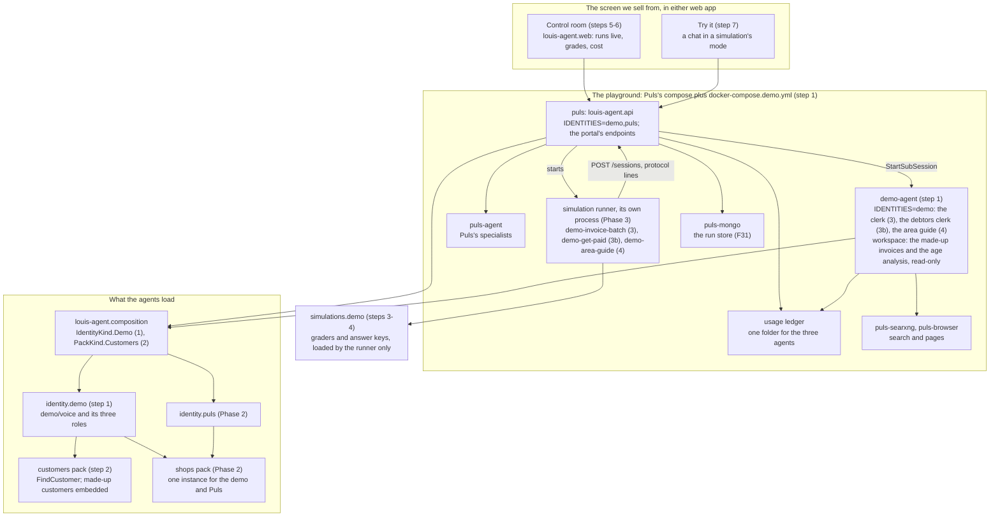
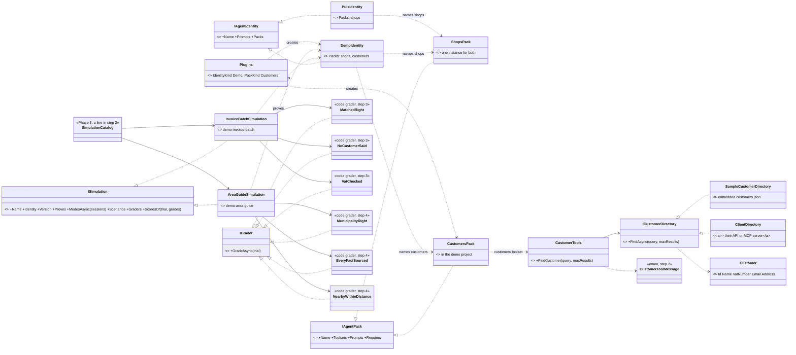
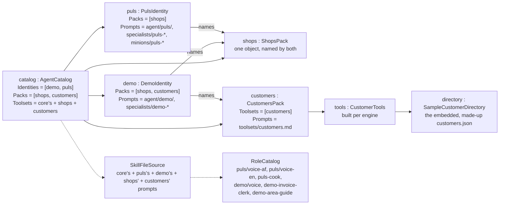
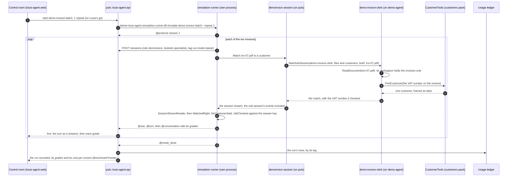

# Draft: F40 The sales playground (Phase 4)

> **Plan draft, not yet approved.** Moved whole out of the old platform plan on 2026-11-07 (CL56), lines 1406 to 1958 of `platform.md` at the tag `pre-roadmap`; the body below is as it was. When the work starts, this is rewritten into the plan Louis approves (the development guide, rule 3) and its TODO row names it. The sub-feature split of 2026-10-28 is the TODO's rows.

### Phase 4 · F40 The sales playground

Branch `feature/F40-sales-playground`. Before step 0 this section is copied, as Louis approved it, into
`docs/plans/F40-sales-playground.md` on that branch, with its four diagrams, namespace map and folder trees; *Approved
during the build* goes in that file, never in `platform.md` (Phase 0 step 1). It starts after Phase 3, whose harness,
runner, simulation catalogue, web record and replay and replay cache it runs on, and it is done only when Louis has
written its learning write-up himself (step 8). GOAL skills: 18, 7 and 12. Paid runs: one per simulation, the invoice
batch in step 3, the debtors book in step 3b and the area guide in step 4, each on Louis's go.

Louis: "demos is for selling, the playground". The two pitches are his own: "Agent should easily be configured for say
reading invoices and matching them to customers or become a code review agent", and "a demo package which contains
examples. where puls will take your location and become a tour guide, a know it all for an area". The demo identity is
what we show a client: each pitch is a mode, a role and a small pack over made-up data, and each is born as a
simulation. It never touches the engine or Puls's identity; only the control room moves out of Puls's web app (step 5).
A pitch that sells moves to a real identity or pack in its own feature, and one that doesn't is dropped; no production
compose names the demo. **Shown, not sold:** no pilot or sale starts before Phase 9, so until then the playground is how
a configured agent is shown, with its numbers, and Phase 0's ten conversations are how it is priced.

**The pitches are the business plan's ten ideas** (Louis, 2026-10-30: "these 10 plans must be in the demonstration
feature", and "to sell it"). Part 6 scores ten ways this earns money in South Africa; each is a pitch here, in Part 6's
rank order, in the pitch table below. The practice's invoice clerk and "get paid" are built in F40 itself, the area
guide stays as Puls's own pitch (the hobby, and the CV), and every other idea is a child feature (`F40.5` and on) with
its own small plan, built the week a buyer asks to see it and not before, so no month goes on a demo nobody asked for.
A bigger company that wants its agent custom built and hosted for it (Louis, 2026-10-30) is a pitch too, *your own
agent*, where the demo is the build itself. Every pitch has one shape, a template (the *template method* of the Gang
of Four, in plain words: the same steps every time, only the content differs): a specialist role file over a small
pack of made-up data, a simulation whose answer key is out of the agent's reach, graders in code, its cost per
conversation from the ledger, a read-only workspace, and nothing sent or changed without a person. In Phase 7 what a
pitch writes becomes a draft a person approves, which is the product; a pitch that sells moves to its own identity or
pack in its own feature (the rule above).

**The order of the pitches.** Part 6's rank, unless Phase 0 step 4's answers choose otherwise: the invoice clerk
(step 3), "get paid" (step 3b), the area guide (step 4). The order is settled before this section is copied into F40's
plan; a swap decided later goes under *Approved during the build*. A pitch the answers ask for that the table doesn't
hold gets its own child plan before it is built.

**Why the demo identity and the invoice pitch are built now.** The challenge recommended deferring the composition
project, `PACKS`, the demo identity and the invoice pitch until a second real consumer exists. They stay, because Louis
asked for a sales playground and for packs pluggable on their own ("say the agent needs it it should be [pluggable]";
"demos is for selling, the playground"). Phase 2 carries the same line for the composition project and `PACKS`.

**The area guide, here or first (question 13).** The challenge recommended running the area guide first, as a hand-run
eval before Phase 2 (one paid run, a role file on the `web` toolset, no new code), as the cheapest test of the vision.
The plan keeps it here, because a simulation needs Phase 3's C# harness and Louis asked that every demo be a C#
simulation ("we call it simulations"). If he answers *first*, that eval's role file and its scored answers become step
4's starting point and the baseline its simulation is compared with; nothing else in this phase changes.

#### The pitches: Part 6's ten ideas, one simulation each

The name a pitch sells under is Part 6's; its code name is its `demo-` role. Grader names past step 4 are a first
sketch that each child's plan settles. Every book, file and roll is made up and embedded; no pitch reads a real
person's data.

| Part 6 rank | Idea | The pitch: a role over made-up data | The simulation, graded in code | Built |
|---|---|---|---|---|
| 1 | Practice assistant for bookkeepers and tax practitioners | `demo-invoice-clerk`: reads a supplier invoice and matches it to the customer by name, VAT number or e-mail (the first pitch in *Design*); the practice's later jobs (a SARS letter read and summarised, CIPC dates) come as children | `demo-invoice-batch`: `MatchedRight`, `NoCustomerSaid`, `VatChecked`; cost per invoice | **F40.1**, steps 0 to 3, now |
| 2 | "Get paid": a debtors agent for small businesses | `demo-debtors-clerk`: reads a made-up age analysis and drafts one reminder per overdue invoice in the business's tone, firmer at 30, 60 and 90 days; it cannot send, because the demo peer has no tool that sends | `demo-get-paid`: `EveryOverdueDrafted`, `NoPaidInvoiceChased`, `AmountsMatchTheBook`, `NothingSent`; cost per debtor | **F40.2**, step 3b, now |
| hobby | Puls, the area guide | `demo-area-guide` (the area guide in *Design*): what is here, each fact with its source and date | `demo-area-guide`: `MunicipalityRight`, `EveryFactSourced`, `NearbyWithinDistance` | **F40.3**, step 4, now |
| 3 | FICA agent for small law firms and estate agencies | `demo-fica-clerk`: from a made-up client file (the text of an ID copy, a proof of address, company documents) fills the firm's FICA checklist, names what is missing and gives a risk rating with its reason; a person signs; the screening list is a stand-in table | `demo-fica-file`: `TickedOnlyWhatIsThere`, `MissingNamed`, `EveryRatingHasItsReason`, `NothingSigned` | **F40.5**, its own plan, when a firm asks |
| 4 | .NET agent engineering, and *your own agent*: custom built and hosted for a bigger company | the demo is the build: a made-up company's identity and one pack over a stand-in system (an in-memory API), built in the open from the engine's guide and timed in steps and hours; it doubles as the engine package's sample (Phase 10) | `demo-your-own-agent`: the new identity loads beside `demo` through `IDENTITIES`, its tool answers only from the stand-in system, every outside result framed, cost per call known | **F40.6**, when a company asks |
| 5 | Assistant for sectional-title managing agents | `demo-scheme-clerk`: levy arrears per unit from a made-up roll, maintenance requests sorted to the right trade, the summary a CSOS dispute needs | `demo-scheme-month`: `ArrearsMatchTheRoll`, `EveryRequestToATrade`, `NothingSent` | **F40.7**, when asked |
| 6 | Claims and admin agent for medical practices | `demo-claims-clerk`: rejected claims from a made-up remittance matched to their reason codes, a resubmission drafted; made-up patients only, never real health data (special personal information, POPIA s26) | `demo-claims-batch`: `EveryRejectionExplained`, `ResubmissionMatchesTheCode`, `NoRealPatient` | **F40.8**, only with a partner that carries the compliance |
| 7 | Shop assistant for online sellers | `demo-seller-clerk`: answers a customer's question from a made-up catalogue and order list and drafts a listing (not the `shops` pack, which reads the grocers' public catalogues) | `demo-seller-questions`: `AnswerFromTheCatalogue`, `OrderStateRight`, `NoPriceInvented` | **F40.9**, when asked |
| 8 | Compliance and renewals agent for insurance brokers | `demo-broker-clerk`: renewals and policy anniversaries from a made-up book, a notice drafted per client, the record-of-advice check | `demo-renewals`: `EveryRenewalInItsMonth`, `NoticeMatchesThePolicy`, `NothingSent` | **F40.10**, when asked |
| 9 | Farm compliance assistant | `demo-farm-clerk`: a GlobalG.A.P. or SIZA checklist against a made-up farm's records, the missing evidence named | `demo-farm-audit`: `TickedOnlyWithEvidence`, `MissingNamed` | **F40.11**, when asked |

**A child from F40.5 on** is about five steps, each a commit with its test: the role file and its made-up data; a pack
only where the data needs a tool (a stand-in system, a screening table), self-contained in the demo's project as the
customers pack is; the simulation, its graders on recorded transcripts and its line in the catalogue; one paid run on
Louis's go; the manual with its cost bar, the feature doc and the write-up. Its plan is `docs/plans/F40.x-name.md`, its
branch `feature/F40.x-name`, its done-when "its simulation passes its bar on a recorded run", and it opens the week a
buyer asks to see that pitch, never before. The playground itself ends with F40.4; the children come and go without
reopening it.

#### Context

| Today (checked at `main` 7894953) | Where |
|---|---|
| No demo identity, no customers pack and no F40 doc: the feature docs stop at F34, and no TODO line names F40 | `docs/features/`, `TODO.md` |
| The admin portal (F27, F31), which the control room grows from, lives in Puls's web app: the page of checks and the live run (routes `/admin` and `/admin/benchmarks`, 671 lines) and one stored run (138 lines). It already follows a running check live: a row per turn, the open turn streaming in the chat's own `TurnView`, and a reloaded page picks the run up again | `src/louis-agent.puls/Pages/Admin/Benchmarks.razor:1-2,16-19`, `BenchmarkRun.razor` |
| What ties the portal to Puls: `@layout AdminLayout` (with `PulsLogo` and "Back to Puls"); `RunExplorer` (986 lines), `TrendChart` (135) and `ChartInfo` (76), which are Puls's own components; the focus helper `pulsUi.focus`; the "· Puls Admin" titles; its styles in Puls's `css/admin/`, and Bootstrap's offcanvas, which only Puls's app loads. 47 lines across these six files name Puls, 27 of them in `RunExplorer`'s charts and legends ("Puls itself" beside the specialist) | `src/louis-agent.puls/Layout/AdminLayout.razor:11,17`; `src/louis-agent.puls/Components/`; `Benchmarks.razor:21,658`; `src/louis-agent.puls/wwwroot/js/chat.js:162`, `wwwroot/css/admin/shell.css:1-4`, `wwwroot/index.html:17,52` (counted with `grep -c Puls`) |
| The shared web project holds no pages: "Each app keeps its own pages, look (CSS) and JavaScript; the shared components only emit class names". Both apps' routers know only their own assembly | `src/louis-agent.web/louis-agent.web.csproj:3-5`; `src/louis-agent.puls/App.razor:1`, `src/louis-agent.code-review/App.razor:1` |
| Neither web app opens another identity's mode: Puls's app always opens `puls/voice-{language}`, and the code-review app passes no role, so it gets the API's default mode; the shared API client already takes a role | `src/louis-agent.puls/Pages/ChatPage.razor:326,769`; `src/louis-agent.code-review/Pages/ChatPage.razor:415`; `src/louis-agent.web/Services/AgentApi.cs:26` |
| The checks the portal offers are stub, cook and routing. A run needs the run store ("without a store no run starts"), and only Puls's stack runs one: the code-review stack has no MongoDB | `src/louis-agent.api/Services/BenchmarkCatalog.cs:12-21`; `src/louis-agent.api/Program.cs:108-109,114`; `docker/docker-compose.yml` |
| No stack runs a demo: CL10 deleted the old order-service `docker/docker-compose.demo.yml` (commit `592e4e4`), though `docs/CLAUDE.md:175` still lists a demo compose. Puls's stack turns on only Puls's roles, and its two agent containers' workspace is the whole repository | `docker/`; `docker/docker-compose.puls.yml:40,82` (`ROLES_ENABLED`), `:51,94` (`${PULS_WORKSPACE:-../}:/workspace`) |
| Reading a document: `ReadDocument` and `ReadTable` are tools of the `files` toolset, beside its write, copy, rename and delete tools; no toolset reads documents only. `FetchUrl` already reaches OpenStreetMap's Nominatim: the cook uses it to find a shop's branch | `louis-agent.core/Tools/Workspace/WorkspaceTools.cs:89,126,233-391`; `louis-agent.core/Agent/ToolsetCatalog.cs:28-32`; `louis-agent.core/Prompts/specialists/puls-cook.md:24-25,65` |
| No web tests: `tests/` holds the core, API and orchestrator tests only, the tests guide says the web app has none yet, and the TODO asks for them (bUnit or Playwright) | `tests/CLAUDE.md:63-64`; `TODO.md:155` |
| The guard on message enums outside core reads only `src/*/Messages` and `tools/*/Messages`, so an identity's or a pack's enum is never checked today. Phase 2 step 4 extends it to `packs/` and `identities/` at any depth, and Phase 3 step 2 to `simulations/`, so by this phase it needs only `CustomerToolMessage` on its list | `tests/louis-agent.core.tests/Messages/HostMessageEnumTests.cs:10-18` |
| The trends hold a cost per answer for a meal only (a meal counts as answered when 80% of its ingredients are priced with a source) | `src/louis-agent.api/Services/Benchmarks/BenchmarkTrends.cs:19,25-26,73` |

#### Design

- **The identity** `identities/louis-agent.identity.demo`: `DemoIdentity` (packs: `shops` from step 1, `customers`
  from step 2), the mode `demo/voice`, its two roles and its made-up invoices. `IDENTITIES=demo,puls` creates one shops
  pack for both, which proves the reuse. Its tests' `[SetUpFixture]` calls `SkillFileSource.Use` with the demo's and
  Puls's prompts, as every test assembly that adds prompts does (Phase 2).
- **Where the playground runs** (step 1): `docker/docker-compose.demo.yml`, applied on top of Puls's stack
  (`docker compose -f docker/docker-compose.puls.yml -f docker/docker-compose.demo.yml --env-file config/.env up -d
  --build`), so it reuses Puls's run store, SearXNG and browser; SearXNG is for development, tests and benchmarks only
  (ADR 0023), which is what the playground is. It sets `IDENTITIES=demo,puls` on Puls's two agent containers, adds
  `demo/voice`, `demo-invoice-clerk`, `demo-debtors-clerk` and `demo-area-guide` to their `ROLES_ENABLED`, and adds one container,
  `demo-agent` (the same image), the peer the demo's specialists run on: `IDENTITIES=demo`, the settings `puls-agent`
  has (`HOST_TIME_ZONE`, `SEARXNG_URL`, `BROWSER_URL`, and Phase 3's `REPLAY_DIRECTORY`), the same ledger folder, the
  same data folder (`../data/puls:/data`, as both Puls agents mount it, `docker/docker-compose.puls.yml:54,97`; Phase 3
  keeps its recordings in `/data/replay`, so the area guide's pages are recorded and replayed on `demo-agent` as the
  cook's are on `puls-agent`), and **a workspace that holds only the made-up invoices**, mounted read-only, with
  `config/` mounted apart for the price and rate tables. `puls`'s `AGENT_PEERS` gains `demo=http://demo-agent:8080`
  (`name=url` pairs, `AgentOptions.cs:117`). Puls's compose alone runs Puls as today.
- **The first pitch: invoices matched to customers** (step 3; the practice assistant's first job, Part 6's idea 2). A specialist `demo-invoice-clerk` (header `toolsets: files,
  customers`) reads an invoice with core's `ReadDocument` and matches it with `FindCustomer`.
  - **The clerk sees only the invoices.** It runs on `demo-agent`, whose whole workspace is the made-up invoices (PDFs
    with a text layer, since `ReadDocument` does no OCR, `louis-agent.core/Prompts/toolsets/files.md:10`), mounted read-only, so a write fails. The
    customers are embedded in the pack and the expected matches in the simulations project, so no file the clerk can
    reach holds the answer: an agent that can read its answer key measures nothing, and a sales demo with more reach
    than its task needs is the excessive agency OWASP LLM06:2025 warns of. A read-only document toolset would also take
    the write tools out of its list, but a tool name may sit in one toolset only (Phase 2 step 1), so that split would
    change core and every role that reads documents with `files` (*Risks*).
  - **The `customers` pack** lives in the demo's project, in its own folder with its guide and its samples, until a
    second identity wants it: `CustomersPack`, `CustomerTools.FindCustomer(query)` over `ICustomerDirectory`, its one
    provider `SampleCustomerDirectory` reading the embedded, made-up `customers.json`. A real client swaps the provider
    for their own system, an API or an MCP server behind our tool (our tool, framing and guards stay); when their own
    tools are what the model should see, it is an orange MCP pack instead (Phase 8, ADR 0028).
  - **The simulation `demo-invoice-batch`:** ten made-up invoices whose right customer is known, some by name, some
    only by VAT number, one with no customer; one conversation per invoice, in `demo/voice` with `specialists`, which
    hands the invoice to the clerk on `demo-agent`; graded in code: matched right, the unmatched one said so, the VAT
    number checked.
  - **Cost per invoice is a measure, not a grader.** Graders run in the runner during the run, before the API joins
    the run's ledger rows (ADR 0022), and Phase 3 takes cost from the ledger, never from the harness (ADR 0007). So the
    API computes it after the run: `BenchmarkTrends` gains a cost per conversation beside its meal-only
    `CostPerAnswer`, and the simulation's manual states its cost bar (as each of F31's checks has a manual,
    `src/louis-agent.api/Services/BenchmarkCheck.cs:12-13`).
  - In Phase 7 each match becomes a draft a clerk approves.
- **The "get paid" pitch: the debtors agent** (step 3b; Part 6's idea 3, the product's first job). A specialist
  `demo-debtors-clerk` (header `toolsets: files, customers`) reads a made-up age analysis, a CSV in the clerks' workspace
  beside the invoices, with core's `ReadTable`, finds each debtor with `FindCustomer`, and writes one reminder per
  overdue invoice as its answer: friendly at 30 days, firmer at 60, a final notice at 90, each naming the invoice, the
  amount and the days overdue from the book, never a number of its own. It cannot send: `demo-agent` has no mail or
  WhatsApp tool, so a send is impossible rather than forbidden (least agency again), and in Phase 7 each reminder
  becomes a draft the business approves, which is the product. The simulation `demo-get-paid` is one conversation per
  debtor, graded in code: every overdue invoice got a reminder, no paid or current one did, the amounts and dates match
  the book, and no tool with an effect appears in the transcript; its cost per debtor comes from the ledger as the
  clerk's does. Its files follow step 3's shape (`GetPaidSimulation`, its graders, the book embedded in the simulations
  project as the answer key).
- **The area guide, Puls's own pitch** (step 4; the hobby, and the CV). A specialist `demo-area-guide` (header `toolsets: web`) that, given a town,
  answers *what is here*: the municipality, what to see nearby and how far, its history, what's on, each fact with its
  source and the date it was read, using core's web tools, OpenStreetMap's Nominatim and Wikipedia's nearby search
  through `FetchUrl` (no new code: the cook already calls Nominatim that way, `puls-cook.md:24-25`). The simulation
  `demo-area-guide` has two kinds of case: *what is here* for Malmesbury, Prince Albert and Stellenbosch, and Phase 0
  step 4's 30 real Malmesbury questions, kept without names or contact details, whose blind answers there (by Puls,
  Gemini, ChatGPT and Google Maps) are the baseline its answers are set beside. It runs on recorded web input (Phase 3
  steps 4a-4b: the browser, search, `FetchUrl` and the clock, set by `WEB_REPLAY` or the runner's `--web`): its paid run
  records, and later runs replay. Graded in code: the municipality right (a table of town to municipality, whose first
  row is Louis's own example, "Malmesbury is swartland municipality"; the table holds the first rows of the 257
  municipalities the places feature keeps as data, Puls's track); every fact with a source and a date, each source a
  page the trial actually read (its URL among the transcript's tool calls and results, so a made-up source fails);
  nearby places within the distance it states. If it proves out, the places pack follows in its own feature (Puls's
  track), and the guide moves into Puls.
- **The control room, the screen we sell from** (steps 5 and 6). The admin pages leave Puls's web app for
  `louis-agent.web`, so every web app has them and none carries Puls's brand: the portal's two pages,
  `AdminLayout` (without Puls's logo), `RunExplorer`, `TrendChart` and `ChartInfo` move, their words made
  identity-neutral ("the identity itself" where they say "Puls itself"); the focus helper and the admin's styles become
  the shared project's own static assets (served at `_content/louis-agent.web/`), the one exception to "each app
  keeps its own look"; the sidebar's offcanvas either loads Bootstrap in both apps or stops needing it (the step
  decides; the code-review app loads no Bootstrap today); both `App.razor` routers gain `AdditionalAssemblies` for the
  shared project; and the csproj's note says what the shared project now holds. A running simulation shows live, as
  F31's portal already does for a check (its transcript as it streams, then each grade and the cost); step 6 shows any
  simulation's own graders, not only the cook's measures. A pitch can be shown again from its recorded run at a known
  $0 (Phase 3's replay cache), so showing it to a client spends nothing; a fresh run is a paid run, on Louis's go. The
  code-review app serves `/admin` too, but its stack has no run store, so there the room says runs need one
  (`BENCHMARKS_MONGO_URL`, `src/louis-agent.api/Config/AdminOptions.cs:11,26`). Later phases add budgets (5),
  approvals and the audit log (7) to the same room.
- **Shown live: *Try it*** (step 7). The control room opens a chat in one of a simulation's modes (its role and
  toolsets, as the simulation catalogue lists them), so a client asks their own question of the pitch whose numbers
  they have just seen; the chat is the shared `TurnView`, and `AgentApi.CreateSessionAsync` already takes the role.

```csharp
// identities/louis-agent.identity.demo (namespace LouisAgent.Identities.Demo)
public sealed class DemoIdentity : IAgentIdentity
{
    public string Name => "demo";                                  // its mode: agent/demo/voice.md
    public IFileProvider Prompts { get; }                          // embedded: agent/demo/, specialists/demo-*
    public IReadOnlyList<string> Packs => ["shops", "customers"];  // step 1 names shops only: a name that resolves to
                                                                   // nothing stops start-up, and customers is step 2's
}

// identities/louis-agent.identity.demo/Packs/Customers (namespace LouisAgent.Identities.Demo.Packs.Customers):
// self-contained, so the folder moves out whole into packs/tools/louis-agent.pack.customers when a second identity wants it
public sealed class CustomersPack : IAgentPack
{
    public string Name => "customers";
    public IReadOnlyList<ToolsetDefinition> Toolsets { get; }      // customers: FindCustomer
    public IFileProvider Prompts { get; }                          // embedded: toolsets/customers.md
    public IReadOnlyList<string> Requires => [];
}
public interface ICustomerDirectory
{
    Task<IReadOnlyList<Customer>> FindAsync(string query, int maxResults, CancellationToken ct = default);
}
public sealed record Customer(string Id, string Name, string? VatNumber, string? Email, string? Address);
public sealed class CustomerTools(ICustomerDirectory directory)
{
    // By name, VAT number or e-mail; says when none matches; its result framed as data (calls served over MCP skip
    // ToolCallGuards, so the pack frames and bounds its own output, ADR 0028).
    [Description("…")] public Task<string> FindCustomer(string query, int maxResults = 5, CancellationToken ct = default);
}
// …/Packs/Customers/Providers
public sealed class SampleCustomerDirectory : ICustomerDirectory;  // the embedded, made-up customers.json: no path,
                                                                   // on no workspace
// …/Packs/Customers/Messages
public enum CustomerToolMessage { … }                              // every text FindCustomer returns (ADR 0009)

// simulations/louis-agent.simulations.demo (namespace LouisAgent.Simulations.Demo)
public sealed class InvoiceBatchSimulation : ISimulation { public string Name => "demo-invoice-batch"; public string Identity => "demo"; }
public sealed class GetPaidSimulation : ISimulation { public string Name => "demo-get-paid"; public string Identity => "demo"; }
public sealed class AreaGuideSimulation : ISimulation { public string Name => "demo-area-guide"; public string Identity => "demo"; }
// Code graders (IGrader): MatchedRight, NoCustomerSaid, VatChecked (step 3); EveryOverdueDrafted, NoPaidInvoiceChased,
// AmountsMatchTheBook, NothingSent (step 3b); MunicipalityRight, EveryFactSourced, NearbyWithinDistance (step 4). The answer keys are embedded in this project, which only the runner loads.

// simulations/louis-agent.simulation.runner: SimulationCatalog gains one line for the demo's project (step 3)
// src/louis-agent.composition: IdentityKind gains Demo (step 1), PackKind gains Customers (step 2)
// src/louis-agent.api/Services/Benchmarks: BenchmarkTrends gains a cost per conversation (step 3)
```

#### Architecture: the playground, by step



#### Interfaces



#### Objects: what exists in memory with `IDENTITIES=demo,puls`

On `puls`, after step 4. Both identities name `shops`: one `ShopsPack` object, shared. The customers are data inside the
pack's assembly, never a file on a workspace.



#### Communication: one `demo-invoice-batch` run, one invoice shown



#### Namespaces (new, moved, changed)

| Type | Folder | Namespace | Step |
|---|---|---|---|
| `DemoIdentity` | `identities/louis-agent.identity.demo/` | `LouisAgent.Identities.Demo` | 1, new |
| `IdentityKind.Demo` | `src/louis-agent.composition/` | `LouisAgent.Composition` | 1, changed |
| `DemoIdentityTests` and the assembly's `[SetUpFixture]` (`SkillFileSource.Use` with the demo's and Puls's prompts) | `tests/louis-agent.identity.demo.tests/` | `LouisAgent.Identities.Demo.Tests` | 1, new |
| `CustomersPack`, `ICustomerDirectory`, `Customer`, `CustomerTools` | `identities/louis-agent.identity.demo/Packs/Customers/` | `LouisAgent.Identities.Demo.Packs.Customers` | 2, new |
| `SampleCustomerDirectory` | `…/Packs/Customers/Providers/` | `LouisAgent.Identities.Demo.Packs.Customers.Providers` | 2, new |
| `CustomerToolMessage` | `…/Packs/Customers/Messages/` | `LouisAgent.Identities.Demo.Packs.Customers.Messages` | 2, new |
| `PackKind.Customers` | `src/louis-agent.composition/` | `LouisAgent.Composition` | 2, changed |
| `CustomerToolsTests`, `SampleCustomerDirectoryTests`, `CustomersPackIsolationTests`, `CustomerToolMessageSnapshotTests` + `CustomerToolMessageSnapshot.json` | `tests/louis-agent.identity.demo.tests/Packs/Customers/` | `LouisAgent.Identities.Demo.Tests.Packs.Customers` | 2, new |
| `HostMessageEnumTests` (lists `CustomerToolMessage`, found in `identities/louis-agent.identity.demo/Packs/Customers/Messages/`; the scan of `identities/` at any depth is Phase 2 step 4's) | `tests/louis-agent.core.tests/Messages/` | `LouisAgent.Core.Tests.Messages` | 2, changed |
| `DemoSessionSnapshotTests` + its golden (`demo-invoice-clerk` with `files` and `customers`) | `tests/louis-agent.identity.demo.tests/` | `LouisAgent.Identities.Demo.Tests` | 3, new |
| `InvoiceBatchSimulation`, `MatchedRight`, `NoCustomerSaid`, `VatChecked` | `simulations/louis-agent.simulations.demo/` | `LouisAgent.Simulations.Demo` | 3, new |
| `AreaGuideSimulation`, `MunicipalityRight`, `EveryFactSourced`, `NearbyWithinDistance` | `simulations/louis-agent.simulations.demo/` | `LouisAgent.Simulations.Demo` | 4, new |
| `SimulationCatalog` (a line for the demo's project) | `simulations/louis-agent.simulation.runner/` | `LouisAgent.Simulation.Runner` | 3, changed |
| The graders' tests on recorded transcripts | `tests/louis-agent.simulations.demo.tests/` | `LouisAgent.Simulations.Demo.Tests` | 3-4, new |
| `BenchmarkTrends` (a cost per conversation) | `src/louis-agent.api/Services/Benchmarks/` | `LouisAgent.Api.Services.Benchmarks` | 3, changed |
| The portal's two pages (`Benchmarks`, `BenchmarkRun` on `main`) | `src/louis-agent.web/Pages/Admin/` | `LouisAgent.Web.Pages.Admin` | 5, moved from `LouisAgent.Puls.Pages.Admin` |
| `AdminLayout` | `src/louis-agent.web/Layout/` | `LouisAgent.Web.Layout` | 5, moved from `LouisAgent.Puls.Layout` |
| `RunExplorer`, `TrendChart`, `ChartInfo` | `src/louis-agent.web/Components/` | `LouisAgent.Web.Components` | 5, moved from `LouisAgent.Puls.Components`; 6, changed |
| The two routers (`AdditionalAssemblies`) | `src/louis-agent.puls/App.razor`, `src/louis-agent.code-review/App.razor` | as now | 5, changed |
| The room's page tests (bUnit) | `tests/louis-agent.web.tests/` | `LouisAgent.Web.Tests` | 5-7, new |
| `TryIt` (`/admin/try`) | `src/louis-agent.web/Pages/Admin/` | `LouisAgent.Web.Pages.Admin` | 7, new |

#### Folder structure: before and after

**Today** (`main`, the parts this phase touches; Phases 2 and 3 add `identities/`, `packs/`, `simulations/` and
`src/louis-agent.composition/` before it starts):

```text
louis-agent/
├── docker/
│   ├── docker-compose.puls.yml            Puls's stack: puls, puls-agent, puls-mongo, puls-searxng, puls-browser;
│   │                                      ROLES_ENABLED names Puls's roles only (:40, :82)
│   └── docker-compose.yml                 the code-review stack: no run store (no demo compose since CL10)
├── src/
│   ├── louis-agent.api/Services/          BenchmarkCatalog (stub, cook, routing), BenchmarkRunner,
│   │                                      Benchmarks/BenchmarkTrends (a meal's CostPerAnswer)
│   ├── louis-agent.puls/
│   │   ├── App.razor                      a router over its own assembly only
│   │   ├── Pages/Admin/                   Benchmarks.razor (671 lines), BenchmarkRun.razor (138): the portal (F27, F31)
│   │   ├── Layout/AdminLayout.razor       its sidebar, with PulsLogo and "Back to Puls"
│   │   ├── Components/                    RunExplorer (986), TrendChart (135), ChartInfo (76), PulsLogo, …
│   │   └── wwwroot/                       the admin's styles in css/admin/; pulsUi.focus in js/chat.js;
│   │                                      Bootstrap from index.html
│   ├── louis-agent.code-review/App.razor          the code-review app: a router over its own assembly only; no /admin
│   └── louis-agent.web/            components and services only: "each app keeps its own pages, look (CSS)
│                                          and JavaScript"
└── tests/                                 core, API and orchestrator tests; no web tests
```

**After F40** (step by step):

```text
louis-agent/
├── docker/docker-compose.demo.yml         step 1, new: the playground, on top of Puls's stack; demo-agent
├── identities/louis-agent.identity.demo/  step 1, new
│   ├── louis-agent.identity.demo.csproj   references core; embeds Prompts/, Packs/Customers/Prompts/ and
│   │                                      Packs/Customers/Samples/ with a manifest
│   ├── DemoIdentity.cs                    step 1; names customers from step 2
│   ├── README.md                          one line per pitch: what it shows, its simulation
│   ├── Packs/Customers/                   step 2: the customers pack, self-contained
│   │   ├── CustomersPack.cs, ICustomerDirectory.cs, Customer.cs, CustomerTools.cs
│   │   ├── Providers/SampleCustomerDirectory.cs
│   │   ├── Messages/CustomerToolMessage.cs
│   │   ├── Prompts/toolsets/customers.md
│   │   └── Samples/customers.json         made up, embedded: on no workspace
│   ├── Prompts/
│   │   ├── agent/demo/voice.md            step 1
│   │   ├── specialists/demo-invoice-clerk.md   step 3: toolsets: files, customers
│   │   └── specialists/demo-area-guide.md      step 4: toolsets: web
│   └── Samples/invoices/*.pdf             step 3: made up, with a text layer; demo-agent's whole workspace, read-only
├── simulations/
│   ├── louis-agent.simulation.runner/     step 3: SimulationCatalog gains the demo's project
│   └── louis-agent.simulations.demo/      steps 3-4, new: InvoiceBatchSimulation, AreaGuideSimulation, their graders,
│                                          Data/ (the answer keys: expected matches, town to municipality), embedded
├── src/
│   ├── louis-agent.composition/           IdentityKind.Demo (step 1), PackKind.Customers (step 2)
│   ├── louis-agent.api/Services/Benchmarks/BenchmarkTrends.cs   step 3: a cost per conversation
│   ├── louis-agent.puls/                  step 5: Pages/Admin/, AdminLayout, RunExplorer, TrendChart, ChartInfo gone;
│   │                                      App.razor gains AdditionalAssemblies; its own logo and chat stay
│   ├── louis-agent.code-review/App.razor          step 5: AdditionalAssemblies, so the code-review app serves /admin
│   └── louis-agent.web/            step 5: Pages/Admin/, Layout/AdminLayout.razor, Components/RunExplorer,
│                                          TrendChart, ChartInfo, wwwroot/ (the admin's styles and focus helper);
│                                          step 7: Pages/Admin/TryIt.razor
└── tests/
    ├── louis-agent.identity.demo.tests/   steps 1-3: the identity, the customers pack, the clerk's golden
    ├── louis-agent.simulations.demo.tests/ steps 3-4: the graders on recorded transcripts
    └── louis-agent.web.tests/      steps 5-7, new: bUnit (MIT), the repo's first web tests
```

#### Steps (one commit each, test first, stop after each)

| # | Step | Test first | Concept (GOAL skill) |
|---|---|---|---|
| 0 | **F40's feature doc** (`docs/features/F40-sales-playground.md`): its user stories and acceptance criteria, each pitch's pass bar and cost bar, the definition of done, and the summary and decision of Phase 0 step 4's conversations (no names or contact details); its TODO line; this section copied into `docs/plans/F40-sales-playground.md` | docs only; links checked | A pass bar written before the build (12) |
| 1 | **The demo identity and the playground:** `identities/louis-agent.identity.demo` and its tests, `DemoIdentity` naming `shops`, `IdentityKind.Demo`, `demo/voice`, the README of pitches; `docker/docker-compose.demo.yml` with `demo-agent`; `docs/CLAUDE.md`'s quick start names the playground, and its project structure's compose list (`docs/CLAUDE.md:175`) is right again | `IDENTITIES=demo,puls` loads both and one shops pack; each lists its own roles; a demo role named like a Puls one stops start-up; with `IdentityKind.Demo`, the convertibility test refuses a `FakePack` description that names "demo" as a whole word, and "demonstrate" passes | Reuse proven: two identities, one pack (18) |
| 2 | **The customers pack:** `CustomersPack` in its own folder of the demo's project, `ICustomerDirectory`, `SampleCustomerDirectory` over the embedded made-up customers, `CustomerTools`, `CustomerToolMessage`, `toolsets/customers.md`; `PackKind.Customers`; `DemoIdentity` names `customers` | `FindCustomer` finds by name, VAT number or e-mail, says when none matches, frames its result as data, and reads no file; nothing in `Packs/Customers/` uses the rest of the demo project (a reflection check), so the folder can move out whole; the convertibility test covers it once `PackKind.Customers` exists, with no new test; `HostMessageEnumTests`, which scans `identities/` at any depth since Phase 2 step 4, lists `CustomerToolMessage` and finds it in `identities/louis-agent.identity.demo/Packs/Customers/Messages/`; `CustomerToolMessageSnapshot.json` pins its texts | A provider swapped per client, the tool unchanged (4, 11) |
| 3 | **The invoice clerk and `demo-invoice-batch`:** `specialists/demo-invoice-clerk.md`, the made-up invoices, `louis-agent.simulations.demo` with `InvoiceBatchSimulation` and its three graders, its line in `SimulationCatalog`, `BenchmarkTrends`' cost per conversation, the simulation's manual with its cost bar; a golden of the clerk's request | the graders on recorded transcripts: a right match, a wrong one, a missed "no customer", a VAT-only invoice matched without checking its number; `SimulationCatalog` lists `demo-invoice-batch` and the portal offers it; the cost per conversation from a recorded run's ledger rows, an unpriced row leaving it unknown, never 0 (ADR 0007); then **one paid run, on Louis's go** | A real task, graded on its outcome, its answer key out of the agent's reach (12) |
| 3b | **"Get paid" and `demo-get-paid`:** `specialists/demo-debtors-clerk.md`, the made-up age analysis beside the invoices, `GetPaidSimulation` and its graders, its line in `SimulationCatalog`, the simulation's manual with its cost bar; a golden of the debtors clerk's request | the graders on recorded transcripts: a reminder for every overdue invoice, none for a paid one, an amount that differs from the book, a transcript with a send-like tool call; `SimulationCatalog` lists `demo-get-paid`; then **one paid run, on Louis's go** | The pitch that sells first, as a scored run; least agency: a send that cannot happen (12, 15) |
| 4 | **The area guide and `demo-area-guide`:** `specialists/demo-area-guide.md`, `AreaGuideSimulation` and its three graders, the town-to-municipality table, its cases (the three towns and Phase 0 step 4's 30 Malmesbury questions, without names or contact details) | the graders on recorded transcripts fail a wrong municipality, a fact with no source or no date, a fact whose source the trial never read, and a nearby place beyond the distance it states; `SimulationCatalog` lists `demo-area-guide`; then **one paid run, on Louis's go**, recording its pages, so later runs replay them | Grounding on location, one place many sources (7, 3) |
| 5 | **The control room moves to `louis-agent.web`:** the portal's two pages, `AdminLayout`, `RunExplorer`, `TrendChart` and `ChartInfo`, their words identity-neutral; the focus helper and the admin's styles as the shared project's own assets; both routers' `AdditionalAssemblies`; the csproj's note; `tests/louis-agent.web.tests` (bUnit 2.11.3, MIT, built for .NET 10; nuget.org, published 2026-09-13), the repo's first web tests | bUnit renders the moved run page from a recorded cook run with the rows, grades and cost that a hand check on `main` shows for the same run, and no Puls name or logo; hand check: Puls's web app and the code-review app both route `/admin`, and in the code-review stack, with no store, it says runs need one | A screen that sells with numbers (17) |
| 6 | **Any simulation's grades in the room:** each grader's score per mode and the cost per conversation, so the demo's runs read as clearly as the cook's; the cook keeps its own measures | bUnit renders a recorded `demo-invoice-batch` run: a row per grader per mode, the cost per invoice, and an unknown cost shown as unknown | Graders, not only one check's measures, on the screen (12, 17) |
| 7 | ***Try it*:** a chat in one of a simulation's modes, opened from the control room | bUnit with the API stubbed: the page lists the simulations' modes and opens a session whose `POST /sessions` carries the mode's role and toolsets (`demo/voice` with `specialists`) | The pitch and its numbers on one screen (17) |
| 8 | **Docs and the learning write-up:** the feature doc's results (each pitch against its pass and cost bars), how to give a pitch, the project docs, the TODO's web-tests line (the bUnit project exists now), work log; **the learning write-up for skills 18, 7 and 12**, written by Louis himself without the code open: `docs/learning/18-testing-and-shipping.md` (Phase 2's) gains the playground (two identities, one pack; a stack apart for showing), `docs/learning/07-context-engineering.md` (the F32 to F34 write-up, written before Phase 2) gains the area guide's grounding (one place, many sources, each fact with its source and date), and skill 12's (`docs/learning/12-evaluation.md`, Phase 3's) gains the answer key kept out of reach and cost as a measure, not a grader; each one's row in `docs/learning/README.md` is updated to say what it now covers. The phase is done only when he has written it; if he can't explain a step, that step goes back | links checked | Writing it up (18, 7, 12) |

#### Verification

- Each step: `dotnet build louis-agent-solution.sln`, `dotnet test` on the projects it touches; the whole solution
  before the PR. Phase 2's three goldens (`ModelRequestSnapshot.json`, `ToolMessageSnapshot.json` and the Puls one)
  stay byte-equal through the phase: the demo brings its own prompts and pack and changes no text that core or Puls
  sends. The demo's own goldens, `CustomerToolMessageSnapshot.json` (step 2) and the clerk's request (step 3), are new,
  and each later diff to them is reviewed.
- **Paid, on Louis's go:** one run of `demo-invoice-batch` (step 3), one of `demo-get-paid` (step 3b) and one of
  `demo-area-guide` (step 4, recording its pages); each is recorded, costed and comparable, and a re-run shown to a client replays it at a known $0 through
  Phase 3's replay cache.
- **The answer key out of reach:** no file the agent can reach holds the expected matches or the customers. The clerks'
  workspace is the invoices and the age analysis alone, the customers are embedded in the demo's assembly, and the answer keys in the
  simulations project, which only the runner loads.
- Free hand checks: the playground up (`docker compose -f docker/docker-compose.puls.yml -f
  docker/docker-compose.demo.yml --env-file config/.env up -d --build`); `GET /roles` lists `demo/voice`,
  `demo-invoice-clerk`, `demo-debtors-clerk` and `demo-area-guide` beside Puls's roles; the free stub simulation runs from `/admin`; in
  `demo-agent`, the workspace lists only the invoices and a write fails; Puls's compose alone lists no demo role;
  `/admin` in both web apps (in the code-review stack it says runs need a store); *Try it* hands an invoice from a
  `demo/voice` chat to the clerk.

#### Risks

- **The demo turning into a product by accident:** a pitch that sells moves to its own identity or pack, in its own
  feature; no production compose names the demo, and the playground is never a sold endpoint.
- **An agent that can read its answer key measures nothing:** hence the demo peer's own workspace and the embedded
  data. A later pitch that needs files gets the same: its own peer and its own workspace.
- **The clerk still sees `files`' write tools** (least agency, OWASP LLM06:2025): the read-only mount makes a write
  fail, and its role says it only reads. A read-only document toolset would take them out of its list, but
  `ReadDocument` and `ReadTable` are `files`' tools (`WorkspaceTools.cs:89,126`) and a tool name may sit in one toolset
  only (Phase 2 step 1), so that split would change core and every role that reads documents with `files`, Puls's
  reader and analyst among them. Phase 7's approval per effect (F41, on `ToolEffect`) refuses the demo's writes in code.
- **Moving the control room touches Puls's web app** (step 5): about 2,000 lines move (the six files above hold 2,044)
  and 47 of them name Puls. bUnit on recorded runs and a hand check of Puls's portal against `main` hold the move, and
  it is the one change this phase makes to Puls.
- **The area guide reads the live web:** sites change and answers drift, so it is graded on recorded pages (Phase 3's
  record and replay, steps 4a-4b), and its paid run records what it read.
- **Checkers in the playground:** the demo names `shops` to prove the reuse; Checkers stays off on a sold endpoint until
  its terms are checked (ADR 0023), and the playground is never sold.
- **Real questions in a simulation:** the 30 Malmesbury questions join the area guide only without names or contact
  details, as Phase 0 step 4 keeps its notes (POPIA).
- **Ten pitches, one person:** every idea past the first three is built only when a buyer asks to see it, as its own
  child with its own plan; a pitch nobody asks for is never built, and the pitch table's grader names stay a sketch
  until then. The playground ends with F40.4, and the children come and go without reopening it.
- **A pitch that sends:** "get paid" and every later clerk draft and never send; the demo peer has no tool with an
  effect outside it, and a transcript with one fails its simulation. The real send is Phase 7's approved draft.
- **Real data in a pitch:** every book, file and roll is made up; the medical pitch never holds a real patient (health
  data is special personal information under POPIA), and it is built only with a partner that carries the compliance
  (Part 6).
- **Order:** Phase 4 needs Phase 2 (the contracts, the composition project, the convertibility test) and Phase 3 (the
  harness, the runner and its catalogue, record and replay, the replay cache).

