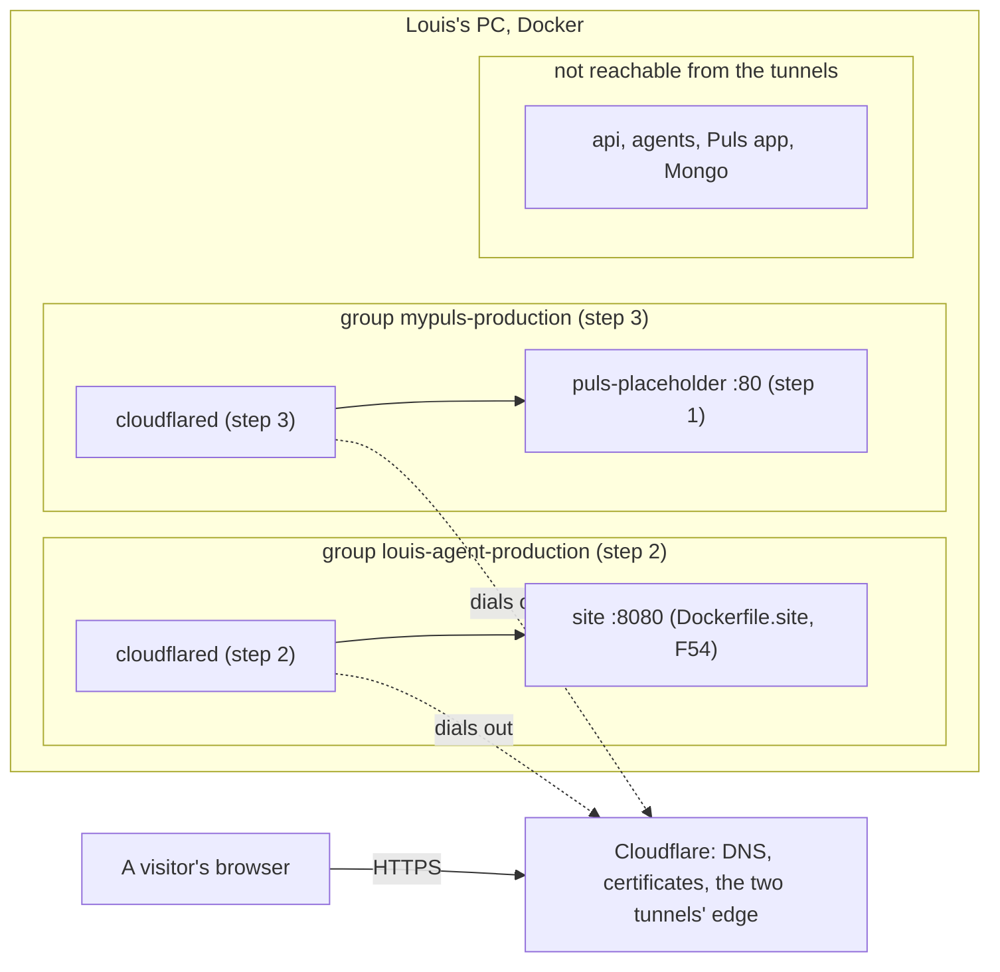
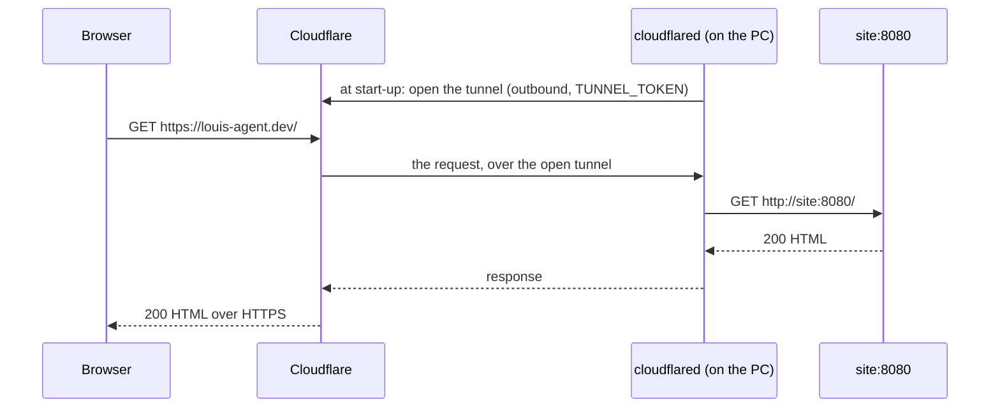

# F58 The two sites go live from this PC

> **Plan.** How we put the framework's site on `louis-agent.dev` and a Puls placeholder on `mypuls.co.za`, served by
> Docker on Louis's PC through a Cloudflare Tunnel. Drafted 2026-11-05 in the thread "Plan domain names for each site";
> **waiting for Louis's approval.** Deleted when the work is done (its why moves to an ADR).

## Context

- **Domains** (bought 2026-11-05 at Afrihost, both parked): `louis-agent.dev` for the framework's site (F54's
  leftovers) and `mypuls.co.za` for Puls. They renew each November (R330 and R109).
- **Louis's choices (2026-11-05):** host from Docker on this PC for now; reach the PC through a **Cloudflare Tunnel**
  (1A); the framework's site goes public, Puls shows **only a landing page as a placeholder** (2B), because every Puls
  chat spends the API key and there are no accounts or rate limits yet (F43, F42).
- **What exists:** `demos/louis-agent/docker/images/Dockerfile.site` builds the site (static Razor, port 8080,
  `/health`), but no compose file runs it. Puls's real landing page is
  `demos/puls/web/louis-agent.puls/Pages/LandingPage.razor`; the Puls app also holds the chat and the admin portal.
- **Louis picked (card, 2026-11-05):** the placeholder is a static copy of the landing page in a tiny container.

## Design

**One rule:** nothing that can spend money or change data is reachable from the internet. The tunnel reaches only two
containers, the site and the placeholder, on networks of their own; the agent, the API, Mongo and Puls's app are not
on those networks, so a wrong hostname in Cloudflare can't reach them.

**Why a tunnel** (picked by Louis, 1A): `cloudflared` runs as a container and dials *out* to Cloudflare, so no port
opens on the router, it works when the ISP shares one public IP between homes (CGNAT), the home IP stays hidden, and
HTTPS certificates come free. The cost: the domains' nameservers move to Cloudflare (registration stays at Afrihost),
and the sites are down when the PC is off or asleep. Considered: port forwarding with Caddy (public home IP, breaks on
CGNAT and IP changes); ngrok (a custom domain needs a paid plan).

**One tunnel per demo, one container group each.** The site belongs to `demos/louis-agent`, the placeholder to `demos/puls`, and a demo holds
its own docker ([ADR 0074](../adr/0074-the-folders-say-what-ships.md)). So each demo gets its own
`docker-compose.public.yml` with its own `cloudflared` and its own token; neither file names the other demo. One
shared tunnel would save a container but tie the two demos together.

**The placeholder** (Louis's pick on the card, the *static holding page* pattern): one `index.html` that copies
the look of Puls's landing page with "coming soon" and no link to the chat or the admin, served by `nginx:alpine`
pinned by digest. Nothing of Puls's app runs publicly; the cost is redoing the copy when the look changes. The other
options: the engine site answers for `mypuls.co.za` too (one container fewer, but Puls inside the framework's site,
against ADR 0074); or the real Puls app with a setting that blocks every page but the landing page (always current,
but the whole app with chat and admin runs publicly, and one routing slip costs money).

**Their own container groups** (Louis, 2026-11-05): each public file starts with a compose project `name:`, which is
the group Docker Desktop shows: `louis-agent-production` (site + its `cloudflared`) and `mypuls-production`
(placeholder + its `cloudflared`). Compose names must be lowercase with dashes, so "louis-agent production" becomes
`louis-agent-production`. Separate groups also mean `docker compose down` on a dev stack never touches production.

**Tokens** live in each demo's `config/.env.secrets` (git-ignored) and reach `cloudflared` as `TUNNEL_TOKEN`, an
environment variable it reads itself, so the token is never on a command line.

### Architecture



### Communication



### Interface and object diagrams

None: this plan adds no C# type and holds nothing in memory beyond the containers above. The only C# is step 1's test.

### Namespace map

| Type | Folder | Namespace | Step |
|---|---|---|---|
| `PlaceholderPageTests` | `demos/puls/tests/louis-agent.puls.tests/Placeholder/` | `LouisAgent.Puls.Tests.Placeholder` | 1, new |

### Folder trees (after)

```
demos/puls/
├── web/puls-placeholder/index.html                 # step 1: the static landing page copy
└── docker/
    ├── images/Dockerfile.puls-placeholder           # step 1: nginx:alpine by digest
    └── docker-compose.public.yml                    # step 3: puls-placeholder + cloudflared
demos/louis-agent/docker/
└── docker-compose.public.yml                        # step 2: site + cloudflared
```

## Steps

**Step 0, Louis, in the browser (no commit).**
1. dash.cloudflare.com → sign up → turn on two-step login (*My Profile → Authentication*).
2. *Add a domain* → `louis-agent.dev` → **Free** plan → Cloudflare shows two nameservers. Repeat for `mypuls.co.za`.
3. Afrihost → *Web Domains* → each domain → *Nameservers* (or "DNS / pointing") → replace Afrihost's with
   Cloudflare's two → save. `.co.za` may take a few hours; Cloudflare emails when each domain is **Active**.
4. Optional, for F54's contact page: *Email → Email Routing* on `louis-agent.dev` → forward `hello@louis-agent.dev` to
   your Gmail.

**Step 1, the placeholder page and its image.** Test first: `PlaceholderPageTests` reads `index.html` and fails while
it links to `/chat` or `/admin`, holds a `<form>` or a `<script>`, or lacks a `<title>`. Then the page (the landing
page's look, "coming soon") and `Dockerfile.puls-placeholder` (`nginx:alpine` by digest, copies the one file).

**Step 2, the site's public stack.** `demos/louis-agent/docker/docker-compose.public.yml`: `site` (builds
`Dockerfile.site`) and `cloudflared` (`cloudflare/cloudflared`, pinned), in the group `name: louis-agent-production`,
on their own network, `restart: unless-stopped`, `TUNNEL_TOKEN` from `.env.secrets` as `SITE_TUNNEL_TOKEN`; the site
also on `127.0.0.1:5060` for a local check. Configuration only: no test first.

**Step 3, Puls's public stack.** `demos/puls/docker/docker-compose.public.yml`: `puls-placeholder` and `cloudflared`
in the group `name: mypuls-production`, the same shape, `PULS_TUNNEL_TOKEN`, local check on `127.0.0.1:5061`.
Configuration only.

**Step 4, Louis, in Cloudflare (no commit).** *Zero Trust → Networks → Tunnels → Create a tunnel → Cloudflared* →
name `louis-agent-site` → copy the token (the long string after `--token`) into `SITE_TUNNEL_TOKEN` → *Public
hostnames*: `louis-agent.dev` and `www.louis-agent.dev` → `HTTP` `site:8080`. Again as `puls-placeholder` →
`PULS_TUNNEL_TOKEN` → `mypuls.co.za` and `www.mypuls.co.za` → `HTTP` `puls-placeholder:80`. Then `docker compose -f
… docker-compose.public.yml --env-file … up -d --build` for each demo. In Windows: Docker Desktop *Start when you sign
in*, and *Settings → Power → Sleep: Never* while plugged in.

**Step 5, the docs.** An ADR (next free number): *the public sites run from this PC through a tunnel, and nothing that
spends money is public*. The deployment view, both docker READMEs, `.env.example` (the two token names), the site's
contact address if step 0.4 was done, the TODO (F54's leftovers closed), a section in the shipping write-up; this plan
deleted.

## Verification

- `dotnet test demos/puls/tests/louis-agent.puls.tests` (step 1).
- Free hand checks, on a phone on **mobile data** (not your Wi-Fi): `https://louis-agent.dev` and `https://mypuls.co.za`
  open with a padlock; `https://mypuls.co.za/chat` and `/admin` give nginx's 404; the router shows no new port
  forward. No paid run.

## Concepts

- **Attack surface and least exposure** (skill 15, safety): publish only what can't spend money or change data, by
  network, not by remembering.
- **Shipping and ingress** (skill 18, testing and shipping): DNS, nameservers, TLS at the edge, an outbound tunnel
  instead of an open port; health checks and `restart` keep it up.
- **Cost guarding before exposure** (skill 13): why Puls's chat waits for F43's accounts and F42's rate limits.
